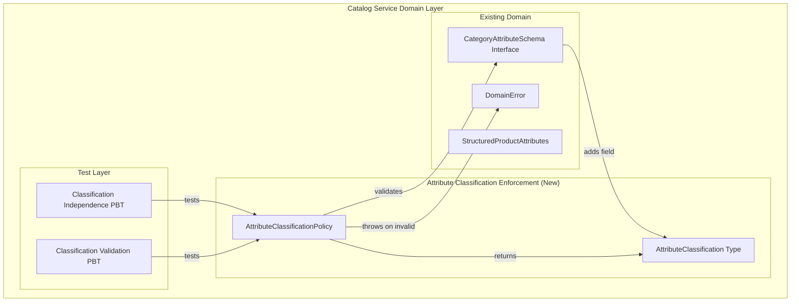

# Design Document: Attribute Classification Enforcement

## Overview

This spec implements ENH-015 from the MUVA+MSLE Constitution Backlog, enforcing the attribute classification rules defined in constitution §4.2. The catalog-service already has a `CategoryAttributeSchema` interface with optional boolean fields (`searchable`, `filterable`, `comparable`, `identityRelevant`) and priority metadata. This spec adds a formal `AttributeClassification` type, an `AttributeClassificationPolicy` domain policy, and property-based tests — all within the domain layer.

**Scope boundaries:**
- Pure domain model + policy + tests. No API routes, controllers, Prisma schema changes, or repository implementations.
- The `classification` field is optional on `CategoryAttributeSchema` to avoid breaking existing schemas during transition.
- Boolean flags (`searchable`, `filterable`, etc.) remain on the interface for backward compatibility but are never used to infer classification.

### Design Decisions

| Decision | Rationale |
|---|---|
| `AttributeClassification` is a TypeScript type union, not an enum | Matches the existing `AttributePriority` type pattern in the same file; keeps it lightweight and tree-shakeable |
| `classification` field is optional on `CategoryAttributeSchema` | Existing schemas in the database and code do not have this field; making it required would break creation paths that don't set it yet |
| `AttributeClassificationPolicy` uses static methods | Matches existing `CatalogMatchingPolicy` and `ConfigurationValidationPolicy` conventions |
| Validation returns structured result with `errors` and `warnings` arrays | Distinguishes hard failures (missing/invalid classification) from soft advisories (flag/classification mismatch); matches `ConfigurationValidationResult` pattern |
| `classifyAttribute` returns `undefined` when classification absent | Explicit signal to callers that the attribute is unclassified, rather than guessing from booleans |
| `isConfigurable` checks `classification === 'configurable'` only | Prevents the exact bug the constitution calls out: `filterable=true` silently implying configurable |
| Property-based tests use the existing `forAll` pattern with `Math.random` generators | Matches `configuration-validation.properties.test.ts` and `configuration-fingerprint.properties.test.ts` conventions |

## Architecture

### High-Level Component Diagram



### Domain Layer Organization

```
services/catalog-service/src/domain/
├── value-objects/
│   ├── product-attributes.value-object.ts          (MODIFIED — add AttributeClassification type + classification field)
│   └── __tests__/
│       └── product-attributes.value-object.test.ts  (existing — no changes needed)
├── policies/
│   ├── attribute-classification.policy.ts           (NEW)
│   └── __tests__/
│       ├── attribute-classification.properties.test.ts  (NEW — independence PBT)
│       └── attribute-classification-validation.properties.test.ts  (NEW — validation PBT)
```

## Components and Interfaces

### 1. AttributeClassification Type

**File:** `services/catalog-service/src/domain/value-objects/product-attributes.value-object.ts` (MODIFIED)

Adds the type and the optional field to the existing `CategoryAttributeSchema` interface.

```typescript
/**
 * The four constitutional attribute classifications (§4.2).
 *
 * - descriptive:  Explain what a product is.
 * - filterable:   Help customers discover products.
 * - configurable: Allow customers to choose a purchasable configuration.
 * - operational:  Support fulfillment, storage, compliance, or internal operations.
 *
 * Classifications must remain independent. A `filterable` boolean being true
 * does NOT automatically mean the attribute is `configurable`.
 */
export type AttributeClassification = 'descriptive' | 'filterable' | 'configurable' | 'operational';
```

The `CategoryAttributeSchema` interface gains one new optional field:

```typescript
export interface CategoryAttributeSchema {
  id: string;
  name: string;
  displayLabel: string;
  type: 'TEXT' | 'NUMBER' | 'SELECT' | 'BOOLEAN';
  options?: string[];
  isRequired: boolean;
  placeholder?: string;

  // ── Semantic Metadata ────────────────────────────────────────────────────────
  searchable?: boolean;
  comparable?: boolean;
  filterable?: boolean;
  descriptionPriority?: AttributePriority;
  seoPriority?: AttributePriority;
  highlightPriority?: AttributePriority;
  displayGroup?: string;
  identityRelevant?: boolean;

  // ── Attribute Classification (§4.2) ──────────────────────────────────────────
  /**
   * The authoritative role classification for this attribute.
   * When present, this field is the sole determinant of the attribute's role.
   * Boolean flags (filterable, searchable, etc.) must NOT be used to infer
   * or override this classification.
   *
   * Optional during the transition period — existing schemas without this
   * field are still valid but will be flagged by AttributeClassificationPolicy.
   */
  classification?: AttributeClassification;
}
```

No changes to `StructuredProductAttributes` class — it operates on the value map, not on classification. The existing validation logic (type checking, requiredness) is unaffected.

### 2. AttributeClassificationPolicy

**File:** `services/catalog-service/src/domain/policies/attribute-classification.policy.ts` (NEW)

```typescript
import { CategoryAttributeSchema, AttributeClassification } from '../value-objects/product-attributes.value-object';

export interface ClassificationFieldError {
  field: string;
  code: string;
  message: string;
}

export interface ClassificationFieldWarning {
  field: string;
  code: string;
  message: string;
}

export interface ClassificationValidationResult {
  valid: boolean;
  errors: ClassificationFieldError[];
  warnings: ClassificationFieldWarning[];
}

const VALID_CLASSIFICATIONS: AttributeClassification[] = [
  'descriptive',
  'filterable',
  'configurable',
  'operational',
];

export class AttributeClassificationPolicy {
  /**
   * Validates an array of CategoryAttributeSchema instances for classification
   * compliance.
   *
   * Hard errors (valid = false):
   *   - MISSING_CLASSIFICATION: schema has no classification field
   *   - INVALID_CLASSIFICATION: classification value is not one of the four allowed
   *
   * Soft warnings (advisory only, do not affect validity):
   *   - FLAG_CLASSIFICATION_MISMATCH: classification suggests a role that
   *     contradicts a boolean flag (e.g. classification='filterable' but
   *     filterable=false)
   *   - CONFIGURABLE_ALSO_FILTERABLE: classification='configurable' but
   *     filterable=true — allowed but may indicate misconfiguration
   */
  static validate(schemas: CategoryAttributeSchema[]): ClassificationValidationResult {
    const errors: ClassificationFieldError[] = [];
    const warnings: ClassificationFieldWarning[] = [];

    for (const schema of schemas) {
      // Check for missing classification
      if (schema.classification === undefined || schema.classification === null) {
        errors.push({
          field: schema.name,
          code: 'MISSING_CLASSIFICATION',
          message: `Attribute "${schema.name}" has no classification. Every attribute must be classified as descriptive, filterable, configurable, or operational.`,
        });
        continue;
      }

      // Check for invalid classification value
      if (!VALID_CLASSIFICATIONS.includes(schema.classification)) {
        errors.push({
          field: schema.name,
          code: 'INVALID_CLASSIFICATION',
          message: `Attribute "${schema.name}" has invalid classification "${schema.classification}". Must be one of: descriptive, filterable, configurable, operational.`,
        });
        continue;
      }

      // Advisory warnings for flag/classification mismatches
      this.checkFlagConsistency(schema, warnings);
    }

    return {
      valid: errors.length === 0,
      errors,
      warnings,
    };
  }

  /**
   * Returns the authoritative classification for a single attribute schema.
   *
   * When the classification field is present, returns that value.
   * When absent, returns undefined — does NOT infer from boolean flags.
   */
  static classifyAttribute(schema: CategoryAttributeSchema): AttributeClassification | undefined {
    return schema.classification;
  }

  /**
   * Returns true if and only if the attribute's classification is 'configurable'.
   *
   * This method checks the classification field only. It does NOT inspect
   * the filterable, searchable, comparable, or identityRelevant boolean flags.
   * This enforces the constitutional principle that filterable ≠ configurable.
   */
  static isConfigurable(schema: CategoryAttributeSchema): boolean {
    return schema.classification === 'configurable';
  }

  /**
   * Checks for advisory warnings where boolean flags and classification
   * may be inconsistent. These are soft advisories — they do not affect
   * the validity of the schema.
   */
  private static checkFlagConsistency(
    schema: CategoryAttributeSchema,
    warnings: ClassificationFieldWarning[]
  ): void {
    // Warning: classification='filterable' but filterable boolean is false
    if (schema.classification === 'filterable' && schema.filterable === false) {
      warnings.push({
        field: schema.name,
        code: 'FLAG_CLASSIFICATION_MISMATCH',
        message: `Attribute "${schema.name}" is classified as filterable but the filterable flag is false.`,
      });
    }

    // Warning: classification='configurable' but filterable is true
    // (allowed, but may indicate misconfiguration)
    if (schema.classification === 'configurable' && schema.filterable === true) {
      warnings.push({
        field: schema.name,
        code: 'CONFIGURABLE_ALSO_FILTERABLE',
        message: `Attribute "${schema.name}" is classified as configurable but also marked filterable. This is allowed but may indicate a misconfiguration — filterable does not automatically mean configurable.`,
      });
    }
  }
}
```

### 3. Property-Based Tests: Classification Independence

**File:** `services/catalog-service/src/domain/policies/__tests__/attribute-classification.properties.test.ts` (NEW)

```typescript
// @ts-nocheck
/**
 * AttributeClassificationPolicy — Classification Independence Property-Based Tests
 *
 * Verifies that classification is never inferred from boolean flags, that
 * isConfigurable checks only the classification field, and that classifyAttribute
 * returns the classification field value (or undefined) regardless of booleans.
 *
 * Feature: attribute-classification-enforcement
 */

import { AttributeClassificationPolicy } from '../attribute-classification.policy';
import { CategoryAttributeSchema, AttributeClassification } from '../../value-objects/product-attributes.value-object';

// ── Helpers ──────────────────────────────────────────────────────────────────

function forAll<T>(
  count: number,
  generator: () => T,
  property: (value: T) => void
): void {
  for (let i = 0; i < count; i++) {
    property(generator());
  }
}

function randomSuffix(): string {
  return Math.random().toString(36).slice(2, 10);
}

function randomBoolean(): boolean {
  return Math.random() < 0.5;
}

const CLASSIFICATIONS: AttributeClassification[] = [
  'descriptive', 'filterable', 'configurable', 'operational',
];

function randomClassification(): AttributeClassification {
  return CLASSIFICATIONS[Math.floor(Math.random() * CLASSIFICATIONS.length)];
}

function randomSchema(
  classification?: AttributeClassification | undefined
): CategoryAttributeSchema {
  return {
    id: `attr-${randomSuffix()}`,
    name: `attr_${randomSuffix()}`,
    displayLabel: `Attribute ${randomSuffix()}`,
    type: 'TEXT',
    isRequired: randomBoolean(),
    searchable: randomBoolean(),
    comparable: randomBoolean(),
    filterable: randomBoolean(),
    identityRelevant: randomBoolean(),
    classification,
  };
}

function randomSchemaWithClassification(): CategoryAttributeSchema {
  return randomSchema(randomClassification());
}

function randomSchemaWithoutClassification(): CategoryAttributeSchema {
  return randomSchema(undefined);
}

// ── Property 1: classifyAttribute returns the classification field value
// Feature: attribute-classification-enforcement, Property 1: Classification Authority
// Validates: Requirements 4.2, 7.1
// ─────────────────────────────────────────────────────────────────────────────

describe('Property 1: classifyAttribute Returns Classification Field Value', () => {
  it('should return the classification field value regardless of boolean flags', () => {
    forAll(
      100,
      randomSchemaWithClassification,
      (schema) => {
        const result = AttributeClassificationPolicy.classifyAttribute(schema);
        expect(result).toBe(schema.classification);
      }
    );
  });
});

// ── Property 2: isConfigurable returns true iff classification === 'configurable'
// Feature: attribute-classification-enforcement, Property 2: isConfigurable Independence
// Validates: Requirements 5.1, 7.2
// ─────────────────────────────────────────────────────────────────────────────

describe('Property 2: isConfigurable Checks Classification Only', () => {
  it('should return true if and only if classification is configurable, regardless of booleans', () => {
    forAll(
      100,
      randomSchemaWithClassification,
      (schema) => {
        const result = AttributeClassificationPolicy.isConfigurable(schema);
        expect(result).toBe(schema.classification === 'configurable');
      }
    );
  });
});

// ── Property 3: isConfigurable returns false for filterable even when filterable=true
// Feature: attribute-classification-enforcement, Property 3: Filterable Not Configurable
// Validates: Requirements 5.2, 7.3
// ─────────────────────────────────────────────────────────────────────────────

describe('Property 3: isConfigurable Returns False for Filterable', () => {
  it('should return false when classification is filterable, even if filterable boolean is true', () => {
    forAll(
      100,
      () => {
        const schema = randomSchema('filterable');
        schema.filterable = true;
        return schema;
      },
      (schema) => {
        const result = AttributeClassificationPolicy.isConfigurable(schema);
        expect(result).toBe(false);
      }
    );
  });
});

// ── Property 4: classifyAttribute returns undefined for schemas without classification
// Feature: attribute-classification-enforcement, Property 4: Undefined Without Classification
// Validates: Requirements 4.3, 7.4
// ─────────────────────────────────────────────────────────────────────────────

describe('Property 4: classifyAttribute Returns Undefined Without Classification', () => {
  it('should return undefined for schemas without classification, regardless of booleans', () => {
    forAll(
      100,
      randomSchemaWithoutClassification,
      (schema) => {
        const result = AttributeClassificationPolicy.classifyAttribute(schema);
        expect(result).toBeUndefined();
      }
    );
  });
});

// ── Property 5: validation passes for all four classification values
// Feature: attribute-classification-enforcement, Property 5: All Classifications Valid
// Validates: Requirements 7.5
// ─────────────────────────────────────────────────────────────────────────────

describe('Property 5: All Four Classifications Pass Validation', () => {
  it('should pass validation for any schema with a valid classification, regardless of booleans', () => {
    forAll(
      100,
      randomSchemaWithClassification,
      (schema) => {
        const result = AttributeClassificationPolicy.validate([schema]);
        expect(result.valid).toBe(true);
        expect(result.errors).toHaveLength(0);
      }
    );
  });
});

// ── Property 6: validation fails for schemas missing classification
// Feature: attribute-classification-enforcement, Property 6: Missing Classification Fails
// Validates: Requirements 7.6
// ─────────────────────────────────────────────────────────────────────────────

describe('Property 6: Missing Classification Fails Validation', () => {
  it('should fail validation for schemas without classification, regardless of booleans', () => {
    forAll(
      100,
      randomSchemaWithoutClassification,
      (schema) => {
        const result = AttributeClassificationPolicy.validate([schema]);
        expect(result.valid).toBe(false);
        expect(result.errors).toHaveLength(1);
        expect(result.errors[0].code).toBe('MISSING_CLASSIFICATION');
        expect(result.errors[0].field).toBe(schema.name);
      }
    );
  });
});

// ── Property 7: classifyAttribute does not inspect boolean flags
// Feature: attribute-classification-enforcement, Property 7: No Boolean Inspection
// Validates: Requirements 4.4
// ─────────────────────────────────────────────────────────────────────────────

describe('Property 7: classifyAttribute Ignores Boolean Flags', () => {
  it('should return the same classification for schemas with identical classification but different booleans', () => {
    forAll(
      100,
      () => {
        const classification = randomClassification();
        const schema1 = randomSchema(classification);
        const schema2 = randomSchema(classification);
        // Ensure booleans are different
        schema2.filterable = !schema1.filterable;
        schema2.searchable = !schema1.searchable;
        schema2.comparable = !schema1.comparable;
        schema2.identityRelevant = !schema1.identityRelevant;
        return { schema1, schema2, classification };
      },
      ({ schema1, schema2, classification }) => {
        expect(AttributeClassificationPolicy.classifyAttribute(schema1)).toBe(classification);
        expect(AttributeClassificationPolicy.classifyAttribute(schema2)).toBe(classification);
      }
    );
  });
});

// ── Property 8: isConfigurable does not inspect boolean flags
// Feature: attribute-classification-enforcement, Property 8: isConfigurable Ignores Booleans
// Validates: Requirements 5.5
// ─────────────────────────────────────────────────────────────────────────────

describe('Property 8: isConfigurable Ignores Boolean Flags', () => {
  it('should return the same result for schemas with identical classification but different booleans', () => {
    forAll(
      100,
      () => {
        const classification = randomClassification();
        const schema1 = randomSchema(classification);
        const schema2 = randomSchema(classification);
        schema2.filterable = !schema1.filterable;
        schema2.searchable = !schema1.searchable;
        schema2.comparable = !schema1.comparable;
        schema2.identityRelevant = !schema1.identityRelevant;
        return { schema1, schema2 };
      },
      ({ schema1, schema2 }) => {
        expect(AttributeClassificationPolicy.isConfigurable(schema1))
          .toBe(AttributeClassificationPolicy.isConfigurable(schema2));
      }
    );
  });
});
```

### 4. Property-Based Tests: Classification Validation

**File:** `services/catalog-service/src/domain/policies/__tests__/attribute-classification-validation.properties.test.ts` (NEW)

```typescript
// @ts-nocheck
/**
 * AttributeClassificationPolicy — Validation Property-Based Tests
 *
 * Verifies that invalid classifications are caught, missing classifications
 * are reported per-schema with names, valid schemas pass, and validation
 * is idempotent across repeated calls.
 *
 * Feature: attribute-classification-enforcement
 */

import { AttributeClassificationPolicy } from '../attribute-classification.policy';
import { CategoryAttributeSchema, AttributeClassification } from '../../value-objects/product-attributes.value-object';

// ── Helpers ──────────────────────────────────────────────────────────────────

function forAll<T>(
  count: number,
  generator: () => T,
  property: (value: T) => void
): void {
  for (let i = 0; i < count; i++) {
    property(generator());
  }
}

function randomSuffix(): string {
  return Math.random().toString(36).slice(2, 10);
}

function randomBoolean(): boolean {
  return Math.random() < 0.5;
}

const CLASSIFICATIONS: AttributeClassification[] = [
  'descriptive', 'filterable', 'configurable', 'operational',
];

function randomClassification(): AttributeClassification {
  return CLASSIFICATIONS[Math.floor(Math.random() * CLASSIFICATIONS.length)];
}

function randomSchema(
  classification?: AttributeClassification | undefined
): CategoryAttributeSchema {
  return {
    id: `attr-${randomSuffix()}`,
    name: `attr_${randomSuffix()}`,
    displayLabel: `Attribute ${randomSuffix()}`,
    type: 'TEXT',
    isRequired: randomBoolean(),
    searchable: randomBoolean(),
    comparable: randomBoolean(),
    filterable: randomBoolean(),
    identityRelevant: randomBoolean(),
    classification,
  };
}

function randomInvalidClassification(): string {
  // Generate strings that are NOT one of the four valid classifications
  const invalid = [
    'searchable', 'variant', 'required', 'optional', 'display',
    'metadata', 'pricing', 'inventory', 'shipping', 'unknown',
    '', 'config', 'desc', 'filt', 'op',
  ];
  return invalid[Math.floor(Math.random() * invalid.length)] || `invalid-${randomSuffix()}`;
}

function randomSchemaArray(count: number, withClassification: boolean): CategoryAttributeSchema[] {
  return Array.from({ length: count }, () =>
    randomSchema(withClassification ? randomClassification() : undefined)
  );
}

// ── Property 1: Invalid classification produces validation error
// Feature: attribute-classification-enforcement, Property 1: Invalid Classification Rejected
// Validates: Requirements 8.1
// ─────────────────────────────────────────────────────────────────────────────

describe('Property 1: Invalid Classification Rejected', () => {
  it('should produce a validation error for any classification outside the four allowed values', () => {
    forAll(
      100,
      () => {
        const schema = randomSchema();
        (schema as any).classification = randomInvalidClassification();
        return schema;
      },
      (schema) => {
        const result = AttributeClassificationPolicy.validate([schema]);
        expect(result.valid).toBe(false);
        expect(result.errors).toHaveLength(1);
        expect(result.errors[0].code).toBe('INVALID_CLASSIFICATION');
        expect(result.errors[0].field).toBe(schema.name);
      }
    );
  });
});

// ── Property 2: Validation reports errors for each missing classification with name
// Feature: attribute-classification-enforcement, Property 2: Per-Schema Missing Classification
// Validates: Requirements 8.2
// ─────────────────────────────────────────────────────────────────────────────

describe('Property 2: Per-Schema Missing Classification Errors', () => {
  it('should return an error for each schema missing a classification, identifying each by name', () => {
    forAll(
      100,
      () => {
        const count = Math.floor(Math.random() * 5) + 1;
        return randomSchemaArray(count, false);
      },
      (schemas) => {
        const result = AttributeClassificationPolicy.validate(schemas);
        expect(result.valid).toBe(false);
        expect(result.errors).toHaveLength(schemas.length);
        for (let i = 0; i < schemas.length; i++) {
          expect(result.errors[i].code).toBe('MISSING_CLASSIFICATION');
          expect(result.errors[i].field).toBe(schemas[i].name);
        }
      }
    );
  });
});

// ── Property 3: Valid schemas produce zero errors
// Feature: attribute-classification-enforcement, Property 3: Valid Schemas Pass
// Validates: Requirements 8.3
// ─────────────────────────────────────────────────────────────────────────────

describe('Property 3: Valid Schemas Pass Validation', () => {
  it('should return valid result with zero errors for an array of valid schemas', () => {
    forAll(
      100,
      () => randomSchemaArray(Math.floor(Math.random() * 5) + 1, true),
      (schemas) => {
        const result = AttributeClassificationPolicy.validate(schemas);
        expect(result.valid).toBe(true);
        expect(result.errors).toHaveLength(0);
      }
    );
  });
});

// ── Property 4: Validation is idempotent
// Feature: attribute-classification-enforcement, Property 4: Validation Idempotence
// Validates: Requirements 8.4
// ─────────────────────────────────────────────────────────────────────────────

describe('Property 4: Validation Idempotence', () => {
  it('should produce identical results when validating the same schema array multiple times', () => {
    forAll(
      100,
      () => randomSchemaArray(Math.floor(Math.random() * 5) + 1, Math.random() < 0.5),
      (schemas) => {
        const result1 = AttributeClassificationPolicy.validate(schemas);
        const result2 = AttributeClassificationPolicy.validate(schemas);
        expect(result1.valid).toBe(result2.valid);
        expect(result1.errors).toEqual(result2.errors);
        expect(result1.warnings).toEqual(result2.warnings);
      }
    );
  });
});
```

## Correctness Properties

### Properties Mapped to Requirements

| # | Property | Pattern | Validates Requirements |
|---|---|---|---|
| P1 | `classifyAttribute` returns the `classification` field value for any schema with a valid classification, regardless of boolean flag combinations | Invariant | 4.2, 7.1 |
| P2 | `isConfigurable` returns `true` if and only if `classification === 'configurable'`, regardless of boolean flag combinations | Invariant | 5.1, 7.2 |
| P3 | `isConfigurable` returns `false` when `classification === 'filterable'`, even when `filterable === true` | Error condition (constitutional guard) | 5.2, 7.3 |
| P4 | `classifyAttribute` returns `undefined` for any schema without a `classification` field, regardless of boolean flag combinations | Invariant | 4.3, 7.4 |
| P5 | Validation passes for all four classification values when explicitly set, regardless of boolean flag combinations | Invariant | 7.5 |
| P6 | Validation fails with `MISSING_CLASSIFICATION` for any schema without a `classification` field | Error condition | 7.6, 2.3 |
| P7 | `classifyAttribute` returns the same result for schemas with identical classification but different boolean flags (no boolean inspection) | Invariant (independence) | 4.4 |
| P8 | `isConfigurable` returns the same result for schemas with identical classification but different boolean flags (no boolean inspection) | Invariant (independence) | 5.5 |
| P9 | Any classification value outside the four allowed values produces `INVALID_CLASSIFICATION` error with schema name | Error condition | 2.2, 8.1 |
| P10 | Validation of an array returns one error per schema missing classification, each identifying the schema by name | Invariant (per-schema reporting) | 2.3, 8.2 |
| P11 | Validation of an array of valid schemas returns `valid: true` with zero errors | Invariant | 8.3 |
| P12 | Validating the same schema array multiple times produces identical results | Idempotence | 8.4 |

### Properties NOT Covered by PBT (Examples Instead)

| # | Property | Pattern | Validates Requirements |
|---|---|---|---|
| E1 | `filterable=true` + `classification='filterable'` is valid | Example | 3.2 |
| E2 | `filterable=true` + `classification='configurable'` is valid | Example | 3.3 |
| E3 | `filterable=true` + `classification='descriptive'` is valid | Example | 3.4 |
| E4 | `classification='filterable'` + `filterable=false` produces a warning but remains valid | Example | 6.1 |
| E5 | `classification='configurable'` + `filterable=true` produces a warning but remains valid | Example | 6.2 |
| E6 | Validation result structure contains both `errors` and `warnings` arrays | Example | 6.3 |
| E7 | Schema with mismatched flags and classification remains valid (warnings are advisory) | Example | 6.4 |

## Testing Strategy

### Property-Based Tests (PBT)

All PBT tests use the established `forAll(count, generator, property)` pattern with 100 iterations per property. Generators use `Math.random` for boolean flags and classification selection, matching the conventions in `configuration-validation.properties.test.ts` and `configuration-fingerprint.properties.test.ts`.

**Independence tests** (`attribute-classification.properties.test.ts`):
- 8 properties verifying that `classifyAttribute` and `isConfigurable` never inspect boolean flags
- Random boolean combinations ensure independence is tested across the full flag space

**Validation tests** (`attribute-classification-validation.properties.test.ts`):
- 4 properties verifying validation behavior for invalid, missing, valid, and repeated inputs
- Random schema arrays test per-schema error reporting

### Example-Based Tests

Example tests for the advisory warning behaviors (Req 6) will be included as `describe` blocks within the same test files, following the existing pattern where both PBT and example tests coexist in the same file (see `configuration-validation.properties.test.ts`).

### Test Execution

Tests run via the existing test infrastructure:
```bash
npx vitest --run services/catalog-service/src/domain/policies/__tests__/attribute-classification*.test.ts
```

No database or external services required — all tests are pure domain-layer tests.
