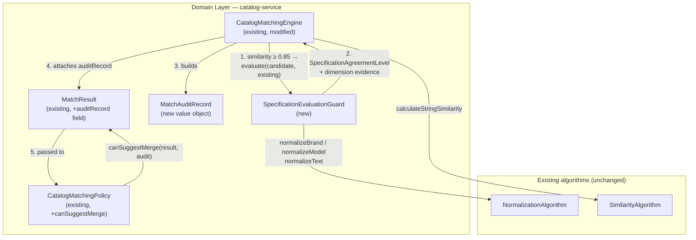
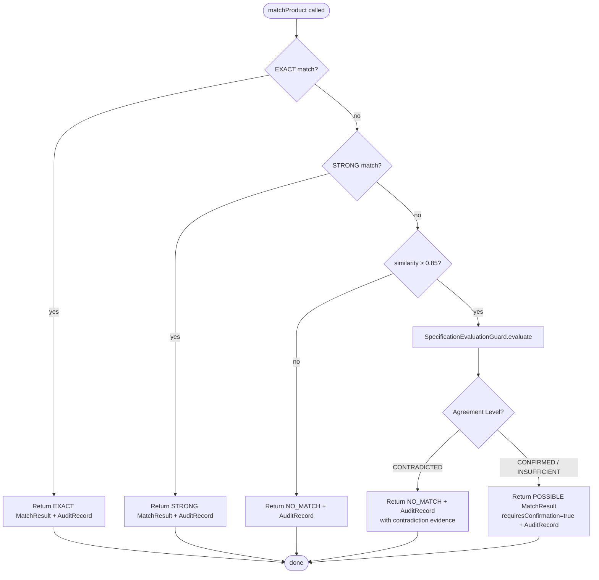

# Design Document: catalog-matching-safeguards

## Overview

The catalog-matching-safeguards feature adds a specification-evidence gate in front of the POSSIBLE match cascade inside `CatalogMatchingEngine`. Today the engine emits a POSSIBLE match whenever brand + normalized-model similarity reaches ≥ 0.85, with no additional evidence requirement. The constitution (§3.1) forbids merging on name similarity alone; a Galaxy A10 and a Galaxy A10 5G must never be merge candidates.

Three new domain artifacts address this:

1. **`SpecificationEvaluationGuard`** — evaluates a candidate/existing product pair across three evidence dimensions (model suffix differentiation, identity-relevant attributes, critical identifier conflict) and returns a `SpecificationAgreementLevel` of `CONFIRMED`, `INSUFFICIENT`, or `CONTRADICTED`.
2. **`MatchAuditRecord`** — an immutable value object that records the full rationale for every match decision: level, similarity score, agreement level, per-dimension outcomes, product IDs, and a UTC timestamp.
3. **`canSuggestMerge()`** — a new static method on `CatalogMatchingPolicy` that uses the audit record to provide a formal, bypass-proof checkpoint before a merge may be proposed to a seller.

All changes are confined to the domain layer. No database schema, API contract, or application layer is modified.

---

## Architecture

### High-Level Component Diagram



### Cascade Flow (Modified POSSIBLE Stage)



---

## Components and Interfaces

### SpecificationEvaluationGuard

New file: `services/catalog-service/src/domain/engines/specification-evaluation-guard.ts`

```typescript
import { ProductCandidate } from './catalog-matching.engine';
import { Product } from '../entities/product.entity';
import { NormalizationAlgorithm } from '../algorithms/normalization.algorithm';

export type DimensionOutcome = 'CONFIRMED' | 'CONTRADICTED' | 'INSUFFICIENT';

export interface DimensionResult {
  outcome: DimensionOutcome;
  /** Human-readable evidence that produced this outcome */
  evidence: string;
}

export interface SpecificationEvaluationResult {
  /** Composite agreement level — CONTRADICTED wins over CONFIRMED/INSUFFICIENT */
  agreementLevel: DimensionOutcome;
  dimensions: {
    modelSuffix: DimensionResult;
    identityAttributes: DimensionResult;
    criticalIdentifiers: DimensionResult;
  };
}

export interface CategoryAttributeSchema {
  key: string;
  identityRelevant: boolean;
}

export class SpecificationEvaluationGuard {
  /**
   * Recognized model suffix tokens (lowercase). Case-insensitive matching applies.
   */
  static readonly SUFFIX_TOKENS: ReadonlySet<string> = new Set([
    '5g', 'pro', 'plus', 'max', 'lite', 'mini', 'ultra', 'neo', 'fe', 'se', 'e', 's',
  ]);

  /**
   * Evaluates specification evidence for a candidate/existing product pair.
   * Returns CONTRADICTED if any dimension contradicts identity; CONFIRMED if at
   * least one dimension confirms and none contradict; INSUFFICIENT otherwise.
   */
  static evaluate(
    candidate: ProductCandidate,
    existing: Product,
    attributeSchemas: CategoryAttributeSchema[] = [],
  ): SpecificationEvaluationResult {
    const modelSuffix = this.evaluateModelSuffix(candidate.model, existing.getModel() ?? '');
    const identityAttributes = this.evaluateIdentityAttributes(
      candidate.attributes ?? {},
      existing.getAttributes?.() ?? {},
      attributeSchemas,
    );
    const criticalIdentifiers = this.evaluateCriticalIdentifiers(candidate, existing);

    const allOutcomes: DimensionOutcome[] = [
      modelSuffix.outcome,
      identityAttributes.outcome,
      criticalIdentifiers.outcome,
    ];

    let agreementLevel: DimensionOutcome = 'INSUFFICIENT';
    if (allOutcomes.includes('CONTRADICTED')) {
      agreementLevel = 'CONTRADICTED';
    } else if (allOutcomes.includes('CONFIRMED')) {
      agreementLevel = 'CONFIRMED';
    }

    return { agreementLevel, dimensions: { modelSuffix, identityAttributes, criticalIdentifiers } };
  }

  // ── Model Suffix Dimension ──────────────────────────────────────────────────

  static evaluateModelSuffix(candidateModel: string, existingModel: string): DimensionResult {
    if (!candidateModel || !existingModel) {
      return { outcome: 'INSUFFICIENT', evidence: 'One or both model strings are absent' };
    }

    const candidateSuffixes = this.extractSuffixTokens(candidateModel);
    const existingSuffixes = this.extractSuffixTokens(existingModel);

    const sameSet =
      candidateSuffixes.size === existingSuffixes.size &&
      [...candidateSuffixes].every(t => existingSuffixes.has(t));

    if (sameSet) {
      return {
        outcome: 'CONFIRMED',
        evidence: `Both models share suffix set: [${[...candidateSuffixes].join(', ') || '(none)'}]`,
      };
    }

    return {
      outcome: 'CONTRADICTED',
      evidence:
        `Candidate suffixes [${[...candidateSuffixes].join(', ') || '(none)'}] differ from ` +
        `existing suffixes [${[...existingSuffixes].join(', ') || '(none)'}]`,
    };
  }

  /** Returns the set of recognized suffix tokens found in a normalized model string. */
  static extractSuffixTokens(model: string): Set<string> {
    const normalized = NormalizationAlgorithm.normalizeText(model);
    const tokens = normalized.split(/\s+/);
    const result = new Set<string>();
    for (const token of tokens) {
      const t = token.trim().toLowerCase();
      if (this.SUFFIX_TOKENS.has(t)) result.add(t);
    }
    return result;
  }

  // ── Identity-Relevant Attribute Dimension ──────────────────────────────────

  static evaluateIdentityAttributes(
    candidateAttrs: Record<string, unknown>,
    existingAttrs: Record<string, unknown>,
    schemas: CategoryAttributeSchema[],
  ): DimensionResult {
    const identityKeys = schemas
      .filter(s => s.identityRelevant)
      .map(s => s.key);

    const sharedKeys = identityKeys.filter(
      k => k in candidateAttrs && k in existingAttrs,
    );

    if (sharedKeys.length === 0) {
      return { outcome: 'INSUFFICIENT', evidence: 'No shared identity-relevant attributes to compare' };
    }

    const contradictions: string[] = [];
    for (const key of sharedKeys) {
      const cv = this.normalizeAttrValue(candidateAttrs[key]);
      const ev = this.normalizeAttrValue(existingAttrs[key]);
      if (cv && ev && cv !== ev) {
        contradictions.push(`${key}: "${cv}" vs "${ev}"`);
      }
    }

    if (contradictions.length > 0) {
      return { outcome: 'CONTRADICTED', evidence: `Attribute conflicts: ${contradictions.join('; ')}` };
    }

    return { outcome: 'CONFIRMED', evidence: `${sharedKeys.length} identity-relevant attribute(s) agree` };
  }

  private static normalizeAttrValue(v: unknown): string {
    if (v === null || v === undefined) return '';
    return String(v).trim().toLowerCase();
  }

  // ── Critical Identifier Dimension ──────────────────────────────────────────

  static evaluateCriticalIdentifiers(
    candidate: ProductCandidate,
    existing: Product,
  ): DimensionResult {
    const candidateIds = candidate.identifiers;
    const existingIds = existing.getIdentifiers?.();

    if (!candidateIds || !existingIds) {
      return { outcome: 'INSUFFICIENT', evidence: 'One or both products lack identifier objects' };
    }

    type IdType = 'GTIN' | 'MPN' | 'ISBN';
    const types: IdType[] = ['GTIN', 'MPN', 'ISBN'];
    const conflicts: string[] = [];
    const confirmed: string[] = [];

    for (const type of types) {
      const cv = this.getIdentifierValue(candidateIds, type);
      const ev = this.getIdentifierValue(existingIds, type);

      if (!cv || !ev) continue; // INSUFFICIENT for this type

      const normalizedCv = this.normalizeIdentifier(cv, type);
      const normalizedEv = this.normalizeIdentifier(ev, type);

      if (!normalizedCv || !normalizedEv) continue; // malformed — treat as absent

      if (normalizedCv !== normalizedEv) {
        conflicts.push(`${type}: "${normalizedCv}" vs "${normalizedEv}"`);
      } else {
        confirmed.push(type);
      }
    }

    if (conflicts.length > 0) {
      return { outcome: 'CONTRADICTED', evidence: `Identifier conflicts: ${conflicts.join('; ')}` };
    }
    if (confirmed.length > 0) {
      return { outcome: 'CONFIRMED', evidence: `Matching identifiers: ${confirmed.join(', ')}` };
    }
    return { outcome: 'INSUFFICIENT', evidence: 'No shared identifier types to compare' };
  }

  private static getIdentifierValue(ids: any, type: 'GTIN' | 'MPN' | 'ISBN'): string | undefined {
    try {
      switch (type) {
        case 'GTIN': return ids.gtin ?? ids.getGtin?.();
        case 'MPN':  return ids.mpn  ?? ids.getMpn?.();
        case 'ISBN': return ids.isbn ?? ids.getIsbn?.();
      }
    } catch {
      return undefined;
    }
  }

  private static normalizeIdentifier(value: string, type: 'GTIN' | 'MPN' | 'ISBN'): string {
    try {
      return NormalizationAlgorithm.normalizeIdentifier(value, type);
    } catch {
      return '';
    }
  }
}
```

### MatchAuditRecord

New file: `services/catalog-service/src/domain/value-objects/match-audit-record.value-object.ts`

```typescript
import { MatchLevel } from './match-result.value-object';
import { DimensionOutcome, DimensionResult } from '../engines/specification-evaluation-guard';

export interface AuditDimensions {
  modelSuffix: DimensionResult;
  identityAttributes: DimensionResult;
  criticalIdentifiers: DimensionResult;
}

export interface MatchAuditRecordProps {
  matchLevel: MatchLevel;
  similarityScore?: number;
  agreementLevel?: DimensionOutcome;
  dimensions?: AuditDimensions;
  candidateProductId?: string;
  matchedProductId?: string;
  decidedAt: Date;
}

export class MatchAuditRecord {
  public readonly matchLevel: MatchLevel;
  public readonly similarityScore?: number;
  public readonly agreementLevel?: DimensionOutcome;
  public readonly dimensions?: AuditDimensions;
  public readonly candidateProductId?: string;
  public readonly matchedProductId?: string;
  public readonly decidedAt: Date;

  constructor(props: MatchAuditRecordProps) {
    this.matchLevel = props.matchLevel;
    this.similarityScore = props.similarityScore;
    this.agreementLevel = props.agreementLevel;
    this.dimensions = props.dimensions;
    this.candidateProductId = props.candidateProductId;
    this.matchedProductId = props.matchedProductId;
    this.decidedAt = props.decidedAt;
    Object.freeze(this);
    if (this.dimensions) Object.freeze(this.dimensions);
  }

  toJSON(): Record<string, unknown> {
    return {
      matchLevel: this.matchLevel,
      similarityScore: this.similarityScore ?? null,
      agreementLevel: this.agreementLevel ?? null,
      dimensions: this.dimensions
        ? {
            modelSuffix: { ...this.dimensions.modelSuffix },
            identityAttributes: { ...this.dimensions.identityAttributes },
            criticalIdentifiers: { ...this.dimensions.criticalIdentifiers },
          }
        : null,
      candidateProductId: this.candidateProductId ?? null,
      matchedProductId: this.matchedProductId ?? null,
      decidedAt: this.decidedAt.toISOString(),
    };
  }
}
```

### Changes to MatchResult

Modified: `services/catalog-service/src/domain/value-objects/match-result.value-object.ts`

Add `auditRecord` as an optional field on `MatchResultProps` and `MatchResult`. The `MatchResult.noMatch()` factory is extended to accept an optional audit record:

```typescript
// New import at top
import { MatchAuditRecord } from './match-audit-record.value-object';

// Updated MatchResultProps
export interface MatchResultProps {
  level: MatchLevel;
  score: number;
  matchedProductId?: string;
  criteria: MatchCriteria;
  requiresConfirmation: boolean;
  auditRecord?: MatchAuditRecord;          // ← new
}

// Updated MatchResult class (add field + update constructor + update noMatch)
export class MatchResult {
  // ... existing fields ...
  public readonly auditRecord?: MatchAuditRecord;   // ← new

  constructor(props: MatchResultProps) {
    // ... existing assignments ...
    this.auditRecord = props.auditRecord;
  }

  // Updated factory
  static noMatch(auditRecord?: MatchAuditRecord): MatchResult {
    return new MatchResult({
      level: MatchLevel.NO_MATCH,
      score: 0,
      criteria: {},
      requiresConfirmation: false,
      auditRecord,
    });
  }
}
```

### Changes to CatalogMatchingPolicy

Modified: `services/catalog-service/src/domain/policies/catalog-matching.policy.ts`

Add the `canSuggestMerge` static method:

```typescript
import { MatchAuditRecord } from '../value-objects/match-audit-record.value-object';

// New method added to CatalogMatchingPolicy (all existing methods unchanged)
static canSuggestMerge(matchResult: MatchResult, auditRecord: MatchAuditRecord): boolean {
  if (matchResult.isExactMatch() || matchResult.isStrongMatch()) return true;
  if (matchResult.isNoMatch()) return false;
  // POSSIBLE match — gate on specification agreement
  return auditRecord.agreementLevel !== 'CONTRADICTED';
}
```

### Changes to CatalogMatchingEngine

Modified: `services/catalog-service/src/domain/engines/catalog-matching.engine.ts`

The POSSIBLE match section is updated to:
1. Invoke `SpecificationEvaluationGuard.evaluate()`.
2. Suppress POSSIBLE emission when `agreementLevel === 'CONTRADICTED'`.
3. Attach a `MatchAuditRecord` to every returned `MatchResult`.

```typescript
// Additional import
import { SpecificationEvaluationGuard, CategoryAttributeSchema } from './specification-evaluation-guard';
import { MatchAuditRecord } from '../value-objects/match-audit-record.value-object';

// Updated signature (attributeSchemas optional, defaults to [])
static matchProduct(
  candidate: ProductCandidate,
  existingProducts: Product[],
  attributeSchemas: CategoryAttributeSchema[] = [],
): MatchResult {

  // 1. EXACT — same as before, but builds audit record
  // ...
  return new MatchResult({
    level: MatchLevel.EXACT, score: 100, matchedProductId: ..., criteria, requiresConfirmation: false,
    auditRecord: new MatchAuditRecord({
      matchLevel: MatchLevel.EXACT, matchedProductId: existing.getId().toString(), decidedAt: new Date(),
    }),
  });

  // 2. STRONG — same as before, but builds audit record
  // ...
  return new MatchResult({
    level: MatchLevel.STRONG, score: 95, matchedProductId: ..., criteria, requiresConfirmation: false,
    auditRecord: new MatchAuditRecord({
      matchLevel: MatchLevel.STRONG, matchedProductId: existing.getId().toString(), decidedAt: new Date(),
    }),
  });

  // 3. POSSIBLE — updated
  for (const existing of existingProducts) {
    // ... category filter, brand filter, similarity computation (unchanged) ...

    if (similarity >= 0.85) {
      const specResult = SpecificationEvaluationGuard.evaluate(candidate, existing, attributeSchemas);

      if (specResult.agreementLevel === 'CONTRADICTED') {
        // Record contradiction but do not emit POSSIBLE — continue to next candidate
        // (track best contradicted for potential NO_MATCH audit record)
        continue;
      }

      const score = similarity * 100;
      if (score > maxScore) {
        maxScore = score;
        // ... build criteria as before ...
        bestPossibleMatch = new MatchResult({
          level: MatchLevel.POSSIBLE,
          score: parseFloat(score.toFixed(2)),
          matchedProductId: existing.getId().toString(),
          criteria,
          requiresConfirmation: true,
          auditRecord: new MatchAuditRecord({
            matchLevel: MatchLevel.POSSIBLE,
            similarityScore: similarity,
            agreementLevel: specResult.agreementLevel,
            dimensions: specResult.dimensions,
            matchedProductId: existing.getId().toString(),
            decidedAt: new Date(),
          }),
        });
      }
    }
  }

  if (bestPossibleMatch) return bestPossibleMatch;

  // 4. NO_MATCH
  return MatchResult.noMatch(
    new MatchAuditRecord({ matchLevel: MatchLevel.NO_MATCH, decidedAt: new Date() })
  );
}
```

---

## Data Models

### MatchAuditRecord Shape

```
MatchAuditRecord {
  matchLevel:          MatchLevel         // EXACT | STRONG | POSSIBLE | NO_MATCH
  similarityScore?:    number             // 0–1, present when similarity was computed
  agreementLevel?:     DimensionOutcome   // CONFIRMED | CONTRADICTED | INSUFFICIENT
  dimensions?: {
    modelSuffix:        DimensionResult   // { outcome, evidence }
    identityAttributes: DimensionResult
    criticalIdentifiers:DimensionResult
  }
  candidateProductId?: string
  matchedProductId?:   string
  decidedAt:           Date               // UTC
}
```

`DimensionResult` is `{ outcome: 'CONFIRMED' | 'CONTRADICTED' | 'INSUFFICIENT', evidence: string }`.

### Updated MatchResult Shape

```
MatchResult {
  level:               MatchLevel
  score:               number
  matchedProductId?:   string
  criteria:            MatchCriteria
  requiresConfirmation: boolean
  auditRecord?:        MatchAuditRecord   // ← new optional field
}
```

### SpecificationEvaluationResult (internal, not persisted)

```
SpecificationEvaluationResult {
  agreementLevel: DimensionOutcome
  dimensions: {
    modelSuffix:        DimensionResult
    identityAttributes: DimensionResult
    criticalIdentifiers:DimensionResult
  }
}
```

### Model Suffix Token Registry

Stored as a `ReadonlySet<string>` constant on `SpecificationEvaluationGuard`:

```
["5g", "pro", "plus", "max", "lite", "mini", "ultra", "neo", "fe", "se", "e", "s"]
```

All comparisons are lowercased before lookup.

---

## Correctness Properties

*A property is a characteristic or behavior that should hold true across all valid executions of a system — essentially, a formal statement about what the system should do. Properties serve as the bridge between human-readable specifications and machine-verifiable correctness guarantees.*

**Property Reflection** — before finalizing the properties below, I reviewed all testable criteria from the prework:

- 1.1 (CONTRADICTED on differing suffixes) and 1.3 (one side has no suffixes) are both suffix-mismatch cases. They are unified into Property 1.
- 1.2 (CONFIRMED on equal suffixes) is the mirror of Property 1 and completes the round-trip story; kept separate as Property 2.
- 4.1 / 4.2 (engine suppresses POSSIBLE on CONTRADICTED) and 7.1 / 7.2 (safety invariants on suffix and identifier conflicts) all assert `NO_MATCH` at the engine level for overlapping conditions. These are consolidated into **Properties 1 and 2** at the engine level and **Property 3** for the general gate.
- 5.1 / 5.4 / 7.3 (audit completeness) are identical; unified into Property 4.
- 6.2 / 6.3 / 6.4 / 6.5 / 7.4 (policy consistency) are unified into Property 5.
- 7.5 (auto-merge invariant) becomes Property 6, a regression guard.
- 5.6 (toJSON round-trip) becomes Property 7.
- 2.1 / 2.2 / 2.3 (identity attributes) become Property 8.

---

### Property 1: Suffix Mismatch Safety Invariant

*For any* candidate product and existing product where both have non-empty model strings and the candidate's recognized suffix token set differs from the existing product's recognized suffix token set (including the case where one set is empty and the other is non-empty), the `CatalogMatchingEngine` SHALL return a `MatchResult` with `level = MatchLevel.NO_MATCH` regardless of name similarity score.

**Validates: Requirements 1.1, 1.3, 4.2, 7.1**

---

### Property 2: Suffix Agreement Confirmation

*For any* candidate product and existing product where both have non-empty model strings and the candidate's recognized suffix token set equals the existing product's recognized suffix token set, the `SpecificationEvaluationGuard` SHALL return `modelSuffix.outcome = 'CONFIRMED'` for that dimension.

**Validates: Requirements 1.2, 1.4**

---

### Property 3: Critical Identifier Conflict Suppresses POSSIBLE

*For any* candidate product and existing product that both carry a non-empty value for the same identifier type (GTIN, MPN, or ISBN) where those values differ after normalization, the `CatalogMatchingEngine` SHALL return a `MatchResult` with `level = MatchLevel.NO_MATCH` — even when brand + model similarity ≥ 0.85.

**Validates: Requirements 3.1, 4.2, 7.2**

---

### Property 4: Audit Trail Completeness

*For any* invocation of `CatalogMatchingEngine.matchProduct()`, the returned `MatchResult` SHALL have a non-null `auditRecord` field, and that audit record SHALL contain at minimum a valid `matchLevel` equal to the result's `level` and a `decidedAt` value that is a valid UTC `Date`.

**Validates: Requirements 5.1, 5.2, 5.4, 7.3**

---

### Property 5: Policy Consistency — canSuggestMerge Never Approves CONTRADICTED

*For any* `MatchResult` produced by `CatalogMatchingEngine.matchProduct()`, if `CatalogMatchingPolicy.canSuggestMerge(result, result.auditRecord!)` returns `true`, then `result.auditRecord!.agreementLevel` SHALL NOT equal `'CONTRADICTED'`.

**Validates: Requirements 6.2, 6.3, 6.4, 6.5, 7.4**

---

### Property 6: Auto-Merge Level Invariant

*For any* `MatchResult` produced by `CatalogMatchingEngine.matchProduct()`, if `result.shouldAutoMerge()` returns `true`, then `result.level` SHALL be `MatchLevel.EXACT` or `MatchLevel.STRONG`.

**Validates: Requirements 7.5**

---

### Property 7: AuditRecord Serialization Round-Trip

*For any* `MatchAuditRecord` instance, calling `toJSON()` and then `JSON.parse(JSON.stringify(record.toJSON()))` SHALL produce an object that is deeply equal to the direct result of `record.toJSON()`, with `decidedAt` representable as a valid ISO-8601 UTC string.

**Validates: Requirements 5.6**

---

### Property 8: Identity-Relevant Attribute Contradiction

*For any* pair of attribute maps where at least one shared key is marked `identityRelevant: true` and those values differ (after normalization), `SpecificationEvaluationGuard.evaluateIdentityAttributes()` SHALL return `outcome = 'CONTRADICTED'`.

**Validates: Requirements 2.1, 2.2, 2.5**

---

## Error Handling

| Scenario | Behavior |
|---|---|
| `candidate.model` or `existing.getModel()` is `null`/`undefined`/empty | `SpecificationEvaluationGuard.evaluateModelSuffix` returns `INSUFFICIENT`; never throws. |
| Identifier normalization fails (malformed GTIN/MPN/ISBN) | `evaluateCriticalIdentifiers` treats that identifier as absent; logs anomaly in `DimensionResult.evidence`. |
| `candidate.identifiers` or `existing.getIdentifiers()` is `null` | `evaluateCriticalIdentifiers` returns `INSUFFICIENT`. |
| `attributeSchemas` not supplied to `matchProduct` | Defaults to `[]`; `evaluateIdentityAttributes` returns `INSUFFICIENT` (no shared keys). |
| `existing.getAttributes()` not implemented on a product entity | Guard falls back to `{}` via optional chaining; identity attribute dimension returns `INSUFFICIENT`. |
| All dimensions `INSUFFICIENT` | Engine emits POSSIBLE with `requiresConfirmation: true`; audit record reflects all-`INSUFFICIENT`. |
| `Date` construction in `MatchAuditRecord` | Always uses `new Date()` at call-site in the engine; no clock injection required for domain objects (testability handled by comparing field existence, not exact value). |

---

## Testing Strategy

### Dual Testing Approach

Unit tests cover specific examples, regression cases, and edge conditions. Property-based tests cover universal invariants across generated inputs.

### Property-Based Testing Library

The project uses a hand-rolled `forAll(count, generator, property)` helper consistent with the existing pattern in `review-properties.test.ts`. No external PBT library is introduced. Minimum **100 iterations** per property test.

### Test File

`services/catalog-service/src/domain/engines/__tests__/catalog-matching-safeguards.properties.test.ts`

### Generators

```typescript
// Random element from an array
function pick<T>(arr: T[]): T { return arr[Math.floor(Math.random() * arr.length)]; }

// Random integer in [min, max]
function randomInt(min: number, max: number): number {
  return Math.floor(Math.random() * (max - min + 1)) + min;
}

// Random non-empty subset of SUFFIX_TOKENS
function randomSuffixSubset(minSize = 0): Set<string> {
  const tokens = [...SpecificationEvaluationGuard.SUFFIX_TOKENS];
  const size = randomInt(minSize, tokens.length);
  const shuffled = tokens.sort(() => Math.random() - 0.5);
  return new Set(shuffled.slice(0, size));
}

// Build a model string from a base and a suffix set
function buildModel(base: string, suffixes: Set<string>): string {
  return [base, ...[...suffixes]].join(' ');
}

// Minimal in-memory Product stub
function makeProduct(opts: {
  brand: string; model: string; categoryId: string;
  attributes?: Record<string, unknown>;
  gtin?: string; mpn?: string;
}): Product { /* ... returns a minimal object satisfying Product interface */ }

// Minimal ProductCandidate
function makeCandidate(opts: {
  brand: string; model: string; categoryId: string;
  attributes?: Record<string, unknown>;
  gtin?: string; mpn?: string;
}): ProductCandidate { /* ... */ }
```

### Property Test Design

**Property 1 — Suffix Mismatch Safety Invariant (100 iterations)**

```
Tag: Feature: catalog-matching-safeguards, Property 1: Suffix Mismatch Safety Invariant

Generator:
  brand        ← random brand string
  base         ← random base model string
  suffixSetA   ← random subset of SUFFIX_TOKENS
  suffixSetB   ← random subset of SUFFIX_TOKENS where suffixSetB ≠ suffixSetA
  (ensure at least one element differs by retrying if sets are equal)
  candidate    ← makeCandidate({ brand, model: buildModel(base, suffixSetA), categoryId })
  existing     ← makeProduct({ brand, model: buildModel(base, suffixSetB), categoryId })
  — engineered so similarity ≥ 0.85 (same brand + nearly same base)

Assertion:
  result = CatalogMatchingEngine.matchProduct(candidate, [existing])
  expect(result.level).toBe(MatchLevel.NO_MATCH)
```

**Property 2 — Suffix Agreement Confirmation (100 iterations)**

```
Tag: Feature: catalog-matching-safeguards, Property 2: Suffix Agreement Confirmation

Generator:
  base         ← random base model string
  suffixSet    ← random subset of SUFFIX_TOKENS (may be empty)
  model        ← buildModel(base, suffixSet)

Assertion:
  result = SpecificationEvaluationGuard.evaluateModelSuffix(model, model)
  expect(result.outcome).toBe('CONFIRMED')
```

**Property 3 — Critical Identifier Conflict Suppresses POSSIBLE (100 iterations)**

```
Tag: Feature: catalog-matching-safeguards, Property 3: Critical Identifier Conflict Suppresses POSSIBLE

Generator:
  idType       ← pick(['GTIN', 'MPN', 'ISBN'])
  valueA       ← random valid identifier string for that type
  valueB       ← different random valid identifier string (valueA ≠ valueB)
  brand/model  ← identical across both products (ensures similarity = 1.0)
  candidate    ← makeCandidate({ brand, model, categoryId, [idType]: valueA })
  existing     ← makeProduct({ brand, model, categoryId, [idType]: valueB })

Assertion:
  result = CatalogMatchingEngine.matchProduct(candidate, [existing])
  expect(result.level).toBe(MatchLevel.NO_MATCH)
```

**Property 4 — Audit Trail Completeness (100 iterations)**

```
Tag: Feature: catalog-matching-safeguards, Property 4: Audit Trail Completeness

Generator:
  arbitrary candidate + [0..3 existing products] with random brands/models/attrs

Assertion:
  result = CatalogMatchingEngine.matchProduct(candidate, existingProducts)
  expect(result.auditRecord).toBeDefined()
  expect(result.auditRecord!.matchLevel).toBe(result.level)
  expect(result.auditRecord!.decidedAt).toBeInstanceOf(Date)
```

**Property 5 — Policy Consistency: canSuggestMerge Never Approves CONTRADICTED (100 iterations)**

```
Tag: Feature: catalog-matching-safeguards, Property 5: Policy Consistency

Generator:
  arbitrary candidate + existingProducts (mix of contradicted and non-contradicted)

Assertion:
  result = CatalogMatchingEngine.matchProduct(candidate, existingProducts)
  const audit = result.auditRecord!
  if (CatalogMatchingPolicy.canSuggestMerge(result, audit)) {
    expect(audit.agreementLevel).not.toBe('CONTRADICTED')
  }
```

### Unit Tests (example-based)

- EXACT match still returns `MatchLevel.EXACT` with audit record (regression).
- STRONG match still returns `MatchLevel.STRONG` with audit record (regression).
- `MatchAuditRecord` constructor freezes the object (mutation attempt throws in strict mode).
- `MatchAuditRecord.toJSON()` returns a plain object with `decidedAt` as ISO string.
- `canSuggestMerge` returns `true` for EXACT/STRONG, `false` for NO_MATCH.
- `canAutoMerge`, `requiresSellerConfirmation`, `shouldCreateNewProduct` behavior unchanged.
- Empty model string → `evaluateModelSuffix` returns `INSUFFICIENT`.
- Malformed GTIN → treated as absent, evidence string notes the anomaly.
