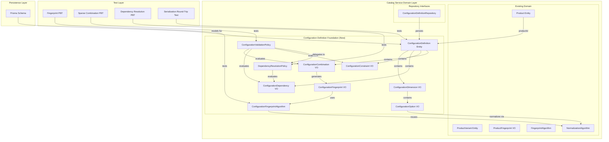

# Design Document: Configuration Definition Foundation

## Overview

This spec implements Phase 1 Foundation of the MUVA (Maysar Universal Variant Architecture) within the catalog-service modular monolith. It delivers the domain entities, value objects, domain policies, algorithms, repository interfaces, Prisma schema additions, and property-based tests for discrete variant configuration (Mode A).

The existing catalog-service has `Product` and `ProductVariant` entities with a deterministic `ProductFingerprint` for product identity deduplication. This phase adds the formal `ConfigurationDefinition` model that defines which configuration dimensions and options a product has, along with dependencies, constraints, and explicitly defined valid combinations (sparse matrix). The `ConfigurationFingerprint` extends the existing fingerprint concept to uniquely identify a configuration based on its dimension-option selections.

**Scope boundaries:**
- Pure domain model + repository interface + tests. No API routes, controllers, or use-case orchestration.
- Mode A (discrete variants) only. Parametric (Mode B) and composable (Mode C) are future phases.
- No infrastructure implementation (Prisma repository, migrations). Schema definitions only.

### Design Decisions

| Decision | Rationale |
|---|---|
| Entities use `// @ts-nocheck` and constructor-injected fields with getters | Matches existing `product.entity.ts` convention |
| Value objects expose `public readonly` fields + static factory methods | Matches existing `ProductFingerprint` and `ids.value-object.ts` |
| Domain policies are static methods on classes | Matches existing `ProductQualityPolicy` and `ConsistencyValidationPolicy` |
| Pure functions exported from entity files for PBT testability | Matches existing `product-review.entity.ts` pattern where `validateRating`, `computeAverageRating` etc. are exported as standalone functions |
| `ConfigurationFingerprintAlgorithm` extends `FingerprintAlgorithm` pattern | Reuses `NormalizationAlgorithm` for option normalization, follows the same SHA-256 hashing approach |
| Repository interface extends existing `interfaces.ts` with `ConfigurationDefinitionRepository` | Keeps configuration persistence separate from `ProductRepository` while remaining in the same domain layer file |
| Configurations stored as JSON in Prisma for dimensions, options, dependencies, constraints | Avoids excessive table proliferation for nested domain objects; matches existing `ProductVariant.attributes Json` pattern |
| `ConfigurationCombination` stored as a separate model with a fingerprint column | Enables unique constraint on fingerprint for duplicate prevention (Requirement 6.6, 7.6) |

## Architecture

### High-Level Component Diagram



### Domain Layer Organization

```
services/catalog-service/src/domain/
├── entities/
│   ├── product.entity.ts                    (existing)
│   ├── product-review.entity.ts              (existing)
│   ├── configuration-definition.entity.ts    (NEW)
│   └── __tests__/
│       └── configuration-definition-serialization.test.ts  (NEW)
├── value-objects/
│   ├── product-fingerprint.value-object.ts   (existing)
│   ├── configuration-dimension.value-object.ts  (NEW)
│   ├── configuration-option.value-object.ts      (NEW)
│   ├── configuration-fingerprint.value-object.ts (NEW)
│   └── __tests__/
│       └── configuration-fingerprint.properties.test.ts  (NEW)
├── algorithms/
│   ├── fingerprint.algorithm.ts              (existing)
│   ├── normalization.algorithm.ts             (existing)
│   └── configuration-fingerprint.algorithm.ts (NEW)
├── policies/
│   ├── configuration-validation.policy.ts      (NEW)
│   ├── dependency-resolution.policy.ts         (NEW)
│   └── __tests__/
│       ├── configuration-validation.properties.test.ts  (NEW)
│       └── dependency-resolution.properties.test.ts     (NEW)
└── interfaces.ts                              (MODIFIED — add ConfigurationDefinitionRepository)
```

## Components and Interfaces

### 1. ConfigurationDimension Value Object

**File:** `services/catalog-service/src/domain/value-objects/configuration-dimension.value-object.ts`

```typescript
// @ts-nocheck

export type SelectionType = 'selectable' | 'customer_defined';
export type SelectionMode = 'single' | 'multiple';

export interface ConfigurationDimensionData {
  id: string;
  configurationDefinitionId: string;
  name: string;
  selectionType: SelectionType;
  selectionMode: SelectionMode;
  minSelections: number;
  maxSelections: number;
  required: boolean;
  sortOrder: number;
}

export class ConfigurationDimension {
  constructor(
    public readonly id: string,
    public readonly configurationDefinitionId: string,
    public readonly name: string,
    public readonly selectionType: SelectionType,
    public readonly selectionMode: SelectionMode,
    public readonly minSelections: number,
    public readonly maxSelections: number,
    public readonly required: boolean,
    public readonly sortOrder: number
  ) {
    if (!name.trim()) {
      throw new Error('ConfigurationDimension name cannot be empty');
    }
    if (minSelections < 0) {
      throw new Error('ConfigurationDimension minSelections cannot be negative');
    }
    if (maxSelections < minSelections) {
      throw new Error('ConfigurationDimension maxSelections must be >= minSelections');
    }
  }

  isSelectable(): boolean {
    return this.selectionType === 'selectable';
  }

  isCustomerDefined(): boolean {
    return this.selectionType === 'customer_defined';
  }

  isRequired(): boolean {
    return this.required;
  }

  toJSON(): ConfigurationDimensionData {
    return {
      id: this.id,
      configurationDefinitionId: this.configurationDefinitionId,
      name: this.name,
      selectionType: this.selectionType,
      selectionMode: this.selectionMode,
      minSelections: this.minSelections,
      maxSelections: this.maxSelections,
      required: this.required,
      sortOrder: this.sortOrder,
    };
  }

  static fromJSON(data: ConfigurationDimensionData): ConfigurationDimension {
    return new ConfigurationDimension(
      data.id,
      data.configurationDefinitionId,
      data.name,
      data.selectionType,
      data.selectionMode,
      data.minSelections,
      data.maxSelections,
      data.required,
      data.sortOrder
    );
  }
}
```

### 2. ConfigurationOption Value Object

**File:** `services/catalog-service/src/domain/value-objects/configuration-option.value-object.ts`

```typescript
// @ts-nocheck

import { NormalizationAlgorithm } from '../algorithms/normalization.algorithm';

export interface ConfigurationOptionData {
  id: string;
  configurationDimensionId: string;
  displayValue: string;
  normalizedValue: string;
  sortOrder: number;
  active: boolean;
}

export class ConfigurationOption {
  public readonly normalizedValue: string;

  constructor(
    public readonly id: string,
    public readonly configurationDimensionId: string,
    public readonly displayValue: string,
    normalizedValue: string | undefined,
    public readonly sortOrder: number,
    public readonly active: boolean = true
  ) {
    if (!displayValue.trim()) {
      throw new Error('ConfigurationOption displayValue cannot be empty');
    }
    // Normalize at construction time if not provided
    this.normalizedValue = normalizedValue ?? NormalizationAlgorithm.normalizeText(displayValue);
  }

  isActive(): boolean {
    return this.active;
  }

  toJSON(): ConfigurationOptionData {
    return {
      id: this.id,
      configurationDimensionId: this.configurationDimensionId,
      displayValue: this.displayValue,
      normalizedValue: this.normalizedValue,
      sortOrder: this.sortOrder,
      active: this.active,
    };
  }

  static fromJSON(data: ConfigurationOptionData): ConfigurationOption {
    return new ConfigurationOption(
      data.id,
      data.configurationDimensionId,
      data.displayValue,
      data.normalizedValue,
      data.sortOrder,
      data.active
    );
  }

  /**
   * Returns true if two options have equivalent normalized values.
   * Used for duplicate detection within the same dimension.
   */
  static areEquivalent(a: ConfigurationOption, b: ConfigurationOption): boolean {
    return a.normalizedValue === b.normalizedValue;
  }
}
```

### 3. ConfigurationFingerprint Value Object

**File:** `services/catalog-service/src/domain/value-objects/configuration-fingerprint.value-object.ts`

```typescript
import { ConfigurationFingerprintAlgorithm, ConfigurationFingerprintInput } from '../algorithms/configuration-fingerprint.algorithm';

export class ConfigurationFingerprint {
  constructor(
    public readonly value: string,
    public readonly version: number = 1,
    public readonly configurationDefinitionId: string
  ) {}

  static generate(input: ConfigurationFingerprintInput): ConfigurationFingerprint {
    const value = ConfigurationFingerprintAlgorithm.generateFingerprint(input);
    return new ConfigurationFingerprint(value, 1, input.configurationDefinitionId);
  }

  matches(other: ConfigurationFingerprint): boolean {
    return (
      this.version === other.version &&
      this.configurationDefinitionId === other.configurationDefinitionId &&
      this.value === other.value
    );
  }

  toString(): string {
    return this.value;
  }
}
```

### 4. ConfigurationFingerprintAlgorithm

**File:** `services/catalog-service/src/domain/algorithms/configuration-fingerprint.algorithm.ts`

```typescript
import { createHash } from 'crypto';
import { NormalizationAlgorithm } from './normalization.algorithm';

export interface ConfigurationFingerprintInput {
  configurationDefinitionId: string;
  /** Map of dimensionId → array of selected option normalized values */
  selections: Record<string, string[]>;
}

export class ConfigurationFingerprintAlgorithm {
  /**
   * Generates a deterministic, order-independent fingerprint from a set of
   * dimension-option selections.
   *
   * Algorithm:
   * 1. Sort dimension IDs alphabetically
   * 2. For each dimension, sort its option normalized values alphabetically
   * 3. Build a canonical string: dimId1:opt1|opt2;dimId2:opt3|opt4
   * 4. SHA-256 hash the canonical string → 64-char lowercase hex
   */
  static generateFingerprint(input: ConfigurationFingerprintInput): string {
    const { configurationDefinitionId, selections } = input;

    // Sort dimension IDs for order independence
    const sortedDimIds = Object.keys(selections).sort();

    const parts: string[] = [];
    for (const dimId of sortedDimIds) {
      // Sort option values within each dimension for order independence
      const sortedOptions = [...selections[dimId]].sort();
      // Normalize each option value
      const normalizedOptions = sortedOptions.map(v =>
        NormalizationAlgorithm.normalizeText(v)
      );
      parts.push(`${dimId}:${normalizedOptions.join('|')}`);
    }

    const canonicalString = parts.join(';');
    return createHash('sha256').update(canonicalString).digest('hex');
  }

  /**
   * Validates that a string is a valid 64-character lowercase hexadecimal
   * SHA-256 fingerprint.
   */
  static validateFingerprint(fingerprint: string): boolean {
    return /^[a-f0-9]{64}$/.test(fingerprint);
  }
}
```

### 5. ConfigurationDependency Value Object

Defined inline within the entity file as a data interface (see entity section below).

### 6. ConfigurationConstraint Value Object

Defined inline within the entity file as a data interface (see entity section below).

### 7. ConfigurationDefinition Entity

**File:** `services/catalog-service/src/domain/entities/configuration-definition.entity.ts`

This is the aggregate root. It owns dimensions, options, dependencies, constraints, and combinations. Pure functions are exported for property-based testing.

```typescript
// @ts-nocheck

import { ConfigurationDimension, ConfigurationDimensionData } from '../value-objects/configuration-dimension.value-object';
import { ConfigurationOption, ConfigurationOptionData } from '../value-objects/configuration-option.value-object';
import { ConfigurationFingerprint } from '../value-objects/configuration-fingerprint.value-object';
import { ConfigurationFingerprintAlgorithm, ConfigurationFingerprintInput } from '../algorithms/configuration-fingerprint.algorithm';
import { NormalizationAlgorithm } from '../algorithms/normalization.algorithm';
import { DomainError } from '../errors/domain.error';

// ── Types ────────────────────────────────────────────────────────────────────

export type ConfigurationDefinitionStatus = 'draft' | 'active' | 'archived';

export type DependencyType = 'conditional' | 'dependent' | 'mutually_exclusive' | 'required' | 'optional';

export type ConstraintType = 'requires' | 'excludes' | 'compatible_with' | 'incompatible_with';

export interface ConfigurationDependencyData {
  id: string;
  type: DependencyType;
  sourceDimensionId: string;
  sourceOptionId: string;
  targetDimensionId: string;
  targetOptionIds: string[];
}

export interface ConfigurationConstraintData {
  id: string;
  type: ConstraintType;
  sourceOptionId: string;
  targetOptionId: string;
  ruleExpression?: string;
}

export interface ConfigurationCombinationData {
  id: string;
  configurationDefinitionId: string;
  /** Map of dimensionId → array of optionIds */
  optionSelections: Record<string, string[]>;
  fingerprint: string;
  active: boolean;
}

export interface ConfigurationDefinitionData {
  id: string;
  productId: string;
  version: number;
  status: ConfigurationDefinitionStatus;
  dimensions: ConfigurationDimensionData[];
  options: ConfigurationOptionData[];
  dependencies: ConfigurationDependencyData[];
  constraints: ConfigurationConstraintData[];
  combinations: ConfigurationCombinationData[];
  predecessorVersionId: string | null;
  createdAt: string;
  updatedAt: string;
}

// ── Pure Functions (for PBT) ──────────────────────────────────────────────────

/**
 * Validates that a set of option selections matches an explicitly defined
 * ConfigurationCombination by fingerprint.
 */
export function validateCombination(
  selections: Record<string, string[]>,
  combinations: ConfigurationCombinationData[]
): { matches: boolean; combination: ConfigurationCombinationData | null } {
  const fingerprint = ConfigurationFingerprintAlgorithm.generateFingerprint({
    configurationDefinitionId: '',
    selections,
  });

  for (const combo of combinations) {
    if (combo.fingerprint === fingerprint) {
      return { matches: true, combination: combo };
    }
  }
  return { matches: false, combination: null };
}

/**
 * Serializes a ConfigurationDefinitionData to a JSON string.
 */
export function serializeConfigurationDefinition(data: ConfigurationDefinitionData): string {
  return JSON.stringify(data);
}

/**
 * Deserializes a JSON string back to a ConfigurationDefinitionData.
 */
export function deserializeConfigurationDefinition(json: string): ConfigurationDefinitionData {
  return JSON.parse(json) as ConfigurationDefinitionData;
}

/**
 * Checks structural equality between two ConfigurationDefinitionData instances.
 */
export function configurationDefinitionsEqual(
  a: ConfigurationDefinitionData,
  b: ConfigurationDefinitionData
): boolean {
  return JSON.stringify(a) === JSON.stringify(b);
}

// ── Entity ────────────────────────────────────────────────────────────────────

export class ConfigurationDefinition {
  private dimensions: Map<string, ConfigurationDimension> = new Map();
  private options: Map<string, ConfigurationOption> = new Map();
  private dependencies: ConfigurationDependencyData[] = [];
  private constraints: ConfigurationConstraintData[] = [];
  private combinations: ConfigurationCombinationData[] = [];

  constructor(
    private readonly id: string,
    private readonly productId: string,
    private version: number,
    private status: ConfigurationDefinitionStatus,
    private predecessorVersionId: string | null = null,
    private readonly createdAt: Date = new Date(),
    private updatedAt: Date = new Date()
  ) {}

  // ── Getters ──────────────────────────────────────────────────────────────────

  getId(): string { return this.id; }
  getProductId(): string { return this.productId; }
  getVersion(): number { return this.version; }
  getStatus(): ConfigurationDefinitionStatus { return this.status; }
  getPredecessorVersionId(): string | null { return this.predecessorVersionId; }
  getCreatedAt(): Date { return this.createdAt; }
  getUpdatedAt(): Date { return this.updatedAt; }

  getDimensions(): ConfigurationDimension[] {
    return Array.from(this.dimensions.values()).sort((a, b) => a.sortOrder - b.sortOrder);
  }

  getOptions(): ConfigurationOption[] {
    return Array.from(this.options.values()).sort((a, b) => a.sortOrder - b.sortOrder);
  }

  getOptionsForDimension(dimensionId: string): ConfigurationOption[] {
    return this.getOptions().filter(o => o.configurationDimensionId === dimensionId);
  }

  getDependencies(): ConfigurationDependencyData[] { return [...this.dependencies]; }
  getConstraints(): ConfigurationConstraintData[] { return [...this.constraints]; }
  getCombinations(): ConfigurationCombinationData[] { return [...this.combinations]; }
  getActiveCombinations(): ConfigurationCombinationData[] {
    return this.combinations.filter(c => c.active);
  }

  // ── Dimension Management ──────────────────────────────────────────────────────

  addDimension(dimension: ConfigurationDimension): void {
    if (this.status === 'archived') {
      throw new DomainError('Cannot modify archived ConfigurationDefinition', 'ARCHIVED_DEFINITION');
    }
    // Reject duplicate dimension names
    for (const existing of this.dimensions.values()) {
      if (existing.name.toLowerCase() === dimension.name.toLowerCase()) {
        throw new DomainError(
          `Duplicate dimension name: ${dimension.name}`,
          'DUPLICATE_DIMENSION_NAME'
        );
      }
    }
    this.dimensions.set(dimension.id, dimension);
    this.touch();
  }

  getDimension(id: string): ConfigurationDimension | undefined {
    return this.dimensions.get(id);
  }

  // ── Option Management ────────────────────────────────────────────────────────

  addOption(option: ConfigurationOption): void {
    if (this.status === 'archived') {
      throw new DomainError('Cannot modify archived ConfigurationDefinition', 'ARCHIVED_DEFINITION');
    }
    // Verify the option's dimension exists
    if (!this.dimensions.has(option.configurationDimensionId)) {
      throw new DomainError(
        `Option references unknown dimension: ${option.configurationDimensionId}`,
        'UNKNOWN_DIMENSION_REFERENCE'
      );
    }
    // Reject duplicate normalized values within the same dimension
    for (const existing of this.options.values()) {
      if (existing.configurationDimensionId === option.configurationDimensionId &&
          ConfigurationOption.areEquivalent(existing, option)) {
        throw new DomainError(
          `Duplicate option normalized value: ${option.normalizedValue}`,
          'DUPLICATE_OPTION_VALUE'
        );
      }
    }
    this.options.set(option.id, option);
    this.touch();
  }

  getOption(id: string): ConfigurationOption | undefined {
    return this.options.get(id);
  }

  // ── Dependency Management ────────────────────────────────────────────────────

  addDependency(dependency: ConfigurationDependencyData): void {
    if (this.status === 'archived') {
      throw new DomainError('Cannot modify archived ConfigurationDefinition', 'ARCHIVED_DEFINITION');
    }
    this.validateDependencyReferences(dependency);
    this.dependencies.push(dependency);
    this.touch();
  }

  private validateDependencyReferences(dependency: ConfigurationDependencyData): void {
    if (!this.dimensions.has(dependency.sourceDimensionId)) {
      throw new DomainError(
        `Dependency source dimension not found: ${dependency.sourceDimensionId}`,
        'DEPENDENCY_REFERENCE_ERROR'
      );
    }
    if (!this.options.has(dependency.sourceOptionId)) {
      throw new DomainError(
        `Dependency source option not found: ${dependency.sourceOptionId}`,
        'DEPENDENCY_REFERENCE_ERROR'
      );
    }
    if (!this.dimensions.has(dependency.targetDimensionId)) {
      throw new DomainError(
        `Dependency target dimension not found: ${dependency.targetDimensionId}`,
        'DEPENDENCY_REFERENCE_ERROR'
      );
    }
    for (const targetOptionId of dependency.targetOptionIds) {
      if (!this.options.has(targetOptionId)) {
        throw new DomainError(
          `Dependency target option not found: ${targetOptionId}`,
          'DEPENDENCY_REFERENCE_ERROR'
        );
      }
    }
  }

  // ── Constraint Management ────────────────────────────────────────────────────

  addConstraint(constraint: ConfigurationConstraintData): void {
    if (this.status === 'archived') {
      throw new DomainError('Cannot modify archived ConfigurationDefinition', 'ARCHIVED_DEFINITION');
    }
    this.validateConstraintReferences(constraint);
    this.constraints.push(constraint);
    this.touch();
  }

  private validateConstraintReferences(constraint: ConfigurationConstraintData): void {
    if (!this.options.has(constraint.sourceOptionId)) {
      throw new DomainError(
        `Constraint source option not found: ${constraint.sourceOptionId}`,
        'CONSTRAINT_REFERENCE_ERROR'
      );
    }
    if (!this.options.has(constraint.targetOptionId)) {
      throw new DomainError(
        `Constraint target option not found: ${constraint.targetOptionId}`,
        'CONSTRAINT_REFERENCE_ERROR'
      );
    }
  }

  // ── Combination Management ───────────────────────────────────────────────────

  addCombination(combo: ConfigurationCombinationData): void {
    if (this.status === 'archived') {
      throw new DomainError('Cannot modify archived ConfigurationDefinition', 'ARCHIVED_DEFINITION');
    }
    // Validate that each referenced option exists in its corresponding dimension
    for (const [dimId, optionIds] of Object.entries(combo.optionSelections)) {
      if (!this.dimensions.has(dimId)) {
        throw new DomainError(
          `Combination references unknown dimension: ${dimId}`,
          'COMBINATION_REFERENCE_ERROR'
        );
      }
      for (const optId of optionIds) {
        const option = this.options.get(optId);
        if (!option) {
          throw new DomainError(
            `Combination references unknown option: ${optId}`,
            'COMBINATION_REFERENCE_ERROR'
          );
        }
        if (option.configurationDimensionId !== dimId) {
          throw new DomainError(
            `Combination option ${optId} does not belong to dimension ${dimId}`,
            'COMBINATION_REFERENCE_ERROR'
          );
        }
      }
    }
    // Generate fingerprint and check for duplicates
    const fingerprint = ConfigurationFingerprint.generate({
      configurationDefinitionId: this.id,
      selections: this.resolveSelectionsToFingerprintInput(combo.optionSelections),
    });
    const comboWithFingerprint = { ...combo, fingerprint: fingerprint.value };

    for (const existing of this.combinations) {
      if (existing.fingerprint === comboWithFingerprint.fingerprint) {
        throw new DomainError(
          'Duplicate configuration combination (same fingerprint)',
          'DUPLICATE_COMBINATION'
        );
      }
    }
    this.combinations.push(comboWithFingerprint);
    this.touch();
  }

  private resolveSelectionsToFingerprintInput(
    selections: Record<string, string[]>
  ): Record<string, string[]> {
    const result: Record<string, string[]> = {};
    for (const [dimId, optionIds] of Object.entries(selections)) {
      result[dimId] = optionIds.map(optId => {
        const option = this.options.get(optId);
        return option ? option.normalizedValue : optId;
      });
    }
    return result;
  }

  // ── Versioning ───────────────────────────────────────────────────────────────

  /**
   * Returns true if structural elements (dimensions, options, dependencies,
   * constraints) have changed, requiring a new version.
   */
  isStructuralChange(other: ConfigurationDefinition): boolean {
    // Compare dimensions
    if (this.dimensions.size !== other.dimensions.size) return true;
    for (const dim of this.dimensions.values()) {
      const otherDim = other.dimensions.get(dim.id);
      if (!otherDim) return true;
      if (JSON.stringify(dim.toJSON()) !== JSON.stringify(otherDim.toJSON())) return true;
    }
    // Compare options
    if (this.options.size !== other.options.size) return true;
    for (const opt of this.options.values()) {
      const otherOpt = other.options.get(opt.id);
      if (!otherOpt) return true;
      if (JSON.stringify(opt.toJSON()) !== JSON.stringify(otherOpt.toJSON())) return true;
    }
    // Compare dependencies
    if (this.dependencies.length !== other.dependencies.length) return true;
    if (JSON.stringify(this.dependencies) !== JSON.stringify(other.dependencies)) return true;
    // Compare constraints
    if (this.constraints.length !== other.constraints.length) return true;
    if (JSON.stringify(this.constraints) !== JSON.stringify(other.constraints)) return true;
    return false;
  }

  /**
   * Creates a new version of this definition, preserving a reference to
   * the current version as predecessor.
   */
  createNewVersion(): ConfigurationDefinition {
    const newVersion = new ConfigurationDefinition(
      `${this.id}-v${this.version + 1}`,
      this.productId,
      this.version + 1,
      'draft',
      this.id,
      new Date(),
      new Date()
    );
    // Copy structural elements
    for (const dim of this.dimensions.values()) {
      newVersion.dimensions.set(dim.id, dim);
    }
    for (const opt of this.options.values()) {
      newVersion.options.set(opt.id, opt);
    }
    newVersion.dependencies = [...this.dependencies];
    newVersion.constraints = [...this.constraints];
    newVersion.combinations = [...this.combinations];
    return newVersion;
  }

  // ── Lifecycle ────────────────────────────────────────────────────────────────

  transitionTo(newStatus: ConfigurationDefinitionStatus): void {
    if (this.status === 'archived') {
      throw new DomainError(
        'Cannot transition from archived status',
        'ARCHIVED_DEFINITION'
      );
    }
    if (newStatus === 'active') {
      this.validateForActivation();
    }
    this.status = newStatus;
    this.touch();
  }

  private validateForActivation(): void {
    if (this.dimensions.size === 0) {
      throw new DomainError(
        'Cannot activate: at least one dimension required',
        'ACTIVATION_VALIDATION_ERROR'
      );
    }
    if (this.options.size === 0) {
      throw new DomainError(
        'Cannot activate: at least one option required',
        'ACTIVATION_VALIDATION_ERROR'
      );
    }
    if (this.combinations.length === 0) {
      throw new DomainError(
        'Cannot activate: at least one combination required',
        'ACTIVATION_VALIDATION_ERROR'
      );
    }
  }

  // ── Serialization ─────────────────────────────────────────────────────────────

  toJSON(): ConfigurationDefinitionData {
    return {
      id: this.id,
      productId: this.productId,
      version: this.version,
      status: this.status,
      dimensions: Array.from(this.dimensions.values()).map(d => d.toJSON()),
      options: Array.from(this.options.values()).map(o => o.toJSON()),
      dependencies: [...this.dependencies],
      constraints: [...this.constraints],
      combinations: [...this.combinations],
      predecessorVersionId: this.predecessorVersionId,
      createdAt: this.createdAt.toISOString(),
      updatedAt: this.updatedAt.toISOString(),
    };
  }

  static fromJSON(data: ConfigurationDefinitionData): ConfigurationDefinition {
    const entity = new ConfigurationDefinition(
      data.id,
      data.productId,
      data.version,
      data.status,
      data.predecessorVersionId,
      new Date(data.createdAt),
      new Date(data.updatedAt)
    );
    for (const dimData of data.dimensions) {
      entity.dimensions.set(dimData.id, ConfigurationDimension.fromJSON(dimData));
    }
    for (const optData of data.options) {
      entity.options.set(optData.id, ConfigurationOption.fromJSON(optData));
    }
    entity.dependencies = [...data.dependencies];
    entity.constraints = [...data.constraints];
    entity.combinations = [...data.combinations];
    return entity;
  }

  // ── Factory ──────────────────────────────────────────────────────────────────

  static create(productId: string): ConfigurationDefinition {
    return new ConfigurationDefinition(
      `cfg-${Date.now()}-${Math.random().toString(36).substr(2, 9)}`,
      productId,
      1,
      'draft',
      null,
      new Date(),
      new Date()
    );
  }

  private touch(): void {
    this.updatedAt = new Date();
  }
}
```

### 8. ConfigurationValidationPolicy

**File:** `services/catalog-service/src/domain/policies/configuration-validation.policy.ts`

```typescript
import { ConfigurationDefinitionData } from '../entities/configuration-definition.entity';
import { DependencyResolutionPolicy, DependencyResolutionResult } from './dependency-resolution.policy';

export interface ValidationFieldError {
  field: string;
  code: string;
  message: string;
}

export interface ConfigurationValidationResult {
  valid: boolean;
  errors: ValidationFieldError[];
}

export class ConfigurationValidationPolicy {
  /**
   * Validates a submitted configuration against a ConfigurationDefinition.
   *
   * Steps:
   * 1. Verify the selection matches an explicitly defined ConfigurationCombination
   * 2. Verify the matched combination is active
   * 3. Evaluate all dependency rules via DependencyResolutionPolicy
   * 4. Evaluate all constraint rules
   * 5. Return structured validation result
   */
  static validate(
    selections: Record<string, string[]>,
    definition: ConfigurationDefinitionData
  ): ConfigurationValidationResult {
    const errors: ValidationFieldError[] = [];

    // Step 1: Find matching combination by fingerprint
    const matchResult = this.findMatchingCombination(selections, definition);
    if (!matchResult.matches) {
      errors.push({
        field: 'selections',
        code: 'NO_MATCHING_COMBINATION',
        message: `Submitted configuration does not match any explicitly defined combination. Unmatched selections: ${
          this.formatUnmatchedSelections(selections)
        }`,
      });
      return { valid: false, errors };
    }

    // Step 2: Check if the combination is active
    if (matchResult.combination && !matchResult.combination.active) {
      errors.push({
        field: 'combination',
        code: 'INACTIVE_COMBINATION',
        message: 'The matching configuration combination is inactive.',
      });
    }

    // Step 3: Evaluate dependencies
    const depResult = DependencyResolutionPolicy.resolve(selections, definition);
    for (const conflict of depResult.conflicts) {
      errors.push({
        field: 'dependency',
        code: conflict.code,
        message: conflict.message,
      });
    }

    // Step 4: Evaluate constraints
    const constraintErrors = this.evaluateConstraints(selections, definition);
    errors.push(...constraintErrors);

    return {
      valid: errors.length === 0,
      errors,
    };
  }

  private static findMatchingCombination(
    selections: Record<string, string[]>,
    definition: ConfigurationDefinitionData
  ): { matches: boolean; combination: ConfigurationCombinationData | null } {
    // Build a lookup map from optionId → normalizedValue
    const optionMap = new Map<string, string>();
    for (const opt of definition.options) {
      optionMap.set(opt.id, opt.normalizedValue);
    }

    // Resolve selections to normalized values for fingerprint comparison
    const normalizedSelections: Record<string, string[]> = {};
    for (const [dimId, optionIds] of Object.entries(selections)) {
      normalizedSelections[dimId] = optionIds.map(id => optionMap.get(id) || id);
    }

    // Compare against each combination's fingerprint
    for (const combo of definition.combinations) {
      const comboNormalized: Record<string, string[]> = {};
      for (const [dimId, optionIds] of Object.entries(combo.optionSelections)) {
        comboNormalized[dimId] = optionIds.map(id => optionMap.get(id) || id);
      }
      // Compare normalized selections
      if (this.selectionsEqual(normalizedSelections, comboNormalized)) {
        return { matches: true, combination: combo };
      }
    }
    return { matches: false, combination: null };
  }

  private static selectionsEqual(
    a: Record<string, string[]>,
    b: Record<string, string[]>
  ): boolean {
    const aKeys = Object.keys(a).sort();
    const bKeys = Object.keys(b).sort();
    if (aKeys.length !== bKeys.length) return false;
    for (let i = 0; i < aKeys.length; i++) {
      if (aKeys[i] !== bKeys[i]) return false;
      const aVals = [...a[aKeys[i]]].sort();
      const bVals = [...b[bKeys[i]]].sort();
      if (aVals.length !== bVals.length) return false;
      for (let j = 0; j < aVals.length; j++) {
        if (aVals[j] !== bVals[j]) return false;
      }
    }
    return true;
  }

  private static evaluateConstraints(
    selections: Record<string, string[]>,
    definition: ConfigurationDefinitionData
  ): ValidationFieldError[] {
    const errors: ValidationFieldError[] = [];
    const allSelectedOptionIds = new Set<string>();
    for (const optionIds of Object.values(selections)) {
      for (const id of optionIds) {
        allSelectedOptionIds.add(id);
      }
    }

    for (const constraint of definition.constraints) {
      const sourceSelected = allSelectedOptionIds.has(constraint.sourceOptionId);
      const targetSelected = allSelectedOptionIds.has(constraint.targetOptionId);

      switch (constraint.type) {
        case 'requires':
          if (sourceSelected && !targetSelected) {
            errors.push({
              field: 'constraint',
              code: 'CONSTRAINT_VIOLATION',
              message: `Option ${constraint.sourceOptionId} requires option ${constraint.targetOptionId}`,
            });
          }
          break;
        case 'excludes':
          if (sourceSelected && targetSelected) {
            errors.push({
              field: 'constraint',
              code: 'CONSTRAINT_VIOLATION',
              message: `Option ${constraint.sourceOptionId} excludes option ${constraint.targetOptionId}`,
            });
          }
          break;
        case 'incompatible_with':
          if (sourceSelected && targetSelected) {
            errors.push({
              field: 'constraint',
              code: 'CONSTRAINT_VIOLATION',
              message: `Option ${constraint.sourceOptionId} is incompatible with option ${constraint.targetOptionId}`,
            });
          }
          break;
        case 'compatible_with':
          // compatible_with is a positive constraint — no violation if both selected
          break;
      }
    }
    return errors;
  }

  private static formatUnmatchedSelections(selections: Record<string, string[]>): string {
    return Object.entries(selections)
      .map(([dim, opts]) => `${dim}: [${opts.join(', ')}]`)
      .join('; ');
  }
}
```

### 9. DependencyResolutionPolicy

**File:** `services/catalog-service/src/domain/policies/dependency-resolution.policy.ts`

```typescript
import { ConfigurationDefinitionData, ConfigurationDependencyData } from '../entities/configuration-definition.entity';

export interface DependencyConflict {
  code: string;
  message: string;
  optionIds: string[];
}

export interface DependencyResolutionResult {
  /** Options filtered by conditional dependencies */
  filteredOptions: Record<string, string[]>;
  /** Required selections that must be present */
  requiredSelections: string[];
  /** Conflicts detected */
  conflicts: DependencyConflict[];
  /** Stale dependency references (pointing to non-existent options/dimensions) */
  staleReferences: DependencyConflict[];
}

export class DependencyResolutionPolicy {
  /**
   * Evaluates dependency rules for a given set of selections.
   *
   * Returns:
   * - filteredOptions: For each dimension, the available option IDs after
   *   applying conditional dependencies
   * - requiredSelections: Option IDs that must be selected based on
   *   'required' dependencies
   * - conflicts: Mutually exclusive violations
   * - staleReferences: Dependencies referencing non-existent entities
   */
  static resolve(
    selections: Record<string, string[]>,
    definition: ConfigurationDefinitionData
  ): DependencyResolutionResult {
    const conflicts: DependencyConflict[] = [];
    const staleReferences: DependencyConflict[] = [];
    const requiredSelections: string[] = [];

    // Build option and dimension lookup sets
    const optionIds = new Set(definition.options.map(o => o.id));
    const dimensionIds = new Set(definition.dimensions.map(d => d.id));

    // Collect all selected option IDs
    const allSelected = new Set<string>();
    for (const opts of Object.values(selections)) {
      for (const id of opts) {
        allSelected.add(id);
      }
    }

    // Start with all options available for each dimension
    const filteredOptions: Record<string, string[]> = {};
    for (const dim of definition.dimensions) {
      filteredOptions[dim.id] = definition.options
        .filter(o => o.configurationDimensionId === dim.id)
        .map(o => o.id);
    }

    // Evaluate each dependency
    for (const dep of definition.dependencies) {
      // Check for stale references
      if (!dimensionIds.has(dep.sourceDimensionId) ||
          !optionIds.has(dep.sourceOptionId) ||
          !dimensionIds.has(dep.targetDimensionId) ||
          !dep.targetOptionIds.every(id => optionIds.has(id))) {
        staleReferences.push({
          code: 'STALE_DEPENDENCY_REFERENCE',
          message: `Dependency ${dep.id} references non-existent dimension or option`,
          optionIds: [],
        });
        continue;
      }

      switch (dep.type) {
        case 'conditional':
          if (allSelected.has(dep.sourceOptionId)) {
            // Filter target dimension options to only those specified
            filteredOptions[dep.targetDimensionId] = dep.targetOptionIds;
          }
          break;

        case 'required':
          if (allSelected.has(dep.sourceOptionId)) {
            for (const targetOptId of dep.targetOptionIds) {
              if (!allSelected.has(targetOptId)) {
                requiredSelections.push(targetOptId);
              }
            }
          }
          break;

        case 'mutually_exclusive':
          // Check if both source and any target are selected
          if (allSelected.has(dep.sourceOptionId)) {
            for (const targetOptId of dep.targetOptionIds) {
              if (allSelected.has(targetOptId)) {
                conflicts.push({
                  code: 'MUTUALLY_EXCLUSIVE_VIOLATION',
                  message: `Options ${dep.sourceOptionId} and ${targetOptId} are mutually exclusive`,
                  optionIds: [dep.sourceOptionId, targetOptId],
                });
              }
            }
          }
          break;

        case 'dependent':
        case 'optional':
          // No enforcement for dependent/optional in this phase
          break;
      }
    }

    return {
      filteredOptions,
      requiredSelections,
      conflicts,
      staleReferences,
    };
  }
}
```

### 10. ConfigurationDefinitionRepository Interface

**File:** `services/catalog-service/src/domain/interfaces.ts` (appended)

```typescript
/**
 * Configuration Definition Repository Interface
 * Defines contract for ConfigurationDefinition persistence operations
 */
export interface ConfigurationDefinitionRepository {
  /**
   * Save a ConfigurationDefinition entity
   */
  saveConfigurationDefinition(definition: DomainRecord): Promise<DomainRecord>;

  /**
   * Find a ConfigurationDefinition by its unique identifier
   */
  findConfigurationDefinitionById(id: string): Promise<DomainRecord | null>;

  /**
   * Find a ConfigurationDefinition by its associated product identifier
   */
  findConfigurationDefinitionByProductId(productId: string): Promise<DomainRecord | null>;

  /**
   * Find a ConfigurationDefinition by its ConfigurationFingerprint
   */
  findConfigurationDefinitionByFingerprint(fingerprint: string): Promise<DomainRecord | null>;

  /**
   * Find all active ConfigurationCombination instances for a given
   * ConfigurationDefinition identifier
   */
  findActiveCombinations(configurationDefinitionId: string): Promise<DomainRecord[]>;
}
```

## Data Models

### Prisma Schema Additions

**File:** `prisma/schema.prisma` (appended)

```prisma
/// Configuration definition lifecycle status
enum Catalog_ConfigurationStatus {
  draft
  active
  archived
}

/// Configuration dimension selection type
enum Catalog_SelectionType {
  selectable
  customer_defined
}

/// Configuration dimension selection mode
enum Catalog_SelectionMode {
  single
  multiple
}

/// Configuration dependency type
enum Catalog_DependencyType {
  conditional
  dependent
  mutually_exclusive
  required
  optional
}

/// Configuration constraint type
enum Catalog_ConstraintType {
  requires
  excludes
  compatible_with
  incompatible_with
}

model ConfigurationDefinition {
  id                    String                        @id @default(cuid()) @db.VarChar(64)
  productId             String                        @db.VarChar(64)
  version               Int                           @default(1)
  status                Catalog_ConfigurationStatus  @default(draft)
  predecessorVersionId  String?                       @db.VarChar(64)
  /// Serialized dimensions, options, dependencies, constraints as JSON
  dimensions            Json
  options               Json
  dependencies          Json
  constraints           Json
  createdAt             DateTime                      @default(now()) @db.Timestamp(6)
  updatedAt             DateTime                      @updatedAt @db.Timestamp(6)
  product               Product                       @relation(fields: [productId], references: [id], onDelete: Cascade)
  combinations          ConfigurationCombination[]

  @@unique([productId, version])
  @@index([productId])
  @@index([status])
  @@index([predecessorVersionId])
  @@map("catalog_configuration_definitions")
}

model ConfigurationCombination {
  id                          String                @id @default(cuid()) @db.VarChar(64)
  configurationDefinitionId   String                @db.VarChar(64)
  /// Map of dimensionId → array of optionIds, stored as JSON
  optionSelections            Json
  /// 64-character lowercase hex SHA-256 fingerprint
  fingerprint                 String                @db.VarChar(64)
  active                      Boolean               @default(true)
  createdAt                   DateTime              @default(now()) @db.Timestamp(6)
  configurationDefinition     ConfigurationDefinition @relation(fields: [configurationDefinitionId], references: [id], onDelete: Cascade)

  @@unique([configurationDefinitionId, fingerprint])
  @@index([configurationDefinitionId])
  @@index([fingerprint])
  @@index([active])
  @@map("catalog_configuration_combinations")
}
```

### Design Notes on Schema

- **Dimensions, options, dependencies, constraints as JSON columns** on `ConfigurationDefinition`: These are domain-internal structural elements that are always loaded and validated together as part of the aggregate root. Storing them as JSON avoids excessive table joins for what is always accessed as a single aggregate. This matches the existing pattern where `ProductVariant.attributes` is stored as `Json`.

- **ConfigurationCombination as a separate model**: Combinations need their own unique constraint on fingerprint (Requirement 6.6, 7.6) and need to be queryable independently (active vs inactive, lookup by fingerprint). This warrants a separate table.

- **Index strategy**: `productId` index for lookups by product, `fingerprint` index for fingerprint-based lookups, `active` index for filtering active combinations, `predecessorVersionId` for version chain traversal.

- **Cascade deletes**: When a Product is deleted, its ConfigurationDefinitions are deleted. When a ConfigurationDefinition is deleted, its Combinations are deleted.
