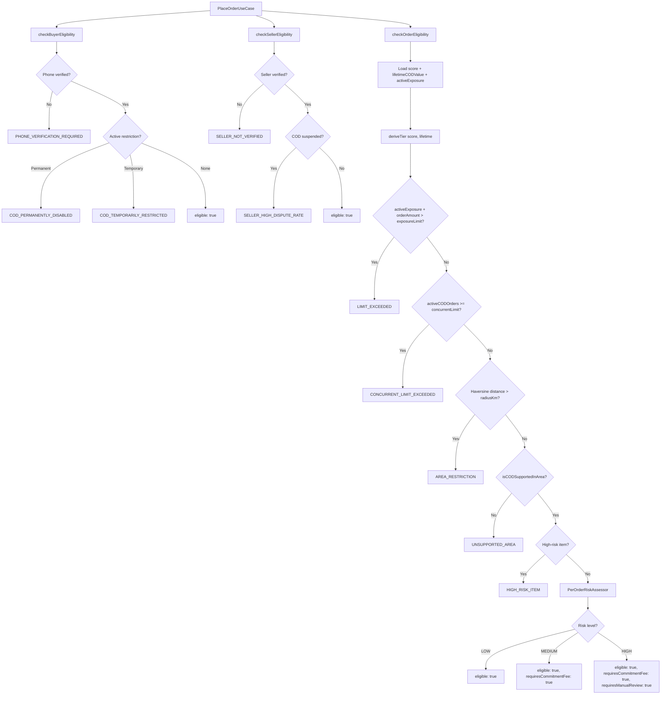
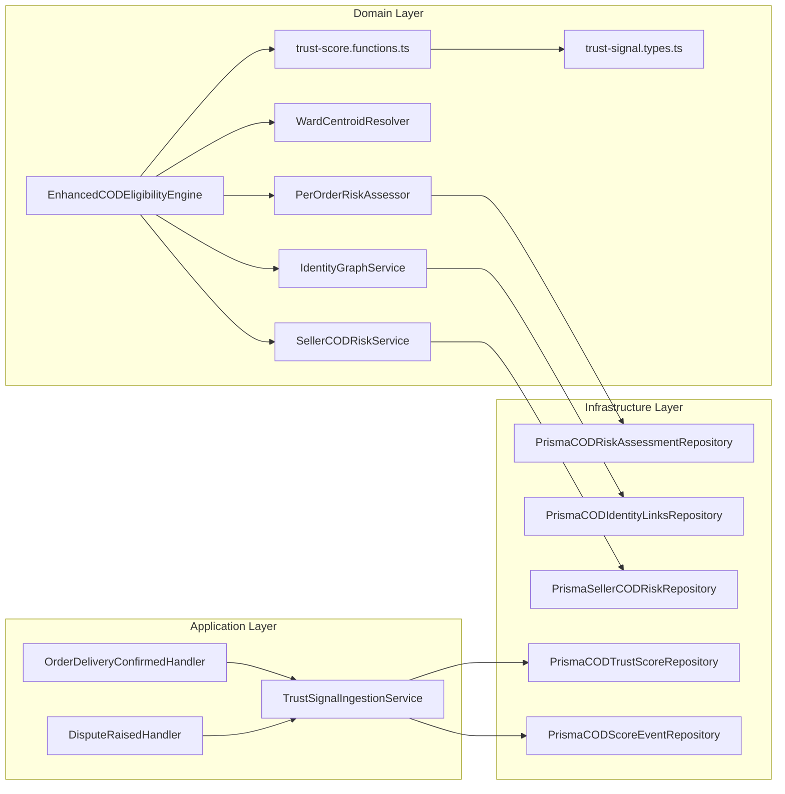
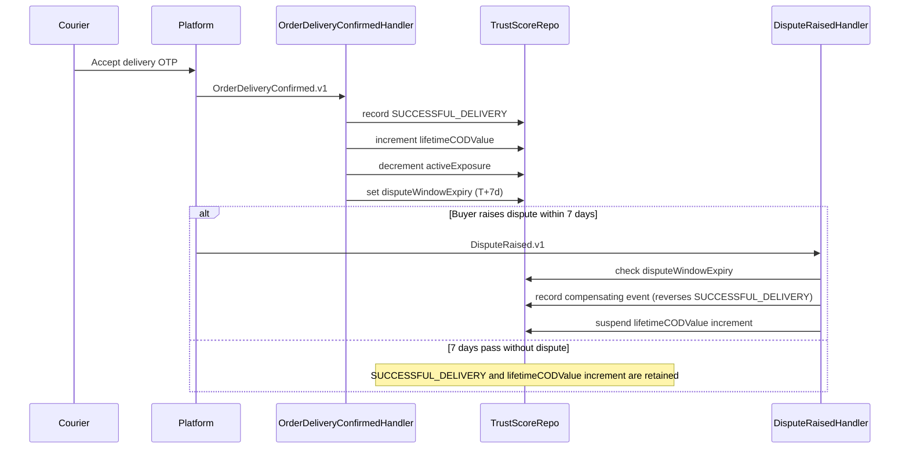

# Design Document: Enhanced COD Trust System

## Overview

The Enhanced COD Trust System replaces the existing `ProgressiveCODEligibilityEngine` (3-tier, score-only) with a 5-tier, dual-axis engine that gates tier advancement on both behavioral score and demonstrated financial history. The upgrade addresses five structural gaps in the live system: unlimited exposure at the top tier, city-level geographic checks that are too coarse for Dar es Salaam, order-count concurrency limits that ignore order value, a single generic courier signal that loses fraud-pattern information, and no seller-side COD risk tracking.

The new engine is a drop-in replacement: it implements the same `checkBuyerEligibility` / `checkSellerEligibility` / `checkOrderEligibility` interface, so `PlaceOrderUseCase` requires no structural changes. All existing `Score_Event` records remain replayable. The feature lives entirely in **order-service** and follows the existing DDD layering: domain → application → infrastructure → api.

### Key Design Decisions

1. **Dual-axis tier derivation** — `deriveTier(score, lifetimeCODValue)` requires both a behavioral score threshold and a financial history threshold. This prevents buyers from gaming the system by completing many small cheap orders to unlock high-value COD exposure.

2. **Active exposure replaces order count** — `activeExposure` (sum of active COD order values) is tracked as a running total on the trust score record. This closes the order-splitting loophole where a buyer could place many small orders to stay under a per-order cap.

3. **Ward-centroid Haversine distance** — Geographic checks use the great-circle distance between ward centroids loaded from `tanzania_national.json` at startup. This is more meaningful than city-level matching in Dar es Salaam, where two wards in the same city can be 40+ km apart.

4. **In-memory ward centroid map** — The 3,054-ward coordinate dataset (~2 MB) is loaded once at service startup into a `Map<number, {lat, lng}>`. No database queries are needed for distance checks, keeping `checkOrderEligibility` fast.

5. **Identity graph as a fraud-reset prevention layer** — Accounts sharing phone, national ID, device fingerprint, or delivery address are linked. Negative signals propagate to all linked accounts, and new accounts inherit the worst score in the group.

6. **Delivery confirmation via platform event** — The engine subscribes to `OrderDeliveryConfirmed.v1` rather than managing its own OTP flow. A 7-day dispute window guards against colluding seller/buyer pairs farming trust signals.

7. **Per-order risk assessment as a friction layer** — Even PLATINUM_BUYER orders are assessed for contextual risk factors (new device, new address, high relative value, velocity, category risk). High-risk orders require a commitment fee and/or manual review rather than being blocked outright.

8. **Seller COD risk as a rolling 30-day rate** — Seller suspension at >15% dispute rate (min 5 orders) and auto-reinstatement at <10% avoids penalising sellers for isolated incidents while catching systematic problems.

9. **`EligibilityResult` extended with optional fields** — `requiresCommitmentFee`, `requiresManualReview`, and `commitmentFeeAmount` are added as optional fields. Existing callers that only check `eligible` and `reason` are unaffected.

10. **Migration via feature flag** — The enhanced engine is wired in parallel with the existing engine behind a feature flag. Both engines share the same database tables. The flag is flipped per-environment after smoke testing.


## Architecture

### Check Pipeline



### Component Relationships




## Components and Interfaces

### Extended `EligibilityResult`

```typescript
// services/order-service/src/domain/engines/cod-eligibility.engine.ts
export interface EligibilityResult {
  eligible: boolean;
  reason?: string;
  // New optional fields — only present when eligible: true and risk assessment ran
  requiresCommitmentFee?: boolean;
  requiresManualReview?: boolean;
  commitmentFeeAmount?: number;
}
```

Existing callers that only read `eligible` and `reason` are unaffected. The new fields are only populated by `checkOrderEligibility` when the per-order risk assessor runs.

---

### `EnhancedCODEligibilityEngine`

**File:** `services/order-service/src/domain/engines/enhanced-cod-eligibility.engine.ts`

Drop-in replacement for `ProgressiveCODEligibilityEngine`. Implements the same three-method interface plus one new listing method.

```typescript
export class EnhancedCODEligibilityEngine {
  constructor(
    private readonly trustScoreRepo: ICODTrustScoreRepository,
    private readonly restrictionRepo: ICODRestrictionRepository,
    private readonly orderRepo: OrderRepository,
    private readonly authService: IAuthServiceClient,
    private readonly logisticsService: ILogisticsServiceClient,
    private readonly perOrderRiskAssessor: PerOrderRiskAssessor,
    private readonly sellerCODRiskService: SellerCODRiskService,
    private readonly wardCentroidResolver: WardCentroidResolver,
  ) {}

  /** Unchanged signature — checks phone verification and active restrictions. */
  async checkBuyerEligibility(buyerId: string): Promise<EligibilityResult>;

  /**
   * Extended — also checks seller COD suspension via SellerCODRiskService.
   * Returns SELLER_HIGH_DISPUTE_RATE if seller is suspended.
   */
  async checkSellerEligibility(sellerId: string): Promise<EligibilityResult>;

  /**
   * Extended — runs 6 checks in fail-fast order:
   * 1. Active exposure check
   * 2. Concurrent order count check
   * 3. Geographic check (Haversine or region-level)
   * 4. Logistics area support
   * 5. High-risk item check
   * 6. Per-order risk assessment (returns commitment fee / manual review flags)
   */
  async checkOrderEligibility(order: Order, sellerAddress: any): Promise<EligibilityResult>;

  /**
   * New method — advisory listing eligibility check.
   * Returns codAvailable + optional codUnavailableReason.
   * Does NOT expose score, tier, or lifetime value.
   * Must complete within 200ms under normal load.
   */
  async getCODEligibilityForListing(
    buyerId: string,
    productId: string,
    price: number,
  ): Promise<ListingEligibilityResult>;
}

export interface ListingEligibilityResult {
  codAvailable: boolean;
  codUnavailableReason?: 'LIMIT_EXCEEDED' | 'AREA_RESTRICTION' | 'HIGH_RISK_ITEM' | 'ACCOUNT_RESTRICTION';
  encouragementMessage?: string;
}
```

**`checkOrderEligibility` detailed flow:**

```typescript
async checkOrderEligibility(order: Order, sellerAddress: any): Promise<EligibilityResult> {
  const scoreRecord = await this.trustScoreRepo.findByBuyerId(order.buyerId);
  const score = scoreRecord?.score ?? 0;
  const lifetimeCODValue = scoreRecord?.lifetimeCODValue ?? 0;
  const activeExposure = scoreRecord?.activeExposure ?? 0;
  const tier = deriveTier(score, lifetimeCODValue);
  const exposureLimit = getExposureLimit(tier);
  const orderAmount = extractAmount(order.totalAmount);

  // 1. Exposure check
  if (activeExposure + orderAmount > exposureLimit) {
    return { eligible: false, reason: 'LIMIT_EXCEEDED' };
  }

  // 2. Concurrent order count
  const activeCODCount = await this.countActiveCODOrders(order.buyerId);
  const concurrentLimit = getConcurrentOrderLimit(tier);
  if (activeCODCount >= concurrentLimit) {
    return { eligible: false, reason: 'CONCURRENT_LIMIT_EXCEEDED' };
  }

  // 3. Geographic check
  const geoResult = await this.checkGeographic(order, sellerAddress, tier);
  if (!geoResult.eligible) return geoResult;

  // 4. Logistics area support
  const isSupportedArea = await this.logisticsService.isCODSupportedInArea(order.deliveryAddress);
  if (!isSupportedArea) return { eligible: false, reason: 'UNSUPPORTED_AREA' };

  // 5. High-risk item check
  if (order.items.some(item => this.isHighRiskItem(item.productId))) {
    return { eligible: false, reason: 'HIGH_RISK_ITEM' };
  }

  // 6. Per-order risk assessment
  const risk = await this.perOrderRiskAssessor.assess(order);
  return {
    eligible: true,
    requiresCommitmentFee: risk.requiresCommitmentFee,
    requiresManualReview: risk.requiresManualReview,
    commitmentFeeAmount: risk.requiresCommitmentFee ? extractDeliveryFee(order) : undefined,
  };
}
```

---

### `PerOrderRiskAssessor`

**File:** `services/order-service/src/domain/engines/cod-trust/per-order-risk.assessor.ts`

```typescript
export type RiskFactor =
  | 'NEW_DEVICE'
  | 'NEW_ADDRESS'
  | 'HIGH_RELATIVE_VALUE'   // order value > 3× buyer's average COD order value
  | 'HIGH_VELOCITY'         // > 3 COD orders within 24 hours
  | 'HIGH_RISK_CATEGORY';

export interface RiskAssessmentResult {
  level: 'LOW' | 'MEDIUM' | 'HIGH';
  activeFactors: RiskFactor[];
  requiresCommitmentFee: boolean;   // MEDIUM or HIGH
  requiresManualReview: boolean;    // HIGH only
}

export class PerOrderRiskAssessor {
  constructor(
    private readonly orderRepo: OrderRepository,
    private readonly riskAssessmentRepo: ICODRiskAssessmentRepository,
  ) {}

  async assess(order: Order): Promise<RiskAssessmentResult>;
}
```

**Risk level mapping:**
- 0 active factors → `LOW` (no friction)
- 1–2 active factors → `MEDIUM` (commitment fee required)
- 3+ active factors → `HIGH` (commitment fee + manual review)

Each assessment is persisted as an immutable record in `order_cod_risk_assessments`.

---

### `IdentityGraphService`

**File:** `services/order-service/src/domain/engines/cod-trust/identity-graph.service.ts`

```typescript
export type IdentityAttributeType = 'PHONE' | 'NATIONAL_ID' | 'DEVICE' | 'ADDRESS';

export interface IdentityLink {
  id: string;
  accountAId: string;
  accountBId: string;
  attributeType: IdentityAttributeType;
  attributeHash: string;   // SHA-256 of the matching attribute value
  disputedAt: Date | null;
  createdAt: Date;
}

export class IdentityGraphService {
  constructor(
    private readonly identityLinksRepo: ICODIdentityLinksRepository,
    private readonly trustScoreRepo: ICODTrustScoreRepository,
    private readonly restrictionRepo: ICODRestrictionRepository,
  ) {}

  /**
   * Called when a new account is created.
   * Finds all existing accounts sharing any identity attribute and creates edges.
   * Propagates worst score and active restrictions to the new account.
   */
  async onAccountCreated(
    newAccountId: string,
    attributes: { phone?: string; nationalId?: string; deviceFingerprint?: string; addressHash?: string },
  ): Promise<void>;

  /**
   * Called when a negative trust signal is recorded.
   * Propagates the signal to all accounts in the same identity graph group.
   */
  async propagateNegativeSignal(
    accountId: string,
    signal: TrustSignalType,
    sourceEntityId: string,
  ): Promise<void>;

  /**
   * Returns all account IDs linked to the given account (including itself).
   */
  async getLinkedAccounts(accountId: string): Promise<string[]>;

  /**
   * Flags a link for manual review without removing it.
   */
  async disputeLink(linkId: string): Promise<void>;
}
```

**Score propagation rule:** When account A (score 70) is linked to account B (score 30), account B's effective score is set to 30 (the lower). Account A is unaffected. This is the identity graph monotonicity invariant.

---

### `SellerCODRiskService`

**File:** `services/order-service/src/domain/engines/cod-trust/seller-cod-risk.service.ts`

```typescript
export class SellerCODRiskService {
  constructor(
    private readonly sellerCODRiskRepo: ISellerCODRiskRepository,
    private readonly sellerCODRiskEventRepo: ISellerCODRiskEventRepository,
  ) {}

  /**
   * Returns true if the seller's COD privilege is currently suspended.
   */
  async isSellerCODSuspended(sellerId: string): Promise<boolean>;

  /**
   * Records a seller fault signal (SELLER_WRONG_ITEM_SHIPPED or SELLER_EMPTY_PACKAGE).
   * Recomputes the rolling 30-day dispute rate.
   * Suspends COD if rate > 15% (min 5 orders).
   * Auto-reinstates if rate < 10% after a suspension.
   */
  async recordSellerFaultSignal(
    sellerId: string,
    signalType: 'SELLER_WRONG_ITEM_SHIPPED' | 'SELLER_EMPTY_PACKAGE',
    orderId: string,
  ): Promise<void>;

  /**
   * Returns the current rolling 30-day dispute rate for a seller.
   */
  async getDisputeRate(sellerId: string): Promise<number>;
}
```

**Suspension logic:**
- Compute `disputeRate = disputedOrders / totalCODOrders` over rolling 30-day window
- If `totalCODOrders < 5`: skip threshold check (insufficient sample)
- If `disputeRate > 0.15` and not already suspended: suspend, emit `SUSPENDED` event
- If `disputeRate < 0.10` and currently suspended: reinstate, emit `REINSTATED` event

---

### `WardCentroidResolver`

**File:** `services/order-service/src/domain/engines/cod-trust/ward-centroid.resolver.ts`

```typescript
export class WardCentroidResolver {
  private readonly centroids: Map<number, { lat: number; lng: number }>;

  constructor(tanzaniaJson: TanzaniaLocationData) {
    this.centroids = this.buildMap(tanzaniaJson);
  }

  /**
   * Returns the centroid for a ward code, or null if not found.
   * Ward codes like 11101 (Kivukoni, Dar es Salaam).
   */
  resolveWardCentroid(wardCode: number): { lat: number; lng: number } | null;

  private buildMap(data: TanzaniaLocationData): Map<number, { lat: number; lng: number }>;
}

/** Loaded once at service startup via dependency injection. */
export function loadWardCentroidResolver(): WardCentroidResolver {
  const json = require('../../../../locations/tanzania_national.json');
  return new WardCentroidResolver(json);
}
```

The `buildMap` method flattens the nested `regions → districts → wards` structure into a flat map, including only wards that have `lat` and `lng` fields (3,054 of 4,035 wards have coordinates per the metadata). Wards without coordinates are omitted; the resolver returns `null` for them, triggering the region-level fallback in the engine.


## Data Models

### Updated `trust-signal.types.ts`

```typescript
// services/order-service/src/domain/engines/cod-trust/trust-signal.types.ts

export enum TrustSignalType {
  // ── Existing positive signals (unchanged) ──────────────────────────────────
  SUCCESSFUL_DELIVERY        = 'SUCCESSFUL_DELIVERY',        // +8
  PHONE_VERIFIED             = 'PHONE_VERIFIED',             // +5
  HIGH_VALUE_COMPLETION      = 'HIGH_VALUE_COMPLETION',      // +10
  ACCOUNT_AGE_MILESTONE      = 'ACCOUNT_AGE_MILESTONE',      // +7

  // ── Existing negative signals (unchanged) ──────────────────────────────────
  POST_DISPATCH_CANCELLATION = 'POST_DISPATCH_CANCELLATION', // -10
  DELIVERY_REFUSED           = 'DELIVERY_REFUSED',           // -15
  DISPUTE_LOST               = 'DISPUTE_LOST',               // -12

  // ── Deprecated (kept for backward-compat replay) ───────────────────────────
  COURIER_NEGATIVE_REPORT    = 'COURIER_NEGATIVE_REPORT',    // -8 (maps to COURIER_UNREACHABLE_CUSTOMER on replay)

  // ── New: structured courier sub-types ──────────────────────────────────────
  COURIER_UNREACHABLE_CUSTOMER = 'COURIER_UNREACHABLE_CUSTOMER', // -5
  COURIER_SUSPICIOUS_ADDRESS   = 'COURIER_SUSPICIOUS_ADDRESS',   // -10
  COURIER_REPEATED_REFUSAL     = 'COURIER_REPEATED_REFUSAL',     // -20
  COURIER_FAKE_PHONE           = 'COURIER_FAKE_PHONE',           // -12

  // ── New: seller-side signals (no score delta — tracked separately) ─────────
  SELLER_WRONG_ITEM_SHIPPED  = 'SELLER_WRONG_ITEM_SHIPPED',
  SELLER_EMPTY_PACKAGE       = 'SELLER_EMPTY_PACKAGE',
}

/** Extended from 3 to 5 tiers. */
export type TrustTier =
  | 'NEW_BUYER'
  | 'TRUSTED_BEGINNER'
  | 'TRUSTED_BUYER'
  | 'GOLD_BUYER'
  | 'PLATINUM_BUYER';

export const SIGNAL_WEIGHTS: Record<TrustSignalType, number> = {
  // Positive
  [TrustSignalType.SUCCESSFUL_DELIVERY]:          +8,
  [TrustSignalType.PHONE_VERIFIED]:               +5,
  [TrustSignalType.HIGH_VALUE_COMPLETION]:        +10,
  [TrustSignalType.ACCOUNT_AGE_MILESTONE]:        +7,
  // Negative — buyer
  [TrustSignalType.POST_DISPATCH_CANCELLATION]:   -10,
  [TrustSignalType.DELIVERY_REFUSED]:             -15,
  [TrustSignalType.DISPUTE_LOST]:                 -12,
  // Deprecated courier signal (kept for replay)
  [TrustSignalType.COURIER_NEGATIVE_REPORT]:      -8,
  // New structured courier signals
  [TrustSignalType.COURIER_UNREACHABLE_CUSTOMER]: -5,
  [TrustSignalType.COURIER_SUSPICIOUS_ADDRESS]:   -10,
  [TrustSignalType.COURIER_REPEATED_REFUSAL]:     -20,
  [TrustSignalType.COURIER_FAKE_PHONE]:           -12,
  // Seller signals — no score delta (tracked in seller risk tables)
  [TrustSignalType.SELLER_WRONG_ITEM_SHIPPED]:    0,
  [TrustSignalType.SELLER_EMPTY_PACKAGE]:         0,
};

/** Extended with lifetimeCODValue and activeExposure. */
export interface TrustScoreRecord {
  buyerId: string;
  score: number;
  tier: TrustTier;
  lifetimeCODValue: number;   // NEW: cumulative confirmed COD value in TZS
  activeExposure: number;     // NEW: sum of active COD order values in TZS
  updatedAt: Date;
  createdAt: Date;
}

// ScoreEventRecord and RestrictionRecord are unchanged.
```

---

### Updated `trust-score.functions.ts`

```typescript
// services/order-service/src/domain/engines/cod-trust/trust-score.functions.ts

/** Unchanged — clamps score to [0, 100]. */
export function applySignal(currentScore: number, signal: TrustSignalType): number;

/** Unchanged — replays event log from 0. */
export function replayScore(events: Array<{ delta: number }>): number;

/**
 * UPDATED — dual-axis tier derivation.
 * Both score AND lifetimeCODValue must meet the threshold for a tier.
 * Falls back to the highest tier where both thresholds are satisfied.
 */
export function deriveTier(score: number, lifetimeCODValue: number): TrustTier {
  if (score >= 85 && lifetimeCODValue >= 10_000_000) return 'PLATINUM_BUYER';
  if (score >= 65 && lifetimeCODValue >= 2_000_000)  return 'GOLD_BUYER';
  if (score >= 41 && lifetimeCODValue >= 500_000)    return 'TRUSTED_BUYER';
  if (score >= 21 && lifetimeCODValue >= 100_000)    return 'TRUSTED_BEGINNER';
  return 'NEW_BUYER';
}

/**
 * NEW — replaces getCODLimit.
 * Returns the maximum total active COD exposure in TZS for a tier.
 */
export function getExposureLimit(tier: TrustTier): number {
  switch (tier) {
    case 'NEW_BUYER':        return 30_000;
    case 'TRUSTED_BEGINNER': return 150_000;
    case 'TRUSTED_BUYER':    return 500_000;
    case 'GOLD_BUYER':       return 2_000_000;
    case 'PLATINUM_BUYER':   return 10_000_000;
  }
}

/**
 * NEW — maximum number of simultaneously active COD orders.
 * Returns Infinity for PLATINUM_BUYER (no limit).
 */
export function getConcurrentOrderLimit(tier: TrustTier): number {
  switch (tier) {
    case 'NEW_BUYER':        return 1;
    case 'TRUSTED_BEGINNER': return 2;
    case 'TRUSTED_BUYER':    return 3;
    case 'GOLD_BUYER':       return 5;
    case 'PLATINUM_BUYER':   return Infinity;
  }
}

/**
 * NEW — maximum Haversine radius in km from seller ward centroid.
 * Returns null for TRUSTED_BUYER (same-region check, no radius cap),
 * and null for GOLD_BUYER / PLATINUM_BUYER (nationwide, no restriction).
 */
export function getRadiusKm(tier: TrustTier): number | null {
  switch (tier) {
    case 'NEW_BUYER':        return 24;
    case 'TRUSTED_BEGINNER': return 50;
    case 'TRUSTED_BUYER':    return null;  // same-region check
    case 'GOLD_BUYER':       return null;  // nationwide
    case 'PLATINUM_BUYER':   return null;  // nationwide
  }
}

/**
 * NEW — Haversine great-circle distance between two lat/lng points.
 * Pure function, no I/O. Uses Earth radius 6371 km.
 * Returns distance in km.
 */
export function haversineDistanceKm(
  lat1: number, lng1: number,
  lat2: number, lng2: number,
): number {
  const R = 6371;
  const dLat = toRad(lat2 - lat1);
  const dLng = toRad(lng2 - lng1);
  const a =
    Math.sin(dLat / 2) ** 2 +
    Math.cos(toRad(lat1)) * Math.cos(toRad(lat2)) * Math.sin(dLng / 2) ** 2;
  return R * 2 * Math.atan2(Math.sqrt(a), Math.sqrt(1 - a));
}

function toRad(deg: number): number {
  return (deg * Math.PI) / 180;
}
```

**Backward compatibility note:** `getCODLimit` is kept as a deprecated alias for `getExposureLimit` to avoid breaking any callers outside `PlaceOrderUseCase` that may reference it directly. It will be removed in a follow-up cleanup.

---

### Tier Summary Table

| Tier | Score threshold | Lifetime COD value | Exposure limit | Radius | Concurrent orders |
|---|---|---|---|---|---|
| NEW_BUYER | 0–20 | any | TZS 30,000 | 24 km | 1 |
| TRUSTED_BEGINNER | ≥ 21 | ≥ TZS 100,000 | TZS 150,000 | 50 km | 2 |
| TRUSTED_BUYER | ≥ 41 | ≥ TZS 500,000 | TZS 500,000 | Same region | 3 |
| GOLD_BUYER | ≥ 65 | ≥ TZS 2,000,000 | TZS 2,000,000 | Nationwide | 5 |
| PLATINUM_BUYER | ≥ 85 | ≥ TZS 10,000,000 | TZS 10,000,000 | Nationwide | ∞ |


## Database Schema Changes

### Migration: Extend Existing Tables

```sql
-- prisma/migrations/YYYYMMDD_enhance_cod_trust_system/migration.sql

-- Add dual-axis tracking columns to existing trust score table
ALTER TABLE "order_cod_trust_scores"
  ADD COLUMN "lifetimeCODValue" BIGINT NOT NULL DEFAULT 0,
  ADD COLUMN "activeExposure"   BIGINT NOT NULL DEFAULT 0;

-- Index for exposure queries (used in checkOrderEligibility)
CREATE INDEX "order_cod_trust_scores_buyerId_activeExposure_idx"
  ON "order_cod_trust_scores"("buyerId", "activeExposure");
```

### Migration: New Tables

```sql
-- Identity graph edges (immutable — never deleted, only disputed)
CREATE TABLE "order_cod_identity_links" (
  "id"            VARCHAR(64)  NOT NULL,
  "accountAId"    VARCHAR(64)  NOT NULL,
  "accountBId"    VARCHAR(64)  NOT NULL,
  "attributeType" VARCHAR(32)  NOT NULL,  -- 'PHONE' | 'NATIONAL_ID' | 'DEVICE' | 'ADDRESS'
  "attributeHash" VARCHAR(64)  NOT NULL,  -- SHA-256 of the matching attribute value
  "disputedAt"    TIMESTAMP(3),           -- NULL = not disputed
  "createdAt"     TIMESTAMP(3) NOT NULL DEFAULT CURRENT_TIMESTAMP,

  CONSTRAINT "order_cod_identity_links_pkey" PRIMARY KEY ("id")
);

CREATE INDEX "order_cod_identity_links_accountAId_idx"
  ON "order_cod_identity_links"("accountAId");
CREATE INDEX "order_cod_identity_links_accountBId_idx"
  ON "order_cod_identity_links"("accountBId");
CREATE INDEX "order_cod_identity_links_attributeHash_idx"
  ON "order_cod_identity_links"("attributeHash");

-- Per-order risk assessments (immutable audit log)
CREATE TABLE "order_cod_risk_assessments" (
  "id"                   VARCHAR(64)  NOT NULL,
  "buyerId"              VARCHAR(64)  NOT NULL,
  "orderId"              VARCHAR(64)  NOT NULL,
  "riskLevel"            VARCHAR(8)   NOT NULL,  -- 'LOW' | 'MEDIUM' | 'HIGH'
  "activeFactors"        JSONB        NOT NULL,  -- string[] of RiskFactor values
  "requiresCommitmentFee" BOOLEAN     NOT NULL DEFAULT false,
  "requiresManualReview"  BOOLEAN     NOT NULL DEFAULT false,
  "createdAt"            TIMESTAMP(3) NOT NULL DEFAULT CURRENT_TIMESTAMP,

  CONSTRAINT "order_cod_risk_assessments_pkey" PRIMARY KEY ("id")
);

CREATE INDEX "order_cod_risk_assessments_buyerId_createdAt_idx"
  ON "order_cod_risk_assessments"("buyerId", "createdAt");
CREATE UNIQUE INDEX "order_cod_risk_assessments_orderId_key"
  ON "order_cod_risk_assessments"("orderId");

-- Seller COD risk tracking (mutable — updated on each recomputation)
CREATE TABLE "order_seller_cod_risk" (
  "id"               VARCHAR(64)    NOT NULL,
  "sellerId"         VARCHAR(64)    NOT NULL,
  "disputeRate"      DECIMAL(5, 4)  NOT NULL DEFAULT 0,  -- rolling 30-day rate
  "codSuspended"     BOOLEAN        NOT NULL DEFAULT false,
  "suspendedAt"      TIMESTAMP(3),
  "reinstatedAt"     TIMESTAMP(3),
  "lastComputedAt"   TIMESTAMP(3)   NOT NULL DEFAULT CURRENT_TIMESTAMP,
  "createdAt"        TIMESTAMP(3)   NOT NULL DEFAULT CURRENT_TIMESTAMP,
  "updatedAt"        TIMESTAMP(3)   NOT NULL,

  CONSTRAINT "order_seller_cod_risk_pkey" PRIMARY KEY ("id")
);

CREATE UNIQUE INDEX "order_seller_cod_risk_sellerId_key"
  ON "order_seller_cod_risk"("sellerId");

-- Seller COD risk events (immutable audit log)
CREATE TABLE "order_seller_cod_risk_events" (
  "id"                  VARCHAR(64)   NOT NULL,
  "sellerId"            VARCHAR(64)   NOT NULL,
  "eventType"           VARCHAR(32)   NOT NULL,  -- 'SUSPENDED' | 'REINSTATED' | 'SIGNAL_RECORDED'
  "signalType"          VARCHAR(64),             -- 'SELLER_WRONG_ITEM_SHIPPED' | 'SELLER_EMPTY_PACKAGE'
  "disputeRateAtEvent"  DECIMAL(5, 4) NOT NULL,
  "createdAt"           TIMESTAMP(3)  NOT NULL DEFAULT CURRENT_TIMESTAMP,

  CONSTRAINT "order_seller_cod_risk_events_pkey" PRIMARY KEY ("id")
);

CREATE INDEX "order_seller_cod_risk_events_sellerId_createdAt_idx"
  ON "order_seller_cod_risk_events"("sellerId", "createdAt");
```

### Prisma Schema Additions

The following models are added to `prisma/schema.prisma`:

```prisma
model OrderCodTrustScore {
  id               String   @id @db.VarChar(64)
  buyerId          String   @unique @db.VarChar(64)
  score            Int      @default(0)
  tier             String   @default("NEW_BUYER") @db.VarChar(32)
  lifetimeCODValue BigInt   @default(0)   // NEW
  activeExposure   BigInt   @default(0)   // NEW
  updatedAt        DateTime @updatedAt
  createdAt        DateTime @default(now())

  @@index([buyerId])
  @@index([buyerId, activeExposure])
  @@map("order_cod_trust_scores")
}

model OrderCodIdentityLink {
  id            String    @id @db.VarChar(64)
  accountAId    String    @db.VarChar(64)
  accountBId    String    @db.VarChar(64)
  attributeType String    @db.VarChar(32)
  attributeHash String    @db.VarChar(64)
  disputedAt    DateTime?
  createdAt     DateTime  @default(now())

  @@index([accountAId])
  @@index([accountBId])
  @@index([attributeHash])
  @@map("order_cod_identity_links")
}

model OrderCodRiskAssessment {
  id                    String   @id @db.VarChar(64)
  buyerId               String   @db.VarChar(64)
  orderId               String   @unique @db.VarChar(64)
  riskLevel             String   @db.VarChar(8)
  activeFactors         Json
  requiresCommitmentFee Boolean  @default(false)
  requiresManualReview  Boolean  @default(false)
  createdAt             DateTime @default(now())

  @@index([buyerId, createdAt])
  @@map("order_cod_risk_assessments")
}

model OrderSellerCodRisk {
  id             String    @id @db.VarChar(64)
  sellerId       String    @unique @db.VarChar(64)
  disputeRate    Decimal   @default(0) @db.Decimal(5, 4)
  codSuspended   Boolean   @default(false)
  suspendedAt    DateTime?
  reinstatedAt   DateTime?
  lastComputedAt DateTime  @default(now())
  createdAt      DateTime  @default(now())
  updatedAt      DateTime  @updatedAt

  @@map("order_seller_cod_risk")
}

model OrderSellerCodRiskEvent {
  id                 String   @id @db.VarChar(64)
  sellerId           String   @db.VarChar(64)
  eventType          String   @db.VarChar(32)
  signalType         String?  @db.VarChar(64)
  disputeRateAtEvent Decimal  @db.Decimal(5, 4)
  createdAt          DateTime @default(now())

  @@index([sellerId, createdAt])
  @@map("order_seller_cod_risk_events")
}
```


## Event Subscription Design

### `OrderDeliveryConfirmedHandler`

**File:** `services/order-service/src/infrastructure/messaging/order-delivery-confirmed.handler.ts`

Subscribes to `OrderDeliveryConfirmed.v1`. This event is emitted by the platform's universal delivery OTP mechanism after the courier accepts the delivery code from the buyer.

```typescript
export interface OrderDeliveryConfirmedPayload {
  orderId: string;
  buyerId: string;
  sellerId: string;
  orderAmount: number;
  currency: string;
  confirmedAt: string;  // ISO 8601
}

export class OrderDeliveryConfirmedHandler {
  constructor(
    private readonly trustSignalIngestion: TrustSignalIngestionService,
    private readonly orderRepo: OrderRepository,
  ) {}

  async handle(payload: OrderDeliveryConfirmedPayload): Promise<void> {
    // 1. Verify the order is a COD order
    const order = await this.orderRepo.findById(payload.orderId);
    if (!order || order.paymentMethod !== 'COD') return;

    // 2. Record SUCCESSFUL_DELIVERY signal
    await this.trustSignalIngestion.recordSignal({
      buyerId: payload.buyerId,
      signalType: TrustSignalType.SUCCESSFUL_DELIVERY,
      sourceService: 'order-service',
      sourceEntityId: payload.orderId,
      confirmationMethod: 'ORDER_DELIVERY_CONFIRMED',
    });

    // 3. Increment lifetimeCODValue
    await this.trustScoreRepo.incrementLifetimeCODValue(payload.buyerId, payload.orderAmount);

    // 4. Decrement activeExposure (order is now terminal)
    await this.trustScoreRepo.decrementActiveExposure(payload.buyerId, payload.orderAmount);

    // 5. Store dispute window expiry (7 days from confirmedAt)
    const disputeWindowExpiresAt = new Date(
      new Date(payload.confirmedAt).getTime() + 7 * 24 * 60 * 60 * 1000
    );
    await this.trustScoreRepo.setDisputeWindowExpiry(payload.orderId, disputeWindowExpiresAt);
  }
}
```

### `DisputeRaisedHandler`

**File:** `services/order-service/src/infrastructure/messaging/dispute-raised.handler.ts`

Subscribes to `DisputeRaised.v1`. Reverses the `SUCCESSFUL_DELIVERY` signal if the dispute is raised within the 7-day dispute window.

```typescript
export interface DisputeRaisedPayload {
  disputeId: string;
  orderId: string;
  buyerId: string;
  raisedAt: string;  // ISO 8601
}

export class DisputeRaisedHandler {
  constructor(
    private readonly trustSignalIngestion: TrustSignalIngestionService,
    private readonly trustScoreRepo: ICODTrustScoreRepository,
  ) {}

  async handle(payload: DisputeRaisedPayload): Promise<void> {
    // 1. Check if within dispute window
    const disputeWindowExpiry = await this.trustScoreRepo.getDisputeWindowExpiry(payload.orderId);
    if (!disputeWindowExpiry) return;  // No delivery confirmation recorded — nothing to reverse

    const raisedAt = new Date(payload.raisedAt);
    if (raisedAt > disputeWindowExpiry) return;  // Outside window — no reversal

    // 2. Reverse SUCCESSFUL_DELIVERY by recording a compensating negative event
    //    (We do NOT delete the original event — event log is immutable)
    await this.trustSignalIngestion.recordCompensatingEvent({
      buyerId: payload.buyerId,
      originalSignalType: TrustSignalType.SUCCESSFUL_DELIVERY,
      sourceService: 'order-service',
      sourceEntityId: payload.orderId,
      reason: 'DISPUTE_WITHIN_WINDOW',
    });

    // 3. Suspend the lifetimeCODValue increment pending dispute resolution
    await this.trustScoreRepo.suspendLifetimeCODValueIncrement(payload.orderId);
  }
}
```

### Event Flow Diagram




## Ward Centroid Loading Strategy

### JSON Structure

The `tanzania_national.json` file uses a nested hierarchy:

```
country
  regions[]
    code: number        (e.g., 11 for Dar es Salaam)
    name: string
    districts[]
      code: number      (e.g., 11 for Ilala CBD)
      name: string
      wards[]
        code: number    (e.g., 11101 for Kivukoni)
        name: string
        lat?: number    (present for 3,054 of 4,035 wards)
        lng?: number
        streets[]
        places[]
```

Ward codes are globally unique 5-digit integers. The first two digits are the region code, the next two are the district code, and the last digit is the ward sequence within the district.

### Loading Algorithm

```typescript
private buildMap(data: TanzaniaLocationData): Map<number, { lat: number; lng: number }> {
  const map = new Map<number, { lat: number; lng: number }>();
  for (const region of data.regions) {
    for (const district of region.districts) {
      for (const ward of district.wards) {
        if (ward.lat !== undefined && ward.lng !== undefined) {
          map.set(ward.code, { lat: ward.lat, lng: ward.lng });
        }
      }
    }
  }
  return map;
}
```

### Memory Footprint

- 3,054 entries × ~40 bytes per entry (number key + two float64 values + Map overhead) ≈ **~120 KB**
- The full JSON file is ~2 MB but is not retained after parsing — only the flat map is kept
- Load time at startup: < 50ms (single synchronous JSON parse + iteration)

### Geographic Check Logic

```typescript
private async checkGeographic(
  order: Order,
  sellerAddress: any,
  tier: TrustTier,
): Promise<EligibilityResult> {
  // GOLD_BUYER and PLATINUM_BUYER: no restriction
  if (tier === 'GOLD_BUYER' || tier === 'PLATINUM_BUYER') {
    return { eligible: true };
  }

  // TRUSTED_BUYER: same-region check
  if (tier === 'TRUSTED_BUYER') {
    const buyerRegion = order.deliveryAddress?.regionCode;
    const sellerRegion = sellerAddress?.regionCode;
    if (buyerRegion && sellerRegion && buyerRegion !== sellerRegion) {
      return { eligible: false, reason: 'AREA_RESTRICTION' };
    }
    return { eligible: true };
  }

  // NEW_BUYER (24 km) and TRUSTED_BEGINNER (50 km): Haversine check
  const radiusKm = getRadiusKm(tier)!;
  const buyerWardCode = order.deliveryAddress?.wardCode;
  const sellerWardCode = sellerAddress?.wardCode;

  const buyerCentroid = buyerWardCode
    ? this.wardCentroidResolver.resolveWardCentroid(buyerWardCode)
    : null;
  const sellerCentroid = sellerWardCode
    ? this.wardCentroidResolver.resolveWardCentroid(sellerWardCode)
    : null;

  // Fallback: if either centroid is missing, use region-level matching
  if (!buyerCentroid || !sellerCentroid) {
    const buyerRegion = order.deliveryAddress?.regionCode;
    const sellerRegion = sellerAddress?.regionCode;
    if (buyerRegion && sellerRegion && buyerRegion !== sellerRegion) {
      return { eligible: false, reason: 'AREA_RESTRICTION' };
    }
    return { eligible: true };
  }

  const distanceKm = haversineDistanceKm(
    sellerCentroid.lat, sellerCentroid.lng,
    buyerCentroid.lat, buyerCentroid.lng,
  );

  if (distanceKm > radiusKm) {
    return { eligible: false, reason: 'AREA_RESTRICTION' };
  }

  return { eligible: true };
}
```


## Correctness Properties

*A property is a characteristic or behavior that should hold true across all valid executions of a system — essentially, a formal statement about what the system should do. Properties serve as the bridge between human-readable specifications and machine-verifiable correctness guarantees.*

This feature uses [fast-check](https://github.com/dubzzz/fast-check) for property-based testing, consistent with the existing `trust-score-functions.pbt.test.ts`. Each property test runs a minimum of 100 iterations.

---

### Property 1: Score Bounds Invariant

*For any* integer score in [0, 100] and any `TrustSignalType` value (including all new courier sub-types), applying the signal via `applySignal(score, signal)` SHALL return an integer in [0, 100].

**Validates: Requirements 12.1**

**Test structure:**
```typescript
fc.assert(
  fc.property(
    fc.integer({ min: 0, max: 100 }),
    fc.constantFrom(...Object.values(TrustSignalType)),
    (score, signal) => {
      const result = applySignal(score, signal);
      expect(result).toBeGreaterThanOrEqual(0);
      expect(result).toBeLessThanOrEqual(100);
      expect(Number.isInteger(result)).toBe(true);
    }
  ),
  { numRuns: 500 }
);
```

---

### Property 2: Tier Completeness

*For any* integer score in [0, 100] and any non-negative integer lifetime COD value, `deriveTier(score, lifetimeCODValue)` SHALL return exactly one of the five valid `TrustTier` values — never `undefined`, never an unlisted value, and never more than one tier simultaneously.

**Validates: Requirements 1.1, 12.6**

**Test structure:**
```typescript
const ALL_TIERS: TrustTier[] = [
  'NEW_BUYER', 'TRUSTED_BEGINNER', 'TRUSTED_BUYER', 'GOLD_BUYER', 'PLATINUM_BUYER'
];
fc.assert(
  fc.property(
    fc.integer({ min: 0, max: 100 }),
    fc.integer({ min: 0, max: 100_000_000 }),
    (score, lifetime) => {
      const tier = deriveTier(score, lifetime);
      expect(ALL_TIERS).toContain(tier);
      expect(tier).toBeDefined();
    }
  ),
  { numRuns: 500 }
);
```

---

### Property 3: Exposure Limit Invariant

*For any* sequence of COD order placements and completions, the buyer's `activeExposure` SHALL never exceed `getExposureLimit(tier)` at any point in the sequence. This holds across all tiers including PLATINUM_BUYER.

**Validates: Requirements 1.9, 4.6**

**Test structure:**
```typescript
fc.assert(
  fc.property(
    fc.array(
      fc.record({
        type: fc.constantFrom('PLACE', 'COMPLETE'),
        amount: fc.integer({ min: 1, max: 500_000 }),
      }),
      { minLength: 1, maxLength: 30 }
    ),
    fc.integer({ min: 0, max: 100 }),
    fc.integer({ min: 0, max: 100_000_000 }),
    (events, score, lifetime) => {
      const tier = deriveTier(score, lifetime);
      const limit = getExposureLimit(tier);
      let activeExposure = 0;
      const activeOrders: number[] = [];

      for (const event of events) {
        if (event.type === 'PLACE') {
          if (activeExposure + event.amount <= limit) {
            activeExposure += event.amount;
            activeOrders.push(event.amount);
          }
          // If it would exceed the limit, the engine rejects it — exposure unchanged
        } else if (event.type === 'COMPLETE' && activeOrders.length > 0) {
          const completed = activeOrders.shift()!;
          activeExposure -= completed;
        }
        expect(activeExposure).toBeLessThanOrEqual(limit);
        expect(activeExposure).toBeGreaterThanOrEqual(0);
      }
    }
  ),
  { numRuns: 200 }
);
```

---

### Property 4: Dual-Axis Invariant

*For any* (score, lifetimeCODValue) pair, `deriveTier` SHALL only return a tier T if and only if both the score threshold AND the lifetime COD value threshold for T are simultaneously satisfied. A buyer with a high score but insufficient lifetime value SHALL NOT advance beyond the tier where both axes are met.

**Validates: Requirements 2.8**

**Test structure:**
```typescript
const TIER_THRESHOLDS = {
  PLATINUM_BUYER:   { score: 85, lifetime: 10_000_000 },
  GOLD_BUYER:       { score: 65, lifetime: 2_000_000 },
  TRUSTED_BUYER:    { score: 41, lifetime: 500_000 },
  TRUSTED_BEGINNER: { score: 21, lifetime: 100_000 },
  NEW_BUYER:        { score: 0,  lifetime: 0 },
};

fc.assert(
  fc.property(
    fc.integer({ min: 0, max: 100 }),
    fc.integer({ min: 0, max: 100_000_000 }),
    (score, lifetime) => {
      const tier = deriveTier(score, lifetime);
      const thresholds = TIER_THRESHOLDS[tier];
      // Both axes must be satisfied for the returned tier
      expect(score).toBeGreaterThanOrEqual(thresholds.score);
      expect(lifetime).toBeGreaterThanOrEqual(thresholds.lifetime);
      // No higher tier should have both axes satisfied
      const higherTiers = Object.entries(TIER_THRESHOLDS)
        .filter(([t]) => tierRank(t as TrustTier) > tierRank(tier));
      for (const [, higherThreshold] of higherTiers) {
        expect(
          score >= higherThreshold.score && lifetime >= higherThreshold.lifetime
        ).toBe(false);
      }
    }
  ),
  { numRuns: 500 }
);
```

---

### Property 5: Identity Graph Monotonicity

*For any* two buyer accounts with scores A and B where A < B, after linking the accounts via `IdentityGraphService`, the effective COD eligibility score of the higher-scored account SHALL remain unchanged, and the effective score of the lower-scored account SHALL be set to min(A, B). Linking accounts SHALL never result in any account in the group having a higher effective score than it had before linking.

**Validates: Requirements 5.8**

**Test structure:**
```typescript
fc.assert(
  fc.property(
    fc.integer({ min: 0, max: 100 }),
    fc.integer({ min: 0, max: 100 }),
    async (scoreA, scoreB) => {
      const { accountA, accountB } = await setupTwoAccounts(scoreA, scoreB);
      await identityGraphService.linkAccounts(accountA.id, accountB.id, 'PHONE', 'hash123');

      const effectiveA = await trustScoreRepo.findByBuyerId(accountA.id);
      const effectiveB = await trustScoreRepo.findByBuyerId(accountB.id);

      // Neither account should have a higher score than the max of the two originals
      expect(effectiveA!.score).toBeLessThanOrEqual(Math.max(scoreA, scoreB));
      expect(effectiveB!.score).toBeLessThanOrEqual(Math.max(scoreA, scoreB));
      // The lower-scored account gets the minimum
      const minScore = Math.min(scoreA, scoreB);
      expect(Math.min(effectiveA!.score, effectiveB!.score)).toBeLessThanOrEqual(minScore);
    }
  ),
  { numRuns: 100 }
);
```

---

### Property 6: Delivery Confirmation State Machine

*For any* sequence of `OrderDeliveryConfirmed` and `DisputeRaised` events with random timestamps, a `SUCCESSFUL_DELIVERY` signal SHALL be present in the final trust state if and only if an `OrderDeliveryConfirmed` event was received AND no `DisputeRaised` event was received within 7 days of the confirmation timestamp.

**Validates: Requirements 6.7**

**Test structure:**
```typescript
fc.assert(
  fc.property(
    fc.record({
      confirmedAt: fc.date({ min: new Date('2024-01-01'), max: new Date('2025-01-01') }),
      disputeRaisedAt: fc.option(
        fc.date({ min: new Date('2024-01-01'), max: new Date('2025-01-15') })
      ),
    }),
    async ({ confirmedAt, disputeRaisedAt }) => {
      const { orderId, buyerId } = await setupCODOrder();

      await deliveryConfirmedHandler.handle({
        orderId, buyerId, orderAmount: 50_000, confirmedAt: confirmedAt.toISOString(),
      });

      if (disputeRaisedAt) {
        await disputeRaisedHandler.handle({
          orderId, buyerId, raisedAt: disputeRaisedAt.toISOString(),
        });
      }

      const events = await scoreEventRepo.findByBuyerId(buyerId);
      const hasSuccessfulDelivery = events.some(
        e => e.signalType === 'SUCCESSFUL_DELIVERY' && e.delta > 0
      );

      const withinWindow = disputeRaisedAt
        ? disputeRaisedAt.getTime() - confirmedAt.getTime() <= 7 * 24 * 60 * 60 * 1000
        : false;

      const expectedDeliverySignal = !disputeRaisedAt || !withinWindow;
      expect(hasSuccessfulDelivery).toBe(expectedDeliverySignal);
    }
  ),
  { numRuns: 100 }
);
```

---

### Property 7: Radius Monotonicity

*For all* tier pairs (tier_A, tier_B) where tier_A ranks higher than tier_B in the trust hierarchy, the geographic zone permitted for tier_A SHALL be equal to or larger than the geographic zone permitted for tier_B. `null` radius (nationwide) is treated as Infinity for comparison purposes.

**Validates: Requirements 3.9**

**Test structure:**
```typescript
const TIER_ORDER: TrustTier[] = [
  'NEW_BUYER', 'TRUSTED_BEGINNER', 'TRUSTED_BUYER', 'GOLD_BUYER', 'PLATINUM_BUYER'
];

// Enumerate all tier pairs
for (let i = 0; i < TIER_ORDER.length; i++) {
  for (let j = i + 1; j < TIER_ORDER.length; j++) {
    const lowerTier = TIER_ORDER[i];
    const higherTier = TIER_ORDER[j];
    const lowerRadius = getRadiusKm(lowerTier) ?? Infinity;
    const higherRadius = getRadiusKm(higherTier) ?? Infinity;
    expect(higherRadius).toBeGreaterThanOrEqual(lowerRadius);
  }
}
```

Note: This property is fully deterministic (no random inputs needed) because `getRadiusKm` is a pure function over a finite domain. It is implemented as an exhaustive enumeration rather than a randomized property test, but is included here as a correctness property because it captures a formal invariant of the tier system.

---

### Property 8: Score Determinism (Event-Sourcing Round-Trip)

*For any* valid sequence of `TrustSignalType` events applied to a buyer starting from score 0, replaying the `Score_Event` log via `replayScore` SHALL reproduce the buyer's current persisted score exactly. The score computation is deterministic and reproducible.

**Validates: Requirements 12.3, 12.7**

**Test structure:**
```typescript
fc.assert(
  fc.property(
    fc.array(
      fc.constantFrom(...Object.values(TrustSignalType).filter(
        s => SIGNAL_WEIGHTS[s] !== 0  // exclude seller signals with 0 delta
      )),
      { minLength: 0, maxLength: 50 }
    ),
    (signals) => {
      let liveScore = 0;
      const events: Array<{ delta: number }> = [];

      for (const signal of signals) {
        const newScore = applySignal(liveScore, signal);
        events.push({ delta: newScore - liveScore });
        liveScore = newScore;
      }

      const replayedScore = replayScore(events);
      expect(replayedScore).toBe(liveScore);
    }
  ),
  { numRuns: 300 }
);
```


## Error Handling

### `checkOrderEligibility` Error Codes

| Reason code | Condition | Tier(s) affected |
|---|---|---|
| `LIMIT_EXCEEDED` | `activeExposure + orderAmount > getExposureLimit(tier)` | All |
| `CONCURRENT_LIMIT_EXCEEDED` | `activeCODOrders >= getConcurrentOrderLimit(tier)` | All |
| `AREA_RESTRICTION` | Haversine distance > radius, or cross-region for TRUSTED_BUYER | NEW_BUYER, TRUSTED_BEGINNER, TRUSTED_BUYER |
| `UNSUPPORTED_AREA` | Logistics service does not support COD in delivery area | All |
| `HIGH_RISK_ITEM` | Product flagged as high-risk for COD | All |
| `PHONE_VERIFICATION_REQUIRED` | Buyer phone not verified | All (buyer check) |
| `COD_PERMANENTLY_DISABLED` | Permanent restriction on buyer account | All (buyer check) |
| `SELLER_NOT_VERIFIED` | Seller identity not verified | All (seller check) |
| `SELLER_HIGH_DISPUTE_RATE` | Seller COD suspended due to >15% dispute rate | All (seller check) |

### Ward Centroid Resolution Failures

When a ward code is present but not found in the centroid map (981 wards without coordinates), the engine falls back to region-level matching. This is a graceful degradation — the buyer is not penalised for a missing coordinate. The fallback is logged at `WARN` level for monitoring.

When a ward code is absent from the address entirely, the same region-level fallback applies.

### Identity Graph Errors

If the identity graph lookup fails (database error), the engine logs the error and proceeds without propagation. This is a fail-open decision: a database outage should not block legitimate orders. The failed propagation is queued for retry via the outbox pattern.

### Seller Risk Service Errors

If `SellerCODRiskService.isSellerCODSuspended` fails, the engine defaults to `false` (not suspended) and logs the error. This is fail-open: a database outage should not block sellers from receiving orders.

### Per-Order Risk Assessor Errors

If `PerOrderRiskAssessor.assess` fails, the engine defaults to `LOW` risk (no friction) and logs the error. This is fail-open: a risk assessment failure should not block a legitimate order.

### Score Repository Errors

Score repository failures are not fail-open. If `trustScoreRepo.findByBuyerId` fails, `checkOrderEligibility` throws and the order is not placed. This is intentional: we cannot safely evaluate exposure limits without the current score record.


## Testing Strategy

### Dual Testing Approach

Unit tests cover specific examples, edge cases, and error conditions. Property-based tests (using fast-check) verify universal properties across all inputs. Both are necessary: unit tests catch concrete bugs in specific scenarios, property tests verify general correctness across the input space.

### Unit Tests

**`trust-score.functions.test.ts`** — pure function unit tests:
- `deriveTier` boundary values: (20, 0) → NEW_BUYER, (21, 99_999) → NEW_BUYER (score met, lifetime not), (21, 100_000) → TRUSTED_BEGINNER, (84, 9_999_999) → GOLD_BUYER, (85, 10_000_000) → PLATINUM_BUYER
- `getExposureLimit` for each tier
- `getConcurrentOrderLimit` for each tier
- `getRadiusKm` for each tier (including null for TRUSTED_BUYER+)
- `haversineDistanceKm` with known coordinates: Kivukoni (−6.810412, 39.291643) to Upanga Mashariki (−6.806953, 39.281699) ≈ 0.9 km

**`ward-centroid.resolver.test.ts`**:
- Known ward code 11101 resolves to `{ lat: -6.810412, lng: 39.291643 }`
- Unknown ward code returns `null`
- All 3,054 coordinate-bearing wards are loaded (count assertion)

**`enhanced-cod-eligibility.engine.test.ts`** — integration-style unit tests with mocks:
- Fail-fast ordering: exposure check fires before concurrent check, concurrent before geo, geo before area support, area support before high-risk, high-risk before risk assessment
- NEW_BUYER: order within 24 km → eligible; order at 25 km → AREA_RESTRICTION
- TRUSTED_BEGINNER: order within 50 km → eligible; order at 51 km → AREA_RESTRICTION
- TRUSTED_BUYER: same-region → eligible; cross-region → AREA_RESTRICTION
- GOLD_BUYER: cross-region → eligible (nationwide)
- Exposure limit: activeExposure 25,000 + order 10,000 > 30,000 → LIMIT_EXCEEDED for NEW_BUYER
- Concurrent limit: 1 active COD order for NEW_BUYER → CONCURRENT_LIMIT_EXCEEDED
- Risk assessment: 0 factors → no friction; 2 factors → requiresCommitmentFee; 3 factors → requiresCommitmentFee + requiresManualReview
- Seller suspended → SELLER_HIGH_DISPUTE_RATE

**`per-order-risk.assessor.test.ts`**:
- New device fingerprint → NEW_DEVICE factor active
- New delivery address → NEW_ADDRESS factor active
- Order value 3.1× average → HIGH_RELATIVE_VALUE active
- 4 orders in 24 hours → HIGH_VELOCITY active
- 0 factors → LOW; 1 factor → MEDIUM; 3 factors → HIGH

**`identity-graph.service.test.ts`**:
- New account with matching phone → link created, lower score propagated
- Negative signal on account A → propagated to all linked accounts
- Disputed link → flagged, not removed

**`seller-cod-risk.service.test.ts`**:
- 3 disputes / 20 orders (15%) → not suspended (exactly at threshold, not above)
- 4 disputes / 20 orders (20%) → suspended
- After suspension, rate drops to 9% → reinstated
- Fewer than 5 orders → no threshold check

**`order-delivery-confirmed.handler.test.ts`**:
- Non-COD order → no signal recorded
- COD order → SUCCESSFUL_DELIVERY recorded, lifetimeCODValue incremented, activeExposure decremented

**`dispute-raised.handler.test.ts`**:
- Dispute within 7 days → SUCCESSFUL_DELIVERY reversed, lifetimeCODValue suspended
- Dispute after 7 days → no reversal

### Property-Based Tests

**File:** `services/order-service/src/__tests__/cod-trust/enhanced-cod-trust.pbt.test.ts`

All 8 correctness properties defined in the Correctness Properties section are implemented here using fast-check. Each test is tagged with a comment referencing the design property:

```typescript
// Feature: enhanced-cod-trust-system, Property 1: Score bounds invariant
// Feature: enhanced-cod-trust-system, Property 2: Tier completeness
// Feature: enhanced-cod-trust-system, Property 3: Exposure limit invariant
// Feature: enhanced-cod-trust-system, Property 4: Dual-axis invariant
// Feature: enhanced-cod-trust-system, Property 5: Identity graph monotonicity
// Feature: enhanced-cod-trust-system, Property 6: Delivery confirmation state machine
// Feature: enhanced-cod-trust-system, Property 7: Radius monotonicity
// Feature: enhanced-cod-trust-system, Property 8: Score determinism
```

Minimum 100 iterations per property (500 for P1, P2, P4, P8 which are pure function tests; 100 for P3, P5, P6 which involve async operations).

### Integration Tests

- `OrderDeliveryConfirmedHandler` end-to-end with real Prisma (test database): verify Score_Event persisted with correct fields
- `DisputeRaisedHandler` end-to-end: verify compensating event persisted and lifetimeCODValue suspended
- `SellerCODRiskService` with real Prisma: verify suspension and reinstatement events persisted


## Migration Strategy

### Zero-Downtime Migration from `ProgressiveCODEligibilityEngine`

The migration proceeds in four phases, each independently deployable and rollback-safe.

#### Phase 1: Database Migration (no code change)

Deploy the Prisma migration that adds `lifetimeCODValue` and `activeExposure` columns to `order_cod_trust_scores` (both default to 0) and creates the four new tables. The existing engine continues to run unchanged — it does not read or write the new columns.

**Rollback:** Drop the new columns and tables. No data loss since they are empty.

#### Phase 2: Backfill (background job, no traffic impact)

Run a one-time backfill job that:
1. For each buyer in `order_cod_trust_scores`, queries `order_cod_score_events` to sum all `SUCCESSFUL_DELIVERY` deltas and sets `lifetimeCODValue` to the corresponding order amounts (sourced from the order table).
2. Queries active COD orders for each buyer and sets `activeExposure` to their sum.

The backfill runs in batches of 100 buyers with a 10ms sleep between batches to avoid database contention. It is idempotent — safe to re-run.

**Rollback:** Reset `lifetimeCODValue` and `activeExposure` to 0. The existing engine ignores these columns.

#### Phase 3: Parallel Wiring (feature flag)

Wire `EnhancedCODEligibilityEngine` into the DI container behind a feature flag (`COD_ENHANCED_ENGINE_ENABLED`). When the flag is `false` (default), `PlaceOrderUseCase` receives `ProgressiveCODEligibilityEngine` as before. When `true`, it receives `EnhancedCODEligibilityEngine`.

Both engines share the same `ICODTrustScoreRepository` interface. The enhanced engine reads `lifetimeCODValue` and `activeExposure` from the extended record; the existing engine ignores them.

Enable the flag in the staging environment and run the full test suite. Monitor for regressions.

**Rollback:** Set `COD_ENHANCED_ENGINE_ENABLED=false`. Instant rollback with no data migration needed.

#### Phase 4: Production Cutover

1. Enable `COD_ENHANCED_ENGINE_ENABLED=true` in production.
2. Monitor `checkOrderEligibility` error rates and `LIMIT_EXCEEDED` / `AREA_RESTRICTION` rejection rates for 24 hours.
3. If metrics are stable, remove the feature flag and delete `ProgressiveCODEligibilityEngine` in the next sprint.

**Rollback:** Set `COD_ENHANCED_ENGINE_ENABLED=false`. The existing engine resumes immediately.

### Backward Compatibility Notes

- **`getCODLimit` alias:** Kept as a deprecated wrapper around `getExposureLimit` for any callers outside `PlaceOrderUseCase`. Removed in the cleanup sprint.
- **`COURIER_NEGATIVE_REPORT` replay:** The `replayScore` function maps legacy `COURIER_NEGATIVE_REPORT` events to `COURIER_UNREACHABLE_CUSTOMER` weight (−5) when replaying. This is a slight change from the original −8 weight, but the difference is small and the replay is used for audit purposes only, not for live score computation.
- **`EligibilityResult` extension:** The new optional fields (`requiresCommitmentFee`, `requiresManualReview`, `commitmentFeeAmount`) are additive. Existing callers that destructure only `{ eligible, reason }` are unaffected.
- **`TrustTier` extension:** The new tier values (`GOLD_BUYER`, `PLATINUM_BUYER`) are additive. Any switch statements on `TrustTier` in the codebase will need to be updated to handle the new values — a TypeScript exhaustiveness check (`never` default) will surface these at compile time.

### Key File Locations Summary

| File | Status | Description |
|---|---|---|
| `services/order-service/src/domain/engines/cod-trust/trust-signal.types.ts` | Modified | Add new TrustSignalType values, extend TrustTier, extend TrustScoreRecord |
| `services/order-service/src/domain/engines/cod-trust/trust-score.functions.ts` | Modified | Update deriveTier (dual-axis), add getExposureLimit, getConcurrentOrderLimit, getRadiusKm, haversineDistanceKm |
| `services/order-service/src/domain/engines/cod-trust/ward-centroid.resolver.ts` | New | Loads tanzania_national.json, exposes resolveWardCentroid |
| `services/order-service/src/domain/engines/cod-trust/per-order-risk.assessor.ts` | New | PerOrderRiskAssessor domain service |
| `services/order-service/src/domain/engines/cod-trust/identity-graph.service.ts` | New | IdentityGraphService domain service |
| `services/order-service/src/domain/engines/cod-trust/seller-cod-risk.service.ts` | New | SellerCODRiskService domain service |
| `services/order-service/src/domain/engines/enhanced-cod-eligibility.engine.ts` | New | EnhancedCODEligibilityEngine (replaces progressive engine) |
| `services/order-service/src/domain/engines/cod-eligibility.engine.ts` | Modified | Extend EligibilityResult with optional risk fields |
| `services/order-service/src/infrastructure/messaging/order-delivery-confirmed.handler.ts` | New | Subscribes to OrderDeliveryConfirmed.v1 |
| `services/order-service/src/infrastructure/messaging/dispute-raised.handler.ts` | New | Subscribes to DisputeRaised.v1 |
| `services/order-service/src/infrastructure/repositories/prisma-cod-trust-score.repository.ts` | Modified | Add lifetimeCODValue/activeExposure read/write methods |
| `services/order-service/src/infrastructure/repositories/prisma-cod-identity-links.repository.ts` | New | CRUD for order_cod_identity_links |
| `services/order-service/src/infrastructure/repositories/prisma-cod-risk-assessment.repository.ts` | New | CRUD for order_cod_risk_assessments |
| `services/order-service/src/infrastructure/repositories/prisma-seller-cod-risk.repository.ts` | New | CRUD for order_seller_cod_risk and order_seller_cod_risk_events |
| `prisma/migrations/YYYYMMDD_enhance_cod_trust_system/migration.sql` | New | New columns + new tables |
| `services/order-service/src/__tests__/cod-trust/enhanced-cod-trust.pbt.test.ts` | New | All 8 property-based tests |
