# Design Document: Lifecycle Verification Script Expansion

## Overview

The `run-lifecycle-checks.mjs` script is expanded from 10 lifecycles (LC-01 through LC-10) to provide full coverage of all 24 platform services. Previously absent services — request/quote, commission, payment, notification, user management, training, enabler, maps, business-registry admin, and catalog admin — are each given their own lifecycle. Existing shallow lifecycles (logistics, auth, order fulfillment, inventory, analytics) are deepened. COD OTP and delivery milestone transitions are added to logistics coverage.

The expansion is purely additive: new lifecycle functions (LC-11 through LC-32) are appended to the existing `main()` call sequence. All existing helpers (`api`, `step`, `header`, `login`, `cleanup`) and the output schema for `lifecycle-results.json` remain unchanged.

---

## Architecture

The script follows a single-file, top-level `async/await` pattern with shared mutable state. There is no module boundary between lifecycles — they all share the same `ctx`, `tokens`, `createdEntities`, `results`, `passed`, and `failed` globals.

### Execution Flow

```mermaid
flowchart TD
    A[main] --> B[lcAuth LC-01]
    B --> C[lcSellerOnboarding LC-02]
    C --> D[lcBuyerPurchase LC-03]
    D --> E[lcOrderFulfillment LC-04]
    E --> F[lcWallet LC-05]
    F --> G[lcPayout LC-06]
    G --> H[lcSupport LC-07]
    H --> I[lcChat LC-08]
    I --> J[lcAnalytics LC-09]
    J --> K[lcKycCompliance LC-10]
    K --> L[lcRequestBuyer LC-11]
    L --> M[lcRequestProvider LC-12]
    M --> N[lcRequestConvert LC-13]
    N --> O[lcLogisticsDepth LC-14]
    O --> P[lcCourierMilestones LC-15]
    P --> Q[lcProductionPlan LC-16]
    Q --> R[lcAuthDepth LC-17]
    R --> S[lcOrderFulfillmentDepth LC-18]
    S --> T[lcInventoryDepth LC-19]
    T --> U[lcAnalyticsDepth LC-20]
    U --> V[lcRbacBoundary LC-21]
    V --> W[lcCommission LC-22]
    W --> X[lcPayment LC-23]
    X --> Y[lcNotification LC-24]
    Y --> Z[lcUserManagement LC-25]
    Z --> AA[lcTraining LC-26]
    AA --> AB[lcEnabler LC-27]
    AB --> AC[lcBusinessRegistryAdmin LC-28]
    AC --> AD[lcCatalogAdmin LC-29]
    AD --> AE[lcMapsAndCodOtp LC-30]
    AE --> AF[lcEnablerCommissionAttribution LC-31]
    AF --> AG[cleanup]
    AG --> AH[printSummary]
```



All 21 new lifecycle functions run inside the same `try/finally` block in `main()` that wraps all existing lifecycles, so cleanup and summary are guaranteed regardless of failures.

### Context Flow Between Lifecycles

New lifecycles depend on `ctx.entities` values accumulated by the existing lifecycles and by each other:

| ctx.entities key | Set By | Consumed By |
|---|---|---|
| `productId` | LC-02 | LC-11 (request items), LC-14 (fulfillment options), LC-27 (listings assignment), LC-29 (buy-box history) |
| `variantId` | LC-02 | LC-19 (inventory depth) |
| `orderId` | LC-03 | LC-14 (delivery tracking), LC-15 (courier milestones), LC-23 (payment lookup), LC-22 (commission calculate), LC-31 (per-order commission) |
| `businessId` | LC-02 | LC-28 (business registry admin) |
| `requestId` | LC-11 | LC-12, LC-13 |
| `requestQuoteId` | LC-12 | LC-13 |
| `assessmentToken` | LC-12 | LC-13 |
| `requestOrderId` | LC-13 | logged only |
| `deliveryId` | LC-14 | LC-15 (milestone transitions), LC-30 (COD OTP) |
| `productionPlanId` | LC-16 | LC-16 (subsequent steps) |
| `notificationId` | LC-24 | LC-24 (mark as read) |
| `enablerId` | LC-27 | LC-27 (subsequent steps), LC-31 (commission attribution) |
| `trainingModuleId` | LC-26 | LC-26 (start/complete) |
| `commissionId` | LC-22 | LC-22 (approve step), LC-31 (attribution check) |

Each consumer checks for the value's presence before use; a missing value triggers a skip record (`ok: null`) rather than an exception.

---

## Components and Interfaces

### Existing Helpers (Unchanged)

```javascript
// All signatures preserved exactly
async function api(method, urlPath, body, role, extraHeaders = {}) → { status, data, ms, ok, error? }
function step(lcId, name, res, expectedStatuses, details = '') → boolean
function header(id, title) → void
async function login(role) → string | undefined
async function cleanup() → void
function printSummary() → void
```

### New Lifecycle Functions

Each new function follows the identical pattern of existing lifecycle functions:

```javascript
async function lcRequestBuyer()          // LC-11
async function lcRequestProvider()       // LC-12
async function lcRequestConvert()        // LC-13
async function lcLogisticsDepth()        // LC-14
async function lcCourierMilestones()     // LC-15
async function lcProductionPlan()        // LC-16
async function lcAuthDepth()             // LC-17
async function lcOrderFulfillmentDepth() // LC-18
async function lcInventoryDepth()        // LC-19
async function lcAnalyticsDepth()        // LC-20
async function lcRbacBoundary()          // LC-21
async function lcCommission()            // LC-22
async function lcPayment()               // LC-23
async function lcNotification()          // LC-24
async function lcUserManagement()        // LC-25
async function lcTraining()              // LC-26
async function lcEnabler()               // LC-27
async function lcBusinessRegistryAdmin() // LC-28
async function lcCatalogAdmin()          // LC-29
async function lcMapsAndCodOtp()         // LC-30
async function lcEnablerCommissionAttribution() // LC-31
```

### Skip Pattern

Every prerequisite check uses a consistent inline skip pattern:

```javascript
if (!ctx.entities.someId) {
  console.log('  ⏭️  [LC-XX] SKIPPED — someId not available (prerequisite failed)');
  results.push({ lifecycle: 'LC-XX', step: 'SKIPPED', status: 'skip', ok: null });
  return;
}
```

This is the same pattern used in the existing LC-03 and is consistent with Requirement 14.

### createdEntities Registry

New entities are registered using the existing `createdEntities` object. New arrays are added for newly created entity types:

```javascript
// Before: { tickets, orders, conversations, carts }
// After:
const createdEntities = {
  tickets: [],
  orders: [],
  conversations: [],
  carts: [],
  requests: [],        // NEW — cancelled via POST /api/request/requests/:id/cancel
  productionPlans: [], // NEW — no cancel endpoint; left as benign test data
};
```

---

## Data Models

### ctx.entities Extensions

The shared context object gains the following new fields during the run:

```typescript
ctx.entities = {
  // existing
  businessId: string | null,
  productId: string | null,
  variantId: string | null,
  productPrice: number | null,
  quoteId: string | null,           // logistics quote
  checkoutSessionId: string | null,
  orderId: string | null,
  cartId: string | null,
  ticketId: string | null,
  conversationId: string | null,

  // new — request service
  requestId: string | null,         // LC-11 — Request_Request ID (REQ-...)
  requestQuoteId: string | null,    // LC-12 — Request_Quote ID (RQO-...)
  assessmentToken: string | null,   // LC-12 — raw assessment link token
  requestOrderId: string | null,    // LC-13 — orderId from convert

  // new — logistics
  deliveryId: string | null,        // LC-14 — Logistics_Delivery ID

  // new — production
  productionPlanId: string | null,  // LC-16 — production plan ID

  // new — notification
  notificationId: string | null,    // LC-24 — first notification ID for mark-read

  // new — enabler
  enablerId: string | null,         // LC-27 — first enabler ID found

  // new — training
  trainingModuleId: string | null,  // LC-26 — first training module ID
};
```

### Output Schema (Unchanged)

The `lifecycle-results.json` schema is preserved exactly:

```json
{
  "runDate": "ISO-8601 string",
  "baseUrl": "string",
  "summary": {
    "total": "number",
    "passed": "number",
    "failed": "number",
    "skipped": "number",
    "passRate": "percentage string"
  },
  "byLifecycle": {
    "LC-XX": { "passed": 0, "failed": 0, "skipped": 0 }
  },
  "results": [
    { "lifecycle": "LC-XX", "step": "string", "status": "number | 'skip'", "ok": "boolean | null" }
  ]
}
```

---

## Correctness Properties

*A property is a characteristic or behavior that should hold true across all valid executions of a system — essentially, a formal statement about what the system should do. Properties serve as the bridge between human-readable specifications and machine-verifiable correctness guarantees.*

### Property 1: Graceful skip on missing prerequisite ID

*For any* lifecycle function in the expanded script, if the required `ctx.entities` key is absent (null or undefined) at the start of execution, the function SHALL push a skip result (`ok: null`) to the `results` array and return without throwing an uncaught exception.

**Validates: Requirements 14.1, 14.2**

### Property 2: RBAC rejection universality

*For any* role-protected endpoint in the new lifecycles (provider-only, admin-only, seller-only), calling it with a role that lacks the required permissions SHALL receive either a 401 or a 403 response — never a 200, 201, or 2xx.

**Validates: Requirements 12.2, 12.3, 12.4**

### Property 3: Quote convert idempotency

*For any* assessment link token that has already been successfully consumed (i.e., `POST /api/request/requests/assess/:token/convert` previously returned 201 with `created: true`), calling the same convert endpoint a second time SHALL return a response where `created` is `false` and the `orderId` matches the originally returned `orderId`.

**Validates: Requirements 3.4**

### Property 4: Delivery state machine rejects invalid transitions

*For any* delivery in any state, attempting to transition directly to a state that is not the valid next state in the linear sequence SHALL return 409.

**Validates: Requirements 6.4**

---

## Error Handling

### Network Errors

The existing `api()` helper already catches network errors and returns `{ status: 0, ok: false, error: err.message }`. All new lifecycle steps use the same `api()` helper, so network errors are automatically recorded as failures without throwing, satisfying Requirement 14.4.

### Prerequisite Chain Failures

Each new lifecycle function checks for required `ctx.entities` values at the start and at key intermediate points using the skip pattern. Example:

```javascript
async function lcRequestConvert() {
  header('LC-13', 'Request Service — Assessment Link & Conversion');

  if (!ctx.entities.assessmentToken) {
    console.log('  ⏭️  [LC-13] SKIPPED — no assessment token (LC-12 prerequisite failed)');
    results.push({ lifecycle: 'LC-13', step: 'SKIPPED', status: 'skip', ok: null });
    return;
  }
  // ... rest of function
}
```

### 422 Responses as Expected

Several steps legitimately return 422 when test data does not satisfy business rules (e.g., publishing a quote with unconfirmed item sources). These are listed in `expectedStatuses` arrays so `step()` records them as passes. This prevents false failures in CI environments where seed data may be minimal.

### Assessment Link Token Handling

The raw assessment link token is returned exactly once by `POST /api/request/provider/quotes/:quoteId/assessment-link`. It must be stored in `ctx.entities.assessmentToken` immediately. A second call to the same endpoint generates a new link (the first is not invalidated, but the token is single-use for conversion).

### COD OTP Error Format

The COD OTP endpoints (`/otp`, `/verify`) use a legacy error format `{ "success": false, "error": "string" }` instead of the standard platform envelope. When the script calls these endpoints, it checks `res.data?.success` in addition to `res.status` for success determination. However, for the purposes of the script, only HTTP status codes are used to determine pass/fail via `step()`.

---

## Testing Strategy

This feature is a scripting/integration testing project — it expands a test runner script, it does not add business logic that would itself benefit from unit tests. The testing strategy therefore focuses on:

**1. Manual smoke verification**

Run the expanded script against a local development environment with seeded data and verify:
- All 11 new lifecycle sections appear in console output
- No uncaught exceptions are thrown
- `lifecycle-results.json` is written with the correct schema
- Exit code is 0 when all steps pass, 1 when any fail

Command: `node scripts/verification/run-lifecycle-checks.mjs`

**2. Graceful degradation verification**

Run against a server with minimal or no seed data and verify:
- Skipped steps appear with `⏭️` icon
- `lifecycle-results.json` is written (not absent)
- No uncaught exceptions

**3. Property-based tests**

PBT is applicable here because the script's graceful-skip and RBAC behaviors are universal properties of the script logic itself (not infrastructure). The following properties are tested using a property-based testing library for JavaScript (e.g., `fast-check`).

**Property-based testing library:** `fast-check` (Node.js/JavaScript)
**Minimum iterations per property test:** 100
**Tag format:** `// Feature: lifecycle-verification-expansion, Property N: <property_text>`

**Property 1 test — graceful skip:**
Generate random partial `ctx.entities` objects (with required key absent), call each new lifecycle function with a mocked `api` that always succeeds, and assert that `results` always contains a skip entry and no exception is thrown.

```javascript
// Feature: lifecycle-verification-expansion, Property 1: graceful skip on missing prerequisite ID
fc.assert(fc.asyncProperty(
  fc.record({ productId: fc.option(fc.string()) }),
  async (partialCtx) => {
    ctx.entities = { ...partialCtx, requestId: null };
    results.length = 0;
    await lcRequestProvider(); // requires requestId
    const lastResult = results[results.length - 1];
    return lastResult?.ok === null;
  }
));
```

**Property 2 test — RBAC rejection:**
For each RBAC-checked endpoint in LC-21, assert that calling it with the wrong role (using real tokens from `tokens`) always returns 401 or 403 — never 2xx.

**Property 3 test — convert idempotency:**
After a successful convert call that sets `created: true`, call the same endpoint again. The second call must have `created === false` and `orderId` matching the first. This is an example-based integration test (single execution against real server) rather than a generative property test due to server state dependency.

**Property 4 test — invalid delivery transition:**
For a delivery in `pending` state, attempt to transition to `delivered` (skipping all intermediate states). Assert 409 is returned.

**4. Output schema validation**

After a run, validate `lifecycle-results.json` against the expected schema:
- `runDate` is a valid ISO-8601 string
- `summary` contains `total`, `passed`, `failed`, `skipped`, `passRate`
- `byLifecycle` keys all follow the `LC-NN` pattern
- `results` is an array where each entry has `lifecycle`, `step`, `status`, `ok`

This can be validated with a simple JSON schema check or assertions in a post-run check script.

---

## New Lifecycle Designs (LC-22 through LC-30)

### LC-20: Analytics Depth Lifecycle

**Service:** `/api/analytics` | **Roles:** seller, admin

Steps:
1. `GET /api/analytics/sellers/:sellerId/sla/breaches` [seller] → expect 200 or 404
2. `GET /api/analytics/seller-profitability/retention` [seller] → expect 200 or 404
3. `GET /api/analytics/seller-profitability/revenue-health` [seller] → expect 200 or 404
4. `GET /api/analytics/admin/dashboard/red-flags` [admin] → expect 200 or 404
5. `GET /api/analytics/admin/dashboard/founder-operating-system` [admin] → expect 200 or 404
6. `PATCH /api/analytics/action-items/:actionId/resolve` [seller] (first actionId from LC-09 dashboard; skip if absent) → expect 200 or 404

**Service:** `/api/commission` | **Roles:** seller, admin

Steps:
1. `GET /api/commission/sellers/:sellerId` [seller] → expect 200
2. `GET /api/commission/sellers/:sellerId/summary` [seller] → expect 200
3. `POST /api/commission/calculate` [admin] with `{ orderId, sellerId }` → expect 200, 201, or 422; extract commissionId → `ctx.entities.commissionId`
4. `PUT /api/commission/:id/approve` [admin] (if commissionId returned from step 3) → expect 200 or 400 (400 acceptable if already approved)
5. `GET /api/commission/:id` [seller] (if commissionId present) → expect 200 or 404
6. `GET /api/commission/health` [seller] → expect 200

`ctx.entities.commissionId` is consumed by LC-31 (enabler commission attribution).
No entities created beyond commission records; no cleanup needed.

---

### LC-23: Payment Lifecycle

**Service:** `/api/payment` | **Roles:** buyer

Steps:
1. `GET /api/payment/payment-methods` [buyer] → expect 200
2. `GET /api/payment/payments/order/:orderId` [buyer] (requires `ctx.entities.orderId`) → expect 200 or 404
3. `GET /api/payment/payments/:paymentId` [buyer] (if paymentId returned from step 2) → expect 200 or 404
4. `GET /api/payment/payments/:paymentId/status` [buyer] → expect 200 or 404

Skip gate: If `ctx.entities.orderId` is null, steps 2–4 are skipped with a single skip record.

---

### LC-24: Notification Lifecycle

**Service:** `/api/notification` | **Roles:** buyer

Steps:
1. `GET /api/notification/notifications` [buyer] → expect 200; extract first notificationId → `ctx.entities.notificationId`
2. `GET /api/notification/notifications/count` [buyer] → expect 200; log unread count
3. `PATCH /api/notification/notifications/:id/read` [buyer] (if notificationId present) → expect 200
4. `GET /api/notification/notifications?page=1&limit=20&isRead=false` [buyer] → expect 200

Skip gate for step 3: if no notificationId, log skip and continue.

---

### LC-25: User Management Lifecycle

**Service:** `/api/auth/admin/users`, `/api/user` | **Roles:** admin, buyer

Steps:
1. `GET /api/auth/admin/users` [admin] → expect 200; log total count
2. `GET /api/user/:userId` [buyer] (buyer's own userId) → expect 200
3. `PATCH /api/user/:userId` [buyer] with `{ "preferences": {} }` → expect 200 or 400
4. `GET /api/user/lookup` [admin] → expect 200
5. `GET /api/user/search` [admin] → expect 200

No entities created; no cleanup needed.

---

### LC-26: Training Lifecycle

**Service:** `/api/training` | **Roles:** courier

Steps:
1. `GET /api/training/api/v1/modules` [courier] → expect 200; extract first moduleId → `ctx.entities.trainingModuleId`
2. `POST /api/training/api/v1/modules/:moduleId/start` [courier] → expect 200, 201, or 400
3. `POST /api/training/api/v1/assessments/:assessmentId/submit` [courier] (if assessmentId available) → expect 200, 201, or 400
4. `GET /api/training/certification` [courier] → expect 200 or 404

Skip gate: If `ctx.entities.trainingModuleId` is null after step 1, steps 2–4 are skipped.

---

### LC-27: Enabler Lifecycle

**Service:** `/api/enabler` | **Roles:** admin

Steps:
1. `GET /api/enabler/enablers` [admin] → expect 200; extract first enablerId → `ctx.entities.enablerId`; log count
2. `GET /api/enabler/enablers/:enablerId` [admin] → expect 200
3. `POST /api/enabler/enablers/:enablerId/listings` [admin] with `{ sellerId, enablerEnabled: true, enablerCommissionRate: 0.05, price: <productPrice> }` (requires `ctx.entities.productId` and `ctx.entities.productPrice`) → expect 200, 201, or 400
4. `GET /api/enabler/enablers/:enablerId/capabilities` [admin] → expect 200 or 404
5. `GET /api/enabler/enablers/:enablerId/earnings` [admin] → expect 200 or 404
6. `POST /api/enabler/enablers/:enablerId/enforcement` [admin] with `{ action: "WARN", reason: "lifecycle-test" }` → expect 200, 201, or 400

Step 3 skip gate: if productId is absent, log skip for that step only and continue to steps 4–6.
Outer skip gate: If `ctx.entities.enablerId` is null after step 1, steps 2–6 are skipped with a single skip record.

`ctx.entities.enablerId` is consumed by LC-31 (enabler commission attribution).

---

### LC-28: Business Registry Admin Lifecycle

**Service:** `/api/business-registry` | **Roles:** admin | **Requires:** `ctx.entities.businessId` from LC-02

Steps:
1. `GET /api/business-registry/businesses/search` [admin] → expect 200
2. `GET /api/business-registry/businesses/:businessId/compliance-records` [admin] → expect 200 or 404
3. `GET /api/business-registry/businesses/:businessId/documents` [admin] → expect 200 or 404
4. `POST /api/business-registry/businesses/:businessId/verify` [admin] → expect 200, 201, or 400

Skip gate: If `ctx.entities.businessId` is null, steps 2–4 are skipped (step 1 always runs).

---

### LC-29: Catalog Admin Lifecycle

**Service:** `/api/catalog` | **Roles:** admin, buyer | **Requires:** `ctx.entities.productId` from LC-02 for step 3

Steps:
1. `GET /api/catalog/v1/pricing/analytics` [admin] → expect 200 or 404
2. `GET /api/catalog/match/pending` [admin] → expect 200
3. `GET /api/catalog/v1/admin/buy-box/history/:productId` [admin] (if productId present) → expect 200 or 404
4. `GET /api/catalog/v1/admin/buy-box/anomaly-flags` [admin] → expect 200 or 404
5. `GET /api/catalog/v1/categories` [buyer] → expect 200
6. `GET /api/catalog/v1/search/products?q=test` [buyer] → expect 200

Step 3 skip gate: logs skip if no productId; all other steps always run.

---

### LC-30: Maps and COD OTP Lifecycle

**Service:** `/api/maps`, `/api/logistics/v1/cod` | **Roles:** courier | **Requires:** `ctx.entities.deliveryId` from LC-14 for steps 3–4

Steps:
1. `POST /api/maps/geocoding/geocode` [courier] with `{ "address": "Uhuru Street 1, Dar es Salaam, Tanzania" }` → expect 200, 400, or 422
2. `POST /api/maps/routing/calculate` [courier] with origin/destination coords → expect 200, 400, or 422
3. `POST /api/logistics/v1/cod/:deliveryId/otp` [courier] → expect 200, 201, or 400
4. `POST /api/logistics/v1/cod/:deliveryId/verify` [courier] with OTP from step 3 → expect 200, 201, or 400

Steps 1–2 always run. Steps 3–4: skip gate if no deliveryId. Step 4: skip gate if step 3 did not return an OTP.

---

## Service Coverage Summary

After the full expansion (LC-01 through LC-30), every service in the platform has at least one lifecycle:

| Service | Lifecycle(s) | Flows covered |
|---|---|---|
| analytics | LC-09, LC-20 | FLOW-001, FLOW-002 |
| auth | LC-01, LC-17 | FLOW-003–008 |
| business-registry | LC-02, LC-28 | FLOW-009, FLOW-010 |
| catalog | LC-02, LC-29 | FLOW-011, FLOW-012, FLOW-013 |
| chat | LC-08 | FLOW-014, FLOW-015 |
| checkout | LC-03 | FLOW-016 |
| commission | LC-22 | FLOW-017, FLOW-018 |
| enabler | LC-27 | FLOW-021, FLOW-022 |
| inventory | LC-02, LC-19 | FLOW-023, FLOW-024 |
| kyc/compliance | LC-10 | FLOW-025–027 |
| logistics | LC-03, LC-14, LC-15, LC-30 | FLOW-028, FLOW-029 |
| maps | LC-30 | FLOW-030 |
| notification | LC-24 | FLOW-031 |
| order | LC-03, LC-04, LC-18 | FLOW-032, FLOW-033 |
| payment | LC-23 | FLOW-034 |
| payout | LC-06 | FLOW-035–038 |
| production | LC-16 | FLOW-039 |
| request | LC-11, LC-12, LC-13 | FLOW-040, FLOW-041 |
| support | LC-07 | FLOW-051–054 |
| training | LC-26 | FLOW-055, FLOW-056 |
| user | LC-25 | FLOW-057, FLOW-058 |
| wallet | LC-05 | FLOW-059–063 |

**Community service (FLOW-019, FLOW-020) is explicitly excluded per decision — the seeded test users do not have community content, making meaningful verification impractical without additional seed data.**
