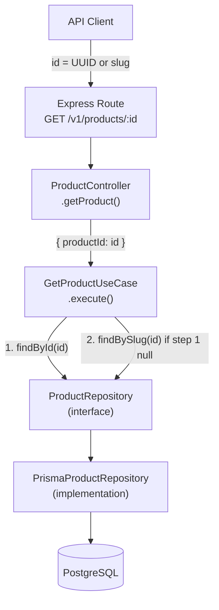
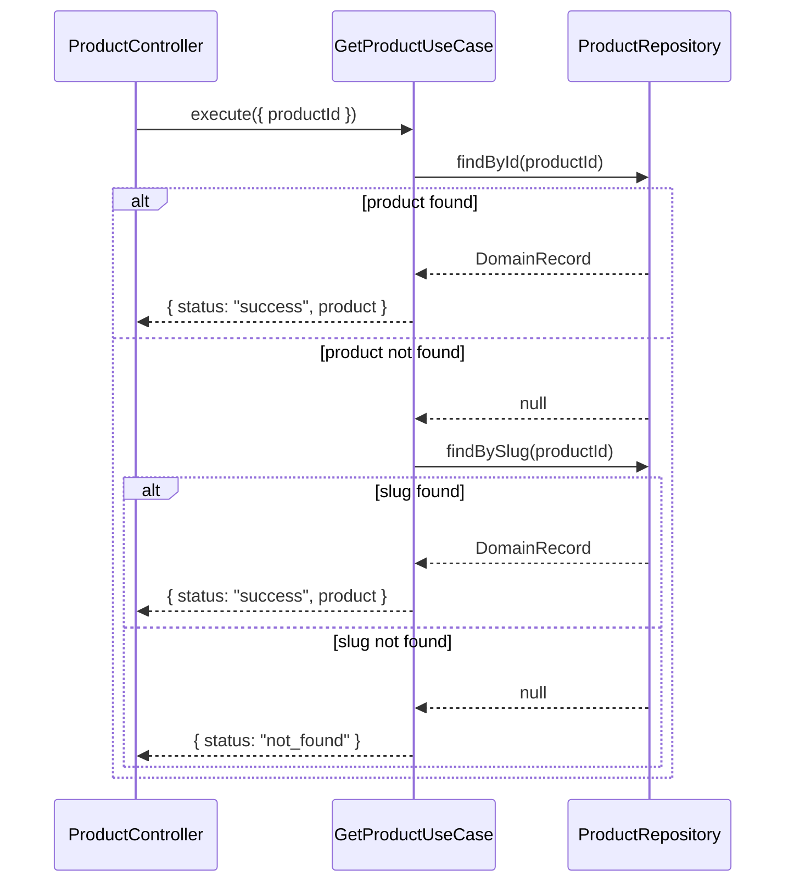

# Design Document — product-identifier-resolution

## Overview

The `GET /v1/products/:id` endpoint is documented as accepting both a system UUID and a
human-readable slug, but the implementation only calls `findById`. A separate
`getProductBySlug` controller method exists as dead code: it bypasses the repository layer,
accesses raw Prisma directly, and has no route registered for it.

This design closes that gap with minimal, targeted changes:

1. Add `findBySlug` to the `ProductRepository` interface so every future implementation
   must declare it.
2. Extend `GetProductUseCase.execute()` with a two-step resolution: try `findById` first,
   fall back to `findBySlug` only when the primary lookup returns null.
3. Delete the dead `getProductBySlug` controller method.

No new endpoints, routes, or database migrations are required. The controller layer is
unchanged beyond removing dead code.

---

## Architecture

### High-Level Component Diagram



### Resolution Flow



**Key invariants:**
- `findBySlug` is called only when `findById` returns null (no wasted queries).
- The controller passes the raw `:id` path parameter unchanged — no pre-processing, no
  format sniffing.
- The response DTO shape is identical regardless of which resolution path was taken.

---

## Components and Interfaces

### 1. `ProductRepository` interface (`domain/interfaces.ts`)

Add one method declaration:

```typescript
/**
 * Find a published product by its URL slug.
 * @param slug URL-safe product slug
 * @returns Promise resolving to product or null
 */
findBySlug(slug: string): Promise<DomainRecord | null>;
```

The `CategoryRepository` already declares an analogous `findBySlug` — this follows the
same pattern.

### 2. `PrismaProductRepository` (`infrastructure/repositories/prisma-product.repository.ts`)

No changes needed. The class already has a well-implemented `findBySlug` that queries
`status: { in: ['published', 'updated'] }` and includes category, variants, and media
enrichment. Adding `findBySlug` to the interface makes the existing implementation
formally compliant.

### 3. `GetProductUseCase` (`application/use-cases/get-product.use-case.ts`)

The `execute()` method currently has this shape:

```typescript
async execute(request: GetProductRequest): Promise<GetProductResponse> {
  // ...
  const product = await this.productRepository.findById(request.productId);
  if (!product) {
    return { status: 'not_found', message: 'Product not found' };
  }
  // ...
}
```

After the change:

```typescript
async execute(request: GetProductRequest): Promise<GetProductResponse> {
  // ...
  let product = await this.productRepository.findById(request.productId);
  if (!product) {
    product = await this.productRepository.findBySlug(request.productId);
  }
  if (!product) {
    return { status: 'not_found', message: 'Product not found' };
  }
  // ...
}
```

The rest of `execute()` and all of `buildProductDetails()` are unchanged.

### 4. `ProductController` (`api/controllers/product.controller.ts`)

- **Delete** the `getProductBySlug()` method entirely (dead code, ~80 lines).
- **No changes** to `getProduct()` — it already passes `req.params.id` directly to the
  use case without modification.

**Reference pattern — `SellerStorefrontController.getSellerDetails`:**
That method first resolves a slug to a `sellerId`, then re-queries by `sellerId`. For
products we do not need that two-step indirection because `findBySlug` returns the full
product record directly (including all enrichments). The resolution is single-pass.

---

## Data Models

No schema changes. No new tables, columns, or migrations.

The relevant existing Prisma schema fields:

```
model Product {
  id     String  @id
  slug   String? @unique
  status String  // enum: draft | pending | published | updated | suspended | archived
  ...
}
```

`findBySlug` already filters on `status IN ('published', 'updated')`, which is the
correct published-state predicate. Draft and archived products are never accessible by
slug — this is an existing invariant that the feature preserves.

---

## Correctness Properties

*A property is a characteristic or behavior that should hold true across all valid
executions of a system — essentially, a formal statement about what the system should do.
Properties serve as the bridge between human-readable specifications and
machine-verifiable correctness guarantees.*

### Property 1: ID–Slug Round-Trip Consistency

*For any* product record seeded into the repository, the `GetProductUseCase` SHALL return
the same product whether the caller supplies the product's System_ID or its Slug as the
`productId` parameter. Specifically:
- Calling with `productId = product.id` (ID path) must return `status: "success"` and
  `product.id === seededProduct.id`.
- Calling with `productId = product.slug` (slug path, where `findById` returns null but
  `findBySlug` returns the product) must return `status: "success"` and
  `product.id === seededProduct.id`.

**Validates: Requirements 2.1, 2.3, 5.1, 5.2, 5.3, 4.5**

---

### Property 2: Fallback Is Invoked If and Only If `findById` Returns Null

*For any* identifier string and repository state:
- If `findById` returns a non-null product, `findBySlug` SHALL NOT be called (zero calls).
- If `findById` returns null, `findBySlug` SHALL be called exactly once with the same
  identifier string.

**Validates: Requirements 2.2, 5.4**

---

### Property 3: Unknown Identifiers Always Yield `not_found`

*For any* identifier that matches neither a System_ID nor a Slug in the repository (both
`findById` and `findBySlug` return null), `GetProductUseCase.execute()` SHALL return
`{ status: "not_found" }`.

**Validates: Requirements 2.4, 4.3**

---

## Error Handling

| Scenario | Behavior |
|---|---|
| `productId` is empty string | Return `{ status: 'error', message: 'Product ID is required' }` — existing guard, unchanged |
| `findById` throws | Caught by the top-level try/catch in `execute()`; returns `{ status: 'error' }` |
| `findBySlug` throws | Same try/catch; returns `{ status: 'error' }` |
| Both return null | Returns `{ status: 'not_found' }` |
| Product found by either path | Proceeds to `buildProductDetails()` as before |

No new error codes. The error contract is identical to the current implementation for all
callers.

---

## Testing Strategy

### Unit Tests

Extend the existing test file
`services/catalog-service/src/application/use-cases/__tests__/get-product.use-case.test.ts`
with example-based tests that cover:

- **ID hit**: `findById` returns a product → `status: 'success'`, `findBySlug` not called.
- **Slug hit**: `findById` returns null, `findBySlug` returns product → `status: 'success'`.
- **Total miss**: both return null → `status: 'not_found'`.
- **Controller wiring**: `getProduct` passes `:id` unchanged to use case (existing test,
  no change needed).

For the mock, extend the existing `jest.Mocked<ProductRepository>` with `findBySlug`:

```typescript
mockProductRepository = {
  save: jest.fn(),
  findById: jest.fn(),
  findBySlug: jest.fn(),   // NEW
  findBySeller: jest.fn(),
  findByCategory: jest.fn(),
  search: jest.fn(),
  updateStatus: jest.fn(),
  delete: jest.fn()
};
```

### Property-Based Tests

**File:**
`services/catalog-service/src/application/use-cases/__tests__/get-product-identifier-resolution.properties.test.ts`

**Framework:** Jest with a hand-rolled `forAll` helper (matching the pattern in
`review-properties.test.ts` — no external PBT library needed, keeping the dependency
footprint identical).

**In-Memory Mock Repository:**

```typescript
class InMemoryProductRepository implements ProductRepository {
  private readonly byId   = new Map<string, DomainRecord>();
  private readonly bySlug = new Map<string, DomainRecord>();
  public findBySlugCallCount = 0;

  seed(product: DomainRecord & { id: string; slug: string }) {
    this.byId.set(product.id, product);
    this.bySlug.set(product.slug, product);
  }

  async findById(id: string)   { return this.byId.get(id)   ?? null; }
  async findBySlug(slug: string) {
    this.findBySlugCallCount++;
    return this.bySlug.get(slug) ?? null;
  }

  // Unused stubs
  save = async (p: DomainRecord) => p;
  findBySeller = async () => [];
  findByCategory = async () => [];
  search = async () => ({} as DomainRecord);
  updateStatus = async (id: string, s: string) => ({} as DomainRecord);
  delete = async () => true;
}
```

**Product Generator:**

```typescript
function randomProduct(): DomainRecord & { id: string; slug: string } {
  const suffix = Math.random().toString(36).slice(2, 10);
  return {
    id:          `prod_${suffix}`,
    slug:        `product-slug-${suffix}`,
    sellerId:    `seller_${suffix}`,
    name:        `Product ${suffix}`,
    description: `Description ${suffix}`,
    price:       { amount: Math.floor(Math.random() * 100_000) + 100, currency: 'TZS' },
    categoryId:  `cat_${suffix}`,
    type:        'physical',
    tags:        [],
    attributes:  {},
    status:      'published',
    createdAt:   new Date(),
    updatedAt:   new Date(),
  };
}
```

**Property test structure (100 iterations each):**

```
Property 1: ID–Slug Round-Trip Consistency
  - Generate N random products (N ∈ [1, 20])
  - Seed all into InMemoryProductRepository
  - Pick one product at random
  - Assert: execute({ productId: product.id })   → status 'success', result id matches
  - Assert: execute({ productId: product.slug })  → status 'success', result id matches
    (requires findById to return null for the slug string, then findBySlug to find it)

Property 2: Fallback Invoked Iff findById Returns Null
  - Generate a random product, seed it
  - Execute with product.id → assert findBySlugCallCount === 0
  - Reset count; execute with product.slug → assert findBySlugCallCount === 1

Property 3: Unknown Identifiers Always Yield not_found
  - Generate a random string that is guaranteed not in the repository
    (e.g., 'unknown-' + random suffix never seeded)
  - Execute with that identifier
  - Assert result.status === 'not_found'
```

**Tag format** (comment above each `describe` block):
```
// Feature: product-identifier-resolution, Property N: <property_text>
```

Each property runs **100 iterations** via the `forAll` helper.

### Integration Tests

Integration tests for `PrismaProductRepository.findBySlug` (in the existing integration
test suite) should cover:

- A product with `status: 'published'` is returned by `findBySlug`.
- A product with `status: 'draft'` is NOT returned by `findBySlug` (returns null).
- A slug that does not exist returns null.

These are 3 example-based tests — no PBT needed because the behavior is deterministic
and doesn't vary meaningfully with input variation.
