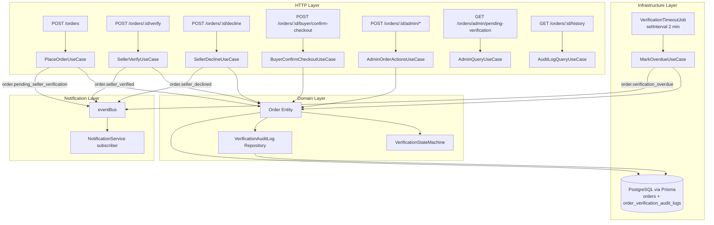
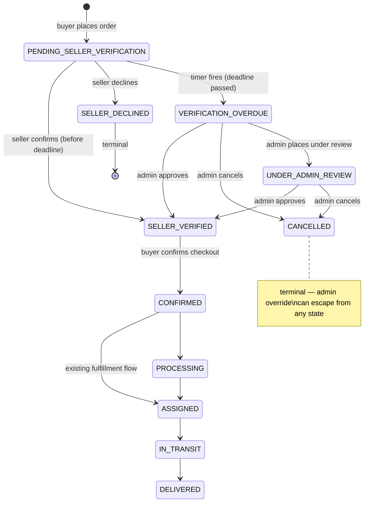

# Design Document: Seller Stock Verification

## Overview

This feature inserts a mandatory seller confirmation step into the Maysar Express order lifecycle. Before any payment is processed, the assigned seller must confirm stock availability within a 30-minute window. All logic lives inside the existing `order-service` module, consistent with the monolith's DDD layering. No new microservice is created.

**Key design decisions:**

1. **Deferred payment**: Wallet debit and COD commitment are moved from `PlaceOrderUseCase` to the new `BuyerConfirmCheckoutUseCase`. The existing `deferPayment` flag pattern is extended to always be `true` for the new flow.
2. **Atomic audit**: Every status transition and the matching `order_VerificationAuditLog` write happen inside a single Prisma transaction, guaranteeing log integrity.
3. **In-process timer**: `VerificationTimeoutJob` uses `setInterval` at 2-minute intervals, consistent with the existing `CODTrustBackfillJob` and `RollingAverageJob` patterns.
4. **State-machine enforcement**: A `VerificationStateMachine` value-object owns the full allowed-transitions table and is the single guard for all status changes.
5. **Configuration at creation time**: The timeout duration is read once at order creation and stored on the order row, so later config changes do not rewind in-flight orders.

---

## Architecture



### Status Transition Diagram



**Valid transition table** (enforced by `VerificationStateMachine`):

| From | To | Actor |
|------|----|-------|
| `PENDING_SELLER_VERIFICATION` | `SELLER_VERIFIED` | seller |
| `PENDING_SELLER_VERIFICATION` | `SELLER_DECLINED` | seller |
| `PENDING_SELLER_VERIFICATION` | `VERIFICATION_OVERDUE` | system |
| `SELLER_VERIFIED` | `CONFIRMED` | buyer |
| `VERIFICATION_OVERDUE` | `SELLER_VERIFIED` | admin |
| `VERIFICATION_OVERDUE` | `CANCELLED` | admin |
| `VERIFICATION_OVERDUE` | `UNDER_ADMIN_REVIEW` | admin |
| `UNDER_ADMIN_REVIEW` | `SELLER_VERIFIED` | admin |
| `UNDER_ADMIN_REVIEW` | `CANCELLED` | admin |
| `CONFIRMED` | `ASSIGNED` | system |
| `CONFIRMED` | `PROCESSING` | system |
| `PROCESSING` | `ASSIGNED` | system |
| `ASSIGNED` | `IN_TRANSIT` | system |
| `IN_TRANSIT` | `DELIVERED` | system |
| `(any)` | `(any)` | admin-override (mandatory reason) |

---

## Components and Interfaces

### 1. Domain: `OrderStatus` enum extensions

Extend `services/order-service/src/domain/entities/order.entity.ts`:

```typescript
export enum OrderStatus {
  // Existing
  PENDING = 'pending',
  CONFIRMED = 'confirmed',
  PROCESSING = 'processing',
  ASSIGNED = 'assigned',
  SHIPPED = 'shipped',
  IN_TRANSIT = 'in_transit',
  DELIVERED = 'delivered',
  CANCELLED = 'cancelled',

  // New
  PENDING_SELLER_VERIFICATION = 'pending_seller_verification',
  SELLER_VERIFIED             = 'seller_verified',
  SELLER_DECLINED             = 'seller_declined',
  VERIFICATION_OVERDUE        = 'verification_overdue',
  UNDER_ADMIN_REVIEW          = 'under_admin_review',
}
```

### 2. Domain: `VerificationStateMachine`

New file: `services/order-service/src/domain/state-machine/verification-state-machine.ts`

Pure value-object. No I/O. Owns the allowed-transitions table and exposes:

```typescript
export interface TransitionResult {
  allowed: boolean;
  error?: string;
  allowedTransitions?: OrderStatus[];
}

export class VerificationStateMachine {
  static canTransition(from: OrderStatus, to: OrderStatus, actor: 'buyer' | 'seller' | 'system' | 'admin'): TransitionResult;
  static getAllowedTransitions(from: OrderStatus): OrderStatus[];
}
```

Returns `{ allowed: false, error, allowedTransitions }` when a transition is invalid so the controller can return a structured 422 response.

### 3. Domain: `VerificationAuditLog` entity and repository

New file: `services/order-service/src/domain/entities/verification-audit-log.entity.ts`

```typescript
export type AuditActor = 'buyer' | 'seller' | 'system' | 'admin';
export type AuditEntryType = 'STATUS_TRANSITION' | 'ADMIN_ACTION' | 'ADMIN_OVERRIDE';

export interface VerificationAuditLogEntry {
  id: string;
  orderId: string;
  entryType: AuditEntryType;
  actorType: AuditActor;
  actorId?: string;          // userId of buyer/seller/admin; undefined for system
  previousStatus: OrderStatus;
  newStatus: OrderStatus;
  reason?: string;           // mandatory for ADMIN_OVERRIDE
  notes?: string;
  timestamp: Date;
}
```

New repository interface: `services/order-service/src/domain/repositories/verification-audit-log.repository.ts`

```typescript
export interface VerificationAuditLogRepository {
  append(entry: VerificationAuditLogEntry): Promise<void>;
  findByOrderId(orderId: string): Promise<VerificationAuditLogEntry[]>;
}
```

### 4. Domain: `Order` entity additions

Add to the `Order` entity:

```typescript
verificationDeadlineAt?: Date;   // createdAt + configuredTimeoutMinutes
verificationTimeoutMinutes?: number; // snapshot of config at creation time
```

Extend `canBeCancelled()`:
```typescript
canBeCancelled(): boolean {
  return [
    OrderStatus.PENDING,
    OrderStatus.CONFIRMED,
    OrderStatus.PENDING_SELLER_VERIFICATION,
    OrderStatus.SELLER_VERIFIED,
    OrderStatus.VERIFICATION_OVERDUE,
    OrderStatus.UNDER_ADMIN_REVIEW,
  ].includes(this.status);
}
```

### 5. Application: Use Cases

All use cases follow the existing pattern: constructor-injected dependencies, single `execute(input)` method.

#### 5.1 Modified `PlaceOrderUseCase`

- Read `seller_verification_timeout_minutes` from config (default 30).
- Create order with `status = PENDING_SELLER_VERIFICATION`.
- Set `verificationDeadlineAt = createdAt + timeoutMinutes`.
- Skip wallet debit and COD commitment (always `deferPayment = true` now).
- Persist order + initial audit log entry in one Prisma transaction.
- Publish `order.pending_seller_verification` event to `eventBus`.

#### 5.2 `SellerVerifyStockUseCase`

File: `services/order-service/src/application/use-cases/seller-verify-stock.use-case.ts`

```typescript
export interface SellerVerifyStockInput {
  orderId: string;
  sellerId: string;
}
export interface SellerVerifyStockOutput {
  orderId: string;
  newStatus: OrderStatus;
}
```

Logic:
1. Load order; 404 if not found.
2. Assert `order.sellerId === sellerId`; 403 if not.
3. `VerificationStateMachine.canTransition(order.status, SELLER_VERIFIED, 'seller')` → 422 if not allowed.
4. Check `now <= verificationDeadlineAt`; 422 with deadline-expired message if past.
5. In transaction: update order status + append audit log entry.
6. Publish `order.seller_verified` event.

#### 5.3 `SellerDeclineStockUseCase`

File: `services/order-service/src/application/use-cases/seller-decline-stock.use-case.ts`

Same shape as above but transitions to `SELLER_DECLINED`.

#### 5.4 `BuyerConfirmCheckoutUseCase`

File: `services/order-service/src/application/use-cases/buyer-confirm-checkout.use-case.ts`

```typescript
export interface BuyerConfirmCheckoutInput {
  orderId: string;
  buyerId: string;
}
```

Logic:
1. Load order; 404 if not found.
2. Assert `order.buyerId === buyerId`; 403 if not.
3. `VerificationStateMachine.canTransition(order.status, CONFIRMED, 'buyer')` → 422 if not allowed.
4. Branch on `paymentMethod`:
   - **COD**: run existing COD eligibility checks and place commitment hold.
   - **WALLET**: debit buyer wallet.
   - **CARD/MOBILE_PAYMENT**: initiate payment gateway flow.
5. On payment success: in transaction, update order status to `CONFIRMED` + append audit log entry.
6. On payment failure: do NOT change order status; return 402 payment-failure error.

#### 5.5 `MarkOrdersOverdueUseCase`

File: `services/order-service/src/application/use-cases/mark-orders-overdue.use-case.ts`

Called by `VerificationTimeoutJob`. Performs a single `findMany` for orders with `status = PENDING_SELLER_VERIFICATION AND verificationDeadlineAt < now`, then for each:
- In transaction: update status to `VERIFICATION_OVERDUE` + append audit entry.
- Publish `order.verification_overdue` event (notification service subscribes for admin alert).

#### 5.6 `AdminOrderActionsUseCase`

File: `services/order-service/src/application/use-cases/admin-order-actions.use-case.ts`

Supports: `approve`, `cancel`, `placeUnderReview`, `override`.

All actions:
- Validate transition via `VerificationStateMachine`.
- In transaction: update order + append audit entry.

`override` additionally:
- Accepts `{ targetStatus, reason, notes }`.
- Requires non-empty `reason` (validated at controller level with Joi).
- Appends entry of type `ADMIN_OVERRIDE` with previous+new status.

#### 5.7 `AdminQueryUseCase`

File: `services/order-service/src/application/use-cases/admin-query.use-case.ts`

- `getPendingVerificationOrders()` → orders with `PENDING_SELLER_VERIFICATION`, includes `verificationDeadlineAt` and `timeRemainingSeconds`.
- `getOverdueOrders()` → orders with `VERIFICATION_OVERDUE`, includes `overdueBySeconds`.
- `getOrderHistory(orderId)` → audit log entries sorted ascending by `timestamp`.

### 6. Infrastructure: `PrismaVerificationAuditLogRepository`

File: `services/order-service/src/infrastructure/database/prisma-verification-audit-log.repository.ts`

Wraps `prisma.order_VerificationAuditLog`. The `append` method is designed to be called **inside** a caller-provided Prisma transaction (passed as a parameter) to achieve atomicity with order status updates.

```typescript
export class PrismaVerificationAuditLogRepository implements VerificationAuditLogRepository {
  async append(entry: VerificationAuditLogEntry, tx?: PrismaTransactionClient): Promise<void>;
  async findByOrderId(orderId: string): Promise<VerificationAuditLogEntry[]>;
}
```

### 7. Infrastructure: `VerificationTimeoutJob`

File: `services/order-service/src/infrastructure/jobs/verification-timeout.job.ts`

```typescript
export class VerificationTimeoutJob {
  private readonly POLL_INTERVAL_MS = 2 * 60 * 1000; // 2 minutes
  private timer?: ReturnType<typeof setInterval>;

  start(): void {
    this.timer = setInterval(() => this.tick(), this.POLL_INTERVAL_MS);
    this.tick(); // immediate first run
  }

  stop(): void {
    if (this.timer) clearInterval(this.timer);
  }

  private async tick(): Promise<void> {
    await this.markOrdersOverdueUseCase.execute();
  }
}
```

Started during application bootstrap alongside the existing catalog jobs.

### 8. Infrastructure: Order config

New file: `services/order-service/src/config/verification.config.ts`

```typescript
export const verificationConfig = {
  timeoutMinutes: Number(process.env.SELLER_VERIFICATION_TIMEOUT_MINUTES) || 30,
};
```

Read once at order creation and stored on the `Order` row as `verificationTimeoutMinutes`.

### 9. API: New routes and controller handlers

Routes added to `setupOrderRoutes()` in `order.routes.ts`. All go through existing `requireAuth` middleware; role checks are applied per route.

| Method | Path | Auth | Handler |
|--------|------|------|---------|
| POST | `/orders/:id/verify` | seller | `verifyStock` |
| POST | `/orders/:id/decline` | seller | `declineStock` |
| POST | `/orders/:id/buyer/confirm-checkout` | buyer | `buyerConfirmCheckout` |
| POST | `/orders/:id/admin/approve` | admin | `adminApprove` |
| POST | `/orders/:id/admin/cancel` | admin | `adminCancel` |
| POST | `/orders/:id/admin/review` | admin | `adminPlaceUnderReview` |
| POST | `/orders/:id/admin/override` | admin | `adminOverride` |
| GET | `/orders/admin/pending-verification` | admin | `getPendingVerification` |
| GET | `/orders/admin/overdue` | admin | `getOverdue` |
| GET | `/orders/:id/history` | admin | `getOrderHistory` |

Joi schemas are defined for each request body/params. `adminOverride` body schema includes `reason: Joi.string().min(1).required()`.

### 10. Domain Events published to `eventBus`

| Event type | Published when | Key payload fields |
|-----------|---------------|-------------------|
| `order.pending_seller_verification` | order created | `orderId`, `sellerId`, `buyerId`, `items`, `verificationDeadlineAt` |
| `order.seller_verified` | seller confirms | `orderId`, `sellerId`, `buyerId`, `verificationDeadlineAt` |
| `order.seller_declined` | seller declines | `orderId`, `sellerId`, `buyerId` |
| `order.verification_overdue` | timer fires | `orderId`, `sellerId`, `buyerId`, `verificationDeadlineAt`, `overdueByMs` |

The notification service subscribes to all four event types and sends appropriate push/email/SMS messages per the existing subscription model.

---

## Data Models

### Prisma schema additions

#### `Order_Order` model additions

```prisma
model Order_Order {
  // ... existing fields ...

  // New fields for seller verification
  verificationDeadlineAt    DateTime?
  verificationTimeoutMinutes Int?     @default(30)

  // Relations
  verificationAuditLogs     Order_VerificationAuditLog[]
}
```

#### New `Order_VerificationAuditLog` model

```prisma
model Order_VerificationAuditLog {
  id             String      @id @default(cuid()) @db.VarChar(64)
  orderId        String      @db.VarChar(64)
  entryType      String      @db.VarChar(32)  // STATUS_TRANSITION | ADMIN_ACTION | ADMIN_OVERRIDE
  actorType      String      @db.VarChar(16)  // buyer | seller | system | admin
  actorId        String?     @db.VarChar(64)
  previousStatus String      @db.VarChar(64)
  newStatus      String      @db.VarChar(64)
  reason         String?
  notes          String?
  timestamp      DateTime    @default(now())

  order          Order_Order @relation(fields: [orderId], references: [id], onDelete: Cascade)

  @@index([orderId, timestamp])
  @@map("order_verification_audit_logs")
}
```

#### Updated `Order_OrderStatus` enum

```prisma
enum Order_OrderStatus {
  PENDING
  CONFIRMED
  PROCESSING
  ASSIGNED
  IN_TRANSIT
  DELIVERED
  CANCELLED
  PENDING_SELLER_VERIFICATION
  SELLER_VERIFIED
  SELLER_DECLINED
  VERIFICATION_OVERDUE
  UNDER_ADMIN_REVIEW
}
```

### TypeScript data shapes

#### `VerificationAuditLogEntry`

```typescript
{
  id: string;
  orderId: string;
  entryType: 'STATUS_TRANSITION' | 'ADMIN_ACTION' | 'ADMIN_OVERRIDE';
  actorType: 'buyer' | 'seller' | 'system' | 'admin';
  actorId?: string;
  previousStatus: OrderStatus;
  newStatus: OrderStatus;
  reason?: string;
  notes?: string;
  timestamp: Date;
}
```

#### `PlaceOrderResponse` additions

```typescript
{
  orderId: string;
  status: 'PENDING_SELLER_VERIFICATION';
  trackingNumber?: string;
  verificationDeadlineAt: string; // ISO-8601 UTC
  nextAction: 'AWAIT_VERIFICATION';
}
```

#### `GET /orders/:id` buyer-visible response additions

```typescript
{
  // ... existing fields ...
  verificationDeadlineAt?: string;
  verificationDeadlineRemainingSeconds?: number;   // only when PENDING_SELLER_VERIFICATION
  checkoutAvailable: boolean;
  checkoutPath?: 'COD_COMMITMENT' | 'FULL_PAYMENT'; // only when checkoutAvailable === true
  nextAction: 'AWAIT_VERIFICATION' | 'PROCEED_TO_CHECKOUT' | 'CONTACT_SUPPORT';
}
```

---

## Correctness Properties

*A property is a characteristic or behavior that should hold true across all valid executions of a system — essentially, a formal statement about what the system should do. Properties serve as the bridge between human-readable specifications and machine-verifiable correctness guarantees.*

### Property 1: Audit log monotonicity

*For any* order, after any sequence of valid status transitions, the count of entries in `order_VerificationAuditLog` for that order must be greater than or equal to the count before any transition was applied. The count is non-decreasing: no transition may reduce the number of audit entries.

**Validates: Requirements 13.3**

---

### Property 2: No payment before seller verification

*For any* order in `PENDING_SELLER_VERIFICATION` status, the order must have zero associated wallet debit transactions, zero COD commitment hold records, and zero `Order_Payment` rows with `status = COMPLETED`.

**Validates: Requirements 1.3, 5.1, 6.1, 9.1**

---

### Property 3: State-machine validity

*For any* attempted status transition, if the `(fromStatus, toStatus, actor)` triple is not present in the allowed-transitions table, then `VerificationStateMachine.canTransition` must return `{ allowed: false }` and the order status must remain unchanged after the call.

**Validates: Requirements 3.3, 3.4, 4.3, 5.4, 6.4, 10.5**

---

### Property 4: Deadline integrity

*For any* order created via `PlaceOrderUseCase`, the stored `verificationDeadlineAt` must equal `createdAt` plus exactly `verificationTimeoutMinutes` minutes (within 1 second tolerance for execution time). This must hold regardless of what value `seller_verification_timeout_minutes` is configured to.

**Validates: Requirements 1.2, 14.1, 14.2, 14.3**

---

## Error Handling

### 4xx errors returned by new endpoints

| Condition | HTTP status | Error code |
|-----------|-------------|------------|
| Order not found | 404 | `ORDER_NOT_FOUND` |
| Seller is not the seller on the order | 403 | `FORBIDDEN` |
| Transition not valid for current status | 422 | `INVALID_STATUS_TRANSITION` |
| Verification deadline has passed | 422 | `VERIFICATION_DEADLINE_EXPIRED` |
| Buyer checkout on non-`SELLER_VERIFIED` order | 422 | `INVALID_STATUS_TRANSITION` |
| Admin override missing reason | 422 | `VALIDATION_ERROR` |
| Payment failure on checkout | 402 | `PAYMENT_FAILED` |

### Notification delivery failures

Per Requirements 2.3 and 8.3: if `eventBus.publish()` throws, the error is caught, logged via `logger.error()`, and the order status is **not** rolled back. Notification failures are non-fatal.

Pattern:
```typescript
try {
  await this.eventBus.publish('order.pending_seller_verification', payload);
} catch (err) {
  logger.error('[SellerVerification] Notification delivery failed', { orderId, err });
  // Do not rethrow — notification failure does not affect order state
}
```

### Timer errors

`VerificationTimeoutJob.tick()` catches all errors per-order. One failing order must not prevent other overdue orders from being processed in the same tick. This mirrors the pattern in `RollingAverageJob`.

### Transactional atomicity

All use cases that write both an order status update and an audit log entry use Prisma interactive transactions:

```typescript
await prisma.$transaction(async (tx) => {
  await tx.order_Order.update({ where: { id: orderId }, data: { status: newStatus } });
  await tx.order_VerificationAuditLog.create({ data: auditEntry });
});
```

If either write fails, both are rolled back (Requirement 13.4).

---

## Testing Strategy

### Dual testing approach

Both unit/example-based tests and property-based tests are used.

### Property-based testing

PBT applies to this feature because it involves:
- A state machine with well-defined transition rules (pure logic)
- An audit log with monotonicity invariants (universal, input-independent)
- A deadline calculation (pure arithmetic)
- Payment-gate invariants that must hold across arbitrary order states

**Library**: [fast-check](https://fast-check.dev/) — standard PBT library for TypeScript.

**Minimum iterations**: 100 per property test.

**Test file**: `services/order-service/src/__tests__/seller-stock-verification.property.test.ts`

**Tag format**: `// Feature: seller-stock-verification, Property {N}: {property_text}`

#### Property 1 test outline — Audit log monotonicity
```
// Feature: seller-stock-verification, Property 1: Audit log monotonicity
fc.assert(fc.asyncProperty(
  fc.array(fc.constantFrom(...validTransitionSequence)),
  async (transitions) => {
    const order = createOrderInPSV();
    let previousCount = 0;
    for (const t of transitions) {
      await applyTransition(order, t);
      const currentCount = await auditRepo.findByOrderId(order.id).then(e => e.length);
      expect(currentCount).toBeGreaterThanOrEqual(previousCount);
      previousCount = currentCount;
    }
  }
), { numRuns: 100 });
```

#### Property 2 test outline — No payment before verify
```
// Feature: seller-stock-verification, Property 2: No payment before seller verification
fc.assert(fc.asyncProperty(
  arbitraryOrderInPendingSellerVerification(),
  async (order) => {
    const payments = await paymentRepo.findByOrderId(order.id);
    const completedPayments = payments.filter(p => p.status === 'COMPLETED');
    expect(completedPayments).toHaveLength(0);
    expect(order.codCommitmentPaid).toBe(false);
    expect(order.codCommitmentHoldId).toBeUndefined();
  }
), { numRuns: 100 });
```

#### Property 3 test outline — State-machine validity
```
// Feature: seller-stock-verification, Property 3: State-machine validity
fc.assert(fc.property(
  arbitraryOrderStatus(),
  arbitraryOrderStatus(),
  arbitraryActor(),
  (from, to, actor) => {
    const result = VerificationStateMachine.canTransition(from, to, actor);
    const isInTable = ALLOWED_TRANSITIONS.some(t => t.from === from && t.to === to && t.actor === actor);
    expect(result.allowed).toBe(isInTable);
  }
), { numRuns: 500 });
```

#### Property 4 test outline — Deadline integrity
```
// Feature: seller-stock-verification, Property 4: Deadline integrity
fc.assert(fc.asyncProperty(
  fc.integer({ min: 1, max: 180 }), // timeout in minutes
  fc.date(),                         // arbitrary creation timestamp
  async (timeoutMinutes, createdAt) => {
    process.env.SELLER_VERIFICATION_TIMEOUT_MINUTES = String(timeoutMinutes);
    const order = await placeOrderAt(createdAt);
    const expectedDeadline = new Date(createdAt.getTime() + timeoutMinutes * 60_000);
    const diff = Math.abs(order.verificationDeadlineAt!.getTime() - expectedDeadline.getTime());
    expect(diff).toBeLessThan(1_000); // within 1 second
  }
), { numRuns: 100 });
```

### Unit and integration tests

In addition to property tests, the following example-based tests are written:

- `PlaceOrderUseCase` — verifies order is created with `PENDING_SELLER_VERIFICATION`, `verificationDeadlineAt` is set, no wallet debit or COD hold occurs.
- `SellerVerifyStockUseCase` — happy path, wrong seller (403), expired deadline (422), wrong status (422).
- `SellerDeclineStockUseCase` — happy path, wrong seller, wrong status.
- `BuyerConfirmCheckoutUseCase` — COD path, WALLET path, payment failure keeps `SELLER_VERIFIED`, wrong status.
- `AdminOrderActionsUseCase` — approve overdue, cancel overdue, place under review, admin override with and without reason.
- `VerificationTimeoutJob` — one overdue order is transitioned, timer calls `MarkOrdersOverdueUseCase.execute()`.
- `VerificationStateMachine` — boundary: all allowed transitions return `allowed: true`; all forbidden transitions return `allowed: false`.
- `AdminQueryUseCase` — pending-verification list includes `timeRemainingSeconds`; overdue list includes `overdueBySeconds`; history is sorted ascending.
- Audit log transactional atomicity — simulate a transaction failure after order update and verify no orphaned audit entry.
