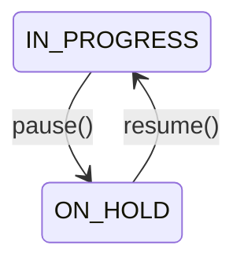

# Diagram Maintenance Guide

## Purpose

This guide ensures that modeling diagrams remain accurate and synchronized with code implementations throughout the development lifecycle.

## When to Update Diagrams

Update diagrams whenever you make changes to:

### 1. **Saga Orchestrations**
- Adding/removing saga steps
- Changing compensation logic
- Modifying event publishing
- Updating service integrations

**Action:** Update the corresponding sequence diagram in `docs/modeling/sequence/`

### 2. **Entity State Transitions**
- Adding new statuses to enums
- Changing state transition rules
- Modifying validation logic
- Adding/removing lifecycle methods

**Action:** Update the corresponding state machine diagram in `docs/modeling/state-machines/`

### 3. **Use Cases**
- Adding new features
- Changing user interactions
- Modifying actor relationships
- Adding/removing system integrations

**Action:** Update the use case diagram in `docs/modeling/use-cases/`

## How to Update Diagrams

### Step 1: Locate the Diagram
Find the relevant `.mmd` file in your service's `docs/modeling/` directory:
- State machines: `docs/modeling/state-machines/`
- Sequence diagrams: `docs/modeling/sequence/`
- Use cases: `docs/modeling/use-cases/`

### Step 2: Edit the Mermaid Syntax
Use Mermaid syntax to update the diagram. See templates in `docs/templates/` for examples.

### Step 3: Verify the Diagram
- Preview using Mermaid Live Editor: https://mermaid.live/
- Ensure diagram matches your code changes exactly
- Check that all participants/states are labeled correctly

### Step 4: Update the README
If you added a new diagram, update `docs/modeling/README.md` with a link and description.

## Diagram Verification Checklist

Before committing, verify:

- [ ] Diagram syntax is valid (no Mermaid errors)
- [ ] All saga steps are represented in sequence diagram
- [ ] All entity statuses match enum values in code
- [ ] Compensation logic is documented in saga diagrams
- [ ] Event names match actual event contracts
- [ ] README.md index is updated (if new diagram added)

## Common Mistakes to Avoid

### ❌ Don't
- Create diagrams that don't match the code
- Leave placeholder diagrams with "TODO" content
- Skip updating diagrams when changing sagas/entities
- Use incorrect state/event names
- Create diagrams for imaginary future features

### ✅ Do
- Keep diagrams synchronized with implementation
- Use actual enum values and event names from code
- Document compensation flows in sagas
- Update diagrams as part of your PR
- Remove outdated diagrams when removing features

## Tools and Resources

### Mermaid Resources
- [Mermaid Documentation](https://mermaid.js.org/)
- [Mermaid Live Editor](https://mermaid.live/)
- [State Diagram Syntax](https://mermaid.js.org/syntax/stateDiagram.html)
- [Sequence Diagram Syntax](https://mermaid.js.org/syntax/sequenceDiagram.html)

### Templates
See `docs/templates/` for:
- `saga-sequence-template.mmd` - Template for saga sequence diagrams
- `state-machine-template.mmd` - Template for entity state machines
- `use-case-template.mmd` - Template for use case diagrams

### Validation
Run the validation script to check diagram compliance:
```bash
npm run validate:diagrams
```

## PR Review Guidelines

### For Authors
Include in your PR description:
- List of diagrams updated
- Reason for diagram changes
- Link to related code changes

### For Reviewers
Verify:
- Diagrams match the code changes
- Mermaid syntax is valid
- Compensation logic is documented
- State transitions are correct
- README is updated if needed

## Examples

### Example 1: Adding a Saga Step

**Code Change:**
```typescript
// Added new fraud check step
await this.fraudEngine.assessTransaction(payment);
```

**Diagram Update:**
```mermaid
rect rgb(240, 240, 240)
    note right of Saga: FraudCheck Step
    Saga->>Fraud: assessTransaction()
    Fraud-->>Saga: Assessment Result
end
```

### Example 2: Adding Entity Status

**Code Change:**
```typescript
export enum OrderStatus {
    // ... existing statuses
    ON_HOLD = 'ON_HOLD', // NEW
}
```

**Diagram Update:**


## Questions?

For questions about diagram updates:
- Review the Software Modeling Constitution: `software-modeling-constitution.md`
- Check existing diagrams for patterns
- Ask in #engineering Slack channel

---

**Remember:** Diagrams are living documentation. Keep them accurate, or don't keep them at all.
