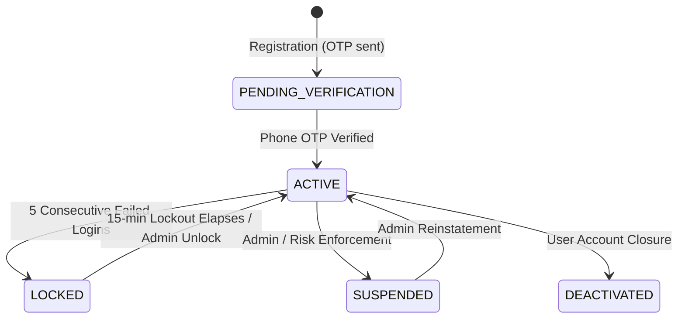
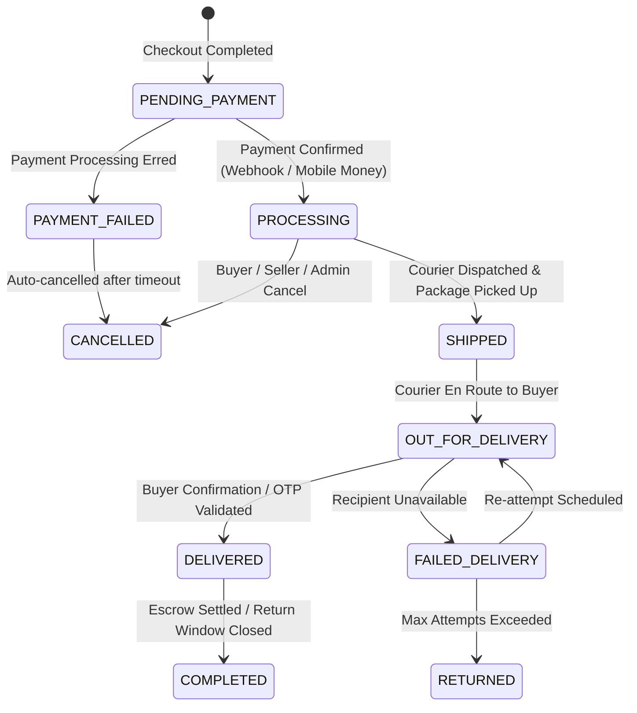
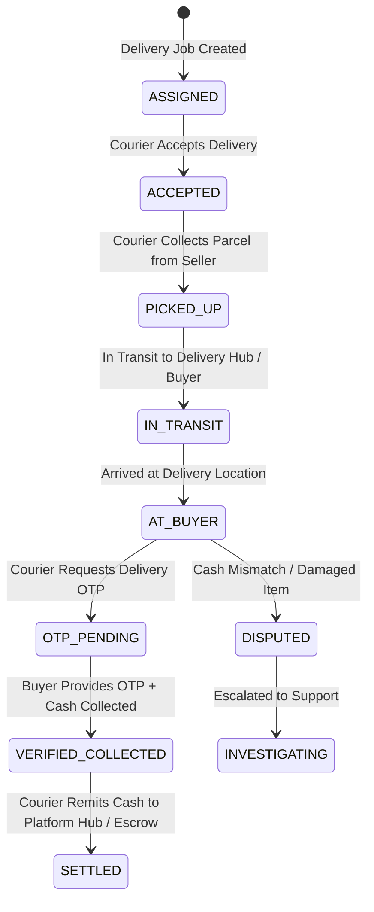
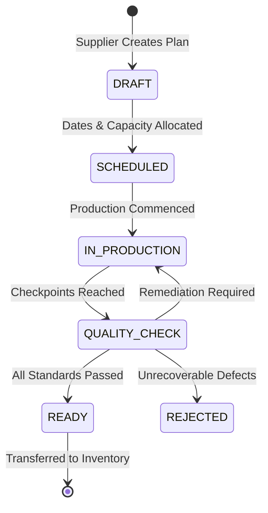
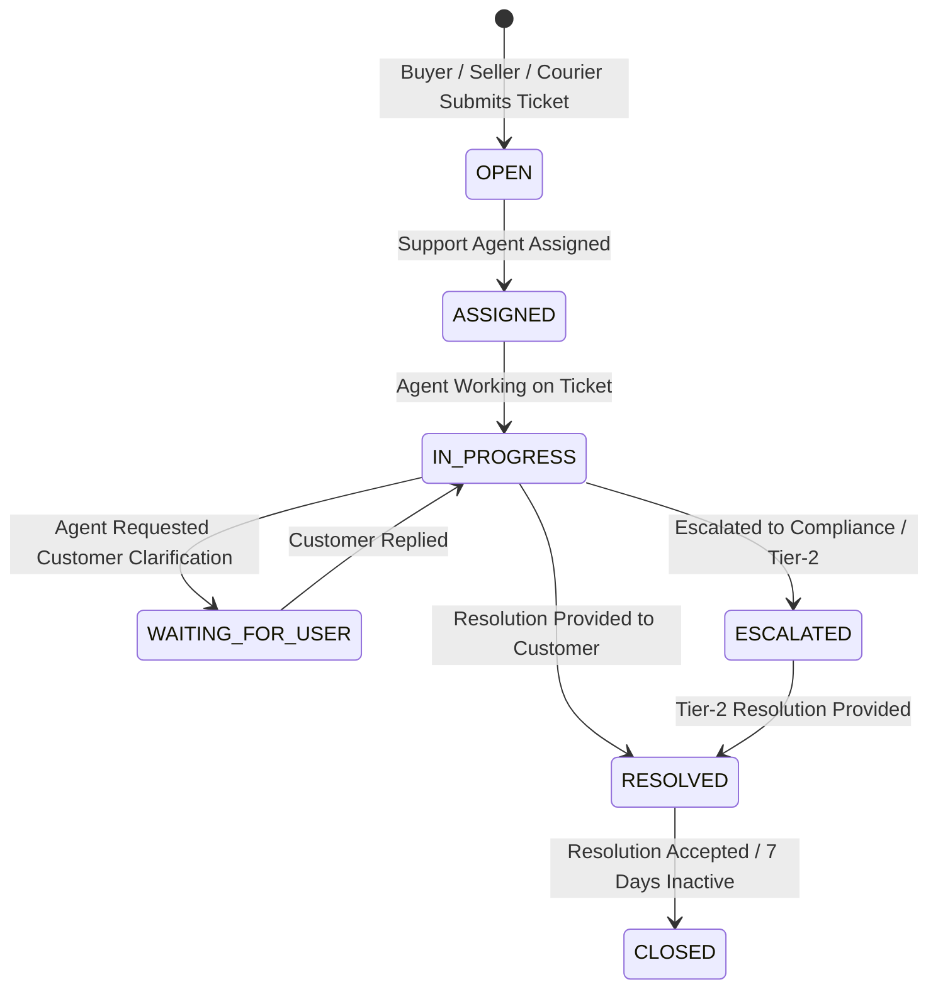
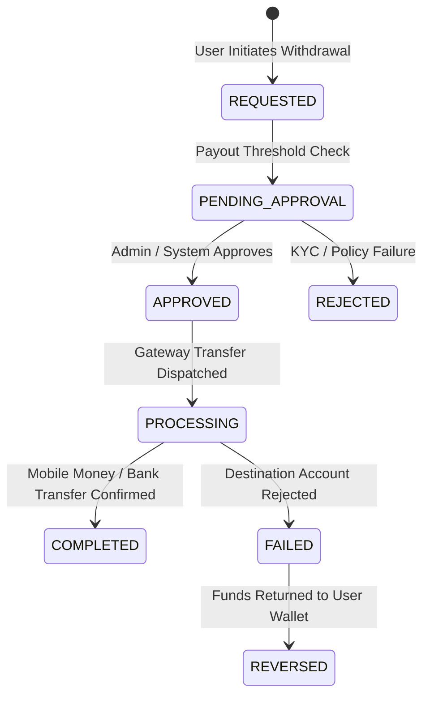

# State Transitions Reference

> **Generated:** September 2026
> **Scope:** Core Domain State Machines across Maysar Monolith Services

This document consolidates and specifies all verified entity state machines across the Maysar backend monolith. Every status transition in user flows and frontend guides adheres to the rules defined below.

---

## 1. Authentication & User Account Lifecycle

**Owner:** `auth-service` / `user-service`

### Valid Transitions
| From Status | To Status | Trigger / Action | Authorization |
|---|---|---|---|
| `[*]` | `PENDING_VERIFICATION` | `POST /api/auth/register` | Public |
| `PENDING_VERIFICATION` | `ACTIVE` | `POST /api/auth/phone/verify-otp` or Admin Bypass | User / Admin |
| `ACTIVE` | `LOCKED` | 5 Failed Logins within lockout window | System |
| `LOCKED` | `ACTIVE` | Lockout timer expires (15m) or `PATCH /api/auth/admin/users/:id/unlock` | System / Admin |
| `ACTIVE` | `SUSPENDED` | `PATCH /api/auth/admin/users/:id/suspend` | Admin |
| `SUSPENDED` | `ACTIVE` | Admin reinstatement | Admin |
| `ACTIVE` | `DEACTIVATED` | User initiates account deletion | User / Admin |

---

## 2. Order Lifecycle & Fulfillment

**Owner:** `order-service` / `logistics-service`

### Valid Transitions
| From Status | To Status | Trigger / Action | Authorization |
|---|---|---|---|
| `PENDING_PAYMENT` | `PROCESSING` | `payment.completed` event / Payment Gateway Webhook | System / Webhook |
| `PENDING_PAYMENT` | `PAYMENT_FAILED` | Payment Gateway rejection | System |
| `PROCESSING` | `SHIPPED` | Seller marks packaged & courier accepts job | Seller / Courier |
| `SHIPPED` | `OUT_FOR_DELIVERY` | Courier starts final delivery leg | Courier |
| `OUT_FOR_DELIVERY` | `DELIVERED` | `POST /api/logistics/api/v1/cod/:id/verify` (OTP match) | Courier |
| `DELIVERED` | `COMPLETED` | Return window expiration or buyer acceptance | System |
| `OUT_FOR_DELIVERY` | `FAILED_DELIVERY` | Delivery attempt failed | Courier |
| `FAILED_DELIVERY` | `RETURNED` | Package returned to seller / hub | Courier / Logistics |

---

## 3. Cash on Delivery (COD) Delivery & Settlement

**Owner:** `logistics-service` / `wallet-service`

---

## 4. Production Plan Lifecycle

**Owner:** `production-service`

### Valid Transitions
| From Status | To Status | Trigger / Action | Authorization |
|---|---|---|---|
| `DRAFT` | `SCHEDULED` | `PUT /api/production/plans/:id/status` (`status: SCHEDULED`) | Supplier |
| `SCHEDULED` | `IN_PRODUCTION` | `PUT /api/production/plans/:id/status` (`status: IN_PRODUCTION`) | Supplier |
| `IN_PRODUCTION` | `QUALITY_CHECK` | `POST /api/production/quality/checkpoints` | Supplier / Inspector |
| `QUALITY_CHECK` | `READY` | Final inspection approved | Quality Inspector |
| `QUALITY_CHECK` | `REJECTED` | Inspection failed standard thresholds | Quality Inspector |

---

## 5. Support Ticket & Dispute Resolution Lifecycle

**Owner:** `support-service`

### Valid Transitions
| From Status | To Status | Trigger / Action | Authorization |
|---|---|---|---|
| `OPEN` | `ASSIGNED` | `PATCH /api/support/tickets/:id/assign` | Admin / Agent |
| `ASSIGNED` | `IN_PROGRESS` | Agent sends response message | Support Agent |
| `IN_PROGRESS` | `WAITING_FOR_USER` | Agent requests info from user | Support Agent |
| `WAITING_FOR_USER` | `IN_PROGRESS` | User submits message | User |
| `IN_PROGRESS` | `RESOLVED` | `POST /api/support/tickets/:id/resolve` | Support Agent |
| `RESOLVED` | `CLOSED` | `POST /api/support/tickets/:id/close` | Support Agent / System |
| `IN_PROGRESS` | `ESCALATED` | `POST /api/support/tickets/:id/escalate` | Support Agent |

---

## 6. Payout Lifecycle

**Owner:** `payout-service`

