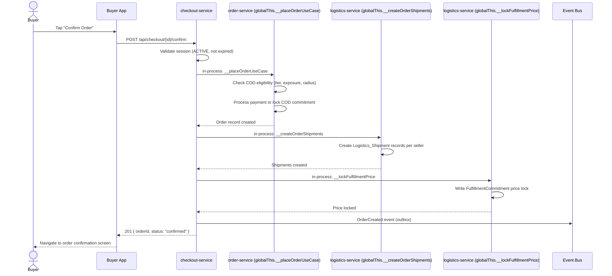

# Buyer Flows — Checkout Service

> **Verification status:** Partially Verified (confirm flow and session status Verified at data-level; cart surface contract-verified at the canonical `/api/checkout/cart/*` paths — live re-verification pending)
> **Verification basis:** `docs/FLOWS/_verification/analysis-report.md` (September 2026)
> **Last updated:** September 2026

---

> **⚠️ Conflicting/Obsolete endpoints (DEF-005):** The paths below were never mounted — the September 2026 live sweep returned **405 Method Not Allowed** for every one of them, because OpenAPI documented paths the router does not serve. Do not call them:
> - `POST /api/checkout/items`
> - `PATCH /api/checkout/items`
> - `DELETE /api/checkout/items`
> - `POST /api/checkout/merge`
> - `DELETE /api/checkout/{cartId}`
>
> The cart surface **is implemented** — it is served under the canonical prefix `/api/checkout/cart/*`: `POST|PATCH|DELETE /api/checkout/cart/items`, `POST /api/checkout/cart/merge`, `GET /api/checkout/cart/current`, `GET|DELETE /api/checkout/cart/{cartId}` (plus a legacy `/api/cart` alias). All of these are mounted, documented in `openapi.yaml`, and covered by `services/checkout-service/src/api/routes/checkout.routes.test.ts`; the contract ratchet (`scripts/contract/openapi-coverage.test.js`) guarantees the spec cannot drift from the mount again. The flows documented below remain the confirm and session-status flows; cart manipulation must use the canonical paths above.

---

## Overview

This document covers checkout-service flows from the buyer's perspective: confirming a checkout session to create an order, and retrieving current checkout session status. The checkout service orchestrates order creation, shipment creation, and price commitment in a single in-process chain triggered by confirmation. All inter-service calls during confirmation happen synchronously via `globalThis` hook registrations — not over HTTP.

---

## Flow Index

| # | Flow Name | Verification Status | Primary Endpoint |
|---|---|---|---|
| 1 | Checkout Confirmation | Partially Verified | `POST /api/checkout/{id}/confirm` |
| 2 | Get Checkout Session Status | Verified (data-level 404 observed) | `GET /api/checkout/{id}` |

---

## Flow 1: Checkout Confirmation

### Summary

| Field | Value |
|---|---|
| Actor | Buyer |
| Trigger | Buyer clicks "Confirm Order" on checkout review screen |
| Preconditions | Authenticated (Bearer JWT, buyer role); active checkout session with valid `quoteId`; cart is non-empty |
| Terminal states (success) | Order created; session status `CONFIRMED`; 201 with `{ orderId, status: "confirmed" }` |
| Terminal states (failure) | 404 (invalid session); 409 (quote already consumed); 402/422 (payment or eligibility failure); 422 (quote expired, COD ineligible, insufficient stock) |
| Verification status | Partially Verified |

### Happy Path

| Step | Actor/System | Action | Endpoint | Auth | Expected Response |
|---|---|---|---|---|---|
| 1 | Buyer | Has active checkout session with a valid `quoteId` | — | — | Session in `ACTIVE` state |
| 2 | Buyer | Clicks "Confirm Order" | — | — | UI disables confirm button immediately |
| 3 | Buyer | Submits confirmation request | `POST /api/checkout/{id}/confirm` | Bearer JWT | Request accepted |
| 4 | checkout-service | Validates session is `ACTIVE` and not expired | — | — | Session valid |
| 5 | checkout-service | In-process: calls `globalThis.__placeOrderUseCase` | — | — | Order created; COD eligibility checked; payment processed or COD commitment locked |
| 6 | checkout-service | In-process: calls `globalThis.__createOrderShipments` | — | — | `Logistics_Shipment` records created in logistics-service |
| 7 | checkout-service | In-process: calls `globalThis.__lockFulfillmentPrice` | — | — | `FulfillmentCommitment` price lock written in logistics-service |
| 8 | checkout-service | Publishes `OrderCreated` event to platform event bus | — | — | Event emitted via outbox |
| 9 | Buyer | Receives response | — | — | 201 `{ orderId, status: "confirmed" }` |

### Service Interaction Chain

The confirmation chain is triggered by a single HTTP request to checkout-service. All downstream calls are in-process via `globalThis` hook registrations set at service init time — not standalone HTTP calls between services.

```
POST /api/checkout/{id}/confirm
  → checkout-service validates session (ACTIVE, not expired)
  → globalThis.__placeOrderUseCase (order-service in-process)
      → creates order record
      → checks COD eligibility (buyer tier, exposure limits)
      → processes payment or locks COD wallet commitment
  → globalThis.__createOrderShipments (logistics-service in-process)
      → creates Logistics_Shipment records for each seller
  → globalThis.__lockFulfillmentPrice (logistics-service in-process)
      → writes FulfillmentCommitment price lock
  → publishes OrderCreated event (outbox → platform event bus)
  → returns 201 { orderId, status: "confirmed" }
```

**`shippingCostTzs` — CRITICAL:** The shipping cost is NEVER read from the client-supplied confirm request body. It is always read from the validated quote record retrieved from logistics-service via the internal quote validation endpoint (`GET /api/logistics/internal/quotes/:quoteId`). The frontend must NOT pass a `shippingCost` value in the confirm request body expecting it to be used. It will be ignored.

**Idempotency — CRITICAL:** Checkout confirmation is idempotent. Calling confirm twice with the same checkout session ID does NOT create a duplicate order. The second call returns the same `orderId` as the first. The frontend MUST disable the confirm button after the first submission and must not re-enable it until a terminal response (success or error) is received. Do not treat a network timeout as confirmation failure — the order may have been created.

### Unhappy Path Branches

| Trigger Condition | System Response | Error Code | Terminal State |
|---|---|---|---|
| Invalid or missing checkout session | 404 | `RESOURCE_NOT_FOUND` | Buyer returns to cart; session must be re-initiated |
| Session expired (`EXPIRED` status) | 422 | `SESSION_EXPIRED` | Buyer must re-initiate checkout |
| Quote expired (`EXPIRED`) | 422 | `QUOTE_EXPIRED` | Buyer must request a new quote and re-initiate checkout |
| Quote already consumed (`CONSUMED`) | 409 | `QUOTE_ALREADY_CONSUMED` | Buyer must request a new quote |
| COD eligibility failed (tier too low or exposure exceeded) | 422 | `COD_NOT_ELIGIBLE` | Buyer must choose a different payment method |
| Payment failed | 402 or 422 | `PAYMENT_FAILED` | Buyer must retry with valid payment method |
| Stock unavailable | 422 | `INSUFFICIENT_STOCK` | Buyer must update cart; some items are no longer available |
| Double submit (second call before first completes) | Idempotent response | — | Same `orderId` returned; no duplicate order created |

---

## Flow 2: Get Checkout Session Status

### Summary

| Field | Value |
|---|---|
| Actor | Buyer |
| Trigger | Buyer polls session status after navigating away or after connection drop during confirmation |
| Preconditions | Authenticated (Bearer JWT); checkout session ID known |
| Terminal states (success) | 200 with current session state (`ACTIVE`, `CONFIRMED`, `EXPIRED`, `ABANDONED`) |
| Terminal states (failure) | 404 if session not found |
| Verification status | Verified (data-level 404 observed in sweep — route exists) |

### Happy Path

| Step | Actor/System | Action | Endpoint | Auth | Expected Response |
|---|---|---|---|---|---|
| 1 | Buyer | Requests current session state | `GET /api/checkout/{id}` | Bearer JWT | 200 `{ sessionId, status, buyerId, expiresAt, orderId? }` |
| 2 | Buyer | Reads `status` field | — | — | One of: `ACTIVE`, `CONFIRMED`, `EXPIRED`, `ABANDONED` |
| 3 | Buyer | If `CONFIRMED`, reads `orderId` from response | — | — | Order exists; buyer can navigate to order detail |

### Session Status Meanings

| Status | Meaning | Buyer Action |
|---|---|---|
| `ACTIVE` | Checkout in progress | Confirm or abandon |
| `CONFIRMED` | Order successfully created | Navigate to order detail using `orderId` |
| `EXPIRED` | Session TTL elapsed before confirmation | Re-initiate checkout |
| `ABANDONED` | Session explicitly abandoned | Re-initiate checkout |

### Service Interaction Chain

`GET /api/checkout/{id}` is handled entirely within checkout-service. No inter-service calls are made. The `orderId` field is populated if confirmation has completed.

### Unhappy Path Branches

| Trigger Condition | System Response | Error Code | Terminal State |
|---|---|---|---|
| Session not found (invalid or expired ID) | 404 | `RESOURCE_NOT_FOUND` | Route exists; session ID is invalid |
| Session belongs to different buyer | 403 | `FORBIDDEN` | Buyer cannot read another buyer's session |


---

## Checkout Confirmation Chain — Sequence Diagram

The following diagram shows the in-process call chain triggered by `POST /api/checkout/{id}/confirm`. All downstream calls happen synchronously within the same process via `globalThis` hook registrations.



**Key points:**
- All three in-process calls (`__placeOrderUseCase`, `__createOrderShipments`, `__lockFulfillmentPrice`) happen synchronously within the same request
- `shippingCostTzs` is read from the validated quote record — never from the request body
- `OrderCreated` is published via outbox for at-least-once delivery
- The entire chain is idempotent — a second confirm call returns the same `orderId`
