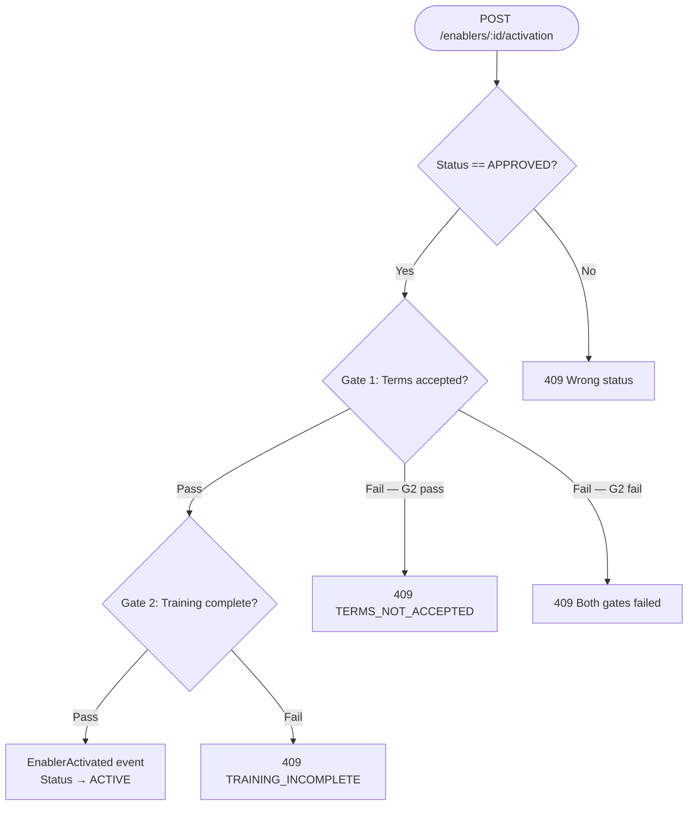

# Enabler Flows — Enabler Service

> **Verification status:** Mixed — Partially Verified (lifecycle flows) | Fixed (`GET /api/enabler/enablers/{id}` → accurate 404, DEF-002)
> **Verification basis:** `docs/FLOWS/_verification/analysis-report.md` — enabler-service section; `docs/enabler/ENABLER_SERVICE_SYSTEM.md`
> **Canonical source:** `docs/FLOWS/enabler/user-flow/enabler-flows.md`
> **Corresponding frontend guide:** `docs/FLOWS/enabler/frontend-guide/enabler-guide.md`

---

> ✅ **Resolved (DEF-002):** `GET /api/enabler/enablers/{id}` previously returned a fabricated `200` stub when no profile row existed. It now returns `200` with the real profile for registered enablers and `404 {success:false, error:"Enabler not found"}` when no profile exists. `GET /enablers/:enablerId/capabilities` remains a valid lighter-weight alternative for activation/status gating.

---

## Flows in This Document

| Flow ID | Flow Name | Status | Primary Endpoint |
|---------|-----------|--------|-----------------|
| ENB-ENB-01 | Enabler Registration and Admin Approval | Partially Verified | `POST /api/auth/register` + `POST /api/enabler/enablers/:id/approve` |
| ENB-ENB-02 | Accept Terms (Idempotent) | Partially Verified | `POST /api/enabler/enablers/:enablerId/terms` |
| ENB-ENB-03 | Two-Gate Activation | Partially Verified | `POST /api/enabler/enablers/:enablerId/activation` |
| ENB-ENB-04 | View Capabilities | Partially Verified | `GET /api/enabler/enablers/:enablerId/capabilities` |

---

## Flow ENB-ENB-01: Enabler Registration and Admin Approval

| Field | Value |
|-------|-------|
| **Actor** | Prospective Enabler (registration); Admin (approval) |
| **Trigger** | User submits registration with `role: enabler`; admin reviews and approves |
| **Preconditions** | None for registration. Admin must have `admin` or `system` role for approval step. |
| **Terminal states** | Profile status `APPROVED`; `enablerCode` and `enablerCodeShort` assigned |
| **Verification status** | Partially Verified |

### Happy Path

| Step | Actor/System | Action | Endpoint Method + Path | Auth | Expected Response |
|------|-------------|--------|------------------------|------|-------------------|
| 1 | Prospective Enabler | Submit registration with enabler role | `POST /api/auth/register` | None | 201 `{ userId, token }` |
| 2 | auth-service | Emit `UserRegistered.v1` event | (internal event) | — | Enabler profile created in `PENDING` status; wallet created by wallet-service |
| 3 | Admin | Approve the enabler profile | `POST /api/enabler/enablers/:id/approve` | Admin JWT | 200 `{ success: true, data: { enablerId, status: "APPROVED", enablerCode: "ENB-XXXXXX", enablerCodeShort: "EXXXXXX" } }` |

### Service Interaction Chain

On registration, auth-service persists the credential and publishes `UserRegistered.v1`. This event is consumed by enabler-service (which creates a `PENDING` profile with no code yet) and by wallet-service (which creates the enabler's wallet). The enabler cannot take any commercial action while in `PENDING` status — only `VIEW_ELIGIBLE_PRODUCTS` is gated away entirely at this stage.

When an admin calls the approve endpoint, `ApproveEnablerUseCase` assigns both the long-form `enablerCode` (`ENB-XXXXXX`) and the short-form `enablerCodeShort` (`EXXXXXX`) and transitions status from `PENDING` to `APPROVED`. The enabler may now accept terms and complete training.

### Unhappy Path Branches

| Trigger | System Response | Error Code | Terminal State |
|---------|----------------|------------|----------------|
| Duplicate email on registration | 409 conflict — email already registered | — | Registration rejected; no profile created |
| Invalid `role` value in body | 422 validation error | `VALIDATION_ERROR` | Registration rejected |
| Invalid `:id` on approve call | 404 not found | — | No state change |
| Enabler already approved (status ≠ `PENDING`) | 409 conflict | — | No state change |
| Caller lacks admin role on approve | 403 forbidden | — | No state change |

---

## Flow ENB-ENB-02: Accept Terms (Idempotent)

| Field | Value |
|-------|-------|
| **Actor** | Enabler (status `APPROVED`) |
| **Trigger** | Enabler submits terms acceptance before activation |
| **Preconditions** | Enabler status is `APPROVED`. Enabler JWT required. This satisfies Gate 1 of the two-gate activation check. |
| **Terminal states** | `termsVersion` and `termsAcceptedAt` recorded on profile; Gate 1 satisfied |
| **Verification status** | Partially Verified |

### Happy Path

| Step | Actor/System | Action | Endpoint Method + Path | Auth | Expected Response |
|------|-------------|--------|------------------------|------|-------------------|
| 1 | Enabler | Submit terms acceptance | `POST /api/enabler/enablers/:enablerId/terms` | Enabler JWT | 200 `{ success: true, data: { enablerId, termsVersion: "2026-01", termsAcceptedAt: "<timestamp>" } }` |

### Service Interaction Chain

`authorizeEnablerIdentity` middleware resolves the enabler from the authenticated JWT — the `:enablerId` URL parameter is validated against the token holder's profile (a mismatch returns `403`). `AcceptEnablerTermsUseCase` writes `termsVersion` and a server-side `termsAcceptedAt` timestamp to the profile. No client-supplied timestamp is accepted.

The operation is **idempotent**: calling this endpoint multiple times with the same `termsVersion` is safe and returns the same result without error. Gate 1 is considered satisfied once `termsAcceptedAt` is set and `termsVersion` matches `ENABLER_REQUIRED_TERMS_VERSION` (default `2026-01`, overridable via environment variable).

### Unhappy Path Branches

| Trigger | System Response | Error Code | Terminal State |
|---------|----------------|------------|----------------|
| `termsVersion` does not match required version | 409 — version cannot be accepted | `cannot be accepted` | Gate 1 remains unsatisfied |
| `:enablerId` does not resolve to a profile | 404 not found | — | No state change |
| Authenticated user is not the profile owner | 403 forbidden — identity mismatch | — | No state change |
| Missing `termsVersion` in body | 422 validation error | `VALIDATION_ERROR` | No state change |

---

## Flow ENB-ENB-03: Two-Gate Activation

| Field | Value |
|-------|-------|
| **Actor** | Enabler (status `APPROVED`) |
| **Trigger** | Enabler requests activation after completing both prerequisite gates |
| **Preconditions** | Status is exactly `APPROVED`; Gate 1: `termsAcceptedAt` set and `termsVersion` matches required version; Gate 2: all mandatory training modules completed and not expired (`trainingStatus === 'completed'`) |
| **Terminal states** | Status `ACTIVE`; `EnablerActivated` event emitted — OR — 409 identifying failed gate(s) |
| **Verification status** | Partially Verified |

### Happy Path

| Step | Actor/System | Action | Endpoint Method + Path | Auth | Expected Response |
|------|-------------|--------|------------------------|------|-------------------|
| 1 | Enabler | Request activation | `POST /api/enabler/enablers/:enablerId/activation` | Enabler JWT | 200 `{ success: true, data: { enablerId, status: "ACTIVE", activatedAt: "<timestamp>" } }` |

### Service Interaction Chain

`ActivateEnablerCapabilityUseCase` is invoked after identity middleware confirms the caller owns this profile. The use case delegates all checks to `EnablerLifecyclePolicy.canActivate(enabler)`:

**Gate 1** evaluates whether `termsAcceptedAt` is set and `termsVersion === requiredTermsVersion`. This is a pure in-memory check on the persisted profile fields.

**Gate 2** calls `EnablerTrainingGateService`, which reads `training_CertificationRequirement` (rows where `mandatory: true`) and the enabler's `training_TrainingRecord` (filtered by `learnerId` and `learnerRole: 'enabler'`). A module qualifies only when its record has status `COMPLETED` and `expiresAt` is in the future (or null). The gate **fails closed**: any infrastructure error reading the training domain returns `{ trainingRequired: true, satisfied: false }` — an outage can never accidentally activate an enabler.

If both gates pass, the profile transitions `APPROVED → ACTIVE`, `activatedAt` is written, and `EnablerActivated` is emitted. All six capabilities become enabled.

### Activation Flowchart



### Unhappy Path Branches

| Trigger | System Response | Error Code | Terminal State |
|---------|----------------|------------|----------------|
| Gate 1 fails only (terms not accepted / wrong version) | 409 with Gate 1 failure detail | `activation requirements` / `TERMS_NOT_ACCEPTED` | Status remains `APPROVED` |
| Gate 2 fails only (training incomplete or expired) | 409 with Gate 2 failure detail | `activation requirements` / `TRAINING_INCOMPLETE` | Status remains `APPROVED` |
| Both gates fail | 409 listing both gate failures | `activation requirements` | Status remains `APPROVED` |
| Status is not exactly `APPROVED` | 409 — invalid status transition | `activation requirements` | No state change |
| Infrastructure error reading training domain | Gate 2 fails closed → same 409 as training incomplete | `activation requirements` | Status remains `APPROVED` |

---

## Flow ENB-ENB-04: View Capabilities

| Field | Value |
|-------|-------|
| **Actor** | Enabler (any status) |
| **Trigger** | Enabler (or frontend) checks which actions are currently permitted |
| **Preconditions** | Enabler JWT. `:enablerId` must match the authenticated user's profile. |
| **Terminal states** | Returns current capability snapshot; no state mutation |
| **Verification status** | Partially Verified |

### Happy Path

| Step | Actor/System | Action | Endpoint Method + Path | Auth | Expected Response |
|------|-------------|--------|------------------------|------|-------------------|
| 1 | Enabler | Fetch capability snapshot | `GET /api/enabler/enablers/:enablerId/capabilities` | Enabler JWT | 200 `EnablerCapabilityStatusDto` (see below) |

### Service Interaction Chain

`authorizeEnablerIdentity` resolves the profile from the JWT and validates the `:enablerId` parameter matches. `GetEnablerCapabilityStatusUseCase` constructs the capability snapshot by evaluating the stored status against the capability matrix defined in `EnablerLifecyclePolicy`. The response includes the server-computed `capabilities` map, the `activation` state (terms + training gates), and the `lifecycle` block (restriction/suspension/deactivation timestamps and reasons).

This endpoint is **always available regardless of enabler status** — it is explicitly registered before the `authorizeEnabler` guard so that restricted or suspended enablers can still read why they were cut off.

**Example response (status `ACTIVE`):**
```jsonc
{
  "enablerId": "enb_01...",
  "userId": "usr_01...",
  "status": "ACTIVE",
  "isOperational": true,
  "capabilities": {
    "VIEW_ELIGIBLE_PRODUCTS": true,
    "SHARE_PRODUCT": true,
    "BUILD_ORDER_DRAFT": true,
    "GENERATE_CUSTOMER_LINK": true,
    "ACCESS_PERMANENT_LINK": true,
    "QUALIFY_EARNING": true
  },
  "activation": {
    "termsAccepted": true,
    "termsVersion": "2026-01",
    "trainingComplete": true
  },
  "lifecycle": {
    "restrictedAt": null,
    "restrictedReason": null,
    "suspendedAt": null,
    "suspendedReason": null,
    "deactivatedAt": null,
    "deactivatedReason": null
  }
}
```

**Example response (status `RESTRICTED`):**
```jsonc
{
  "status": "RESTRICTED",
  "isOperational": false,
  "capabilities": {
    "VIEW_ELIGIBLE_PRODUCTS": true,
    "SHARE_PRODUCT": true,
    "BUILD_ORDER_DRAFT": false,
    "GENERATE_CUSTOMER_LINK": false,
    "ACCESS_PERMANENT_LINK": false,
    "QUALIFY_EARNING": false
  }
}
```

### Capability Matrix by Status

| Status | VIEW_ELIGIBLE_PRODUCTS | SHARE_PRODUCT | BUILD_ORDER_DRAFT | GENERATE_CUSTOMER_LINK | ACCESS_PERMANENT_LINK | QUALIFY_EARNING |
|--------|:-:|:-:|:-:|:-:|:-:|:-:|
| `PENDING` | — | — | — | — | — | — |
| `APPROVED` | ✓ | — | — | — | — | — |
| `ACTIVE` | ✓ | ✓ | ✓ | ✓ | ✓ | ✓ |
| `RESTRICTED` | ✓ | ✓ | — | — | — | — |
| `SUSPENDED` / `REJECTED` / `DEACTIVATED` | — | — | — | — | — | — |

`isOperational` is `true` only when status is `ACTIVE`.

### Unhappy Path Branches

| Trigger | System Response | Error Code | Terminal State |
|---------|----------------|------------|----------------|
| Authenticated user is not the profile owner | 403 forbidden | — | No state change |
| Profile does not exist | 404 not found | — | No state change |
| Capability denied (on a different write route) | 403 — capability denied | `STATUS_NOT_PERMITTED` | No state change |

---

## Resolved — GET Profile (DEF-002)

> ✅ **Resolved:** `GET /api/enabler/enablers/{id}` previously answered with a fabricated `200` stub (`status: "pending"`, `message: "Enabler profile not yet registered"`) whenever no profile row existed, which hid the missing record.
>
> **Current behaviour:**
> - Registered enabler → `200` with the full `EnablerEntity` DTO (`enablerCode`, `businessName`, `tier`, `totalSales`, `commissionRate`, …).
> - No profile row → `404 {success:false, error:"Enabler not found"}` (also echoes `data.userId`).
> - `POST /api/enabler/enablers/{id}/approve` for a missing profile also returns `404` instead of reporting a false `approved: true`.
>
> **Still recommended:** `GET /api/enabler/enablers/:enablerId/capabilities` is the lightest call for activation/status gating and returns `status`, `isOperational`, `capabilities`, `activation`, and `lifecycle`.
>
> **Tracked in:** `docs/FLOWS/_verification/defect-register.md` (DEF-002)
