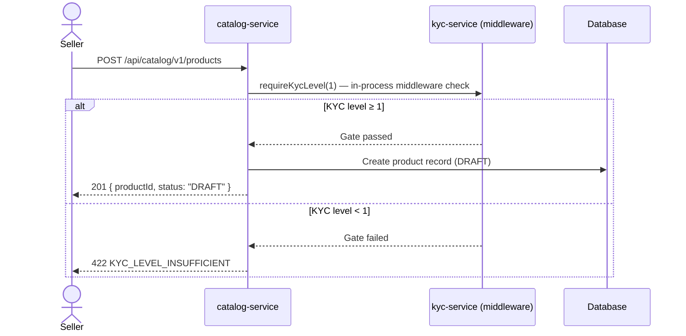

# Seller Flows — KYC Service

> **Verification status:** Verified — Live-verified 2026-11-06 against `run-lifecycle-checks.mjs` (LC-10)
> **Verification basis:** `scripts/verification/run-lifecycle-checks.mjs` LC-10 (2026-11-06)

---

> ⚠️ **KYC Architecture Clarification — REQUIRED READING**
>
> KYC enforcement uses `requireKycLevel(N)` middleware imported **directly from kyc-service** into catalog-service, payout-service, wallet-service, and enabler-service routes. This is an **in-process gate**.
>
> **However, there IS a live HTTP surface:**
> - `GET /api/kyc/status` — returns the authenticated user's current KYC level and status (verified in LC-10)
> - `GET /api/compliance/kyc-status/:userId` — admin compliance lookup (verified in LC-10)
> - `GET /api/compliance/manual-review/pending` — admin pending review queue (verified in LC-10)
> - `GET /api/compliance/audit-log` — admin audit log (verified in LC-10)
> - `GET /api/support/admin/kyc/:userId` — support agent KYC lookup (verified in LC-10)
>
> Legacy documentation incorrectly shows `compliance-service` as a standalone KYC service. **That is wrong** — these endpoints are served by existing services. The canonical KYC architecture is documented here.

---

## Flows in This Document

| Flow ID | Flow Name | Status | Primary Endpoint |
|---------|-----------|--------|-----------------|
| KYC-SEL-01 | KYC Gate on Product Creation | Verified | `POST /api/catalog/v1/products` (with in-process KYC check) |
| KYC-SEL-02 | KYC Gate on Payout | Verified | `POST /api/payout/payouts` (with in-process KYC check) |
| KYC-SEL-03 | Check KYC Status (Self) | Verified | `GET /api/kyc/status` |
| KYC-SEL-04 | Admin: KYC Status Lookup | Verified | `GET /api/compliance/kyc-status/:userId` |
| KYC-SEL-05 | Admin: Pending Manual Reviews | Verified | `GET /api/compliance/manual-review/pending` |
| KYC-SEL-06 | Admin: Compliance Audit Log | Verified | `GET /api/compliance/audit-log` |
| KYC-SEL-07 | Support: KYC Lookup by UserId | Verified | `GET /api/support/admin/kyc/:userId` |

---

## Flow KYC-SEL-03: Check KYC Status

> ✅ Added 2026-11-06 — verified in LC-10.

| Step | Actor/System | Action | Endpoint | Auth | Expected Response |
|---|---|---|---|---|---|
| 1 | Seller | Check own KYC level | `GET /api/kyc/status` | Bearer JWT | 200 `{ data: { kycLevel: N, status } }` or 404 |

**Response:**
```json
{
  "data": {
    "kycLevel": 2,
    "status": "VERIFIED"
  }
}
```

---

## Flow KYC-SEL-04 through KYC-SEL-07: Admin / Support Compliance Endpoints

> ✅ All verified in LC-10.

| Endpoint | Auth | Response |
|---|---|---|
| `GET /api/compliance/kyc-status/:userId` | Admin JWT | 200 `{ data: { kycLevel, status, verifiedAt } }` or 404 |
| `GET /api/compliance/manual-review/pending` | Admin JWT | 200 `{ data: { items: [], total } }` |
| `GET /api/compliance/audit-log` | Admin JWT | 200 `{ data: [...] }` |
| `GET /api/support/admin/kyc/:userId` | Admin JWT | 200 with KYC submission detail or 404 (expected when KYC was seeded directly, not submitted) |

---

## Flow KYC-SEL-01: KYC Gate on Product Creation

| Field | Value |
|-------|-------|
| **Actor** | Seller |
| **Trigger** | Seller attempts to create a product listing |
| **Preconditions** | Seller is authenticated. KYC level must be ≥ 1 to pass the gate. |
| **Terminal states** | **Pass:** product created with status `DRAFT` (201). **Fail:** 422 `KYC_LEVEL_INSUFFICIENT`. |
| **Verification status** | Partially Verified |

### Happy Path

| Step | Actor/System | Action | Endpoint Method + Path | Auth | Expected Response |
|------|-------------|--------|------------------------|------|-------------------|
| 1 | Seller | Submit product creation request | `POST /api/catalog/v1/products` | Seller JWT | 201 `{ success: true, data: { productId, status: "DRAFT" } }` |

### Service Interaction Chain



There is no separate HTTP call to a compliance-service or a `/api/kyc/*` endpoint. `requireKycLevel(1)` runs entirely in-process inside catalog-service as an imported middleware from kyc-service. The middleware reads the caller's KYC level from the authenticated JWT or an internal store, evaluates `level >= 1`, and either passes control to the next handler or short-circuits with `422`.

### Unhappy Path Branches

| Trigger | System Response | Error Code | Terminal State |
|---------|----------------|------------|----------------|
| Seller KYC level < 1 | 422 — middleware gate rejected | `KYC_LEVEL_INSUFFICIENT` | No product created |
| Invalid product body | 422 validation error | `VALIDATION_ERROR` | No product created |
| No JWT or expired token | 401 unauthorized | — | No product created |

---

## Flow KYC-SEL-02: KYC Gate on Payout

| Field | Value |
|-------|-------|
| **Actor** | Seller |
| **Trigger** | Seller requests a payout from their wallet balance |
| **Preconditions** | Seller is authenticated. KYC level must be ≥ 2 to initiate a payout. |
| **Terminal states** | **Pass:** payout initiated with status `PENDING` (201). **Fail:** 422 `KYC_LEVEL_INSUFFICIENT`. |
| **Verification status** | Partially Verified |

### Happy Path

| Step | Actor/System | Action | Endpoint Method + Path | Auth | Expected Response |
|------|-------------|--------|------------------------|------|-------------------|
| 1 | Seller | Request payout | `POST /api/payout/payouts` | Seller JWT | 201 `{ data: { payoutId, status: "PENDING" } }` |

### Service Interaction Chain

`requireKycLevel(2)` is applied as in-process middleware in payout-service before the `InitiatePayoutUseCase` is reached. If `level >= 2`, the gate passes and the use case proceeds: eligibility is checked, funds are frozen in the wallet, then debited and credited via the payout saga. If the level is insufficient, the middleware short-circuits before any wallet interaction.

Note: a buyer-role caller receives `403 FORBIDDEN` on this endpoint regardless of KYC level — payouts are not available to buyers.

### Unhappy Path Branches

| Trigger | System Response | Error Code | Terminal State |
|---------|----------------|------------|----------------|
| Seller KYC level < 2 | 422 — middleware gate rejected | `KYC_LEVEL_INSUFFICIENT` | No payout initiated |
| Buyer role calling payout endpoint | 403 — permission denied | — | No payout initiated |
| Wallet balance < requested payout amount | 422 — business rule error | — | No payout initiated |
| No JWT or expired token | 401 unauthorized | — | No payout initiated |

---

## Flow KYC-SEL-03: KYC Status Change Propagation

| Field | Value |
|-------|-------|
| **Actor** | System (event-driven — no direct seller API call) |
| **Trigger** | kyc-service emits `kyc.status_changed` when a seller's KYC level changes |
| **Preconditions** | KYC review process has completed (approved or revoked). |
| **Terminal states** | Downstream services reflect the new KYC level on the next in-process middleware check; no HTTP response |
| **Verification status** | Partially Verified |

### Happy Path

| Step | Actor/System | Action | Endpoint Method + Path | Auth | Expected Response |
|------|-------------|--------|------------------------|------|-------------------|
| 1 | kyc-service | Publish KYC level change | `kyc.status_changed` event (internal event bus) | — | Consumed by order-service for COD trust signals |
| 2 | Seller (subsequent action) | Create product | `POST /api/catalog/v1/products` | Seller JWT | 201 — `requireKycLevel(1)` now passes |
| 3 | Seller (subsequent action) | Request payout | `POST /api/payout/payouts` | Seller JWT | 201 — `requireKycLevel(2)` now passes (if level ≥ 2) |

### Service Interaction Chain

When kyc-service completes a review and the seller's KYC level changes, it publishes `kyc.status_changed` with the new level. order-service consumes this event to update buyer COD trust signals for the associated user. Catalog-service and payout-service do not consume this event directly — the new KYC level is read live from the seller's stored KYC record by the `requireKycLevel(N)` middleware on each subsequent request. Previously blocked actions therefore become available immediately on the next call after the KYC level is updated.

### What Changes When KYC Is Approved

| Action | Before KYC Level 1 | After KYC Level 1 | After KYC Level 2 |
|--------|--------------------|-------------------|-------------------|
| `POST /api/catalog/v1/products` | 422 `KYC_LEVEL_INSUFFICIENT` | ✓ Product creation succeeds | ✓ |
| `POST /api/payout/payouts` | 422 | 422 | ✓ Payout request succeeds |
| Enabler listing creation | Blocked (`KYC_LEVEL_INSUFFICIENT`) | ✓ Allowed | ✓ |

### Unhappy Path Branches

| Trigger | System Response | Error Code | Terminal State |
|---------|----------------|------------|----------------|
| KYC level revoked / drops below required | `requireKycLevel(N)` rejects on next request | `KYC_LEVEL_INSUFFICIENT` | Gated actions blocked again |
| order-service fails to consume `kyc.status_changed` | COD trust signals may lag | — | Event redelivery handles retry |
