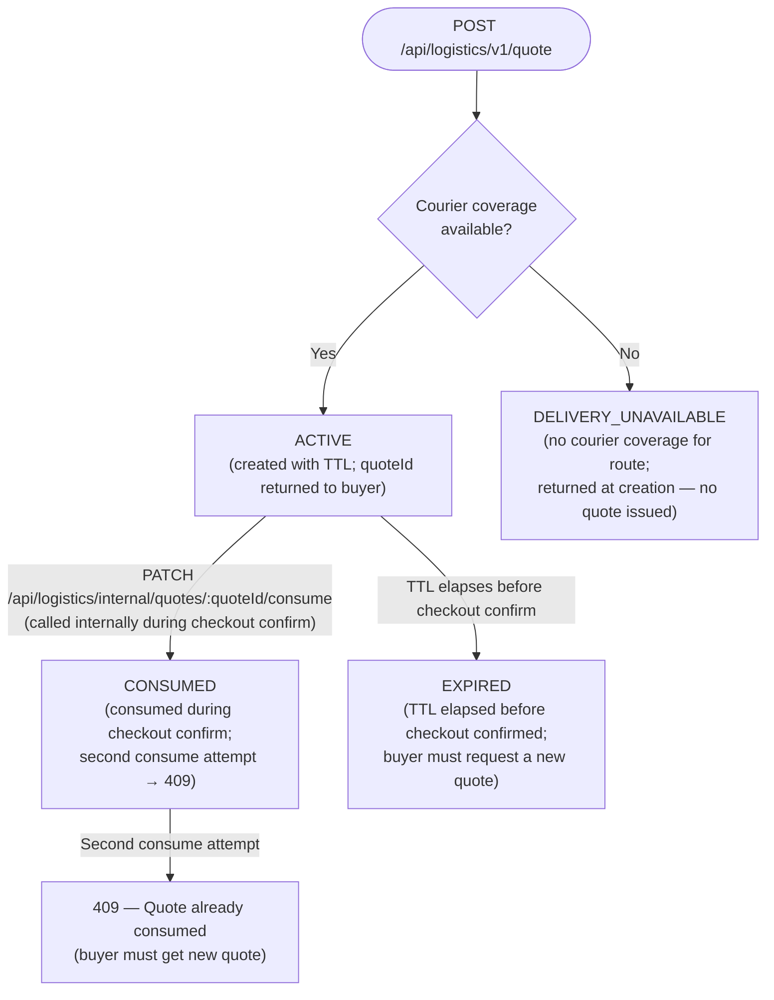

# Buyer Flows — Logistics Service

> **Verification status:** Mixed (Verified for quote/fulfillment-options/COD; Partially Verified for delivery tracking)
> **Verification basis:** `docs/FLOWS/_verification/analysis-report.md` (September 2026)
> **Last updated:** September 2026

## Overview

This document covers all logistics-service flows from the buyer's perspective: requesting a delivery quote, fetching multi-seller fulfillment options, tracking a delivery, and receiving COD OTP confirmation. The courier-side of COD verification is in `docs/FLOWS/logistics/user-flow/courier-flows.md`.

---

## Flow Index

| # | Flow Name | Verification Status | Primary Endpoint |
|---|---|---|---|
| 1 | Get Shipping Quote | Verified | `POST /api/logistics/v1/quote` |
| 2 | Get Fulfillment Options (Multi-Seller) | Verified | `POST /api/logistics/v1/fulfillment-options` |
| 3 | Track Delivery Status | Partially Verified | `GET /api/logistics/api/v1/deliveries/:deliveryId` |
| 4 | COD OTP — Buyer Side | Verified | Notification-driven; buyer does not call endpoints directly |

---

## Flow 1: Get Shipping Quote

### Summary

| Field | Value |
|---|---|
| Actor | Buyer |
| Trigger | Buyer proceeds to checkout and needs a shipping cost estimate |
| Preconditions | Authenticated (JWT); delivery addresses provided; cart items have weight/dimensions |
| Terminal states (success) | Quote created with status `ACTIVE` |
| Terminal states (failure) | `DELIVERY_UNAVAILABLE`; validation error |
| Verification status | Verified |

### Happy Path

| Step | Actor/System | Action | Endpoint | Auth | Expected Response |
|---|---|---|---|---|---|
| 1 | Buyer | Submit quote request with from/to addresses and item list | `POST /api/logistics/v1/quote` | Bearer JWT | 201 `{ quoteId, status: "ACTIVE", shippingCostTzs, ttlSeconds, expiresAt }` |
| 2 | logistics-service | Validates addresses and items | — | — | Internal validation |
| 3 | logistics-service | Checks courier coverage for route | — | — | Coverage confirmed |
| 4 | logistics-service | Calculates shipping cost (distance + weight + vehicle type) | — | — | Cost computed |
| 5 | logistics-service | Creates quote record with TTL | — | — | Quote persisted |
| 6 | Buyer | Receives `quoteId` | — | — | Use `quoteId` in checkout |

### Service Interaction Chain

`POST /api/logistics/v1/quote` is handled entirely within logistics-service. No inter-service calls are made during quote creation. The returned `quoteId` is stored on the checkout session and passed to `POST /api/checkout/{id}/confirm`, which triggers the internal quote validation and consume chain.

The `shippingCostTzs` in the quote response is the **authoritative shipping cost** — it must never be overridden by a client-supplied value at checkout.

### Quote Lifecycle

```
ACTIVE (created with TTL)
  → CONSUMED (on PATCH /api/logistics/internal/quotes/:quoteId/consume, called internally during checkout confirm)
  → EXPIRED (TTL elapsed before checkout confirmed)
  → DELIVERY_UNAVAILABLE (no courier coverage — returned at quote creation, not a state transition)
```

A second consume attempt on a `CONSUMED` quote returns **409** with error indicating the quote is already consumed. The buyer must request a new quote.

### Unhappy Path Branches

| Trigger Condition | System Response | Error Code | Terminal State |
|---|---|---|---|
| Missing or invalid delivery address | 400 validation error | `VALIDATION_ERROR` | Flow aborted; buyer corrects address |
| No courier coverage for route | 422 | `DELIVERY_UNAVAILABLE` | COD or delivery not available for this route |
| Invalid items (missing weight/dimensions) | 400 validation error | `VALIDATION_ERROR` | Flow aborted; buyer corrects items |
| Items too heavy for any vehicle | 422 | `NO_ELIGIBLE_VEHICLE` | No suitable courier vehicle; delivery not possible |

---

## Flow 2: Get Fulfillment Options (Multi-Seller)

### Summary

| Field | Value |
|---|---|
| Actor | Buyer |
| Trigger | Buyer has a multi-seller cart and wants to see ranked fulfillment options |
| Preconditions | Authenticated (JWT); cart items have `sellerId`, weight, and dimensions |
| Terminal states (success) | `options[]` returned (may be empty if all excluded) |
| Verification status | Verified |

### Happy Path

| Step | Actor/System | Action | Endpoint | Auth | Expected Response |
|---|---|---|---|---|---|
| 1 | Buyer | Request fulfillment options for cart | `POST /api/logistics/v1/fulfillment-options` | Bearer JWT | 200 `{ options[], exclusions[], fairnessExcluded[] }` |
| 2 | logistics-service | Checks feasibility for each seller-item combination | — | — | Feasibility matrix computed |
| 3 | logistics-service | Runs FairnessGate on candidate plans | — | — | Anti-competitive plans identified |
| 4 | logistics-service | Ranks remaining valid options | — | — | `options[]` sorted by rank |
| 5 | Buyer | Sees ranked options and selects one | — | — | Selected option passed to checkout |

### Response Shape

```
{
  options[]:          Ranked fulfillment plans — SHOW THESE to buyer
  exclusions[]:       Feasibility-eliminated — DO NOT SHOW (cannot be fulfilled by any courier)
  fairnessExcluded[]: FairnessGate eliminations — DO NOT SHOW as options
    Each entry has violations[] explaining which anti-competitive pattern was detected
}
```

### Money Fields — CRITICAL

The fulfillment options response contains four separate money fields. **They must never be summed together.** Each represents a different party's view of the transaction:

| Field | Meaning | Show to Buyer? |
|---|---|---|
| `buyerPriceTzs` | What the buyer pays for shipping | ✅ YES — show this |
| `driverCompensationTzs` | What the courier earns | ❌ NO — internal |
| `maysarMarginTzs` | Platform margin | ❌ NO — internal |
| `fulfillmentCostTzs` | Total cost of fulfillment | ❌ NO — internal |

### FairnessGate

The `FairnessGate` component prevents anti-competitive fulfillment plans where a single seller would dominate all shipments. Plans excluded by FairnessGate appear in `fairnessExcluded[]` with a `violations[]` array. These plans are not available to the buyer.

### Service Interaction Chain

`POST /api/logistics/v1/fulfillment-options` is handled entirely within logistics-service. maps-service may be consulted for distance calculations. No order-service or payment-service involvement at this stage.

### Unhappy Path Branches

| Trigger Condition | System Response | Error Code | Terminal State |
|---|---|---|---|
| Empty items array | 400 validation error | `VALIDATION_ERROR` | Flow aborted |
| Delivery address outside service area | 422 | `DELIVERY_UNAVAILABLE` | Buyer cannot proceed |
| All options feasibility-eliminated | 200 with empty `options[]`, all in `exclusions[]` | — | Buyer cannot proceed with current cart |
| All options fairness-excluded | 200 with empty `options[]`, all in `fairnessExcluded[]` | — | Rare; contact support |

---

## Flow 3: Track Delivery Status

### Summary

| Field | Value |
|---|---|
| Actor | Buyer |
| Trigger | Order placed; buyer wants to track delivery progress |
| Preconditions | Authenticated (JWT); order exists; delivery record exists |
| Terminal states | `delivered` (success); `cancelled` (cancelled); `failed` (failed delivery) |
| Verification status | Partially Verified |

### Happy Path

| Step | Actor/System | Action | Endpoint | Auth | Expected Response |
|---|---|---|---|---|---|
| 1 | Buyer | Request delivery status | `GET /api/logistics/api/v1/deliveries/:deliveryId` | Bearer JWT | 200 `{ deliveryId, status, updatedAt, courier: { name, phone }, estimatedArrival }` |
| 2 | Buyer | See buyer-facing label for current status | — | — | Map raw status to label (see below) |
| 3 | System | Delivery progresses through states via courier milestones | — | — | Status updates pushed via notification |

### Delivery State → Buyer-Facing Label Mapping

| Raw Status (internal) | Buyer-Facing Label | Description |
|---|---|---|
| `pending` | Order placed | Awaiting courier assignment |
| `assigned` | Courier assigned | Courier has been assigned to your order |
| `picked_up` | Picked up | Courier has collected your order |
| `in_transit` | On the way | Your order is on its way |
| `out_for_delivery` | Out for delivery | Courier is nearby — be ready |
| `delivered` | Delivered ✓ | Your order has been delivered |
| `cancelled` | Order cancelled | This order was cancelled |
| `failed` | Delivery failed — contact support | Something went wrong; open a support ticket |

**Never expose raw status names to buyers.** Always map to buyer-facing labels.

### Service Interaction Chain

Delivery status is stored and updated by logistics-service. Couriers write milestone events (via `PATCH /api/logistics/api/v1/deliveries/:deliveryId/status`) which are relayed to the event bus as outbox events. notification-service consumes these events and sends push/SMS updates to the buyer. The buyer can also poll `GET .../deliveries/:deliveryId` directly.

### Unhappy Path Branches

| Trigger Condition | System Response | Error Code | Terminal State |
|---|---|---|---|
| Delivery not found | 404 (data-level) | `RESOURCE_NOT_FOUND` | Route exists; delivery ID invalid or wrong buyer |
| Status `failed` | 200 with `status: "failed"` | — | Buyer opens support ticket |
| Status `cancelled` | 200 with `status: "cancelled"` | — | Buyer checks order for refund status |

---

## Flow 4: COD OTP — Buyer Side

### Summary

| Field | Value |
|---|---|
| Actor | Buyer (passive recipient); Courier (active verifier) |
| Trigger | COD order reaches `out_for_delivery` state |
| Preconditions | COD order placed; wallet commitment locked; delivery in `out_for_delivery` |
| Terminal states | `delivered` (OTP verified); `failed` (OTP max retries exceeded) |
| Verification status | Verified |

> **Note:** The buyer does not call any endpoints in this flow. The buyer receives an OTP via notification and shares it verbally with the courier. The courier-side verification endpoints are documented in `docs/FLOWS/logistics/user-flow/courier-flows.md`.

### Buyer Experience Steps

| Step | Actor | What Happens |
|---|---|---|
| 1 | System | COD order placed at checkout; wallet-service locks COD commitment (`useCODCommitment`) |
| 2 | System | Delivery progresses to `out_for_delivery` via courier milestone events |
| 3 | notification-service | Sends OTP to buyer's registered phone number (SMS/push) |
| 4 | Buyer | Receives OTP on phone |
| 5 | Buyer | Verbally shares OTP with courier when they arrive |
| 6 | Courier | Enters OTP in Courier App → `POST /api/logistics/v1/cod/:deliveryId/verify` |
| 7 | logistics-service | Verifies OTP → wallet-service releases COD commitment → seller credited |
| 8 | System | `Delivery.Success.v1` published → user-service updates buyer COD reputation |
| 9 | Buyer | Receives delivery confirmation notification; delivery status → `delivered` |

### Service Interaction Chain

```
Courier App → POST /api/logistics/v1/cod/:deliveryId/verify
  → logistics-service validates OTP
  → wallet-service.releaseCODCommitment(deliveryId)
  → wallet-service credits seller wallet
  → logistics-service publishes Delivery.Success.v1 (outbox)
  → user-service consumes Delivery.Success.v1 → updates buyer COD trust score
  → notification-service sends delivery confirmation to buyer
```

### COD Error Format Note

> ⚠️ **Legacy error format:** The COD endpoints (`POST /api/logistics/v1/cod/:deliveryId/otp` and `POST /api/logistics/v1/cod/:deliveryId/verify`) use a legacy error format: `{ "success": false, "error": "<string>" }` where `error` is a plain string. This is NOT the standard platform envelope `{ "error": { "code": "...", "message": "..." } }`. Frontend code handling any COD flow must handle both formats.

### Unhappy Path Branches

| Trigger Condition | System Response | Error Code | Terminal State |
|---|---|---|---|
| OTP expired before courier enters it | Legacy error `{ "success": false, "error": "OTP has expired" }` | — | Courier requests new OTP |
| OTP mismatch | Legacy error `{ "success": false, "error": "Invalid OTP" }` | — | Courier retries |
| Max OTP retries exceeded | Legacy error `{ "success": false, "error": "Max OTP attempts exceeded" }` | — | Escalate to support |
| Buyer does not receive OTP | Buyer contacts support | — | Support-service ticket |


---

## Quote Lifecycle — Flowchart



**Rules:**
- `ACTIVE` → `CONSUMED`: triggered internally by checkout-service during `POST /api/checkout/{id}/confirm`
- `ACTIVE` → `EXPIRED`: TTL from `ttlSeconds` in the quote response elapses
- A second consume attempt on a `CONSUMED` quote returns **409** — the buyer must request a new quote
- `DELIVERY_UNAVAILABLE` is returned at creation time, not as a state transition
