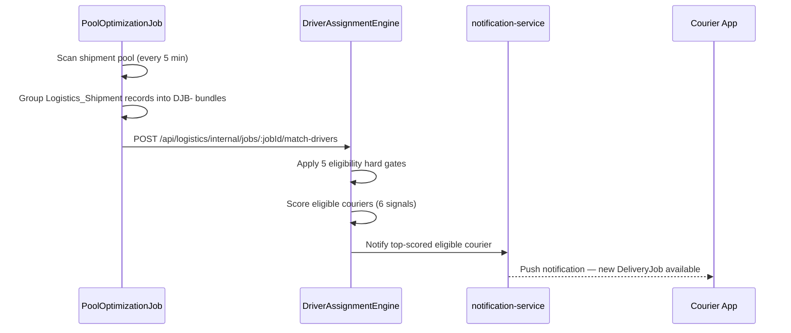
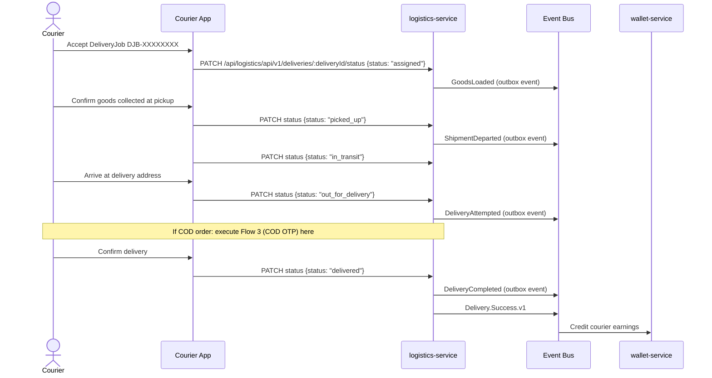
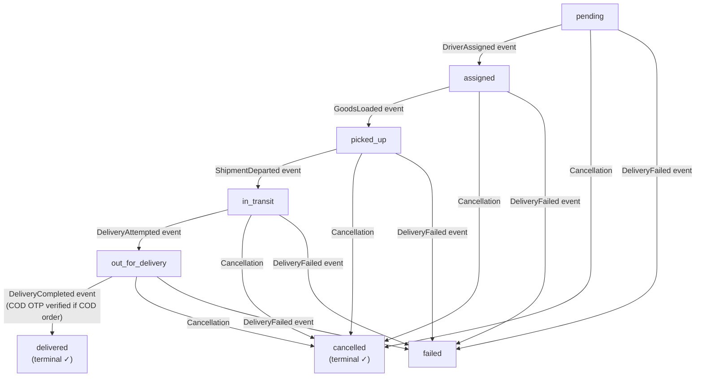

# Courier Flows — Logistics Service

> **Verification status:** Verified
> **Verification basis:** `docs/FLOWS/_verification/analysis-report.md` (September 2026); `docs/logistics/LOGISTICS_SERVICE_SYSTEM.md`
> **Last updated:** September 2026

> ⚠️ **Canonical replacement for `docs/Flow Docs/05-courier-journeys.md`**
>
> This document supersedes the legacy courier journey diagrams. Three specific errors in the legacy document have been corrected:
>
> 1. **Dispatch model corrected:** The legacy diagrams show direct delivery status writes by the courier UI (`UI->>Logistics: Update delivery status`). The actual model uses `Logistics_DeliveryJob` records (`DJB-` prefix) dispatched via `PoolOptimizationJob` (every 5 min) → `DriverAssignmentEngine`. Couriers receive job assignments via notification; they do not write status directly to create a delivery.
>
> 2. **COD OTP routing corrected:** The legacy diagrams show COD OTP routing through `payment-service`. The actual routing is: `logistics-service` → `notification-service` → Buyer → Courier → `logistics-service` → `wallet-service` → `Delivery.Success.v1` → `user-service`. `payment-service` is NOT involved in the COD OTP flow.
>
> 3. **Assignment unit corrected:** The legacy diagrams show bare `Logistics_Delivery` records being assigned to couriers. The actual unit of work is a `Logistics_DeliveryJob` (`DJB-` prefix) which bundles one or more `Logistics_Shipment` records.

---

## Overview

This document covers all logistics-service flows from the courier's perspective: how jobs are dispatched to couriers by the system, how couriers execute deliveries via milestone events, the full COD OTP verification flow, and the delivery lifecycle state machine. The buyer's view of COD is in `docs/FLOWS/logistics/user-flow/buyer-flows.md`.

---

## Flow Index

| # | Flow Name | Verification Status | Primary Endpoint |
|---|---|---|---|
| 1 | DeliveryJob Dispatch (System → Courier) | Verified | `POST /api/logistics/internal/jobs/:jobId/match-drivers` (internal) |
| 2 | Delivery Execution — Milestone Events | Verified | `PATCH /api/logistics/api/v1/deliveries/:deliveryId/status` |
| 3 | COD OTP Verification | Verified | `POST /api/logistics/v1/cod/:deliveryId/otp` + `/verify` |
| 4 | Delivery Lifecycle State Machine | Verified | Reference — all state transitions |

---

## Flow 1: DeliveryJob Dispatch (System → Courier)

### Summary

| Field | Value |
|---|---|
| Actor | System (`PoolOptimizationJob` + `DriverAssignmentEngine`) |
| Trigger | Every 5 minutes (configurable via `POOL_OPTIMIZATION_INTERVAL_MS`) |
| Preconditions | At least one unassigned `Logistics_Shipment` in the pool; at least one eligible courier online |
| Terminal states (success) | Courier notified of new `Logistics_DeliveryJob` |
| Terminal states (failure) | No eligible couriers; job remains unassigned until next cycle |
| Verification status | Verified |

### Happy Path

| Step | Actor/System | Action | Endpoint | Auth | Expected Response |
|---|---|---|---|---|---|
| 1 | PoolOptimizationJob | Scans shipment opportunity pool on 5-min schedule | Internal | — | Shipment records fetched |
| 2 | PoolOptimizationJob | Groups `Logistics_Shipment` records into `Logistics_DeliveryJob` (`DJB-` prefix) bundles | Internal | — | DeliveryJob records created |
| 3 | DriverAssignmentEngine | Called to match eligible couriers to job | `POST /api/logistics/internal/jobs/:jobId/match-drivers` | Internal (x-service-key) | Eligible courier list returned |
| 4 | DriverAssignmentEngine | Applies 5 hard eligibility gates to all available couriers | Internal | — | Ineligible couriers filtered out |
| 5 | DriverAssignmentEngine | Scores eligible couriers using 6 signals | Internal | — | Ranked courier list |
| 6 | notification-service | Highest-scored eligible courier notified | Internal event | — | Push notification sent |
| 7 | Courier | Receives job notification in Courier App | — | — | DeliveryJob details displayed |

### Eligibility Hard Gates (all 5 must pass simultaneously)

| # | Gate | Required Value |
|---|---|---|
| 1 | Courier status | Must be `online` |
| 2 | Rating | ≥ 4.0 |
| 3 | Completion rate | ≥ 95% (0.95) |
| 4 | Distance to pickup | Within 50 km |
| 5 | Vehicle capacity | Sufficient for total package weight |

### Assignment Scoring Signals (6 signals, total weight = 1.00)

| Signal | Weight |
|---|---|
| Distance to pickup | 0.25 |
| Rating | 0.20 |
| Completion rate | 0.20 |
| Vehicle match | 0.15 |
| Weather suitability | 0.10 |
| Traffic experience | 0.10 |

### Dispatch Sequence Diagram



### Service Interaction Chain

The dispatch flow is entirely within logistics-service and notification-service. No buyer-facing or seller-facing endpoints are involved. The `ConsolidationOrchestrator` manages the `PoolOptimizationJob` lifecycle. The `DriverMatchAudit` record (`Logistics_DriverMatchAudit`) is written for every match attempt, providing an auditable trail of scoring and eligibility decisions.

### Unhappy Path Branches

| Trigger Condition | System Response | Terminal State |
|---|---|---|
| No couriers meet all 5 eligibility gates | Job remains unassigned | Re-evaluated on next 5-min cycle |
| Courier declines the job | Job returned to pool | Next highest-scored courier notified |
| All eligible couriers decline | Job escalated or pool criteria widened | Platform operator intervention may be needed |
| Job TTL exceeded without assignment | Job marked as unassigned; shipments returned to pool | New dispatch attempt on next cycle |

---

## Flow 2: Delivery Execution — Milestone Events

### Summary

| Field | Value |
|---|---|
| Actor | Courier |
| Trigger | Courier accepts a DeliveryJob notification |
| Preconditions | Courier is online; DeliveryJob exists; all 5 eligibility gates still pass |
| Terminal states (success) | Delivery status `delivered`; `Delivery.Success.v1` published |
| Terminal states (failure) | Delivery status `failed`; `cancelled` |
| Verification status | Verified |

### Happy Path

| Step | Actor/System | Action | Endpoint | Auth | Expected Response |
|---|---|---|---|---|---|
| 1 | Courier | Accept DeliveryJob in app | App action | JWT | DeliveryJob details loaded |
| 2 | Courier | Navigate to pickup location | — | — | Maps routing provided |
| 3 | Courier | Collect goods at pickup | — | — | — |
| 4 | logistics-service | `GoodsLoaded` outbox event emitted | Internal (outbox) | — | Event written to `logistics_OutboxEvent` |
| 5 | Courier | Depart from pickup | `PATCH /api/logistics/api/v1/deliveries/:deliveryId/status` `{ status: "picked_up" }` | JWT | 200 status updated |
| 6 | logistics-service | `ShipmentDeparted` outbox event emitted | Internal (outbox) | — | Event relayed to platform bus |
| 7 | Courier | Update status to in_transit | `PATCH ...status` `{ status: "in_transit" }` | JWT | 200 |
| 8 | Courier | Arrive at delivery address | `PATCH ...status` `{ status: "out_for_delivery" }` | JWT | 200 |
| 9 | logistics-service | `DeliveryAttempted` outbox event emitted | Internal (outbox) | — | Buyer notified |
| 10 | Courier | If COD: complete COD OTP flow (see Flow 3) | See Flow 3 | JWT | OTP verified |
| 11 | Courier | Confirm delivery | `PATCH ...status` `{ status: "delivered" }` | JWT | 200 |
| 12 | logistics-service | `DeliveryCompleted` outbox event emitted | Internal (outbox) | — | Event relayed |
| 13 | logistics-service | `Delivery.Success.v1` published | Internal (outbox) | — | wallet-service credits earnings; user-service updates buyer COD reputation |

### Milestone Events Sequence Diagram



### Service Interaction Chain

Milestone status writes go to logistics-service, which writes outbox events to `logistics_OutboxEvent`. The outbox relay publishes events to the platform event bus. notification-service consumes delivery events to send push/SMS updates to the buyer. wallet-service consumes `Delivery.Success.v1` to credit the courier's earnings ledger entry (`Logistics_LedgerEntry` — `CARRIER_PAYABLE`).

### Unhappy Path Branches

| Trigger Condition | System Response | Error Code | Terminal State |
|---|---|---|---|
| Invalid status transition (e.g., `picked_up` → `assigned`) | 409 | `INVALID_STATUS_TRANSITION` | Courier corrects to valid next state |
| Delivery attempt failed (buyer not home) | Courier logs reason code; status → `failed` | — | Support ticket or retry |
| Package damaged | Courier reports; delivery held for resolution | — | Support intervention |
| Courier cancels mid-delivery | Status → `cancelled` (terminal) | — | Job returned to pool for reassignment |

---

## Flow 3: COD OTP Verification

### Summary

| Field | Value |
|---|---|
| Actor | Courier (active); Buyer (passive OTP recipient) |
| Trigger | COD order reaches `out_for_delivery` state |
| Preconditions | COD order; wallet commitment locked at buyer checkout; delivery in `out_for_delivery` |
| Terminal states (success) | OTP verified; COD commitment released; delivery → `delivered` |
| Terminal states (failure) | Max retries exceeded; delivery escalated to support |
| Verification status | Verified |

> ⚠️ **Legacy error format:** Both COD endpoints (`/otp` and `/verify`) return errors as `{ "success": false, "error": "<string>" }` where `error` is a plain string. This is NOT the standard platform envelope `{ "error": { "code": "...", "message": "..." } }`. The Courier App must handle both formats.

### Happy Path

| Step | Actor/System | Action | Endpoint | Auth | Expected Response |
|---|---|---|---|---|---|
| 1 | Courier | Request OTP generation for delivery | `POST /api/logistics/api/v1/cod/:deliveryId/otp` | JWT (courier) + `idempotency-key` header | 200 `{ success: true, message: "OTP sent to buyer" }` |
| 2 | logistics-service | Generates OTP; sends to buyer via notification-service | Internal | — | OTP delivered to buyer |
| 3 | Buyer | Receives OTP via SMS/push | — | — | — |
| 4 | Buyer → Courier | Buyer verbally shares OTP | — | — | — |
| 5 | Courier | Enter OTP in app; submit verification | `POST /api/logistics/api/v1/cod/:deliveryId/verify` `{ otp: "XXXXXX", location: { lat, lng, address } }` | JWT (courier) | 200 `{ success: true, message: "COD verified successfully" }` |
| 6 | logistics-service | Calls wallet-service `releaseCODCommitment(deliveryId)` | Internal | — | COD hold released; seller credited |
| 7 | logistics-service | Publishes `Delivery.Success.v1` (outbox) | Internal | — | user-service updates buyer COD reputation |
| 8 | Courier | Delivery confirmed as completed | — | — | Status transitions to `delivered` |

> ⚠️ **FLW-003 + FLW-004 corrected 2026-11-06:**
> - **Path corrected:** Both COD endpoints use `/api/logistics/api/v1/cod/` NOT `/api/logistics/v1/cod/`. Calling the old path returns 404.
> - **Idempotency key required:** `POST .../otp` requires an `idempotency-key` header (e.g. `idempotency-key: otp-{deliveryId}`). Omitting it returns 400 "Missing idempotency key".
> - **Verify body:** `POST .../verify` requires `location: { lat, lng, address }` in addition to `otp`.

### COD OTP Full Sequence Diagram

```mermaid
sequenceDiagram
    actor Courier
    participant CA as Courier App
    participant LS as logistics-service
    participant NS as notification-service
    actor Buyer
    participant WS as wallet-service
    participant US as user-service

    Courier->>CA: Initiate COD OTP for deliveryId
    CA->>LS: POST /api/logistics/api/v1/cod/:deliveryId/otp (+ idempotency-key header)
    LS->>NS: Send OTP to buyer phone number
    NS-->>Buyer: OTP via SMS / push notification

    Buyer-->>Courier: Share OTP verbally

    Courier->>CA: Enter OTP received from buyer
    CA->>LS: POST /api/logistics/api/v1/cod/:deliveryId/verify {otp: "XXXXXX", location: {lat, lng, address}}

    alt OTP valid and not expired
        LS->>WS: releaseCODCommitment(deliveryId)
        WS-->>LS: Commitment released; seller credited
        LS->>LS: Publish Delivery.Success.v1 (outbox)
        LS-->>US: [via event bus] Update buyer COD reputation
        LS-->>CA: {success: true, message: "COD verified successfully"}
    else OTP invalid
        LS-->>CA: {success: false, error: "Invalid OTP"} (LEGACY FORMAT)
    else OTP expired
        LS-->>CA: {success: false, error: "OTP has expired"} (LEGACY FORMAT)
    else Max retries exceeded
        LS-->>CA: {success: false, error: "Max OTP attempts exceeded"} (LEGACY FORMAT)
    end
```

### Service Interaction Chain

`POST /api/logistics/v1/cod/:deliveryId/otp` → logistics-service generates OTP → notification-service delivers OTP to buyer.

`POST /api/logistics/v1/cod/:deliveryId/verify` → logistics-service validates OTP → on success: wallet-service `releaseCODCommitment` (in-process call) → COD hold released, seller wallet credited → logistics-service publishes `Delivery.Success.v1` to outbox → user-service consumes event and updates buyer's COD trust score and lifetime value.

**payment-service is NOT involved in the COD OTP flow.** This corrects the legacy diagram in `docs/Flow Docs/05-courier-journeys.md`.

### Unhappy Path Branches

| Trigger Condition | System Response | Error Format | Action |
|---|---|---|---|
| OTP invalid | `{ "success": false, "error": "Invalid OTP" }` | Legacy | Courier asks buyer to re-check OTP |
| OTP expired | `{ "success": false, "error": "OTP has expired" }` | Legacy | Courier calls `/otp` again to generate new OTP |
| Max retries exceeded | `{ "success": false, "error": "Max OTP attempts exceeded" }` | Legacy | Escalate to support; delivery cannot be confirmed via OTP |
| Buyer not receiving OTP | — | — | Buyer contacts support; courier awaits |

---

## Flow 4: Delivery Lifecycle State Machine

### Summary

| Field | Value |
|---|---|
| Actor | System + Courier |
| Purpose | Reference: all valid delivery state transitions |
| Verification status | Verified |

This is not a user-initiated flow — it documents all valid state transitions for a `Logistics_Delivery` record. State transitions must be monotonically forward. Attempting an invalid transition returns **409 `INVALID_STATUS_TRANSITION`**.

### State Machine Diagram



### State Definitions

| State | Description | Terminal? |
|---|---|---|
| `pending` | Delivery created; awaiting courier assignment | No |
| `assigned` | Courier assigned; navigating to pickup | No |
| `picked_up` | Goods collected at pickup | No |
| `in_transit` | En route to delivery address | No |
| `out_for_delivery` | Courier at or near delivery address; COD OTP in progress if COD | No |
| `delivered` | Delivery confirmed (and COD OTP verified if COD order) | **Yes** |
| `cancelled` | Delivery cancelled from any non-terminal state | **Yes** |
| `failed` | Delivery attempt failed; may allow retry or support intervention | No |

### Rules

- `delivered` and `cancelled` are terminal — no further transitions are permitted
- `failed` is non-terminal — may allow retry or escalation
- All transitions are driven by outbox events (`GoodsLoaded`, `ShipmentDeparted`, `DeliveryAttempted`, `DeliveryCompleted`, `DeliveryFailed`)
- Invalid transitions return **409 `INVALID_STATUS_TRANSITION`**
- The buyer-facing label mapping is documented in `docs/FLOWS/logistics/user-flow/buyer-flows.md` (Flow 3)
