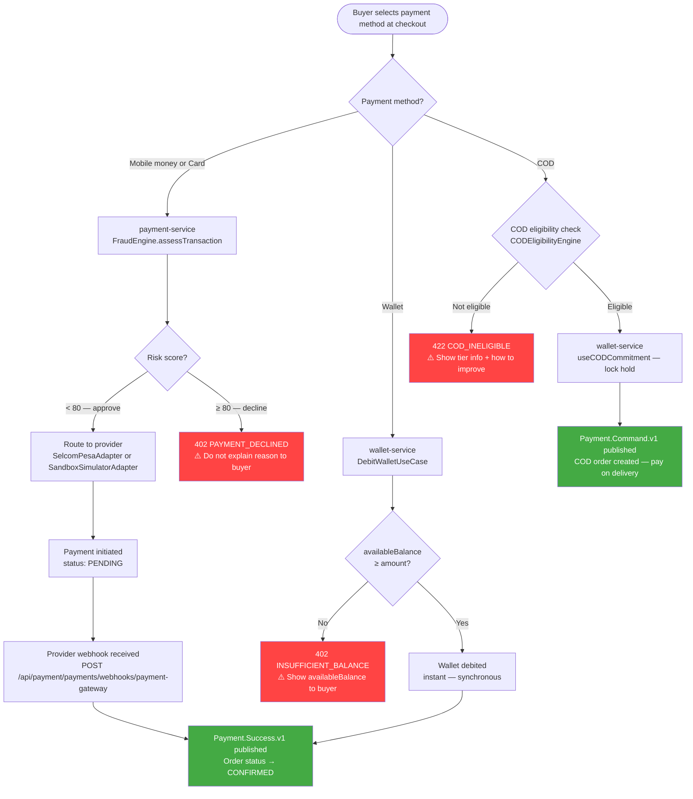

# Buyer Flows — Payment Service

> **Verification status:** Failing (GET payment status endpoints return 500 in September 2026 sweep; POST initiate endpoints Partially Verified)
> **Verification basis:** `docs/FLOWS/_verification/analysis-report.md` (September 2026); `docs/payment/PAYMENT_SERVICE_SYSTEM.md`
> **Canonical source:** `docs/FLOWS/payment/user-flow/buyer-flows.md`
> **Corresponding frontend guide:** `docs/FLOWS/payment/frontend-guide/buyer-guide.md`

## Overview

This document covers payment-service flows from the buyer's perspective: initiating a mobile money or card payment, initiating a wallet payment, and initiating a COD commitment lock. Write flows (POST initiate) are Partially Verified. All three GET status endpoints are **500 FAILING** in the September 2026 sweep — see Known Gap below.

The payment-service supports seven method codes (`MPESA`, `AIRTEL_MONEY`, `MIXX_BY_YAS`, `HALOPESA`, `CARD`, `BANK_TRANSFER`, `WALLET`), each independently configurable as `sandbox`, `live`, or `off` via environment variables. A method with `off` status is returned with `available: false` from `GET /api/payment/payment-methods` and is never accessible to buyers.

---

## Flow Index

| # | Flow Name | Verification Status | Primary Endpoint |
|---|---|---|---|
| 1 | Initiate Mobile Money / Card Payment | Partially Verified | `POST /api/payment/payments` |
| 2 | Initiate Wallet Payment | Partially Verified | `POST /api/payment/payments` (method: `WALLET`) |
| 3 | Initiate COD | Partially Verified | COD commitment via wallet-service (in-process during checkout confirm) |
| 4 | Check Payment Status | ⚠️ FAILING | `GET /api/payment/payments/:paymentId` |
| 5 | Check Payment Status (status sub-route) | ⚠️ FAILING | `GET /api/payment/payments/:paymentId/status` |
| 6 | Check Payment Status by Order | ⚠️ FAILING | `GET /api/payment/payments/order/:orderId` |

---

## Flow 1: Initiate Mobile Money / Card Payment

### Summary

| Field | Value |
|---|---|
| Actor | Buyer |
| Trigger | Buyer confirms checkout with mobile money (MPESA, AIRTEL_MONEY, MIXX_BY_YAS, HALOPESA) or card payment method |
| Preconditions | Authenticated (Bearer JWT, buyer role); checkout session confirmed; payment method is `available: true` |
| Terminal states (success) | Payment record created; `payment.initiated` event published; async processing begins → `payment.completed` event on success |
| Terminal states (failure) | 422 `METHOD_DISABLED` if method is `off`; 503 `METHOD_MISCONFIGURED` if live credentials incomplete; `payment.failed` event on gateway decline |
| Verification status | Partially Verified |

### Happy Path

| Step | Actor/System | Action | Endpoint | Auth | Expected Response |
|---|---|---|---|---|---|
| 1 | Buyer | Selects mobile money / card at checkout and submits payment | `POST /api/payment/payments` | Bearer JWT (buyer role) | Request accepted |
| 2 | payment-service | Validates method availability: `PaymentMethodConfigService.isOperational(code)` | — | — | Method confirmed `live` or `sandbox` and operational |
| 3 | payment-service | Runs `FraudEngine.assessTransaction()` — 5 parallel checks (velocity, amount, location, device, behavior) | — | — | Risk score computed; `recommend: approve` if score < 80 |
| 4 | payment-service | Routes to provider: `SelcomPesaAdapter` (live) or `SandboxSimulatorAdapter` (sandbox) | — | — | Payment initiation request sent to provider / simulator |
| 5 | payment-service | Creates payment record with status `PENDING`; emits `payment.initiated` event | — | — | 201/202 `{ paymentId, status: "PENDING", method, amount }` |
| 6 | Provider / Sandbox | Processes payment asynchronously; dispatches webhook back | `POST /api/payment/payments/webhooks/payment-gateway` | Webhook signature | Webhook received and verified |
| 7 | payment-service | Verifies webhook signature → transitions payment to `COMPLETED` | — | — | Payment status updated |
| 8 | payment-service | Emits `payment.completed` event → order-service advances order status | — | — | `Payment.Success.v1` published to event bus |

### Fraud Engine Risk Scores

| Score Range | Risk Level | Recommendation |
|---|---|---|
| 0–29 | Low | Approve |
| 30–59 | Medium | Approve (logged) |
| 60–79 | High | Review |
| ≥ 80 | Critical | Decline |

### Service Interaction Chain

`POST /api/payment/payments` is handled by `ProcessPaymentUseCase` within payment-service. The fraud engine runs in-process. Provider routing is determined by `PaymentMethodProviderRegistry.getProvider()`. The `payment.completed` event (a.k.a. `Payment.Success.v1`) is published via outbox and consumed by order-service to advance the order from `PENDING` to `CONFIRMED`. No direct HTTP call from payment-service to order-service occurs.

### Unhappy Path Branches

| Trigger Condition | System Response | HTTP Status | Error Code |
|---|---|---|---|
| Payment method is `off` | 422 | 422 | `METHOD_DISABLED` |
| Live credentials incomplete | 503 | 503 | `METHOD_MISCONFIGURED` |
| Unknown or invalid method code | 400 | 400 | `METHOD_NOT_FOUND` |
| Fraud engine recommends `decline` (score ≥ 80) | 402 | 402 | `PAYMENT_DECLINED` |
| Provider / gateway unreachable | 503 | 503 | `PROVIDER_UNAVAILABLE` |
| Duplicate payment for same order | 409 | 409 | `DUPLICATE_PAYMENT` |
| Mobile money timeout (async) | `payment.failed` event | — | `PAYMENT_EXPIRED` |
| JWT missing or expired | 401 | 401 | `UNAUTHORIZED` |

---

## Flow 2: Initiate Wallet Payment

### Summary

| Field | Value |
|---|---|
| Actor | Buyer |
| Trigger | Buyer confirms checkout using their Maysar wallet balance |
| Preconditions | Authenticated (Bearer JWT, buyer role); wallet balance ≥ order amount; `WALLET` method is `available: true` |
| Terminal states (success) | wallet-service debits buyer's wallet; `payment.completed` / `Payment.Success.v1` event published |
| Terminal states (failure) | 402 if insufficient wallet balance; 422 if method disabled |
| Verification status | Partially Verified |

> **Note:** Wallet payment may be handled in-process during checkout confirm (`BuyerConfirmCheckoutUseCase`) rather than via a separate call to `POST /api/payment/payments`. In that case, the wallet debit runs synchronously as part of the checkout saga — the payment record is still created and the `payment.completed` event is still emitted. Consult the checkout flow doc for the exact entry point.

### Happy Path

| Step | Actor/System | Action | Endpoint | Auth | Expected Response |
|---|---|---|---|---|---|
| 1 | Buyer | Selects wallet as payment method and confirms checkout | `POST /api/payment/payments` (method: `WALLET`) or in-process checkout confirm | Bearer JWT (buyer role) | Request accepted |
| 2 | payment-service | Routes to `InternalWalletAdapter` | — | — | Wallet debit initiated |
| 3 | wallet-service | Calls `DebitWalletUseCase`: velocity check → limit check → `wallet.debit()` | — | — | Wallet debited; transaction recorded |
| 4 | payment-service | Transitions payment to `COMPLETED`; emits `payment.completed` | — | — | `Payment.Success.v1` published |
| 5 | order-service | Consumes `payment.completed` → advances order to `CONFIRMED` | — | — | Order confirmed |
| 6 | Buyer | Receives order confirmation | — | — | 200/201 order confirmed |

### Service Interaction Chain

The wallet payment path calls wallet-service in-process (via `globalThis.__debitWallet` or direct import depending on deployment). The debit is idempotent when an `X-Idempotency-Key` header is provided. The `payment.completed` event then flows through the same outbox as other payment methods.

### Unhappy Path Branches

| Trigger Condition | System Response | HTTP Status | Error Code |
|---|---|---|---|
| Wallet balance < order amount | 402 — `availableBalance` insufficient | 402 | `INSUFFICIENT_BALANCE` |
| Velocity limit exceeded | 422 | 422 | `VELOCITY_LIMIT_EXCEEDED` |
| Wallet suspended or closed | 422 | 422 | `WALLET_NOT_ACTIVE` |
| `WALLET` method is `off` | 422 | 422 | `METHOD_DISABLED` |

---

## Flow 3: Initiate COD

### Summary

| Field | Value |
|---|---|
| Actor | Buyer |
| Trigger | Buyer confirms checkout with COD payment method |
| Preconditions | Authenticated (Bearer JWT, buyer role); COD eligibility confirmed (trust tier, exposure, radius gates passed); `useCODCommitment` succeeds |
| Terminal states (success) | COD commitment placed on buyer's wallet (`codCommitmentUsed` incremented); `Payment.Command.v1` event published; order proceeds |
| Terminal states (failure) | 422 if COD eligibility fails; 422 if commitment limit exceeded |
| Verification status | Partially Verified |

### Happy Path

| Step | Actor/System | Action | Endpoint | Auth | Expected Response |
|---|---|---|---|---|---|
| 1 | Buyer | Selects COD at checkout and confirms | In-process during `BuyerConfirmCheckoutUseCase` (checkout-service) | Bearer JWT (buyer role) | COD flow initiated |
| 2 | order-service | Runs `CODEligibilityEngine` + `ProgressiveCODEligibilityEngine` (dual-axis tier, exposure, concurrent, radius) | — | — | All gates pass |
| 3 | wallet-service | `wallet.useCODCommitment(orderAmount)` — increments `codCommitmentUsed` and `codCommitmentCount` | — | — | COD commitment recorded on buyer wallet |
| 4 | payment-service / order-service | `Payment.Command.v1` event published — COD order formally created | — | — | Event emitted |
| 5 | Buyer | Proceeds to await delivery and COD OTP | — | — | Order created; delivery tracking begins |

### COD Commitment Lifecycle

```
useCODCommitment (at order placement)
  → HoldPlaced / commitment active while order is pending
  → releaseCODCommitment (on order cancellation — codCommitmentUsed decremented)
  → captureHold via CODSettlementSaga (on delivery confirmation — seller credited, buyer wallet debited)
```

### Service Interaction Chain

The COD commitment is tracked as part of the buyer's wallet (`codCommitmentUsed` / `codCommitmentLimit`). No actual wallet balance debit occurs at placement — only the commitment counter is incremented. The actual money movement happens at delivery via the `CODSettlementSaga` in wallet-service, triggered by `Delivery.Success.v1` from logistics-service.

### Unhappy Path Branches

| Trigger Condition | System Response | HTTP Status | Error Code |
|---|---|---|---|
| COD eligibility check fails (tier, exposure, radius) | 422 | 422 | `COD_INELIGIBLE` |
| COD commitment limit already reached | 422 | 422 | `COD_COMMITMENT_LIMIT_EXCEEDED` |
| COD not supported in delivery area | 422 | 422 | `COD_AREA_NOT_SUPPORTED` |

---

## Known Gap — GET Payment Status Endpoints (FAILING)

> ⚠️ **Known Gap — Not Yet Verified:** The following endpoints return **500 FAILING** in the September 2026 sweep. All flows depending on them are blocked:
>
> - `GET /api/payment/payments/:paymentId` → **500 Internal Server Error**
> - `GET /api/payment/payments/:paymentId/status` → **500 Internal Server Error**
> - `GET /api/payment/payments/order/:orderId` → **500 Internal Server Error**
>
> **Do not implement payment detail screens** that rely on these endpoints. They cannot be used as a source of truth for payment status at this time.
>
> **UI fallback — primary:** Use order status from `GET /api/order/orders/:orderId` as the primary payment confirmation indicator. A `CONFIRMED` or `PROCESSING` order status reliably indicates payment was accepted.
>
> **UI fallback — payment history:** Use wallet transaction history `GET /api/wallet/statement` to show the buyer a record of what was debited from their wallet. This endpoint is Partially Verified and working.
>
> **Tracked in:** `docs/FLOWS/_verification/analysis-report.md` (September 2026 sweep — payment-service section).


---

## Payment Method Decision Tree — Flowchart



> ⚠️ **GET payment status endpoints (flows 4–5): 500 FAILING** — Do not build payment retrieval screens. Use order status (`GET /api/order/orders/:orderId`) and wallet statement (`GET /api/wallet/statement`) as fallbacks.
