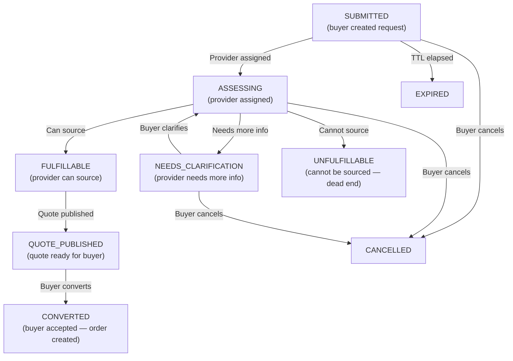

# Buyer (Customer) Flows — Request Service

> **Verification status:** Verified (103/103 tests pass; full E2E lifecycle confirmed)
> **Verification basis:** `services/request-service` test suite (September 2026); `docs/requests/REQUEST_SERVICE_SYSTEM.md`
> **Last updated:** September 2026

## Overview

The request service handles custom procurement requests — a buyer submits a request for something not in the standard catalog. Maysar ops/providers source it, create a quote, and the buyer converts the quote into an order via a secure single-use access link. This flow is fully separate from the catalog/checkout flow.

**Base URL:** `/api/request`

**Authentication:**
- Customer routes: Bearer JWT (buyer role)
- Assessment link routes: Token-based (public, no JWT) — the token IS the credential

---

## Flow Index

| # | Flow Name | Verification Status | Primary Endpoint |
|---|---|---|---|
| 1 | Submit a Request | Verified | `POST /api/request/requests` |
| 2 | View Request Status | Verified | `GET /api/request/requests/:requestId` |
| 3 | Post Message to Thread | Verified | `POST /api/request/requests/:requestId/messages` |
| 4 | View Quotes | Verified | `GET /api/request/requests/:requestId/quotes` |
| 5 | Resolve Assessment Link | Verified | `GET /api/request/requests/assess/:token` |
| 6 | Convert Quote to Order (Accept) | Verified | `POST /api/request/requests/assess/:token/convert` |
| 7 | Cancel Request | Verified | `POST /api/request/requests/:requestId/cancel` |

---

## Request Lifecycle State Machine



---

## Flow 1: Submit a Request

### Summary

| Field | Value |
|---|---|
| Actor | Buyer |
| Trigger | Buyer wants something not available in the standard catalog |
| Preconditions | Authenticated (Bearer JWT, buyer role) |
| Terminal states (success) | 201 — request created in `SUBMITTED` status |
| Verification status | Verified |

### Happy Path

| Step | Actor/System | Action | Endpoint | Auth | Expected Response |
|---|---|---|---|---|---|
| 1 | Buyer | Submit request with title, items, delivery address, and optional budget | `POST /api/request/requests` | Bearer JWT | 201 `{ requestId: "REQ-...", status: "SUBMITTED" }` |
| 2 | request-service | Creates `Request_Request` + `Request_Item` rows | — | — | Records persisted |
| 3 | request-service | Emits `request.submitted` event (outbox) | — | — | Event published |

### Request Body

```json
{
  "title": "Custom printed t-shirts, 50 units",
  "items": [
    { "description": "100% cotton t-shirt, L size, white, custom print", "quantity": 50 }
  ],
  "deliveryAddress": { "city": "Dar es Salaam", "region": "Dar es Salaam" },
  "budgetTzs": 500000
}
```

### Service Interaction Chain

`POST /api/request/requests` → `CreateRequestUseCase` → validates title + delivery address (city + region required) → creates `Request_Request` + `Request_Item` rows → emits `request.submitted` outbox event. No inter-service calls at submission.

### Unhappy Path Branches

| Trigger | System Response | Error Code | Terminal State |
|---|---|---|---|
| Missing title | 400 | VALIDATION_ERROR | Request not created |
| Delivery address missing city or region | 400 | VALIDATION_ERROR | Request not created |
| Empty items array | 400 | VALIDATION_ERROR | Request not created |
| JWT missing | 401 | UNAUTHORIZED | — |

---

## Flow 2: View Request Status

### Happy Path

| Step | Actor/System | Action | Endpoint | Auth | Expected Response |
|---|---|---|---|---|---|
| 1 | Buyer | Fetch request detail | `GET /api/request/requests/:requestId` | Bearer JWT | 200 — request with status, items, messages, quotes summary |
| 2 | Buyer | Poll for status changes | `GET /api/request/requests` | Bearer JWT | 200 — paginated list of buyer's requests |

Returns customer-scoped data only. Internal fields (`procurementCostTzs`, provider notes) are never exposed to buyers.

---

## Flow 3: Post Message to Thread

### Summary

Messages are append-only — they cannot be edited or deleted. The conversation thread is shared between buyer and provider.

### Happy Path

| Step | Actor/System | Action | Endpoint | Auth | Expected Response |
|---|---|---|---|---|---|
| 1 | Buyer | Post message | `POST /api/request/requests/:requestId/messages` | Bearer JWT | 201 `{ messageId: "RQM-...", authorType: "CUSTOMER" }` |
| 2 | Buyer | Read message thread | `GET /api/request/requests/:requestId/messages` | Bearer JWT | 200 — cursor-paginated messages |

---

## Flow 4: View Quotes

Only `PUBLISHED` (and later) quotes are returned — DRAFT and SUPERSEDED quotes are never visible to buyers.

### Happy Path

| Step | Actor/System | Action | Endpoint | Auth | Expected Response |
|---|---|---|---|---|---|
| 1 | Buyer | List quotes for a request | `GET /api/request/requests/:requestId/quotes` | Bearer JWT | 200 — array of PUBLISHED+ quotes with `sellingPriceTzs`, `deliveryDate`, `validUntil` |

**Note:** `procurementCostTzs` (internal Maysar cost) is never exposed in customer-facing quote payloads.

---

## Flow 5: Resolve Assessment Link

The provider generates a secure single-use link and shares it with the buyer. The buyer clicks the link to review the quote before accepting.

### Summary

| Field | Value |
|---|---|
| Actor | Buyer (unauthenticated — token is the credential) |
| Trigger | Buyer clicks the assessment link sent by the provider |
| Authentication | Token in URL path — no JWT required |
| Terminal states (success) | 200 — quote summary for review |
| Terminal states (failure) | 410 `LINK_EXPIRED`, 410 `LINK_CONSUMED` |

### Happy Path

| Step | Actor/System | Action | Endpoint | Auth | Expected Response |
|---|---|---|---|---|---|
| 1 | Buyer | Click assessment link | `GET /api/request/requests/assess/:token` | None (token = credential) | 200 — quote summary (`sellingPriceTzs`, items, `deliveryDate`, `validUntil`) |
| 2 | Buyer | Review quote details | — | — | No API call — buyer reviews the rendered quote |

### Access Link Security

- The raw token is generated exactly once and shown to the provider at creation time
- Only the SHA-256 hash (`tokenHash`) is stored — the raw token never persists
- The link has a TTL (`validUntil`)
- Each link is single-use: once converted, resolving it again returns 410 `LINK_CONSUMED`

### Unhappy Path Branches

| Trigger | System Response | HTTP Status | Error Code |
|---|---|---|---|
| Link TTL expired | 410 | 410 | `LINK_EXPIRED` |
| Link already used (quote converted) | 410 | 410 | `LINK_CONSUMED` |
| Token not found / invalid | 404 | 404 | `LINK_NOT_FOUND` |

---

## Flow 6: Convert Quote to Order (Accept Offer)

### Summary

| Field | Value |
|---|---|
| Actor | Buyer (unauthenticated — token is the credential) |
| Trigger | Buyer clicks "Accept offer" / "Place order" on the quote review screen |
| Authentication | Token in URL path — no JWT required |
| Terminal states (success) | 201 `{ orderId, quoteId, created: true }` — order created |
| Terminal states (idempotent) | 200 `{ orderId, quoteId, created: false }` — order already exists (safe to retry) |
| Verification status | Verified |

**This is idempotent:** calling convert twice returns the same `orderId` with `created: false` on the second call. No duplicate orders are ever created.

### Happy Path

| Step | Actor/System | Action | Endpoint | Auth | Expected Response |
|---|---|---|---|---|---|
| 1 | Buyer | Accept the offer | `POST /api/request/requests/assess/:token/convert` | None (token = credential) | 201 `{ orderId, quoteId, created: true }` |
| 2 | request-service | Transaction: creates `Order_Order` + item/subtotals rows | Internal | — | Order record created |
| 3 | request-service | Marks quote `CONVERTED`, request `CONVERTED`, link `USED` | Internal | — | State transitions committed |
| 4 | request-service | Emits `request.converted` event (outbox) | Internal | — | Event published |
| 5 | Buyer | Receives confirmation | — | — | Navigate to order detail using `orderId` |

### Service Interaction Chain

`POST /api/request/requests/assess/:token/convert` → `ConvertQuoteToOrderUseCase` → resolves token hash → validates link `ACTIVE` + quote `PUBLISHED` + `validUntil` in future → **in a single transaction:** creates `Order_Order` (standard order record accessible via order-service), marks quote `CONVERTED`, marks request `CONVERTED`, marks link `USED` → emits `request.converted` outbox event → returns `{ orderId, quoteId, created: true }`.

### Unhappy Path Branches

| Trigger | System Response | HTTP Status | Error Code |
|---|---|---|---|
| Link expired | 410 | 410 | `LINK_EXPIRED` |
| Link already used (called twice) | idempotent 200/201 `{ ..., created: false }` | 200 | — |
| Quote `validUntil` elapsed | 410 | 410 | `QUOTE_EXPIRED` |
| Quote already converted | idempotent return | 200 | — |

---

## Flow 7: Cancel Request

### Summary

Only cancellable from `SUBMITTED`, `ASSESSING`, or `NEEDS_CLARIFICATION` states.

### Happy Path

| Step | Actor/System | Action | Endpoint | Auth | Expected Response |
|---|---|---|---|---|---|
| 1 | Buyer | Cancel request | `POST /api/request/requests/:requestId/cancel` | Bearer JWT | 200 — status updated to `CANCELLED` |
| 2 | request-service | Emits `request.cancelled` event | Internal | — | Event published |

### Unhappy Path Branches

| Trigger | System Response | Error Code |
|---|---|---|
| Request in non-cancellable state (FULFILLABLE, QUOTE_PUBLISHED, CONVERTED) | 422 | `INVALID_STATUS_TRANSITION` |
| Request already cancelled | 422 | `INVALID_STATUS_TRANSITION` |
| Request belongs to different customer | 403 | `FORBIDDEN` |
