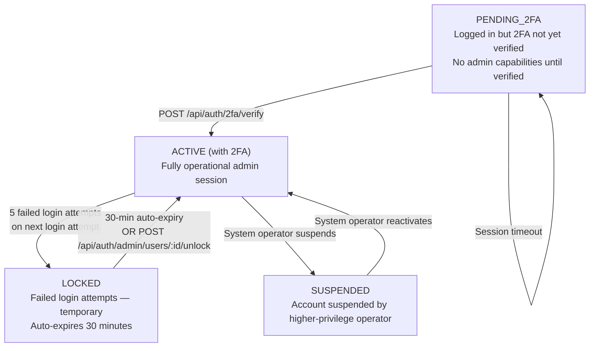

# Admin Lifecycle Overview

> **Verification basis:** `docs/FLOWS/_verification/analysis-report.md` (September 2026 sweep) + `docs/auth/AUTH_SERVICE_SYSTEM.md` + `docs/support/SUPPORT_SERVICE_SYSTEM.md` + `docs/analytics/ANALYTICS_SERVICE_SYSTEM.md`
> **Canonical source:** `docs/FLOWS/role-overviews/admin-lifecycle.md`
> **Legacy reference:** `docs/Flow Docs/07-admin-support-compliance.md` (archived; ⚠️ conflicts — references `compliance-service` as a live service; see Known Gaps)

---

## Role Summary

**Definition:** An Admin has full platform oversight. Admins can approve/reject enabler applications, suspend or unlock user accounts, manage the KYC review queue, resolve disputes, manage catalog buy-box anomaly flags, access platform analytics dashboards, and execute system maintenance operations. All admin actions are audit-logged. Admin accounts require 2FA.

**Primary services:** auth-service (2FA required), user-service, support-service, catalog-service, analytics-service, order-service, payment-service, community-service, chat-service, all service system maintenance endpoints

**Key prerequisites:**
1. Account with `admin` or `system` role (cannot self-register — requires `allowPrivilegedRole: true`)
2. 2FA must be enabled and verified at login
3. System/maintenance endpoints additionally require `x-service-key` header

---

## Hard Prerequisites

| Prerequisite | Required For | Endpoint / Mechanism | Failure Response |
|---|---|---|---|
| `admin` or `system` role | All admin operations | JWT role claim | 403 Forbidden |
| 2FA verified at login | All admin sessions | `POST /api/auth/2fa/verify` after login | Session not established |
| CSRF token | Enable/disable 2FA | `POST /api/auth/2fa/enable`, `POST /api/auth/2fa/disable` | 403 `"CSRF token missing"` |
| `x-service-key` header | All system maintenance endpoints | `ALLOWED_SERVICE_KEYS` env var | 401 Unauthorized |
| Valid JWT (admin/system role) + `x-service-key` | Outbox/idempotency cleanup | Both required simultaneously | 401/403 if either is missing |

---

## Lifecycle Phases

| Phase | Description | Key Endpoints | Services Involved | Prerequisites |
|---|---|---|---|---|
| **1. Authentication (2FA Required)** | Login with credentials; verify TOTP code; receive JWT pair. 2FA is mandatory — session cannot be established without TOTP verification. | `POST /api/auth/login`, `POST /api/auth/2fa/verify` | auth-service | Admin/system role account |
| **2. Dashboard & Monitoring** | Access platform KPIs, red-flag metrics, founder OS view, and analytics dashboards | `GET /api/analytics/admin/dashboard/red-flags`, `GET /api/analytics/admin/dashboard/founder-operating-system`, `GET /api/analytics/platform/kpis` | analytics-service | 2FA-verified session |
| **3. KYC Review** | Review KYC queue for sellers and enablers via support-service KYC lookup | `GET /api/support/admin/kyc/:userId` | support-service, kyc-service (middleware) | 2FA-verified session |
| **4. User Management** | Suspend or unlock user accounts | `POST /api/auth/admin/users/:id/suspend`, `POST /api/auth/admin/users/:id/unlock`, `GET /api/auth/admin/users` | auth-service, user-service | 2FA-verified session |
| **5. Dispute Resolution** | Review and resolve COD disputes and support escalations | `POST /api/support/disputes/:id/resolve`, `GET /api/support/disputes/:id` | support-service | 2FA-verified session |
| **6. Catalog Management** | Review buy-box anomaly flags. Read-only only — delete endpoint is FAILING (see Known Gaps). | `GET /api/catalog/v1/admin/buy-box/anomaly-flags` | catalog-service | 2FA-verified session |
| **7. System Maintenance** | Execute outbox cleanup operations across all services. Requires BOTH valid JWT (admin/system role) AND `x-service-key` header. Internal/ops-only — never expose to user-facing UI. | `POST /api/{service}/system/maintenance/cleanup/outbox`, `POST /api/{service}/system/maintenance/cleanup/outbox/report` | All services with outbox maintenance routes | JWT (admin/system) + `x-service-key` |

---

## Account States

### State Table

| State | Description | Transitions To | Trigger |
|---|---|---|---|
| `PENDING_2FA` | Credentials verified; awaiting TOTP verification | `ACTIVE` | `POST /api/auth/2fa/verify` with valid TOTP |
| `ACTIVE` (with 2FA) | Fully operational; all admin capabilities available | `LOCKED`, `SUSPENDED` | Login attempt failures / operator action |
| `LOCKED` | Temporary lockout after ≥5 failed login attempts | `ACTIVE` | 30-minute auto-expiry or unlock |
| `SUSPENDED` | All capabilities revoked | `ACTIVE` | Higher-privilege operator action |

---

## Phase Detail

### Phase 1: Authentication (2FA Required)

Admin login is a two-step process — 2FA is mandatory, not optional:

**Step 1:** `POST /api/auth/login` — submit credentials (email + password). Returns a partial session or challenge indicating 2FA verification is required.

**Step 2:** `POST /api/auth/2fa/verify` — submit the TOTP code from the authenticator app. On success, the JWT pair is issued and the admin session is established.

**2FA management:**
- `POST /api/auth/2fa/enable` — requires CSRF token; returns `403 "CSRF token missing"` when absent
- `POST /api/auth/2fa/disable` — requires CSRF token; returns `403 "CSRF token missing"` when absent
- Backup codes: `POST /api/auth/2fa/backup-codes/regenerate` — provides 10 recovery codes for authenticator app loss scenarios

**Lockout behavior:** After 5 consecutive failed login attempts, the account is locked for 30 minutes (`status = LOCKED`, `lockoutUntil = now + 30min`). A peer admin can unlock early via `POST /api/auth/admin/users/:id/unlock`.

### Phase 2: Dashboard & Monitoring

After establishing a 2FA-verified session, admin accesses platform KPIs and health metrics:

- `GET /api/analytics/platform/kpis` — platform-wide GMV, order count, conversion rate, active users, delivery success rate
- `GET /api/analytics/admin/dashboard/red-flags` — anomaly flags surfaced by the analytics engine
- `GET /api/analytics/admin/dashboard/founder-operating-system` — founder OS view with cohort and retention data

> ⚠️ **Known Gap:** `PATCH /api/analytics/action-items/:actionId/resolve` returns HTTP 500 in the September 2026 sweep. Admin cannot resolve action items via this endpoint. Use the dashboard for read-only monitoring only.

### Phase 3: KYC Review

Admin (or compliance officer using admin/support role) reviews the KYC queue using:
- `GET /api/support/admin/kyc/:userId` — look up KYC status for a specific user

> **Important:** There is no standalone `compliance-service`. KYC is enforced as `requireKycLevel` middleware (imported from kyc-service into catalog-service, payout-service, wallet-service, and enabler-service). Compliance review is performed through kyc-service events (`kyc.status_changed`) and support-service KYC lookup — not through a dedicated compliance HTTP surface.

### Phase 4: User Management

Admins manage user account states:
- `GET /api/auth/admin/users` — paginated user list with filters (role, status, search)
- `POST /api/auth/admin/users/:id/suspend` — suspend user account (policy-gated; writes to enforcement trail)
- `POST /api/auth/admin/users/:id/unlock` — unlock a locked account (clears `failedLoginAttempts` and `lockoutUntil`)

For enabler-specific enforcement (restrict, suspend, reactivate, deactivate):
- `POST /api/enabler/enablers/:enablerId/enforcement` — admin-only; applies the specified enforcement action and writes an immutable enforcement trail record

### Phase 5: Dispute Resolution

Admin reviews and resolves escalated disputes via support-service:
- `GET /api/support/admin/tickets` — all tickets (admin inbox view)
- `GET /api/support/disputes/:id` — dispute detail
- `POST /api/support/disputes/:id/resolve` — resolve a dispute; emits `COD_DISPUTE_RESOLVED` event → user-service applies COD reputation penalty to the buyer

### Phase 6: Catalog Management

Admin reviews buy-box anomaly flags surfaced by the catalog-service anomaly detection:
- View flagged anomalies *(exact list endpoint — consult catalog-service system doc)*
- `DELETE /api/catalog/v1/admin/buy-box/anomaly-flags/{flagId}` → **500 FAILING** — see Known Gaps

**Current capability:** Read-only anomaly flag view only. Deletion is not available while the endpoint is failing.

### Phase 7: System Maintenance

All system maintenance endpoints require **BOTH**:
1. Valid JWT with `admin` or `system` role
2. `x-service-key` header containing an authorized internal service key (value set in `ALLOWED_SERVICE_KEYS` env var)

Calling with JWT alone returns 401/403. These endpoints are **internal/ops-only** and must **never** be exposed in user-facing UI.

Available maintenance operations (pattern repeated across all services with outbox):

| Service | Outbox Cleanup Endpoint |
|---|---|
| auth-service | `POST /api/auth/system/maintenance/cleanup/outbox` |
| enabler-service | `POST /api/enabler/system/maintenance/cleanup/outbox` |
| wallet-service | `POST /api/wallet/system/maintenance/cleanup/outbox` |
| support-service | `POST /api/support/system/maintenance/cleanup/outbox` |
| payout-service | `POST /api/payout/system/maintenance/cleanup/outbox` |
| user-service | `POST /api/user/system/maintenance/cleanup/outbox` |
| notification-service | `POST /api/notification/system/maintenance/cleanup/outbox` |
| order-service | `POST /api/order/system/maintenance/cleanup/outbox` |
| logistics-service | `POST /api/logistics/system/maintenance/cleanup/outbox` |

Each endpoint also has a dry-run report variant: `POST ...cleanup/outbox/report`

Retention defaults: `SENT`/`PROCESSED` → 7 days, `FAILED` → 30 days. Batch size: 1000. Max runtime: 20 seconds.

---

## Known Gaps

### ⚠️ `DELETE /api/catalog/v1/admin/buy-box/anomaly-flags/{flagId}` — 500 FAILING

**Sweep result:** HTTP 500 in the September 2026 sweep.

**Impact:** Admin cannot delete buy-box anomaly flags. The catalog management phase is **read-only** while this endpoint is failing.

**Recommended UI treatment:** Show the anomaly flag list as read-only. Disable/hide the delete button with a tooltip: *"Deletion temporarily unavailable."*

---

### ⚠️ `/api/governance/*` — Route-Level 404 (Missing)

**Sweep result:** All routes under `/api/governance/*` return route-level 404 — the governance feature is not live.

**Impact:** Any admin workflow referencing governance endpoints cannot be implemented. Do not surface governance features in the admin UI until this route surface is active.

**Legacy docs conflict:** `docs/Flow Docs/07-admin-support-compliance.md` references governance routes as live. This is incorrect — they are missing.

---

### ⚠️ `PATCH /api/analytics/action-items/{actionId}/resolve` — 500 FAILING

**Sweep result:** HTTP 500 in the September 2026 sweep.

**Impact:** Admin cannot resolve action items via the analytics dashboard. The action item resolution button should be disabled with a note: *"Action resolution temporarily unavailable."*

---

### ⚠️ `compliance-service` Does Not Exist

**Legacy docs conflict:** `docs/Flow Docs/07-admin-support-compliance.md` and `docs/Flow Docs/03-seller-journeys.md` reference `compliance-service` as an independent live service.

**Verified reality:** `compliance-service` does not exist in the verified service inventory or `docs/SERVICE_DEPENDENCY_MAP.md`. Compliance work is performed through:
1. `kyc-service` events — `kyc.status_changed` event published by kyc-service, consumed by order-service for COD trust signals
2. `support-service` KYC lookup — `GET /api/support/admin/kyc/:userId`
3. `support-service` COD dispute resolution — `POST /api/support/disputes/:id/resolve` → `COD_DISPUTE_RESOLVED` → user-service reputation penalty

---

## Cross-References

| Document | Scope |
|---|---|
| `docs/FLOWS/auth/user-flow/admin-flows.md` | Admin login, 2FA, session management, user suspension |
| `docs/FLOWS/user/user-flow/admin-flows.md` | User profile management, account state transitions |
| `docs/FLOWS/catalog/user-flow/seller-flows.md` | Buy-box mechanics and anomaly flags (seller perspective) |
| `docs/FLOWS/analytics/user-flow/admin-flows.md` | Platform KPIs, red flags, founder OS view |
| `docs/FLOWS/support/user-flow/support-agent-flows.md` | Ticket management and dispute resolution |
| `docs/FLOWS/role-overviews/compliance-officer-lifecycle.md` | Compliance officer role (uses admin/support role — no dedicated compliance role) |
| `docs/auth/AUTH_SERVICE_SYSTEM.md` | Authoritative auth service reference |
| `docs/support/SUPPORT_SERVICE_SYSTEM.md` | Authoritative support service reference |
| `docs/FLOWS/_verification/analysis-report.md` | September 2026 endpoint sweep — verification evidence |
