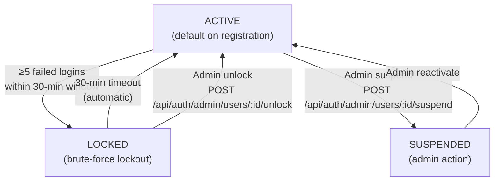
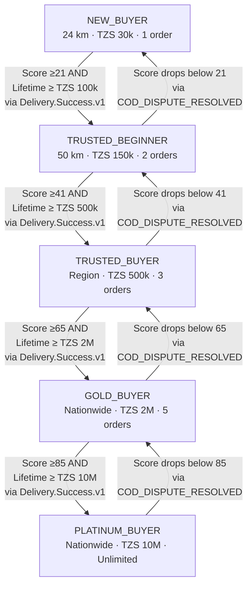

# Buyer Lifecycle Overview

> **Verification basis:** `docs/FLOWS/_verification/analysis-report.md` (September 2026 sweep, 563 operations)
> **Canonical source:** `docs/FLOWS/role-overviews/buyer-lifecycle.md`
> **Legacy reference:** `docs/Flow Docs/02-customer-journeys.md` (archived; partially obsolete — references legacy cart endpoints that return 405 and simplifies the COD flow)
> **Last updated:** September 2026

---

## Role Summary

A Buyer is a registered platform user who browses the catalog, places orders, tracks deliveries, and participates in post-purchase activities such as reviews and support tickets. Buyers cannot sell products, create listings, initiate payouts, or access seller analytics. COD payment access is gated by a trust tier that begins at `NEW_BUYER` (24 km radius, TZS 30,000 max exposure, 1 concurrent COD order) and progresses through five tiers based on delivery outcomes and COD dispute history. All buyers receive a wallet at registration, usable for wallet-based payments and fund top-ups.

---

## Hard Prerequisites

| Prerequisite | What Must Be True | Gate |
|---|---|---|
| Account registration | `POST /api/auth/register` completed; `UserRegistered.v1` event emitted | Required for all actions |
| Wallet initialized | wallet-service creates wallet on `user.registered` event | Required before any payment |
| COD access — `NEW_BUYER` tier | Default tier on registration; no additional prerequisite | 24 km, TZS 30,000 max, 1 concurrent order |
| COD access — `TRUSTED_BEGINNER`+ | Score ≥ 21 AND lifetime COD value ≥ TZS 100,000 (dual-axis) | 50 km radius, higher exposure |
| Phone verification (recommended) | `POST /api/auth/phone/initiate` → `POST /api/auth/phone/verify` | Recommended before checkout |

---

## Lifecycle Phases

| Phase | Description | Key Endpoints | Services Involved | Prerequisites |
|---|---|---|---|---|
| **1. Registration** | Create account, receive JWT, wallet initialized automatically | `POST /api/auth/register` | auth, user, wallet, notification | None |
| **2. Browse & Discover** | Search catalog, view product details, see buy-box winner | `GET /api/catalog/v1/products/search`, `GET /api/catalog/v1/products/:productId` | catalog | Registered account |
| **3. Checkout** | Get shipping quote, select payment method, confirm order | `POST /api/logistics/v1/quote`, `POST /api/checkout/{id}/confirm` | checkout, logistics, order, payment, wallet | Authenticated; wallet initialized |
| **4. Delivery** | Track delivery state transitions; COD OTP verification if COD order | `GET /api/order/orders/:orderId`, `POST /api/logistics/v1/cod/:deliveryId/otp` (courier-side) | logistics, notification | Active order |
| **5. Post-Delivery** | Submit reviews, raise support tickets, chat with seller | `POST /api/catalog/v1/products/:productId/reviews`, `POST /api/support/tickets` | catalog, support, chat, community | Delivered order |

---

## Account States

| State | Description | Entry Trigger | Exit Trigger |
|---|---|---|---|
| `ACTIVE` | Normal operating state; all buyer actions available | Registration | Lockout or suspension |
| `LOCKED` | Account temporarily frozen after ≥5 failed login attempts | 5 failed logins in 30-min window | 30-min timeout (automatic) or admin unlock |
| `SUSPENDED` | Admin-imposed suspension; no access | Admin action | Admin reactivation |

---

## Phase Detail

### Phase 1: Registration

`POST /api/auth/register` is called with `role: "buyer"`. On success:
- auth-service emits `UserRegistered.v1`
- user-service creates the profile record
- wallet-service creates the buyer's wallet (event-driven via `user.registered`)
- notification-service sends a welcome notification

The buyer starts at `NEW_BUYER` COD trust tier by default.

### Phase 2: Browse & Discover

Use the **canonical search path** `GET /api/catalog/v1/products/search` directly. Do not use the legacy paths `GET /api/catalog/v1/search` or `GET /api/catalog/v1/search/products` — these return 301 redirects.

Product detail (`GET /api/catalog/v1/products/:productId`) returns the buy-box winner alongside the product. The buy-box winner is the seller whose listing the platform will route the order to by default, selected by a 9-signal composite ranking engine.

### Phase 3: Checkout

**Shipping quote:** `POST /api/logistics/v1/quote` creates an `ACTIVE` quote with a TTL. The returned `quoteId` must be passed to checkout — the shipping cost is read from the quote record, never from the client request body.

**Checkout confirmation chain:** `POST /api/checkout/{id}/confirm` triggers an in-process chain:
1. `__placeOrderUseCase` (order-service) — COD eligibility check, exposure check, wallet debit/hold
2. `__createOrderShipments` (logistics-service) — creates `Logistics_Shipment` records
3. `__lockFulfillmentPrice` (logistics-service) — writes `FulfillmentCommitment` price lock
4. `OrderCreated` event published

**Payment methods at checkout:**

| Method | Flow |
|---|---|
| Mobile money / card | payment-service fraud check → gateway → `Payment.Success.v1` |
| Wallet | wallet-service debit → `Payment.Success.v1` |
| COD | wallet-service COD commitment lock (`useCODCommitment`) → `Payment.Command.v1`; exposure checked against COD trust tier |

### Phase 4: Delivery

The delivery state machine progresses from `pending` through to `delivered`. For COD orders the courier generates an OTP (`POST /api/logistics/v1/cod/:deliveryId/otp`) which is sent to the buyer; the buyer shares it verbally with the courier, who enters it to verify delivery.

Delivery state → buyer-facing label:

| State | Buyer-Facing Label |
|---|---|
| `pending` | Order placed |
| `assigned` | Courier assigned |
| `picked_up` | Picked up |
| `in_transit` | On the way |
| `out_for_delivery` | Out for delivery |
| `delivered` | Delivered |
| `cancelled` | Order cancelled |
| `failed` | Delivery failed — contact support |

### Phase 5: Post-Delivery

After delivery, the buyer can submit a product review, open a support ticket, or chat with the seller. COD disputes are raised through support-service (`POST /api/support/disputes`). A resolved COD dispute emits `COD_DISPUTE_RESOLVED` which decreases the buyer's COD trust score.

---

## COD Trust Tier Progression

COD trust is **dual-axis**: both the behavioral score AND the lifetime COD value must meet tier thresholds simultaneously. The score starts at 0 and is clamped to [0, 100].

### Tier Thresholds (order-service: `trust-score.functions.ts`)

| Tier | Score Threshold | Lifetime COD Value | COD Radius | Max Exposure | Max Concurrent Orders |
|---|---|---|---|---|---|
| `NEW_BUYER` | any (all others) | — | 24 km | TZS 30,000 | 1 |
| `TRUSTED_BEGINNER` | ≥ 21 | ≥ TZS 100,000 | 50 km | TZS 150,000 | 2 |
| `TRUSTED_BUYER` | ≥ 41 | ≥ TZS 500,000 | Same region | TZS 500,000 | 3 |
| `GOLD_BUYER` | ≥ 65 | ≥ TZS 2,000,000 | Nationwide | TZS 2,000,000 | 5 |
| `PLATINUM_BUYER` | ≥ 85 | ≥ TZS 10,000,000 | Nationwide | TZS 10,000,000 | Unlimited |

### Trust Score Signals

| Signal | Score Delta |
|---|---|
| `SUCCESSFUL_DELIVERY` | +10 |
| `PAYMENT_ON_DELIVERY` | +5 |
| `REPEAT_PURCHASE` | +3 |
| `COURIER_UNREACHABLE_CUSTOMER` | -5 |
| `REFUSED_DELIVERY` | -15 |
| `FRAUDULENT_ORDER` | -30 |

### COD Trust Tier Progression Diagram

**Trust INCREASED by:** `Delivery.Success.v1` event published by logistics-service and consumed by user-service — updates behavioral score and lifetime COD value.

**Trust DECREASED by:** `COD_DISPUTE_RESOLVED` event published by support-service and consumed by user-service — applies a negative score signal (e.g., `REFUSED_DELIVERY` −15, `FRAUDULENT_ORDER` −30).

**COD eligibility checked by:** order-service `CODEligibilityEngine` and `ProgressiveCODEligibilityEngine` on every COD order placement. Per-order risk assessment (`per-order-risk.assessor.ts`) may require a wallet commitment fee for high-risk orders.

**Identity graph:** `identity-graph.service.ts` links buyer identities across phone numbers, devices, and addresses. A flagged member can block COD access for all linked accounts.

---

## Known Gaps

| Endpoint | Status | Impact | Workaround |
|---|---|---|---|
| `GET /api/payment/payments/{id}` | **FAILING (500)** | Buyer cannot retrieve payment record by ID | Use order status from `GET /api/order/orders/:orderId` |
| `GET /api/payment/payments/{id}/status` | **FAILING (500)** | Buyer cannot check payment status directly | Use order status; order reflects payment confirmation |
| `GET /api/payment/payments/order/{orderId}` | **FAILING (500)** | Buyer cannot look up payment by order | Use order status + wallet statement (`GET /api/wallet/statement`) |

All three payment GET endpoints were confirmed returning 500 in the September 2026 sweep. The write flow (initiate payment) is Partially Verified. Do not surface payment lookup UI until these endpoints are fixed.

---

## Cross-References

| Service | User Flow Document | Frontend Guide |
|---|---|---|
| auth | `docs/FLOWS/auth/user-flow/buyer-flows.md` | `docs/FLOWS/auth/frontend-guide/buyer-guide.md` |
| catalog | `docs/FLOWS/catalog/user-flow/buyer-flows.md` | `docs/FLOWS/catalog/frontend-guide/buyer-guide.md` |
| checkout | `docs/FLOWS/checkout/user-flow/buyer-flows.md` | `docs/FLOWS/checkout/frontend-guide/buyer-guide.md` |
| order | `docs/FLOWS/order/user-flow/buyer-flows.md` | `docs/FLOWS/order/frontend-guide/buyer-guide.md` |
| logistics | `docs/FLOWS/logistics/user-flow/buyer-flows.md` | `docs/FLOWS/logistics/frontend-guide/buyer-guide.md` |
| payment | `docs/FLOWS/payment/user-flow/buyer-flows.md` | `docs/FLOWS/payment/frontend-guide/buyer-guide.md` |
| wallet | `docs/FLOWS/wallet/user-flow/buyer-flows.md` | `docs/FLOWS/wallet/frontend-guide/buyer-guide.md` |
| support | `docs/FLOWS/support/user-flow/buyer-flows.md` | `docs/FLOWS/support/frontend-guide/buyer-guide.md` |
| chat | `docs/FLOWS/chat/user-flow/buyer-flows.md` | `docs/FLOWS/chat/frontend-guide/buyer-guide.md` |
| community | `docs/FLOWS/community/user-flow/buyer-flows.md` | `docs/FLOWS/community/frontend-guide/buyer-guide.md` |
