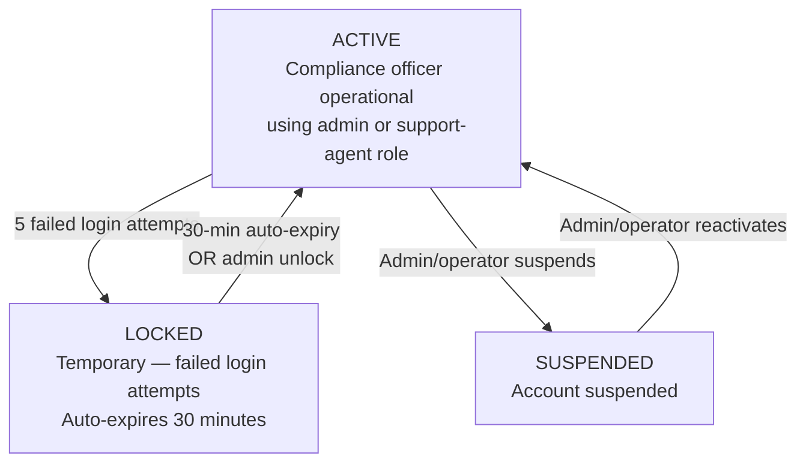

# Compliance Officer Lifecycle Overview

> **Verification basis:** `docs/FLOWS/_verification/analysis-report.md` (September 2026 sweep) + `docs/support/SUPPORT_SERVICE_SYSTEM.md` + `docs/auth/AUTH_SERVICE_SYSTEM.md`
> **Canonical source:** `docs/FLOWS/role-overviews/compliance-officer-lifecycle.md`
> **Legacy reference:** `docs/Flow Docs/07-admin-support-compliance.md` (archived; ⚠️ **Conflicting** — references `compliance-service` as a live service; this is incorrect; see Role Summary)

---

## Role Summary

> ⚠️ **CRITICAL: A standalone `compliance-service` does NOT exist in the verified system.**

No `/api/compliance/*` routes exist. The `compliance-service` referenced in legacy documentation (`docs/Flow Docs/03-seller-journeys.md`, `docs/Flow Docs/07-admin-support-compliance.md`) is **not a live service** and is not present in `docs/SERVICE_DEPENDENCY_MAP.md`.

Actual compliance work is performed through three verified mechanisms:

1. **kyc-service events** — `kyc.status_changed` event published by kyc-service when a user's KYC level changes; consumed by order-service for COD trust signal updates
2. **support-service KYC lookup** — `GET /api/support/admin/kyc/:userId` allows accounts with admin or support-agent role to look up a user's KYC status without accessing raw identity documents
3. **support-service COD dispute resolution** — `POST /api/support/disputes/:id/resolve` → emits `COD_DISPUTE_RESOLVED` event → user-service applies COD reputation penalty to the buyer

**Definition:** A Compliance Officer reviews KYC documents, monitors AML (anti-money laundering) signals, and manages escalated COD disputes. In the current system, there is **no dedicated `compliance` role** — compliance officers use the `admin` or `support-agent` role. There is no dedicated compliance dashboard, no compliance-specific API surface, and no `/api/governance/*` routes (all return route-level 404 — not live).

**Primary services:** auth-service, support-service (KYC lookup and dispute resolution), kyc-service (events and middleware — no standalone HTTP surface), analytics-service (AML signals surfaced via admin dashboard), user-service (account states)

**Key prerequisites:**
1. Account with `admin` or `support-agent` role (no dedicated `compliance` role exists)
2. Access to support-service KYC lookup: `GET /api/support/admin/kyc/:userId`

---

## Hard Prerequisites

| Prerequisite | Required For | Endpoint / Mechanism | Failure Response |
|---|---|---|---|
| `admin` or `support-agent` role | All compliance operations | JWT role claim | 403 Forbidden |
| Valid JWT session | KYC lookup, dispute review | `POST /api/auth/login` | 401 Unauthorized |
| 2FA (if using admin role) | Admin-level compliance access | `POST /api/auth/2fa/verify` | Session not established |
| Agent JWT or admin JWT | Support-service operations | Role check in support-service | 403 Forbidden |

---

## Lifecycle Phases

| Phase | Description | Key Endpoints | Services Involved | Prerequisites |
|---|---|---|---|---|
| **1. Authentication** | Login with admin or support-agent role; no dedicated compliance role exists | `POST /api/auth/login` (+ `POST /api/auth/2fa/verify` if admin role) | auth-service | Admin or support-agent account |
| **2. KYC Review Queue** | Access KYC cases through support-service lookup; no dedicated compliance dashboard | `GET /api/support/admin/kyc/:userId` | support-service, kyc-service (event source) | Valid session |
| **3. AML Review** | Review suspicious activity flags surfaced through analytics and user management; no dedicated AML HTTP surface | `GET /api/analytics/admin/dashboard/red-flags`, `GET /api/analytics/admin/dashboard/founder-operating-system` | analytics-service | Admin role + valid session |
| **4. Dispute Escalation Review** | Review escalated COD disputes; resolve to apply reputation consequences | `GET /api/support/disputes/:id`, `POST /api/support/disputes/:id/resolve` | support-service, user-service | Valid session |

---

## Account States

The compliance officer uses the `admin` or `support-agent` account state model — there is no dedicated compliance role state machine.

### State Table

| State | Description | Transitions To | Trigger |
|---|---|---|---|
| `ACTIVE` | Operational; compliance work accessible via admin/support-agent role | `LOCKED`, `SUSPENDED` | Failed logins / operator action |
| `LOCKED` | Temporary lockout after ≥5 failed login attempts | `ACTIVE` | 30-minute auto-expiry or admin unlock |
| `SUSPENDED` | All capabilities revoked | `ACTIVE` | Operator action |

---

## Phase Detail

### Phase 1: Authentication

The compliance officer logs in using their `admin` or `support-agent` credentials:

- **Using admin role:** `POST /api/auth/login` → `POST /api/auth/2fa/verify` (2FA mandatory for admin)
- **Using support-agent role:** `POST /api/auth/login` (2FA optional)

There is no dedicated compliance role. The role assignment determines which compliance tools are accessible:
- `admin` role → full analytics dashboard, red flags, AML signals, user management, KYC lookup
- `support-agent` role → KYC lookup, dispute resolution, ticket triage

### Phase 2: KYC Review Queue

**No dedicated compliance dashboard exists.** KYC review is performed through support-service:

`GET /api/support/admin/kyc/:userId`

Returns the KYC status for a specific user without exposing raw identity documents. The compliance officer must know (or look up) the `userId` to query — there is no paginated KYC queue endpoint.

**How KYC status changes propagate:**
- kyc-service publishes `kyc.status_changed` event when a user's KYC level is updated
- order-service consumes this event to update COD trust signals
- The `kyc.status_changed` event is the primary mechanism for downstream services to react to KYC decisions

**kyc-service is middleware, not a standalone HTTP service:** There are no `/api/kyc/*` routes. KYC enforcement is the `requireKycLevel(N)` middleware imported directly into catalog-service, payout-service, wallet-service, and enabler-service routes.

### Phase 3: AML Review

**No dedicated AML HTTP surface exists.** AML review is performed through the admin analytics dashboard:

- `GET /api/analytics/admin/dashboard/red-flags` — anomaly flags surfaced by the analytics engine (requires admin role JWT)
- `GET /api/analytics/admin/dashboard/founder-operating-system` — platform-wide metrics including suspicious pattern signals

Suspicious accounts identified through this review can be flagged for admin action:
- `POST /api/auth/admin/users/:id/suspend` — suspend a suspicious user account
- `POST /api/support/tickets` (or direct admin action) — escalate for further review

> ⚠️ **Known Gap:** `/api/governance/*` → ALL routes return route-level 404 (Missing). Any governance-related compliance workflow cannot be implemented via API. Do not surface governance features in the UI.

### Phase 4: Dispute Escalation Review

Compliance officers review escalated COD disputes via support-service:

1. **View dispute:** `GET /api/support/disputes/:id` — detail view including evidence, timeline, and parties
2. **Resolve dispute:** `POST /api/support/disputes/:id/resolve`
   - Emits `COD_DISPUTE_RESOLVED` event
   - user-service consumes the event and applies a **COD reputation penalty** to the buyer
   - The buyer's COD trust tier may be downgraded, reducing their future COD exposure limits

> Compliance officers can also view escalated support tickets via `GET /api/support/admin/tickets` and add messages or close tickets using the standard support agent workflow.

---

## Known Gaps

### ⚠️ `compliance-service` Does Not Exist

**Verified reality:** `compliance-service` is not present in `docs/SERVICE_DEPENDENCY_MAP.md` and no `/api/compliance/*` routes exist in the verified sweep. References in legacy docs are **incorrect**.

**Legacy docs affected:**
- `docs/Flow Docs/03-seller-journeys.md` — Onboarding diagram shows `compliance-service` (`Comp`) as a live service
- `docs/Flow Docs/07-admin-support-compliance.md` — multiple references to `compliance-service` as live

**Authoritative replacement:** Compliance functionality is distributed across kyc-service (middleware + events), support-service (KYC lookup, dispute resolution), and analytics-service (anomaly detection).

---

### ⚠️ No Dedicated `compliance` Role

**Verified reality:** The auth-service `UserRole` enum contains: `ADMIN | USER | MODERATOR | GUEST | BUYER | SELLER | COURIER | SUPPLIER | ENABLER | SYSTEM`. There is no `COMPLIANCE_OFFICER` role.

**Impact:** Compliance officers share role-based access with admin or support-agent users. Fine-grained compliance-specific permissions are not currently enforceable through the role system.

---

### ⚠️ `/api/governance/*` — Route-Level 404 (Missing)

**Sweep result:** All routes under `/api/governance/*` return route-level 404 — the governance feature is **not live**.

**Impact:** Any compliance workflow requiring governance endpoints cannot be implemented. Do not document or surface governance features as current capabilities.

---

### ⚠️ No Dedicated KYC Queue Endpoint

**Current state:** `GET /api/support/admin/kyc/:userId` requires knowing the user ID in advance. There is no paginated "KYC review queue" endpoint — no way to list all users pending KYC review through the API.

**Impact:** Compliance officers cannot bulk-review the KYC queue via API. User identification must happen through other means (support tickets, user search via `GET /api/auth/admin/users`).

---

## Cross-References

| Document | Scope |
|---|---|
| `docs/FLOWS/support/user-flow/support-agent-flows.md` | Support workflows used by compliance officers with support-agent role |
| `docs/FLOWS/role-overviews/admin-lifecycle.md` | Admin role workflows (compliance officers often use admin role) |
| `docs/FLOWS/role-overviews/support-agent-lifecycle.md` | Support agent workflows for dispute and ticket handling |
| `docs/FLOWS/kyc/user-flow/seller-flows.md` | KYC middleware gate — how KYC is enforced (not a standalone service) |
| `docs/FLOWS/analytics/user-flow/admin-flows.md` | Platform red flags and anomaly detection |
| `docs/support/SUPPORT_SERVICE_SYSTEM.md` | Authoritative support service reference |
| `docs/SERVICE_DEPENDENCY_MAP.md` | Verified dependency map — confirms compliance-service absence |
| `docs/FLOWS/_verification/analysis-report.md` | September 2026 endpoint sweep — verification evidence |
