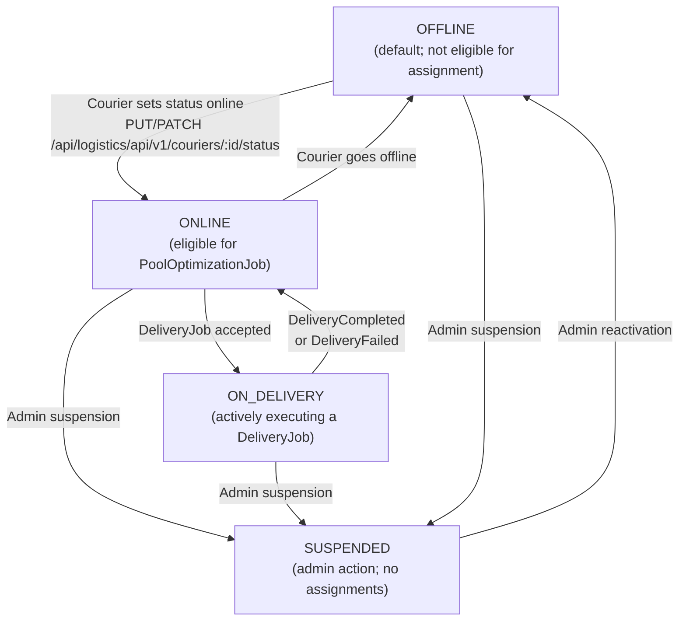
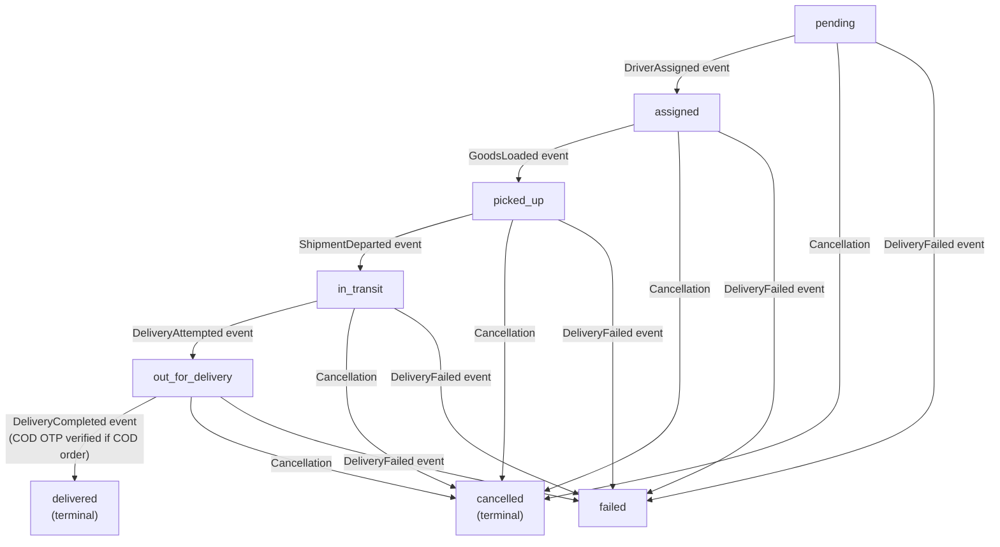

# Courier Lifecycle Overview

> **Verification basis:** `docs/FLOWS/_verification/analysis-report.md` (September 2026 sweep, 563 operations); `docs/logistics/LOGISTICS_SERVICE_SYSTEM.md`
> **Canonical source:** `docs/FLOWS/role-overviews/courier-lifecycle.md`
> **Legacy reference:** `docs/Flow Docs/05-courier-journeys.md` — ⚠️ **PARTIALLY OBSOLETE** (diagrams predate the `Logistics_DeliveryJob` / `PoolOptimizationJob` dispatch model; COD OTP flow incorrectly routes through payment-service)
> **Last updated:** September 2026

---

## Role Summary

A Courier is a registered platform user who accepts delivery jobs, executes physical deliveries, verifies COD payments via OTP, and receives earnings credited to their wallet. Couriers must complete training certification before they can be assigned jobs. At the time of assignment, five eligibility hard gates must all pass simultaneously. Jobs are dispatched via the `Logistics_DeliveryJob` model (`DJB-` prefix) — not bare delivery records — through the `PoolOptimizationJob` background job that runs every 5 minutes and the `DriverAssignmentEngine` that scores eligible couriers using 6 weighted signals.

---

## Hard Prerequisites

| Prerequisite | What Must Be True | Gate |
|---|---|---|
| Account registration | `POST /api/auth/register` with `role: "courier"` | Required for all actions |
| Wallet initialized | wallet-service creates wallet on `user.registered` event | Required to receive earnings |
| Training certification | Complete all training modules and pass assessment; `certificationStatus === 'PASSED'` | Required before any delivery assignment |
| Status `online` | Set via `PUT/PATCH /api/logistics/api/v1/couriers/:courierId/status` | Required at time of assignment |
| Rating ≥ 4.0 | Maintained through delivery outcomes | Eligibility hard gate |
| Completion rate ≥ 95% | Maintained through delivery outcomes | Eligibility hard gate |
| Within 50 km of pickup | Checked by assignment engine at job time | Eligibility hard gate |
| Vehicle capacity sufficient | Package weight ≤ vehicle capacity | Eligibility hard gate |
| KYC level 2 | `requireKycLevel(2)` middleware in payout-service | Required to request payouts |

---

## Lifecycle Phases

| Phase | Description | Key Endpoints | Services Involved | Prerequisites |
|---|---|---|---|---|
| **1. Registration** | Create courier account; wallet initialized automatically | `POST /api/auth/register` | auth, user, wallet | None |
| **2. Training & Certification** | Complete training modules, pass assessment, achieve `certificationStatus === 'PASSED'` | `GET /api/training/api/v1/modules`, `POST /api/training/api/v1/modules/:id/complete`, `POST /api/training/api/v1/assessments` | training | Registered account |
| **3. Eligibility & Assignment** | Set status online; `PoolOptimizationJob` runs every 5 min; `DriverAssignmentEngine` scores candidates; all 5 hard gates must pass | `PUT/PATCH /api/logistics/api/v1/couriers/:courierId/status` | logistics (dispatch), maps | Training certified |
| **4. Delivery Execution** | Accept DeliveryJob, navigate to pickup, emit milestone outbox events, complete delivery | `GET /api/logistics/api/v1/deliveries/:deliveryId`, `POST/PATCH /api/logistics/api/v1/deliveries/:deliveryId/status` | logistics, notification | Assignment received |
| **5. COD OTP (if applicable)** | Generate OTP for buyer, receive OTP from buyer, verify to confirm delivery and trigger settlement | `POST /api/logistics/v1/cod/:deliveryId/otp`, `POST /api/logistics/v1/cod/:deliveryId/verify` | logistics, notification, wallet, user | Delivery in `out_for_delivery` state; COD order |
| **6. Earnings & Payout** | `Delivery.Success.v1` credits earnings to wallet; request payout when KYC level 2 met | `GET /api/logistics/api/v1/earnings`, `POST /api/payout/payouts` | wallet, payout | Delivery completed; KYC level 2 for payout |

---

## Account States

| State | Description | Entry Trigger | Exit Trigger |
|---|---|---|---|
| `OFFLINE` | Not available for assignment; `PoolOptimizationJob` skips this courier | Default on registration; courier goes offline | Courier sets status to `online` |
| `ONLINE` | Eligible to be scored and assigned by `DriverAssignmentEngine` | Courier sets status to `online` | DeliveryJob accepted or goes offline |
| `ON_DELIVERY` | Actively executing a DeliveryJob; not available for new assignments | DeliveryJob accepted | Delivery completed or failed |
| `SUSPENDED` | Admin-imposed suspension; no assignments possible | Admin action | Admin reactivation |

---

## Phase Detail

### Phase 1: Registration

`POST /api/auth/register` with `role: "courier"`. On success:
- auth-service emits `UserRegistered.v1`
- user-service creates the profile
- wallet-service creates the courier's wallet (event-driven via `user.registered`)

### Phase 2: Training & Certification

The courier must complete all mandatory training modules and pass the assessment before any delivery assignment. The `certificationStatus` field must equal `'PASSED'`. training-service tracks module completion and certification status.

The `TrainingSaga` in order-service triggers training certification checks for couriers on their first delivery assignment.

### Phase 3: Eligibility & Assignment

**All 5 eligibility hard gates must pass simultaneously at the moment of assignment:**

| # | Hard Gate | Required Value |
|---|---|---|
| 1 | Courier status | `online` |
| 2 | Rating | ≥ 4.0 |
| 3 | Completion rate | ≥ 95% (0.95) |
| 4 | Distance to pickup | Within 50 km |
| 5 | Vehicle capacity | Sufficient for package weight |

**Assignment scoring — `DriverAssignmentEngine` ranks eligible couriers using 6 signals:**

| Signal | Weight |
|---|---|
| Distance to pickup | 0.25 |
| Rating | 0.20 |
| Completion rate | 0.20 |
| Vehicle match | 0.15 |
| Weather suitability | 0.10 |
| Traffic experience | 0.10 |
| **Total** | **1.00** |

The `PoolOptimizationJob` runs every 5 minutes (configurable via `POOL_OPTIMIZATION_INTERVAL_MS`). It scans the shipment opportunity pool, groups `Logistics_Shipment` records into `Logistics_DeliveryJob` bundles (`DJB-` prefix), then invokes `DriverAssignmentEngine` to rank eligible couriers. The highest-scoring eligible courier receives the job notification.

### Phase 4: Delivery Execution

After accepting a `DeliveryJob` (`DJB-` prefix), the courier executes the following milestone sequence. Each milestone writes an outbox event to `logistics_OutboxEvent` for relay via the platform event bus:

| Milestone | Outbox Event | Trigger |
|---|---|---|
| Goods collected at pickup | `GoodsLoaded` | Courier confirms package picked up |
| Departed from pickup | `ShipmentDeparted` | Courier departs for delivery |
| Delivery attempted | `DeliveryAttempted` | Courier arrives at delivery address |
| Delivery completed | `DeliveryCompleted` | Successful delivery confirmed |
| Delivery failed | `DeliveryFailed` | Failed delivery with reason code |

### Phase 5: COD OTP Flow (if applicable)

For COD orders, the delivery confirmation requires OTP verification before the wallet commitment is released:

1. Courier calls `POST /api/logistics/v1/cod/:deliveryId/otp` — generates OTP, sends to buyer via notification-service
2. Buyer receives OTP (SMS/push notification)
3. Buyer shares OTP verbally with courier
4. Courier enters OTP and calls `POST /api/logistics/v1/cod/:deliveryId/verify`
5. On success:
   - wallet-service COD commitment is released (`releaseCODCommitment`)
   - Seller receives payment
   - `Delivery.Success.v1` event emitted → user-service updates buyer COD reputation

> ⚠️ **Legacy Error Format:** The COD endpoints (`/cod/:deliveryId/otp` and `/cod/:deliveryId/verify`) return errors in a legacy format: `{ "success": false, "error": "<string>" }` where `error` is a plain string, not an object. This is a known exception to the platform's standard error envelope format. Clients must handle both formats.

### Phase 6: Earnings & Payout

`Delivery.Success.v1` triggers wallet-service to credit the courier's earnings. Earnings can be reviewed at `GET /api/logistics/api/v1/earnings` and `GET /api/logistics/api/v1/earnings/summary`.

To request a payout, the courier needs KYC level 2 (`requireKycLevel(2)` middleware in payout-service). `POST /api/payout/payouts` initiates the payout saga.

---

## Delivery Lifecycle State Machine

`delivered` and `cancelled` are terminal states. `failed` is a non-terminal state that may allow retry or escalation.

---

## Known Gaps

There are no courier-specific Failing or Missing endpoints identified in the September 2026 sweep. The core quote, COD, earnings, and courier console endpoints are Verified or Partially Verified.

> Note: Route-level 404 is observed on `GET /api/logistics/api/v1/routes` and sub-routes — this is data-level (no fixture routes in sweep), not a missing route. The routes endpoint itself is Verified.

---

## Cross-References

| Service | User Flow Document | Frontend Guide |
|---|---|---|
| auth | `docs/FLOWS/auth/user-flow/courier-flows.md` | `docs/FLOWS/auth/frontend-guide/courier-guide.md` |
| logistics | `docs/FLOWS/logistics/user-flow/courier-flows.md` | `docs/FLOWS/logistics/frontend-guide/courier-guide.md` |
| training | `docs/FLOWS/training/user-flow/enabler-flows.md` | `docs/FLOWS/training/frontend-guide/enabler-guide.md` |
| payout | `docs/FLOWS/payout/user-flow/courier-flows.md` | `docs/FLOWS/payout/frontend-guide/courier-guide.md` |
| wallet | `docs/FLOWS/wallet/user-flow/courier-flows.md` | `docs/FLOWS/wallet/frontend-guide/courier-guide.md` |
| maps | `docs/FLOWS/maps/user-flow/courier-flows.md` | `docs/FLOWS/maps/frontend-guide/courier-guide.md` |
