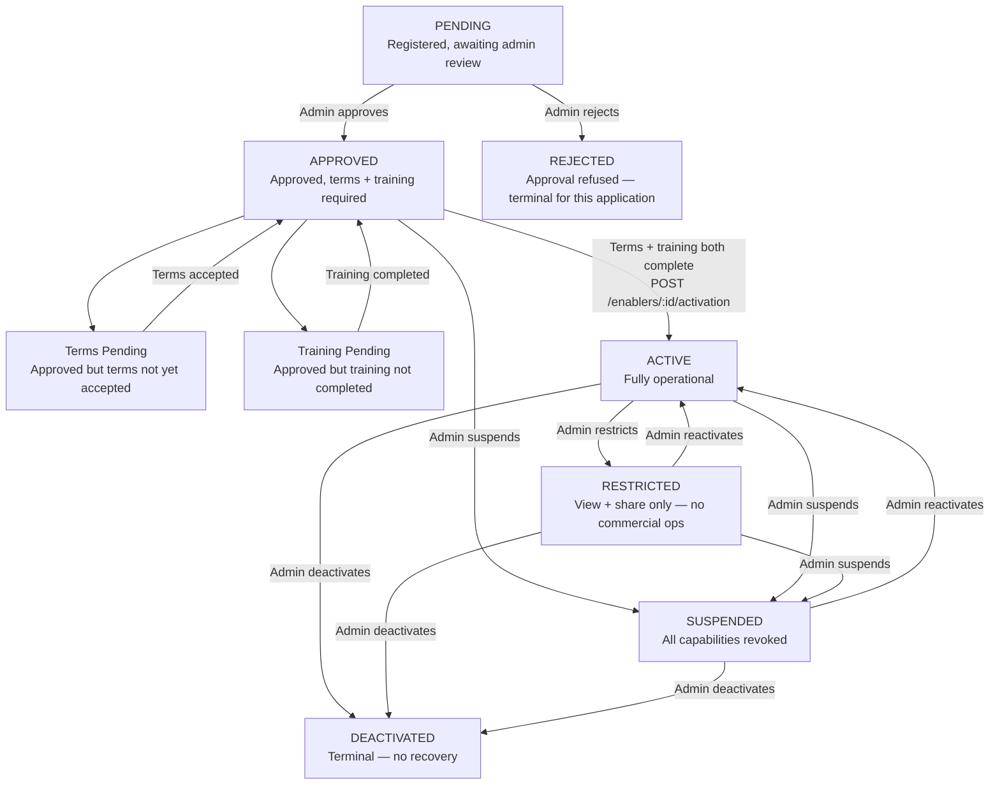
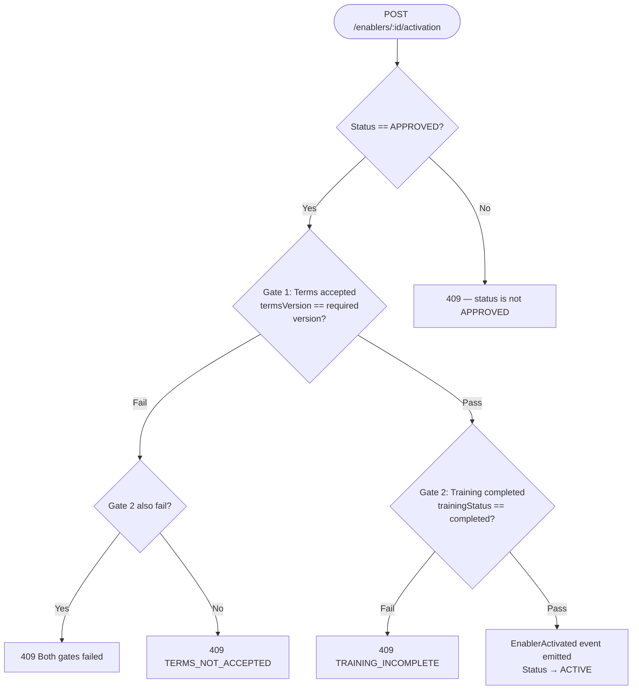

# Enabler Lifecycle Overview

> **Verification basis:** `docs/FLOWS/_verification/analysis-report.md` (September 2026 sweep); enabler-service & training-service route source (`services/enabler-service/src/api/routes/*`, `services/training-service/src/...`); `docs/enabler/ENABLER_SERVICE_SYSTEM.md` is a **phantom reference** (no such file exists) — see Known Gaps.

> **Canonical source:** `docs/FLOWS/role-overviews/enabler-lifecycle.md`
> **Legacy reference:** `docs/Flow Docs/06-enabler-journeys.md` (archived; partially verified — commission reads are now live at `/api/commission/*`, see Known Gaps below)

---

## Role Summary

**Definition:** An Enabler is an independent sales associate who generates referral links, assists buyers through the purchase journey, and earns commission on attributed orders. Commercial capabilities are not role-based — they are gated by lifecycle status, accepted terms, and training certification. The frontend must never assume an enabler is capable of any commercial action without confirming server-computed capability state.

**Primary services:** auth-service, enabler-service, training-service, kyc-service (middleware), catalog-service (via referral attribution), wallet-service, payout-service, commission-service (reads commission records and approvals at `/api/commission/*` — DEF-006 resolved)

**Key prerequisites:**
1. Account registered with `enabler` role via `POST /api/auth/register`
2. Admin approval (status transitions to `APPROVED`)
3. Current terms version accepted via `POST /enablers/:id/terms` (idempotent)
4. All mandatory training modules completed (training-service certification)
5. Both gates verified server-side via `POST /enablers/:id/activation` → status becomes `ACTIVE`

---

## Hard Prerequisites

| Prerequisite | Required For | Endpoint / Mechanism | Failure Response |
|---|---|---|---|
| Registered `enabler` account | All access | `POST /api/auth/register` with `role: "enabler"` | 400 validation error |
| Admin approval (`APPROVED` status) | Activation | Admin action via `POST /api/enabler/enablers/:id/approve` | 409 if activation attempted from `PENDING` |
| Terms acceptance (current version `2026-01`) | Activation gate 1 | `POST /enablers/:id/terms` (idempotent) | 409 `TERMS_NOT_ACCEPTED` on activation |
| Training completion (`trainingStatus === "completed"`) | Activation gate 2 | Complete all mandatory modules via training-service | 409 `TRAINING_INCOMPLETE` on activation |
| KYC level 1 | Listing creation | `requireKycLevel(1)` middleware in enabler-service | 422 `KYC_LEVEL_REQUIRED` |
| KYC level 2 | Payout initiation | `requireKycLevel` middleware in payout-service | 403 `KYC_LEVEL_INSUFFICIENT` |

---

## Lifecycle Phases

| Phase | Description | Key Endpoints | Services Involved | Prerequisites |
|---|---|---|---|---|
| **1. Registration** | Self-register with `enabler` role; wallet initialized automatically via `UserRegistered.v1` event | `POST /api/auth/register` | auth-service, user-service, wallet-service | None |
| **2. Admin Approval** | Admin reviews and approves enabler application; `enablerCode` (`ENB-XXXXXX`) and `enablerCodeShort` assigned; status → `APPROVED` | `POST /api/enabler/enablers/:id/approve` | enabler-service | Registered `enabler` account |
| **3. Terms Acceptance** | Accept current terms version (`2026-01`); endpoint is idempotent — multiple calls are safe | `POST /enablers/:id/terms` | enabler-service | `APPROVED` status |
| **4. Training Completion** | Complete all mandatory training modules; assessment scored; `training.certification_passed` event published | `POST /api/training/modules/:moduleId/complete`, `POST /api/training/assessments/:assessmentId/submit` | training-service | `APPROVED` status |
| **5. Activation (Two-Gate)** | Server checks BOTH gates simultaneously: terms accepted AND training completed. Both must pass → `EnablerActivated` event → status `ACTIVE`. Either fails → 409 | `POST /enablers/:id/activation` | enabler-service, training-service | Terms accepted + training completed |
| **6. Active Referrals** | Generate referral links, share product links with encoded `enablerCode`, assist buyers through purchase funnel | `GET /enablers/:enablerId/capabilities`, referral link endpoints | enabler-service, catalog-service, checkout-service | `ACTIVE` status |
| **7. Commission & Payout** | Commission credited to wallet by order fulfillment sagas after attributed order completes; initiate payout | `POST /api/payout/payouts` | wallet-service, payout-service | `ACTIVE` status + KYC level 2 |

---

## Account States

### State Table

| State | Description | Transitions To | Trigger |
|---|---|---|---|
| `PENDING` | Registered; awaiting admin review | `APPROVED`, `REJECTED` | Admin action |
| `APPROVED` | Approved; must complete terms + training before activation | `ACTIVE`, `SUSPENDED`, `DEACTIVATED` | Activation gates pass / admin enforcement |
| `REJECTED` | Approval refused | — (terminal for this application) | Admin decision |
| `ACTIVE` | Fully operational; all commercial capabilities available | `RESTRICTED`, `SUSPENDED`, `DEACTIVATED` | Admin enforcement |
| `RESTRICTED` | View + share capabilities only; commercial operations blocked | `ACTIVE`, `SUSPENDED`, `DEACTIVATED` | Admin enforcement; `REACTIVATE` admin action |
| `SUSPENDED` | All capabilities revoked | `ACTIVE`, `DEACTIVATED` | Admin enforcement; `REACTIVATE` admin action |
| `DEACTIVATED` | Terminal; no recovery path | — | Admin enforcement |

---

## Phase Detail

### Phase 1: Registration

The enabler self-registers using `POST /api/auth/register` with `role: "enabler"`. Self-registration is permitted — `enabler` is in `SELF_REGISTERABLE_ROLES`. On success:
- Auth-service emits `UserRegistered.v1` event
- user-service creates the user profile
- wallet-service creates a wallet for the new user (via `UserRegistered.v1` event handler)
- enabler-service creates the `PENDING` enabler profile (no `enablerCode` yet)

### Phase 2: Admin Approval

An admin reviews the application and calls the approval endpoint. On approval:
- `enablerCode` (format: `ENB-XXXXXX`) and `enablerCodeShort` (format: `EXXXXXX`) are assigned
- Enabler status transitions from `PENDING` → `APPROVED`
- Enabler can now view eligible products (`VIEW_ELIGIBLE_PRODUCTS` capability unlocked)

### Phase 3: Terms Acceptance

The enabler accepts the current terms version via `POST /enablers/:id/terms`. This endpoint is **idempotent** — calling it multiple times with the same or newer accepted version is safe and returns success. The server records `termsVersion = "2026-01"` and `termsAcceptedAt` timestamp. Terms acceptance is Gate 1 of the two-gate activation.

### Phase 4: Training Completion

The enabler completes all mandatory training modules (role: `ENABLER`) through training-service:
1. Browse available modules: `GET /api/training/modules?role=ENABLER`
2. Start each module: `POST /api/training/modules/:moduleId/start`
3. Complete each module: `POST /api/training/modules/:moduleId/complete`
4. Submit assessment: `POST /api/training/assessments/:assessmentId/submit`
5. On passing all required modules: `training.certification_passed` event published

`trainingStatus` on the enabler profile mirrors the training domain outcome: `not_started → in_progress → completed`. Training completion is Gate 2 of the two-gate activation. The training gate **fails closed**: any infrastructure error reading training state returns `trainingRequired: true, satisfied: false` — an error can never accidentally activate an enabler.

### Phase 5: Activation (Two-Gate)

`POST /enablers/:id/activation` triggers a server-side policy check (`EnablerLifecyclePolicy.canActivate`) that evaluates **both gates simultaneously**:

- **Both gates pass** → `EnablerActivated` event emitted → status = `ACTIVE` → all commercial capabilities unlocked
- **Gate 1 fails** → 409 with code `TERMS_NOT_ACCEPTED`
- **Gate 2 fails** → 409 with code `TRAINING_INCOMPLETE`
- **Both gates fail** → 409 identifying both failures
- **`POST /enablers/:id/terms` is idempotent** — the enabler can re-call it without side effects

### Phase 6: Active Referrals

Once `ACTIVE`, the enabler can:
- Generate unique referral links embedding their `enablerCode` URL parameter
- Share product links; checkout-service resolves `enablerCode`, validates the enabler is operational and not the buyer, and records attribution on the checkout session and order
- Use the Hub (`GET /api/enabler/hub`) to view product opportunities and promotion jobs
- Use assisted-sale flows (`POST /api/enabler/enablers/:enablerId/orders`) with `BUILD_ORDER_DRAFT` capability

Capability matrix for `ACTIVE` status: `VIEW_ELIGIBLE_PRODUCTS ✓`, `SHARE_PRODUCT ✓`, `BUILD_ORDER_DRAFT ✓`, `GENERATE_CUSTOMER_LINK ✓`, `ACCESS_PERMANENT_LINK ✓`, `QUALIFY_EARNING ✓`

If status transitions to `RESTRICTED` (admin enforcement): `SHARE_PRODUCT ✓` and `VIEW_ELIGIBLE_PRODUCTS ✓` remain; all others are blocked with `STATUS_NOT_PERMITTED` (403).

### Phase 7: Commission & Payout

Commission is calculated internally by order fulfillment sagas (`CalculateEnablerCommissionUseCase`); the commission rate is capped at 25%. Commission is credited to the enabler's wallet automatically — there is no HTTP endpoint to initiate commission collection.

To view earnings: `GET /api/enabler/enablers/:enablerId/earnings` and `GET /api/enabler/enablers/:enablerId/earnings/summary`.

To withdraw earnings: `POST /api/payout/payouts` (requires KYC level 2). Supported payout methods: MPESA, Airtel Money, Tigo Pesa, HaloPesa, Bank Transfer.

---

## Known Gaps

### ✅ DEF-002 — Resolved

**Sweep result (September 2026):** `GET /api/enabler/enablers/{id}` answered with a fabricated `200` stub whenever no profile row existed.

**Current state:** both `getProfile` and `POST /approve` return a truthful `404 {success:false, error:'Enabler not found'}`. `tests/e2e/enabler.e2e.test.ts` (tolerating <500 / 404) is green — verified live: 8/8 enabler E2E specs green.

**Impact:** enabler cannot retrieve their own profile via this endpoint. Any UI feature that calls `GET /api/enabler/enablers/{id}` to display the enabler's profile will receive a 404 (not 500) when the profile row is missing, and a real 200 when it exists.

**Recommended UI fallback:** show a loading skeleton that times out gracefully. Display a non-alarming message: *"Profile currently unavailable — try again later."* Do not expose the raw error to the user.

**Workaround:** enabler capabilities and status are available via `GET /enablers/:enablerId/capabilities` (Verified). Use this endpoint as the primary data source for capability-gated UI decisions.

**See also:** `docs/FLOWS/_verification/analysis-report.md`

---

### ✅ `/api/commission/*` — Registered (DEF-006 resolved)

**Sweep result (September 2026):** all `/api/commission/*` routes returned route-level 404 because `CommissionModule.name` had regressed to `commissions-service` and the bootstrap derives the mount path from the module name, so the surface was mounted at `/api/commissions`.

**Current state:** the module is named `commission-service` again; `/api/commission/*` is live and every documented operation is reachable (locked by `commission-module.contract.test.ts`).

**Context:** Commission is still calculated internally by order fulfillment sagas and credited directly to the enabler's wallet. The enabler can now also read the composition of those credits:
- `GET /api/commission/sellers/:sellerId` (use the enabler's `userId`) and `.../summary`
- `GET /api/commission/:id` for a single commission record

**Recommended UI behavior:** show the commission summary/history from `/api/commission/*`, and keep the wallet statement (`GET /api/wallet/statement`, `GET /api/enabler/enablers/:enablerId/earnings`) as the canonical record of credited money.

---

## Cross-References

| Document | Scope |
|---|---|
| `docs/FLOWS/auth/user-flow/enabler-flows.md` | Registration, login, 2FA, session lifecycle for enabler role |
| `docs/FLOWS/enabler/user-flow/enabler-flows.md` | Full enabler lifecycle: registration, terms, activation, listings, hub |
| `docs/FLOWS/training/user-flow/enabler-flows.md` | Training module completion, assessment, certification event |
| `docs/FLOWS/kyc/user-flow/enabler-flows.md` | KYC middleware gate for listing creation and payout |
| `docs/FLOWS/payout/user-flow/enabler-flows.md` | Payout initiation (KYC level 2 required) |
| `services/enabler-service/src/api/routes/` | Enabler-service route-level reference (authoritative, in-place) |
| `services/training-service/src/` | Training-service route-level reference (authoritative, in-place) |
| `docs/FLOWS/_verification/analysis-report.md` | September 2026 endpoint sweep — verification evidence |
