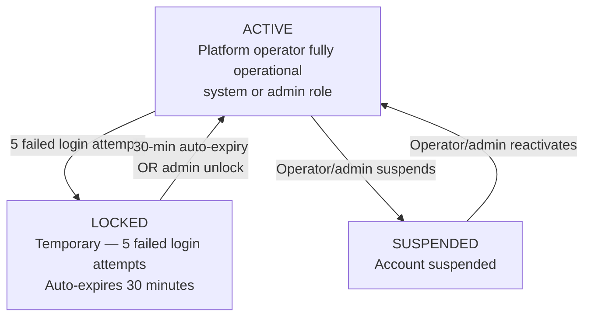

# Platform Operator Lifecycle Overview

> **Verification basis:** `docs/FLOWS/_verification/analysis-report.md` (September 2026 sweep) + `docs/auth/AUTH_SERVICE_SYSTEM.md` + `docs/wallet/WALLET_SERVICE_SYSTEM.md` + `docs/analytics/ANALYTICS_SERVICE_SYSTEM.md`
> **Canonical source:** `docs/FLOWS/role-overviews/platform-operator-lifecycle.md`
> **Legacy reference:** `docs/Flow Docs/08-platform-operations.md` (archived; accurate description of operational patterns; some maintenance endpoints note the `x-service-key` requirement less prominently than required — canonical reference is this document)

---

## Role Summary

**Definition:** A Platform Operator manages the health, reliability, and operational integrity of the Maysar platform infrastructure. Operators execute system maintenance operations (outbox cleanup, idempotency key cleanup), monitor saga health, perform saga recovery for stuck distributed transactions, and review analytics platform KPIs. Operators cannot modify user data directly.

**Primary services:** auth-service, wallet-service, notification-service, analytics-service, and all service system maintenance endpoints (auth, enabler, wallet, support, payout, user, notification, order, logistics, and others with outbox routes)

**Key prerequisites:**
1. Account with `system` or `admin` role
2. `x-service-key` header required for **all** `/system/maintenance/*` endpoints — in addition to JWT
3. 2FA recommended (mandatory if using `admin` role)

---

## Hard Prerequisites

| Prerequisite | Required For | Endpoint / Mechanism | Failure Response |
|---|---|---|---|
| `system` or `admin` role | All maintenance endpoints | JWT role claim | 401/403 |
| `x-service-key` header | All `/system/maintenance/*` endpoints | `ALLOWED_SERVICE_KEYS` env var | 401 Unauthorized |
| **Both** JWT (admin/system role) AND `x-service-key` | Outbox/idempotency cleanup operations | Both required simultaneously | 401/403 if either is missing |
| Valid JWT session | Analytics review | `POST /api/auth/login` | 401 Unauthorized |
| 2FA (if admin role) | Admin-authenticated sessions | `POST /api/auth/2fa/verify` | Session not established |

> ⚠️ **Authentication requirement for all maintenance endpoints (MANDATORY):**
> All `/system/maintenance/*` endpoints require:
> 1. Valid JWT with `admin` or `system` role
> 2. `x-service-key` header with the authorized internal service key
>
> Calling with JWT alone returns 401/403. These endpoints are **never user-facing** and must **never** be exposed in any user-facing UI or client application.

---

## Lifecycle Phases

| Phase | Description | Key Endpoints | Services Involved | Prerequisites |
|---|---|---|---|---|
| **1. Authentication** | Login with `system` or `admin` role; 2FA recommended (mandatory for admin role) | `POST /api/auth/login` (+ `POST /api/auth/2fa/verify` if admin) | auth-service | System/admin account |
| **2. Platform Monitoring** | Monitor health endpoints across all services; review analytics platform KPIs, seller profitability, SLA metrics | `GET /api/analytics/platform/kpis`, `GET /api/analytics/admin/dashboard/red-flags`, `GET /api/{service}/health/live` | analytics-service, all services | Valid session |
| **3. Outbox Management** | Execute batched outbox cleanup across all services. Requires BOTH JWT (admin/system) AND `x-service-key`. Dry-run mode available. | `POST /api/{service}/system/maintenance/cleanup/outbox`, `POST /api/{service}/system/maintenance/cleanup/outbox/report` | All services with outbox maintenance routes | JWT + `x-service-key` |
| **4. Idempotency Key Cleanup** | Clean up expired idempotency keys to prevent memory buildup. Same dual-auth requirement. | `POST /api/{service}/system/maintenance/cleanup/idempotency` | wallet-service, and others with idempotency key stores | JWT + `x-service-key` |
| **5. Saga Recovery** | Monitor and recover stuck distributed sagas via `DistributedSagaOrchestrator`. Compensation steps run automatically on failure; manual intervention for stuck sagas. | Internal saga management tooling | All services participating in sagas (order, wallet, payout, logistics) | JWT + system role |
| **6. Analytics Review** | Review founder OS view, SLA metrics, seller profitability reports, platform KPI trends | `GET /api/analytics/admin/dashboard/founder-operating-system`, `GET /api/analytics/seller-profitability/dashboard`, `GET /api/analytics/sellers/:sellerId/sla` | analytics-service | Admin role JWT |

---

## Account States

### State Table

| State | Description | Transitions To | Trigger |
|---|---|---|---|
| `ACTIVE` | Fully operational; all platform maintenance capabilities available | `LOCKED`, `SUSPENDED` | Failed login attempts / operator action |
| `LOCKED` | Temporary lockout after ≥5 failed login attempts | `ACTIVE` | 30-minute auto-expiry or admin unlock |
| `SUSPENDED` | All capabilities revoked | `ACTIVE` | Operator/admin action |

---

## Phase Detail

### Phase 1: Authentication

Platform operators authenticate with a `system` or `admin` role account:

- **`system` role:** Receives `roles: ['admin', 'system']` in JWT payload — full maintenance access
- **`admin` role:** Requires 2FA verification (`POST /api/auth/2fa/verify`) before session is established

**Note:** 2FA is recommended for all platform operator accounts given their elevated access to maintenance endpoints. For `admin` role, 2FA is mandatory.

### Phase 2: Platform Monitoring

Platform operators monitor service health and KPIs:

**Health checks (each service):**
- `GET /api/{service}/health/live` — service liveness check (no auth required)

**Platform KPIs:**
- `GET /api/analytics/platform/kpis` — platform-wide GMV, active users, active sellers, order count, conversion rate, AOV, COD acceptance rate, delivery success rate
- `GET /api/analytics/admin/dashboard/red-flags` — anomaly flags and threshold breaches
- `GET /api/analytics/admin/dashboard/founder-operating-system` — founder OS view with cohort and retention data

**Seller SLA monitoring:**
- `GET /api/analytics/sellers/:sellerId/sla` — seller SLA metrics
- `GET /api/analytics/sellers/:sellerId/sla/breaches` — SLA breach history
- `POST /api/analytics/sellers/:sellerId/sla/evaluate` — trigger SLA recalculation

### Phase 3: Outbox Management

The outbox pattern provides durable, at-least-once event publishing across all services. Outbox cleanup removes processed/sent events older than the retention window and failed events older than the failure retention window. This prevents unbounded table growth.

> ⚠️ **Authentication requirement (MANDATORY):** All outbox cleanup endpoints require:
> 1. Valid JWT with `admin` or `system` role
> 2. `x-service-key` header with the internal service key
>
> Missing either returns 401/403. These are **internal/ops-only** — never expose to user-facing UI.

**Outbox cleanup endpoints by service:**

| Service | Report (dry-run) | Execute cleanup |
|---|---|---|
| auth-service | `POST /api/auth/system/maintenance/cleanup/outbox/report` | `POST /api/auth/system/maintenance/cleanup/outbox` |
| enabler-service | `POST /api/enabler/system/maintenance/cleanup/outbox/report` | `POST /api/enabler/system/maintenance/cleanup/outbox` |
| wallet-service | `POST /api/wallet/system/maintenance/cleanup/outbox/report` | `POST /api/wallet/system/maintenance/cleanup/outbox` |
| support-service | `POST /api/support/system/maintenance/cleanup/outbox/report` | `POST /api/support/system/maintenance/cleanup/outbox` |
| payout-service | `POST /api/payout/system/maintenance/cleanup/outbox/report` | `POST /api/payout/system/maintenance/cleanup/outbox` |
| user-service | `POST /api/user/system/maintenance/cleanup/outbox/report` | `POST /api/user/system/maintenance/cleanup/outbox` |
| notification-service | `POST /api/notification/system/maintenance/cleanup/outbox/report` | `POST /api/notification/system/maintenance/cleanup/outbox` |
| order-service | `POST /api/order/system/maintenance/cleanup/outbox/report` | `POST /api/order/system/maintenance/cleanup/outbox` |
| logistics-service | `POST /api/logistics/system/maintenance/cleanup/outbox/report` | `POST /api/logistics/system/maintenance/cleanup/outbox` |

**Recommended workflow:**
1. Run the `report` endpoint first (dry-run, no deletion) — returns count of deletable rows and estimated batches
2. Review the report output
3. Run the execute endpoint with `{ "dryRun": false }` to perform actual cleanup
4. Optionally run with `{ "dryRun": true }` body parameter to simulate again

**Default retention settings (per service, overridable via env vars):**
- `SENT`/`PROCESSED` events: 7 days (`OUTBOX_SENT_RETENTION_DAYS`)
- `FAILED` events: 30 days (`OUTBOX_FAILED_RETENTION_DAYS`)
- Batch size: 1000 rows (`CLEANUP_BATCH_SIZE`)
- Max runtime per call: 20 seconds (`CLEANUP_MAX_RUNTIME_MS`)
- Sleep between batches: 200 ms (`CLEANUP_SLEEP_MS`)

**Services without outbox maintenance routes:** analytics-service and training-service do not currently expose outbox maintenance routes. If an outbox is added in future, the standard pattern applies.

### Phase 4: Idempotency Key Cleanup

Services that enforce idempotency store `IdempotencyKey` records in their databases. Expired keys accumulate over time and must be cleaned up to prevent memory and storage buildup.

> ⚠️ **Authentication requirement:** Same dual-auth requirement as outbox cleanup: JWT (admin/system role) + `x-service-key` header.

**wallet-service idempotency cleanup:**
- `POST /api/wallet/system/maintenance/cleanup/idempotency/report` — dry-run count
- `POST /api/wallet/system/maintenance/cleanup/idempotency` — execute cleanup

Other services may expose idempotency cleanup routes following the same pattern. Consult each service's system documentation.

### Phase 5: Saga Recovery

The platform uses `DistributedSagaOrchestrator` for multi-service operations that require compensation on failure. Key sagas:

| Saga | Services Involved | Purpose |
|---|---|---|
| `WalletTransactionSaga` | wallet-service | Multi-step wallet operations with compensation |
| `CODSettlementSaga` | wallet-service, logistics-service | COD hold capture on delivery; release on cancellation |
| Payout saga | wallet-service, payout-service | `checkEligibility → freezeFunds → debitFrozenFunds → creditWallet` |
| Order creation chain | checkout-service, order-service, logistics-service, wallet-service | `POST /api/checkout/{id}/confirm` → in-process order + shipment + price lock |

**Automatic compensation:** On saga failure, compensation steps run automatically — e.g., a held amount is released if the downstream payout fails.

**Manual saga recovery (for stuck sagas):** When a saga is stuck (e.g., a compensation step failed, or the saga is in a limbo state due to a service restart mid-saga), manual intervention may be needed. This typically involves:
1. Identifying the stuck saga record in the database
2. Determining the last successful step and the compensation state
3. Manually triggering the appropriate compensation endpoint or correcting the saga state

**Saga recovery is not surfaced through documented HTTP endpoints** — it requires direct database access or internal tooling. Contact the platform engineering team for saga recovery procedures.

**Ledger integrity monitoring (wallet-service):**
- `GET /api/wallet/balance` — verify wallet balance consistency
- `GET /api/wallet/statement` — paginated transaction history for audit
- The wallet enforces `availableBalance = balance − frozenAmount` as a domain invariant (enforced at construction)

### Phase 6: Analytics Review

Platform operators have access to the full analytics suite for operational and business review:

- `GET /api/analytics/platform/kpis` — platform-wide KPIs with trend data
- `GET /api/analytics/admin/dashboard/founder-operating-system` — cohort analysis, retention curves, GMV breakdown
- `GET /api/analytics/seller-profitability/dashboard` — aggregate seller profitability
- `GET /api/analytics/seller-profitability/revenue-health` — revenue health signals
- `GET /api/analytics/seller-profitability/retention` — buyer retention metrics

---

## Known Gaps

### ℹ️ `/api/governance/*` — Removed From The Platform (DEF-007)

The governance route surface does not exist in this platform. The governance-service module was deleted
(commit `cfcfd08b`), and its retainer artifacts were removed with it: all `/api/governance/*` paths and
`Governance*` schemas are gone from `openapi.yaml` and `api-contract.yaml`, the CI `governance-audit`
job and the `governance:*` npm scripts are deleted, and `reports/governance/` is gone.

**Impact:** no admin or compliance workflow may reference governance endpoints. Platform administration
runs through the service endpoints listed above.

---

### No User-Facing Gaps in Core Maintenance Operations

All `/system/maintenance/*` operations are internal-only. There are no user-facing flows that depend on these endpoints, and their unavailability does not surface as a user-visible gap. The dual-auth requirement (JWT + `x-service-key`) ensures these endpoints are not accidentally called from user-facing code.

---

## Cross-References

| Document | Scope |
|---|---|
| `docs/FLOWS/analytics/user-flow/admin-flows.md` | Platform KPI monitoring, red flags, founder OS view |
| `docs/FLOWS/wallet/user-flow/buyer-flows.md` | Wallet hold lifecycle and COD commitment ledger (ledger integrity context) |
| `docs/wallet/WALLET_SERVICE_SYSTEM.md` | Wallet sagas, idempotency, COD commitment ledger — authoritative reference |
| `docs/auth/AUTH_SERVICE_SYSTEM.md` | Authentication, 2FA, session management — authoritative reference |
| `docs/analytics/ANALYTICS_SERVICE_SYSTEM.md` | Analytics service endpoints — authoritative reference |
| `docs/FLOWS/role-overviews/admin-lifecycle.md` | Admin lifecycle (overlapping maintenance capabilities) |
| `docs/FLOWS/_verification/analysis-report.md` | September 2026 endpoint sweep — verification evidence |
