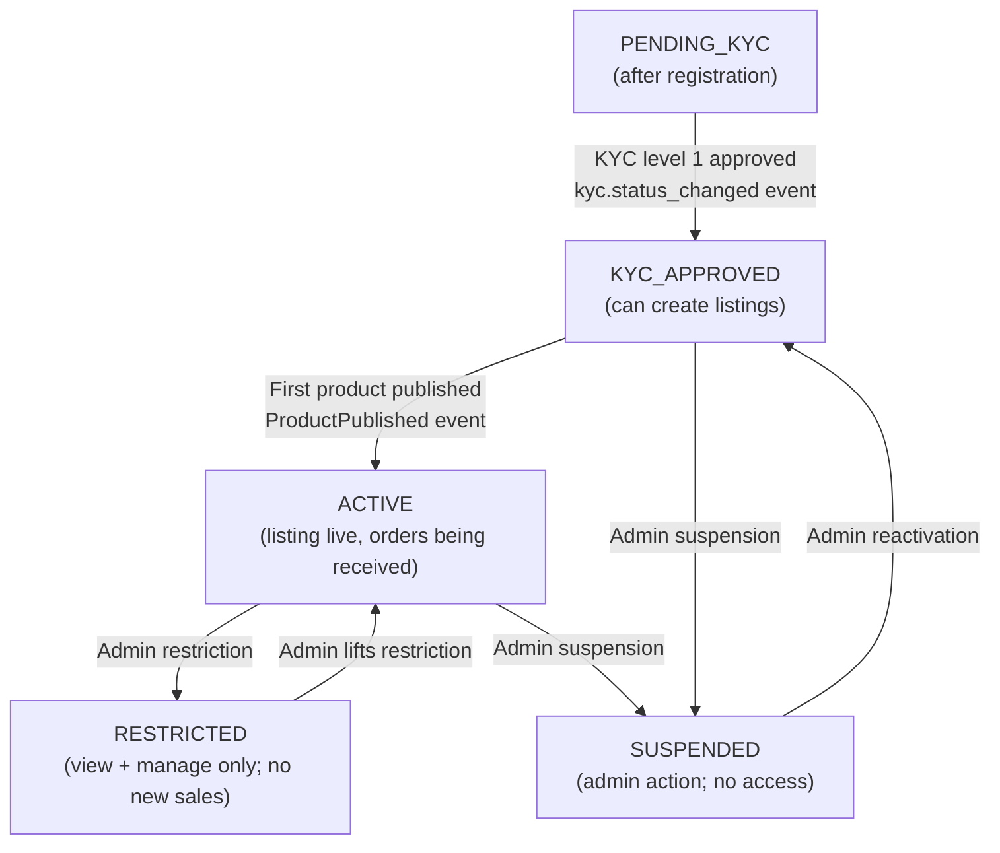

# Seller Lifecycle Overview

> **Verification basis:** `docs/FLOWS/_verification/analysis-report.md` (September 2026 sweep, 563 operations)
> **Canonical source:** `docs/FLOWS/role-overviews/seller-lifecycle.md`
> **Legacy reference:** `docs/Flow Docs/03-seller-journeys.md` — ⚠️ **CONFLICTING** (references `compliance-service` as a live service; see Conflict Notes below)
> **Last updated:** September 2026

---

## Role Summary

A Seller is a registered platform user who lists products, manages inventory, fulfills orders, and receives payouts. Sellers operate within a structured gate system: a business must be registered via business-registry-service, and KYC must be completed at the required level before commercial activities are unlocked. KYC level 1 is required before creating product listings; KYC level 2 is required before requesting payouts. Sellers cannot access buyer COD trust controls, courier assignment details, or admin dashboards.

> ⚠️ **Conflict Note:** `docs/Flow Docs/03-seller-journeys.md` references `compliance-service` (`Comp`) as an independent live service for KYC and AML review. **`compliance-service` does not exist** in the verified service inventory and is not present in `docs/SERVICE_DEPENDENCY_MAP.md`. KYC is handled entirely by the `kyc-service` middleware — specifically the `requireKycLevel` function imported into catalog-service, payout-service, wallet-service, and enabler-service routes. There are no `/api/kyc/*` HTTP endpoints. The canonical KYC flow is documented at `docs/FLOWS/kyc/user-flow/seller-flows.md`.

---

## Hard Prerequisites

| Prerequisite | What Must Be True | Gate |
|---|---|---|
| Account registration | `POST /api/auth/register` with `role: "seller"` | Required for all actions |
| Wallet initialized | wallet-service creates wallet on `user.registered` event | Required before receiving payments |
| Business registered | `POST /api/business-registry/businesses` | Required before selling |
| KYC level 1 | `requireKycLevel(1)` middleware in catalog-service routes | Required to create product listings (`POST /api/catalog/v1/products`) |
| KYC level 2 | `requireKycLevel(2)` middleware in payout-service routes | Required to request payouts (`POST /api/payout/payouts`) |
| Quality score ≥ 60 | Catalog quality score checked at publish time | Required to publish a product listing |

---

## Lifecycle Phases

| Phase | Description | Key Endpoints | Services Involved | Prerequisites |
|---|---|---|---|---|
| **1. Registration** | Create seller account; wallet initialized automatically | `POST /api/auth/register` | auth, user, wallet | None |
| **2. Business Registration** | Register business entity for the seller | `POST /api/business-registry/businesses` | business-registry | Registered account |
| **3. KYC** | Complete KYC verification via kyc-service middleware gate; unlocks product creation and payouts | KYC middleware gate (no direct HTTP surface) | kyc (middleware only) | Business registered |
| **4. Catalog Setup** | Create product drafts, publish listings (quality score ≥ 60), enter buy-box competition | `POST /api/catalog/v1/products`, `POST /api/catalog/v1/products/{id}/publish` | catalog, inventory | KYC level 1 |
| **5. Active Selling** | Receive order notifications, verify or decline stock, hand off to logistics | `GET /api/order/seller/orders`, `POST /api/order/orders/:orderId/verify-stock`, `POST /api/order/orders/:orderId/decline-stock` | order, logistics, notification | Published product |
| **6. Payout** | Request payout of earned wallet balance to mobile money or bank | `POST /api/payout/payouts` | payout, wallet | KYC level 2 |

---

## Account States

| State | Description | Entry Trigger | Exit Trigger |
|---|---|---|---|
| `PENDING_KYC` | Account created; KYC not yet completed | Registration | KYC level 1 approved |
| `KYC_APPROVED` | KYC level 1 passed; can create listings but no active sales yet | `kyc.status_changed` event | First product published or suspension |
| `ACTIVE` | Products published; orders being received and fulfilled | First `ProductPublished` event | Restriction or suspension |
| `RESTRICTED` | Can view and manage existing inventory; cannot receive new orders | Admin action | Admin lifts restriction |
| `SUSPENDED` | Full account suspension; no access to selling functions | Admin action | Admin reactivation |

---

## Phase Detail

### Phase 1: Registration

`POST /api/auth/register` with `role: "seller"`. On success:
- auth-service emits `UserRegistered.v1`
- user-service creates the profile
- wallet-service creates the seller's wallet (event-driven via `user.registered`)

### Phase 2: Business Registration

`POST /api/business-registry/businesses` creates the seller's business record. This is required before the seller can list products or be shown in seller discovery.

> ⚠️ **Known Gap:** Most `/api/business-registry/public/*` sub-routes return route-level 404 (Missing) in the September 2026 sweep. `GET /api/business-registry/public/sellers/{sellerId}` returns a data-level 404 (Verified — route exists). Seller public discovery is partially broken. See `docs/FLOWS/business-registry/user-flow/seller-flows.md`.

### Phase 3: KYC

**KYC is not a standalone HTTP service.** There are no `/api/kyc/*` endpoints. KYC is enforced as the `requireKycLevel` middleware function imported from kyc-service into consuming services:

| Gate | Middleware | Enforced In |
|---|---|---|
| KYC level 1 | `requireKycLevel(1)` | catalog-service — `POST /api/catalog/v1/products` |
| KYC level 2 | `requireKycLevel(2)` | payout-service — `POST /api/payout/payouts` |

When KYC is insufficient, the route returns 422 with error code `KYC_LEVEL_INSUFFICIENT`.

The `kyc.status_changed` event is published by kyc-service and consumed by order-service, which uses it as a COD trust signal.

### Phase 4: Catalog Setup

1. `POST /api/catalog/v1/products` — KYC level 1 required; creates product in `DRAFT` status
2. Product fingerprinting prevents duplicate listings (`FingerprintAlgorithm`)
3. `POST /api/catalog/v1/products/{id}/publish` — quality score ≥ 60 required; transitions product to `ACTIVE`
4. `ProductPublished` event emitted → buy-box competition begins (9-signal composite ranking engine)

Product statuses: `DRAFT → PENDING_REVIEW → ACTIVE | REJECTED | ARCHIVED`

> ⚠️ **Known Gap:** `DELETE /api/catalog/v1/admin/buy-box/anomaly-flags/{flagId}` returns 500 (Failing). This affects admin workflows, not seller directly, but sellers' listings may remain flagged if the admin cannot clear anomaly flags.

### Phase 5: Active Selling

When an order is placed for a seller's product, order-service sends `order.pending_seller_verification` notification. The seller must respond within the configured `VerificationTimeoutJob` window:

- `POST /api/order/orders/:orderId/verify-stock` — confirms stock; order advances to `CONFIRMED`
- `POST /api/order/orders/:orderId/decline-stock` — declines; order cancelled, buyer wallet restored

After verification, logistics-service handles the fulfillment chain. The seller hands off the physical goods to the courier.

### Phase 6: Payout

`POST /api/payout/payouts` requires KYC level 2. It returns **403 Forbidden** if the user is a buyer role — this endpoint is blocked for buyers by design.

Payout saga:
1. `checkEligibility` — validates KYC level, minimum payout amount, wallet balance
2. `freezeFunds` — freezes payout amount in wallet
3. `debitFrozenFunds` — debits the frozen amount
4. `creditWallet` — routes funds to provider (MPESA, Airtel Money, Tigo Pesa, HaloPesa, bank transfer)

Payout statuses: `PENDING → PROCESSING → COMPLETED | FAILED | REVERSED`

---

## Known Gaps

| Endpoint | Status | Impact |
|---|---|---|
| `DELETE /api/catalog/v1/admin/buy-box/anomaly-flags/{flagId}` | **FAILING (500)** | Admin cannot delete buy-box anomaly flags; affects seller listing visibility indirectly |
| Most `/api/business-registry/public/*` sub-routes | **MISSING (route-level 404)** | Public seller discovery is partially broken |

---

## Cross-References

| Service | User Flow Document | Frontend Guide |
|---|---|---|
| auth | `docs/FLOWS/auth/user-flow/seller-flows.md` | `docs/FLOWS/auth/frontend-guide/seller-guide.md` |
| business-registry | `docs/FLOWS/business-registry/user-flow/seller-flows.md` | `docs/FLOWS/business-registry/frontend-guide/seller-guide.md` |
| kyc | `docs/FLOWS/kyc/user-flow/seller-flows.md` | `docs/FLOWS/kyc/frontend-guide/seller-guide.md` |
| catalog | `docs/FLOWS/catalog/user-flow/seller-flows.md` | `docs/FLOWS/catalog/frontend-guide/seller-guide.md` |
| inventory | `docs/FLOWS/inventory/user-flow/seller-flows.md` | `docs/FLOWS/inventory/frontend-guide/seller-guide.md` |
| order | `docs/FLOWS/order/user-flow/seller-flows.md` | `docs/FLOWS/order/frontend-guide/seller-guide.md` |
| payout | `docs/FLOWS/payout/user-flow/seller-flows.md` | `docs/FLOWS/payout/frontend-guide/seller-guide.md` |
| wallet | `docs/FLOWS/wallet/user-flow/seller-flows.md` | `docs/FLOWS/wallet/frontend-guide/seller-guide.md` |
| analytics | `docs/FLOWS/analytics/user-flow/seller-flows.md` | `docs/FLOWS/analytics/frontend-guide/seller-guide.md` |
