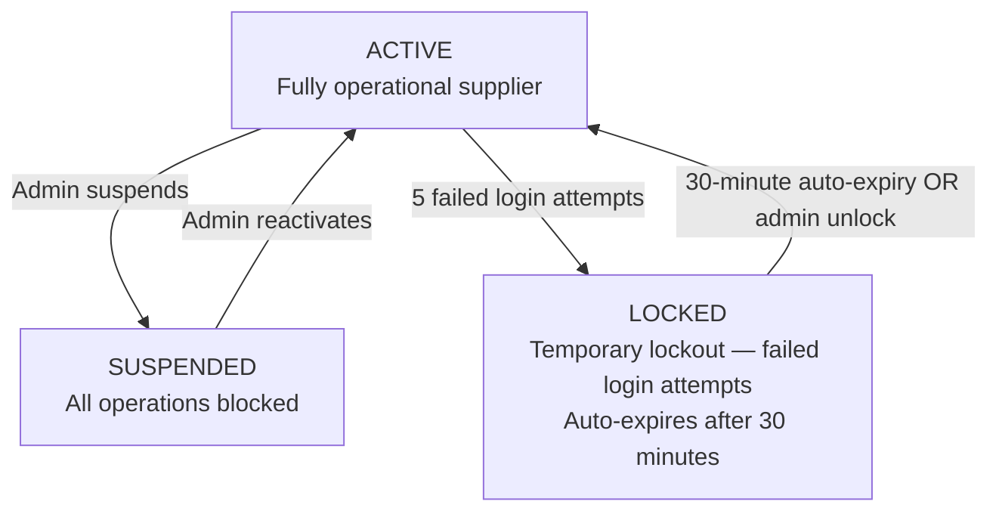

# Supplier Lifecycle Overview

> **Verification basis:** `docs/FLOWS/_verification/analysis-report.md` (September 2026 sweep) + `docs/production/PRODUCTION_SERVICE_SYSTEM.md`
> **Canonical source:** `docs/FLOWS/role-overviews/supplier-lifecycle.md`
> **Legacy reference:** `docs/Flow Docs/04-supplier-journeys.md` (archived; Partially Verified only — see Role Summary and Known Gaps below)
> **Verification status:** ⚠️ **Partially Verified** — `production-service` has no documented inter-service event subscriptions in the verified dependency map (`docs/SERVICE_DEPENDENCY_MAP.md`). Supplier flows are partially verified only. This limitation is documented throughout this file.

---

## Role Summary

**Definition:** A Supplier produces goods at scale for the platform. Suppliers manage production plans, execute quality checkpoints, sync completed inventory, fulfill bulk orders from sellers and the platform, and receive payment via the payout system.

> ⚠️ **Partially Verified Notice:** The `production-service` has **no documented inter-service event subscriptions** in the verified dependency map (`docs/SERVICE_DEPENDENCY_MAP.md`). This means the integration chain between production-service and other services (inventory-service, order-service, logistics-service) has not been fully confirmed via the September 2026 sweep. All supplier flows that cross service boundaries should be treated as **Partially Verified** until the dependency map is updated with confirmed event subscriptions. This limitation does not affect the happy path within production-service itself — the production plan lifecycle endpoints are live and verified.

**Primary services:** auth-service, user-service, production-service, inventory-service, wallet-service, payout-service

**Key prerequisites:**
1. Account registered with `supplier` role via `POST /api/auth/register`
2. KYC level 2 required for payout initiation

---

## Hard Prerequisites

| Prerequisite | Required For | Endpoint / Mechanism | Failure Response |
|---|---|---|---|
| Registered `supplier` account | All access | `POST /api/auth/register` with `role: "supplier"` | 400 validation error |
| Active account status | All operations | Auth-service JWT validation | 401 / 403 |
| KYC level 2 | Payout initiation | `requireKycLevel` middleware in payout-service | 403 `KYC_LEVEL_INSUFFICIENT` |

---

## Lifecycle Phases

| Phase | Description | Key Endpoints | Services Involved | Prerequisites |
|---|---|---|---|---|
| **1. Registration** | Self-register with `supplier` role; wallet initialized automatically via `UserRegistered.v1` event | `POST /api/auth/register` | auth-service, user-service, wallet-service | None |
| **2. Production Planning** | Create and manage production plans through the full plan lifecycle: `DRAFT → SCHEDULED → IN_PRODUCTION → QUALITY_CHECK → READY` | `POST /api/production/plans`, `POST /api/production/plans/:planId/schedule`, `POST /api/production/plans/:planId/start` | production-service | Registered supplier account |
| **3. Quality Checkpoints** | Record quality checkpoint results at each production stage; all required checkpoints must pass before a plan can be marked READY | `POST /api/production/plans/:planId/checkpoints/:checkpointId` | production-service | Active production plan in `IN_PRODUCTION` or `QUALITY_CHECK` state |
| **4. Inventory Sync** | Completed goods (`READY` plans) sync to inventory-service; stock becomes available for order fulfillment | `production.plan_ready` event → inventory-service *(Partially Verified — event subscription unconfirmed)* | production-service, inventory-service | Plan status `READY` |
| **5. Bulk Fulfillment** | Fulfill bulk orders from sellers and the platform; goods shipped via logistics-service | Logistics and order endpoints *(Partially Verified — cross-service integration unconfirmed)* | production-service, inventory-service, logistics-service, order-service | `READY` inventory |
| **6. Receivables & Payout** | Receive payment in wallet after order fulfillment; initiate payout to bank/mobile money | `POST /api/payout/payouts` | wallet-service, payout-service | KYC level 2 |

---

## Account States



### State Table

| State | Description | Transitions To | Trigger |
|---|---|---|---|
| `ACTIVE` | Fully operational; all supplier capabilities available | `SUSPENDED`, `LOCKED` | Admin enforcement / failed login attempts |
| `SUSPENDED` | All capabilities revoked | `ACTIVE` | Admin enforcement — `POST /api/auth/admin/users/:id/suspend` |
| `LOCKED` | Temporary lockout after ≥5 failed login attempts | `ACTIVE` | 30-minute auto-expiry or admin `POST /api/auth/admin/users/:id/unlock` |

---

## Phase Detail

### Phase 1: Registration

The supplier self-registers using `POST /api/auth/register` with `role: "supplier"`. The `supplier` role is in `SELF_REGISTERABLE_ROLES`. On success:
- Auth-service emits `UserRegistered.v1` event
- user-service creates the user profile
- wallet-service creates a wallet for the new user (via `UserRegistered.v1` event handler)

No additional approval step is required — supplier accounts are `ACTIVE` immediately after email/phone verification.

### Phase 2: Production Planning

The supplier creates a production plan via `POST /api/production/plans`. The plan begins as a `DRAFT` and follows a structured state machine:

```
DRAFT → SCHEDULED → IN_PRODUCTION → QUALITY_CHECK → READY | REJECTED
```

| Plan Status | Supplier Action | Endpoint |
|---|---|---|
| `DRAFT` | Schedule production start date | `POST /api/production/plans/:planId/schedule` |
| `SCHEDULED` | Start production when ready | `POST /api/production/plans/:planId/start` |
| `IN_PRODUCTION` | Record quality checkpoints | `POST /api/production/plans/:planId/checkpoints/:checkpointId` |
| `QUALITY_CHECK` | Complete final inspection | `POST /api/production/plans/:planId/checkpoints/:checkpointId` |
| `READY` | Notify logistics; plan is complete | (event-driven) |
| `REJECTED` | Review rejection reason; create new plan | `POST /api/production/plans` |

Plans can be rejected by admin (`POST /api/production/plans/:planId/reject`) from any non-terminal state.

### Phase 3: Quality Checkpoints

Each production plan includes mandatory quality checkpoints. Checkpoint types:
- `RAW_MATERIAL_INSPECTION` — verify input materials before production starts
- `IN_PROCESS_INSPECTION` — verify work in progress
- `FINAL_INSPECTION` — verify completed goods
- `PACKAGING_INSPECTION` — verify packaging before shipment

All required checkpoints must reach `PASSED` status before `POST /api/production/plans/:planId/complete` can be called. A `FAILED` checkpoint emits `production.checkpoint_failed` and must be re-inspected or the plan re-evaluated.

### Phase 4: Inventory Sync

> ⚠️ **Partially Verified:** The `production.plan_ready` event is documented as emitted by `CompleteProductionUseCase`, but no consumer subscription from inventory-service is confirmed in `docs/SERVICE_DEPENDENCY_MAP.md`.

When a plan reaches `READY`, the `production.plan_ready` event is published. Based on service documentation, inventory-service is expected to consume this event and update stock levels. However, this integration is **not confirmed in the verified dependency map**. Supplier UX should not rely on immediate inventory availability after a plan completes until this integration is fully verified.

### Phase 5: Bulk Fulfillment

> ⚠️ **Partially Verified:** Cross-service integration between production-service, inventory-service, and order-service for bulk fulfillment is not confirmed in the verified dependency map.

Once inventory is available, bulk orders from sellers or the platform are fulfilled. The exact integration chain (order triggers, inventory reservation, logistics handoff) follows the same patterns as standard seller fulfillment but is not fully confirmed for the supplier role specifically.

### Phase 6: Receivables & Payout

Payment is credited to the supplier's wallet through the platform's settlement process. To initiate a withdrawal:
- `POST /api/payout/payouts` — requires KYC level 2 and a valid JWT with supplier role
- Supported payout methods: MPESA (TZS 1,000 min), Airtel Money (TZS 1,000 min), Tigo Pesa (TZS 1,000 min), HaloPesa (TZS 1,000 min), Bank Transfer (TZS 10,000 min, 1–3 business days)
- Payout status: `PENDING → PROCESSING → COMPLETED | FAILED | REVERSED`

---

## Known Gaps

### ⚠️ Production-Service: No Confirmed Inter-Service Event Subscriptions

**Status:** Partially Verified

The `production-service` does not have inter-service event subscriptions documented in the verified dependency map (`docs/SERVICE_DEPENDENCY_MAP.md`). This means:
- The integration between `production.plan_ready` and inventory-service stock updates is **not sweep-confirmed**
- Cross-service bulk fulfillment flows are **not sweep-confirmed**
- The happy path **within** production-service (plan creation, quality checkpoints, state transitions) is verified based on service documentation

**Impact:** Supplier flows that depend on production completing and triggering downstream services (inventory, order, logistics) cannot be documented as fully verified capabilities.

**Recommended approach:** Until the dependency map is updated, test the full supplier fulfillment flow in a staging environment before relying on it in production. The production plan lifecycle itself (all endpoints under `/api/production/plans/*`) can be relied upon as verified.

---

## Cross-References

| Document | Scope |
|---|---|
| `docs/FLOWS/auth/user-flow/supplier-flows.md` | Registration, login, session lifecycle for supplier role |
| `docs/FLOWS/production/user-flow/supplier-flows.md` | Production planning, quality checkpoints, plan lifecycle |
| `docs/FLOWS/inventory/user-flow/seller-flows.md` | Inventory management (shared with seller role) |
| `docs/FLOWS/payout/user-flow/supplier-flows.md` | Payout initiation (KYC level 2 required) |
| `docs/production/PRODUCTION_SERVICE_SYSTEM.md` | Authoritative service implementation reference |
| `docs/SERVICE_DEPENDENCY_MAP.md` | Verified inter-service dependency map — notes absence of production-service subscriptions |
| `docs/FLOWS/_verification/analysis-report.md` | September 2026 endpoint sweep — verification evidence |
