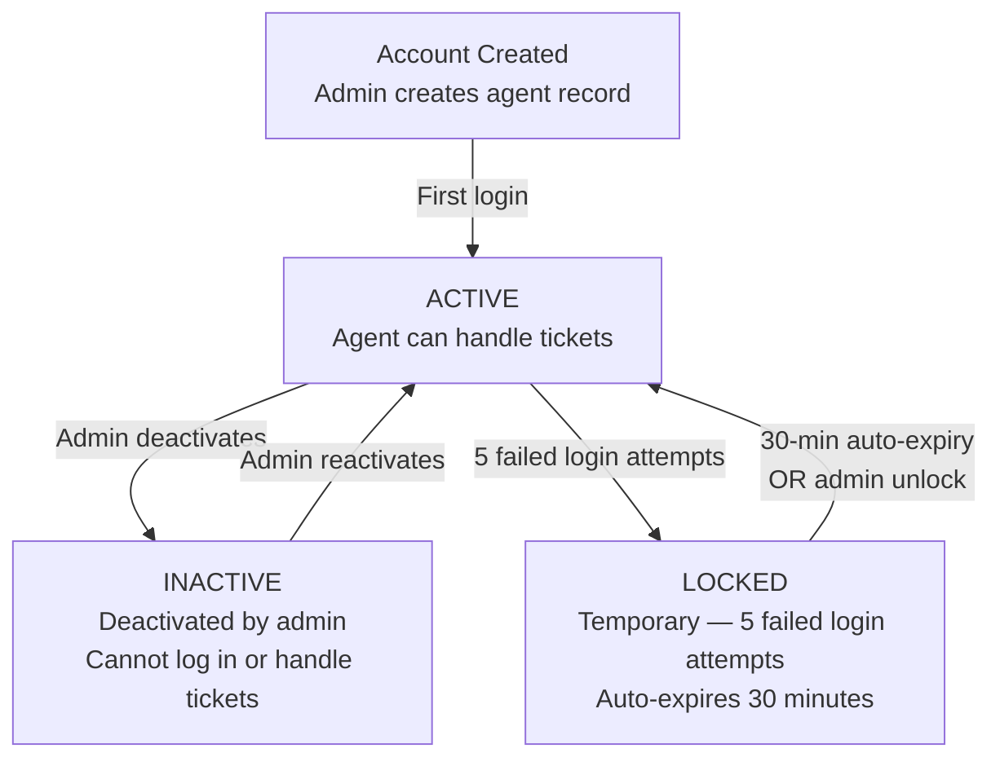

# Support Agent Lifecycle Overview

> **Verification basis:** `docs/FLOWS/_verification/analysis-report.md` (September 2026 sweep) + `docs/support/SUPPORT_SERVICE_SYSTEM.md`
> **Canonical source:** `docs/FLOWS/role-overviews/support-agent-lifecycle.md`
> **Legacy reference:** `docs/Flow Docs/07-admin-support-compliance.md` (archived; conflicts on `compliance-service` — not applicable to this role)
> **Verification status:** ✅ **Verified** — support-service endpoints confirmed in the September 2026 sweep

---

## Role Summary

**Definition:** A Support Agent handles customer support tickets, manages escalations, resolves disputes (including COD disputes), and performs KYC status lookups. Support agents cannot self-register — their accounts are created by an admin. Support agents cannot initiate payouts, access seller analytics, or modify catalog or order data directly.

**Primary services:** auth-service, support-service, user-service (read for context), order-service (read for context), payment-service (read for context)

**Key prerequisites:**
1. Account with `support-agent` role — **created by admin** via `POST /api/support/agents` (cannot self-register)
2. Admin creates the agent record in support-service and the corresponding auth account

---

## Hard Prerequisites

| Prerequisite | Required For | Endpoint / Mechanism | Failure Response |
|---|---|---|---|
| `support-agent` role account (admin-created) | All support operations | Admin action: `POST /api/support/agents` | Account does not exist |
| Valid JWT (support-agent role) | All ticket/dispute operations | `POST /api/auth/login` | 401 Unauthorized |
| Agent JWT | Ticket assignment, resolution, escalation | Role check in support-service middleware | 403 Forbidden |
| Admin JWT | Agent record creation/update | `POST /api/support/agents`, `PUT /api/support/agents/:id` | 403 Forbidden |

---

## Lifecycle Phases

| Phase | Description | Key Endpoints | Services Involved | Prerequisites |
|---|---|---|---|---|
| **1. Account Creation** | Admin creates support agent record; agent cannot self-register | `POST /api/support/agents` | support-service, auth-service | Admin account |
| **2. Authentication** | Agent logs in with credentials issued by admin | `POST /api/auth/login` | auth-service | Admin-created account |
| **3. Ticket Triage** | View open ticket inbox; review ticket categories and priorities | `GET /api/support/tickets`, `GET /api/support/admin/tickets` | support-service | Valid agent session |
| **4. Assignment** | Assign ticket to self or another agent | `PATCH /api/support/tickets/:id/assign` | support-service | Valid agent session |
| **5. Resolution** | Add messages to ticket thread; resolve or close ticket | `POST /api/support/tickets/:ticketId/messages`, `POST /api/support/tickets/:id/resolve`, `POST /api/support/tickets/:id/close` | support-service | Assigned ticket |
| **6. Escalation** | Manual escalation or SLA-breach auto-escalation | `POST /api/support/tickets/:id/escalate` | support-service | Assigned ticket |
| **7. COD Dispute Handling** | Handle COD disputes; resolution emits event that applies reputation penalty | `POST /api/support/disputes/:id/resolve` | support-service, user-service | Valid agent session |

---

## Account States



### State Table

| State | Description | Transitions To | Trigger |
|---|---|---|---|
| Account Created | Admin has created the agent record; first login pending | `ACTIVE` | Agent first login |
| `ACTIVE` | Fully operational; can handle tickets and disputes | `INACTIVE`, `LOCKED` | Admin action / failed login attempts |
| `INACTIVE` | Deactivated by admin; cannot log in or handle tickets | `ACTIVE` | Admin reactivation via `PUT /api/support/agents/:id` |
| `LOCKED` | Temporary lockout after ≥5 failed login attempts | `ACTIVE` | 30-minute auto-expiry or admin unlock |

---

## Phase Detail

### Phase 1: Account Creation

Support agents **cannot self-register**. Account creation is admin-gated:

1. Admin calls `POST /api/support/agents` to create the agent record in support-service
2. Admin (or auth-service integration) provisions the corresponding auth account with `support-agent` role
3. Admin communicates credentials to the agent (initial password, login URL)

To update an agent record: `PUT /api/support/agents/:id` (admin JWT required)

### Phase 2: Authentication

The agent logs in using `POST /api/auth/login` with their admin-issued credentials. A standard JWT pair is returned. 2FA is not mandatory for support agents (unlike admins), but can be optionally configured.

**Lockout behavior:** After 5 consecutive failed login attempts, the account is locked for 30 minutes. An admin can unlock early via `POST /api/auth/admin/users/:id/unlock`.

### Phase 3: Ticket Triage

After login, the agent accesses the ticket inbox:
- `GET /api/support/admin/tickets` — all tickets (admin inbox; requires agent JWT)
- `GET /api/support/tickets?status=OPEN` — filter for open tickets requiring attention

**Ticket categories:** `ORDER_ISSUE`, `PAYMENT_ISSUE`, `DELIVERY_ISSUE`, `ACCOUNT_ISSUE`, `KYC_ISSUE`, `REFUND_REQUEST`, `GENERAL`

**Ticket priorities:** `LOW`, `MEDIUM`, `HIGH`, `URGENT`

**Ticket status lifecycle:**
```
OPEN → ASSIGNED → IN_PROGRESS → ESCALATED → RESOLVED → CLOSED
                ↑                          ↓
                └────────── reopen ────────┘ (RESOLVED | CLOSED → IN_PROGRESS)
```

### Phase 4: Assignment

The agent assigns a ticket to themselves or to another agent:
- `PATCH /api/support/tickets/:id/assign` — body: `{ "agentId": "agent_user_id" }`

After assignment, ticket status transitions to `IN_PROGRESS`. The assigned agent's name is visible in the ticket UI for the user.

### Phase 5: Resolution

The agent works the ticket by adding messages to the thread and then resolving:
1. `POST /api/support/tickets/:ticketId/messages` — append message to the ticket thread (append-only; messages are never deleted)
2. `POST /api/support/tickets/:id/resolve` — mark ticket as resolved; triggers `support.ticket_resolved` event and sends resolution notification to user
3. `POST /api/support/tickets/:id/close` — close the ticket (typically after user confirms resolution or after SLA-mandated auto-close period)

**Ticket thread model:** Messages are append-only — the audit trail is permanent. Sender field is `USER` or `AGENT` for display purposes.

### Phase 6: Escalation

Escalation can be triggered two ways:

**Automatic (SLA breach):** When a ticket's `slaDeadline` passes without resolution, the system automatically triggers an `EscalationTriggered` event. This transitions the ticket to `ESCALATED` and notifies the next tier.

**Manual (agent action):** `POST /api/support/tickets/:id/escalate` — agent can manually escalate before SLA breach. Body: `{ "reason": "..." }`.

Both automatic and manual escalation emit `support.ticket_escalated` event (payload: `ticketId, escalationLevel`).

**SLA deadline** is set at ticket creation based on priority. The ticket UI should display a countdown to `slaDeadline` for `OPEN` and `IN_PROGRESS` tickets.

### Phase 7: COD Dispute Handling

COD (Cash on Delivery) disputes arise when a buyer disputes a COD transaction — e.g., claims payment was not accepted correctly or goods were not received.

**COD dispute workflow:**
1. Dispute is created (by buyer or system) and routed to support queue
2. Agent reviews dispute: `GET /api/support/disputes/:id`
3. Agent resolves: `POST /api/support/disputes/:id/resolve`

**On resolution:**
- support-service emits `COD_DISPUTE_RESOLVED` event
- user-service consumes the event and applies a **COD reputation penalty** to the buyer's trust profile
- The buyer's COD trust tier may be downgraded based on accumulated dispute history

> **Note:** COD dispute resolution has real, lasting consequences for the buyer's platform access (COD exposure limits, geographic radius). Agents should confirm facts before resolving a dispute.

**KYC lookup** (used in dispute context):
- `GET /api/support/admin/kyc/:userId` — retrieve KYC status for a user (agent JWT required)

---

## Known Gaps

Support-service endpoints are **Verified** in the September 2026 sweep. There are no known failing or missing endpoints that block core support agent workflows.

Data-level 404s observed in the sweep (`GET /api/support/disputes/{id}` and `GET /api/support/tickets/{id}`) are verified behavior — the route exists; the sweep fixture had no matching data.

---

## Cross-References

| Document | Scope |
|---|---|
| `docs/FLOWS/support/user-flow/support-agent-flows.md` | Full support agent ticket and dispute flows |
| `docs/FLOWS/auth/user-flow/support-agent-flows.md` | Authentication, session management for support role |
| `docs/FLOWS/role-overviews/admin-lifecycle.md` | Admin creates support agent accounts |
| `docs/FLOWS/role-overviews/compliance-officer-lifecycle.md` | Compliance officer uses admin/support role for KYC review |
| `docs/support/SUPPORT_SERVICE_SYSTEM.md` | Authoritative support service reference |
| `docs/FLOWS/_verification/analysis-report.md` | September 2026 endpoint sweep — verification evidence |
