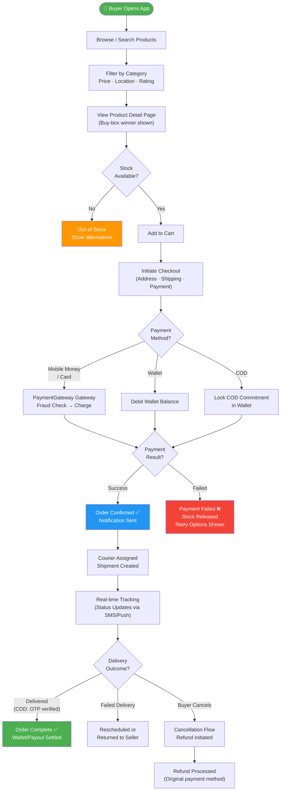
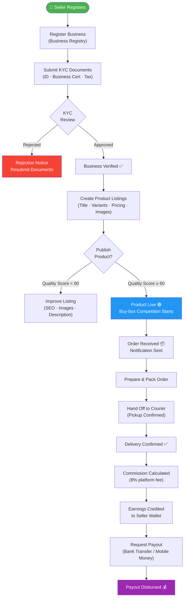
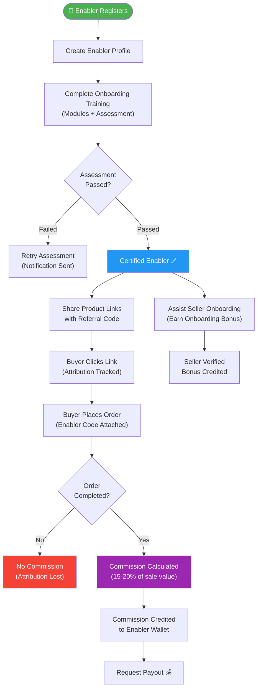
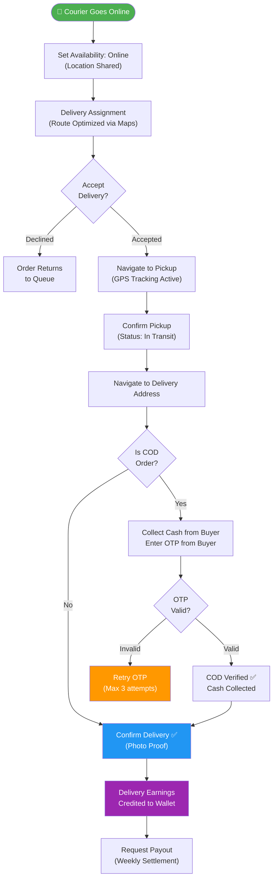
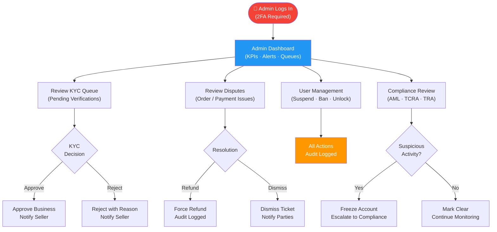

# Maysar Express — User Flow Maps (Navigation Index)

> This file is a high-level navigation index. Detailed, verified flows are in the per-service directories under `docs/FLOWS/`.
> The legacy diagrams from before the September 2026 verification sweep are preserved at the bottom of this file for historical reference — do not use them as implementation references.

---

## Role → Service → Document Index

| Role | Service | User Flow Document | Frontend Guide |
|---|---|---|---|
| **Buyer** | auth | [auth/user-flow/buyer-flows.md](./auth/user-flow/buyer-flows.md) | [auth/frontend-guide/buyer-guide.md](./auth/frontend-guide/buyer-guide.md) |
| **Buyer** | catalog | [catalog/user-flow/buyer-flows.md](./catalog/user-flow/buyer-flows.md) | [catalog/frontend-guide/buyer-guide.md](./catalog/frontend-guide/buyer-guide.md) |
| **Buyer** | checkout | [checkout/user-flow/buyer-flows.md](./checkout/user-flow/buyer-flows.md) | [checkout/frontend-guide/buyer-guide.md](./checkout/frontend-guide/buyer-guide.md) |
| **Buyer** | order | [order/user-flow/buyer-flows.md](./order/user-flow/buyer-flows.md) | [order/frontend-guide/buyer-guide.md](./order/frontend-guide/buyer-guide.md) |
| **Buyer** | logistics | [logistics/user-flow/buyer-flows.md](./logistics/user-flow/buyer-flows.md) | [logistics/frontend-guide/buyer-guide.md](./logistics/frontend-guide/buyer-guide.md) |
| **Buyer** | payment | [payment/user-flow/buyer-flows.md](./payment/user-flow/buyer-flows.md) | [payment/frontend-guide/buyer-guide.md](./payment/frontend-guide/buyer-guide.md) |
| **Buyer** | wallet | [wallet/user-flow/buyer-flows.md](./wallet/user-flow/buyer-flows.md) | [wallet/frontend-guide/buyer-guide.md](./wallet/frontend-guide/buyer-guide.md) |
| **Buyer** | support | [support/user-flow/buyer-flows.md](./support/user-flow/buyer-flows.md) | [support/frontend-guide/buyer-guide.md](./support/frontend-guide/buyer-guide.md) |
| **Buyer** | chat | [chat/user-flow/buyer-flows.md](./chat/user-flow/buyer-flows.md) | [chat/frontend-guide/buyer-guide.md](./chat/frontend-guide/buyer-guide.md) |
| **Buyer** | notification | [notification/user-flow/buyer-flows.md](./notification/user-flow/buyer-flows.md) | [notification/frontend-guide/buyer-guide.md](./notification/frontend-guide/buyer-guide.md) |
| **Buyer** | user | [user/user-flow/buyer-flows.md](./user/user-flow/buyer-flows.md) | [user/frontend-guide/buyer-guide.md](./user/frontend-guide/buyer-guide.md) |
| **Seller** | auth | [auth/user-flow/seller-flows.md](./auth/user-flow/seller-flows.md) | [auth/frontend-guide/seller-guide.md](./auth/frontend-guide/seller-guide.md) |
| **Seller** | business-registry | [business-registry/user-flow/seller-flows.md](./business-registry/user-flow/seller-flows.md) | [business-registry/frontend-guide/seller-guide.md](./business-registry/frontend-guide/seller-guide.md) |
| **Seller** | kyc | [kyc/user-flow/seller-flows.md](./kyc/user-flow/seller-flows.md) | [kyc/frontend-guide/seller-guide.md](./kyc/frontend-guide/seller-guide.md) |
| **Seller** | catalog | [catalog/user-flow/seller-flows.md](./catalog/user-flow/seller-flows.md) | [catalog/frontend-guide/seller-guide.md](./catalog/frontend-guide/seller-guide.md) |
| **Seller** | inventory | [inventory/user-flow/seller-flows.md](./inventory/user-flow/seller-flows.md) | [inventory/frontend-guide/seller-guide.md](./inventory/frontend-guide/seller-guide.md) |
| **Seller** | order | [order/user-flow/seller-flows.md](./order/user-flow/seller-flows.md) | [order/frontend-guide/seller-guide.md](./order/frontend-guide/seller-guide.md) |
| **Seller** | payout | [payout/user-flow/seller-flows.md](./payout/user-flow/seller-flows.md) | [payout/frontend-guide/seller-guide.md](./payout/frontend-guide/seller-guide.md) |
| **Seller** | wallet | [wallet/user-flow/seller-flows.md](./wallet/user-flow/seller-flows.md) | [wallet/frontend-guide/seller-guide.md](./wallet/frontend-guide/seller-guide.md) |
| **Seller** | analytics | [analytics/user-flow/seller-flows.md](./analytics/user-flow/seller-flows.md) | [analytics/frontend-guide/seller-guide.md](./analytics/frontend-guide/seller-guide.md) |
| **Seller** | chat | [chat/user-flow/seller-flows.md](./chat/user-flow/seller-flows.md) | [chat/frontend-guide/seller-guide.md](./chat/frontend-guide/seller-guide.md) |
| **Seller** | support | [support/user-flow/seller-flows.md](./support/user-flow/seller-flows.md) | [support/frontend-guide/seller-guide.md](./support/frontend-guide/seller-guide.md) |
| **Seller** | community | [community/user-flow/seller-flows.md](./community/user-flow/seller-flows.md) | [community/frontend-guide/seller-guide.md](./community/frontend-guide/seller-guide.md) |
| **Seller** | commission | [commission/user-flow/seller-flows.md](./commission/user-flow/seller-flows.md) | [commission/frontend-guide/seller-guide.md](./commission/frontend-guide/seller-guide.md) |
| **Courier** | auth | [auth/user-flow/courier-flows.md](./auth/user-flow/courier-flows.md) | [auth/frontend-guide/courier-guide.md](./auth/frontend-guide/courier-guide.md) |
| **Courier** | logistics | [logistics/user-flow/courier-flows.md](./logistics/user-flow/courier-flows.md) | [logistics/frontend-guide/courier-guide.md](./logistics/frontend-guide/courier-guide.md) |
| **Courier** | training | [training/user-flow/courier-flows.md](./training/user-flow/courier-flows.md) | [training/frontend-guide/courier-guide.md](./training/frontend-guide/courier-guide.md) |
| **Courier** | payout | [payout/user-flow/courier-flows.md](./payout/user-flow/courier-flows.md) | [payout/frontend-guide/courier-guide.md](./payout/frontend-guide/courier-guide.md) |
| **Courier** | wallet | [wallet/user-flow/courier-flows.md](./wallet/user-flow/courier-flows.md) | [wallet/frontend-guide/courier-guide.md](./wallet/frontend-guide/courier-guide.md) |
| **Courier** | maps | [maps/user-flow/courier-flows.md](./maps/user-flow/courier-flows.md) | [maps/frontend-guide/courier-guide.md](./maps/frontend-guide/courier-guide.md) |
| **Enabler** | auth | [auth/user-flow/enabler-flows.md](./auth/user-flow/enabler-flows.md) | [auth/frontend-guide/enabler-guide.md](./auth/frontend-guide/enabler-guide.md) |
| **Enabler** | enabler | [enabler/user-flow/enabler-flows.md](./enabler/user-flow/enabler-flows.md) | [enabler/frontend-guide/enabler-guide.md](./enabler/frontend-guide/enabler-guide.md) |
| **Enabler** | training | [training/user-flow/enabler-flows.md](./training/user-flow/enabler-flows.md) | [training/frontend-guide/enabler-guide.md](./training/frontend-guide/enabler-guide.md) |
| **Enabler** | kyc | [kyc/user-flow/enabler-flows.md](./kyc/user-flow/enabler-flows.md) | [kyc/frontend-guide/enabler-guide.md](./kyc/frontend-guide/enabler-guide.md) |
| **Enabler** | payout | [payout/user-flow/enabler-flows.md](./payout/user-flow/enabler-flows.md) | [payout/frontend-guide/enabler-guide.md](./payout/frontend-guide/enabler-guide.md) |
| **Enabler** | wallet | No wallet surface (403 `FORBIDDEN` — `authorizeWalletAccess()` excludes enablers) | No UI; redirect to payout status page |
| **Supplier** | auth | [auth/user-flow/supplier-flows.md](./auth/user-flow/supplier-flows.md) | [auth/frontend-guide/supplier-guide.md](./auth/frontend-guide/supplier-guide.md) |
| **Supplier** | production | [production/user-flow/supplier-flows.md](./production/user-flow/supplier-flows.md) | [production/frontend-guide/supplier-guide.md](./production/frontend-guide/supplier-guide.md) |
| **Supplier** | inventory | [inventory/user-flow/supplier-flows.md](./inventory/user-flow/supplier-flows.md) | [inventory/frontend-guide/supplier-guide.md](./inventory/frontend-guide/supplier-guide.md) |
| **Supplier** | payout | [payout/user-flow/supplier-flows.md](./payout/user-flow/supplier-flows.md) | [payout/frontend-guide/supplier-guide.md](./payout/frontend-guide/supplier-guide.md) |
| **Supplier** | wallet | No wallet surface (403 `FORBIDDEN` — `authorizeWalletAccess()` excludes suppliers) | No UI; redirect to payout status page |
| **Supplier** | kyc | [kyc/user-flow/supplier-flows.md](./kyc/user-flow/supplier-flows.md) | [kyc/frontend-guide/supplier-guide.md](./kyc/frontend-guide/supplier-guide.md) |
| **Admin** | auth | [auth/user-flow/admin-flows.md](./auth/user-flow/admin-flows.md) | [auth/frontend-guide/admin-guide.md](./auth/frontend-guide/admin-guide.md) |
| **Admin** | user | [user/user-flow/admin-flows.md](./user/user-flow/admin-flows.md) | [user/frontend-guide/admin-guide.md](./user/frontend-guide/admin-guide.md) |
| **Admin** | catalog | [catalog/user-flow/admin-flows.md](./catalog/user-flow/admin-flows.md) | [catalog/frontend-guide/admin-guide.md](./catalog/frontend-guide/admin-guide.md) |
| **Admin** | analytics | [analytics/user-flow/admin-flows.md](./analytics/user-flow/admin-flows.md) | [analytics/frontend-guide/admin-guide.md](./analytics/frontend-guide/admin-guide.md) |
| **Admin** | support | [support/user-flow/admin-flows.md](./support/user-flow/admin-flows.md) | [support/frontend-guide/admin-guide.md](./support/frontend-guide/admin-guide.md) |
| **Support Agent** | support | [support/user-flow/support-agent-flows.md](./support/user-flow/support-agent-flows.md) | [support/frontend-guide/support-agent-guide.md](./support/frontend-guide/support-agent-guide.md) |
| **Buyer (Request)** | request | [request/user-flow/buyer-flows.md](./request/user-flow/buyer-flows.md) | [request/frontend-guide/buyer-guide.md](./request/frontend-guide/buyer-guide.md) |
| **Provider/Ops (Request)** | request | [request/user-flow/provider-flows.md](./request/user-flow/provider-flows.md) | [request/frontend-guide/provider-guide.md](./request/frontend-guide/provider-guide.md) |

---

## Cross-Service Flow Summary

Three flows span multiple services and are the highest-risk integration points:

**1. Checkout Confirmation Chain**
`POST /api/checkout/{id}/confirm` → in-process `__placeOrderUseCase` (order-service) → in-process `__createOrderShipments` (logistics-service) → in-process `__lockFulfillmentPrice` (logistics-service) → `OrderCreated` event published.
Documented in: [checkout/user-flow/buyer-flows.md](./checkout/user-flow/buyer-flows.md)

**2. COD Delivery Verification Flow**
`POST /api/logistics/v1/cod/:deliveryId/otp` → notification-service (OTP to buyer) → courier enters OTP → `POST /api/logistics/v1/cod/:deliveryId/verify` → wallet-service commitment release → `Delivery.Success.v1` → user-service COD reputation update.
Documented in: [logistics/user-flow/courier-flows.md](./logistics/user-flow/courier-flows.md)

**3. Seller Onboarding (KYC Gate)**
Registration → business-registry → `POST /api/catalog/v1/products` hits `requireKycLevel` middleware (in-process, kyc-service) → KYC gate passes/fails → `kyc.status_changed` event → order-service COD trust signal.
Documented in: [kyc/user-flow/seller-flows.md](./kyc/user-flow/seller-flows.md)

---

## Legacy Diagrams (Archive)

> ⚠️ **The following diagrams predate the September 2026 verification sweep. They may contain obsolete patterns, deprecated endpoint paths, and incorrect service routing.** Do not use as implementation references — use the per-service documents above.
>
> Specific known issues: (1) Checkout cart item endpoints now return 405. (2) COD OTP routing in the Courier diagram incorrectly shows payment-service involvement. (3) The Seller KYC diagram references `compliance-service` which does not exist.

### Buyer Journey — Discovery to Delivery

### Seller Journey — Onboarding to Payout

### Enabler Journey — Onboarding to Commission

### Courier Journey — Assignment to Earnings

### Admin Journey — Oversight & Control

