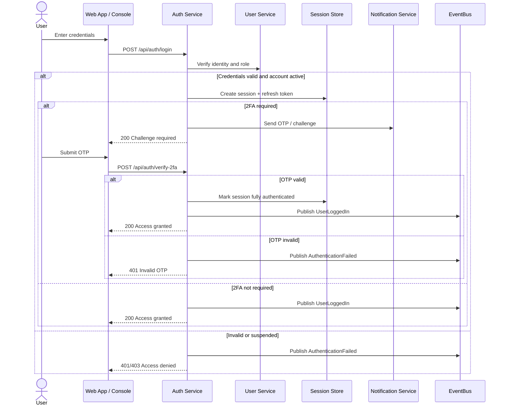
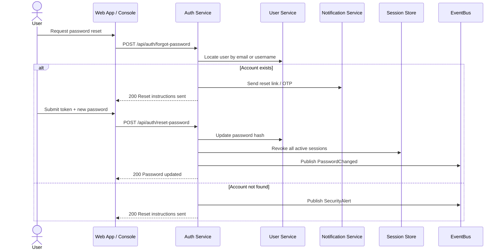

# Auth And Access

This doc covers access control for all platform users. It aligns with the auth and user services and keeps login, session, password, and 2FA behavior explicit.

## Concerned Actors

| Actor | Concern |
|------|---------|
| User | Can I log in, stay signed in, and recover access safely? |
| Admin | Can I enforce access policies and revoke risky sessions? |
| `auth-service` | Issues and validates tokens, sessions, and 2FA challenges |
| `user-service` | Verifies identity, status, and role before access is granted |
| `notification-service` | Delivers OTPs, reset links, and security alerts |
| Session store / Redis | Holds active sessions and token blacklists |
| Audit log | Captures login, logout, reset, and security events |

## Use Case Matrix

| ID | Use case | Happy path | Unhappy path |
|----|----------|------------|--------------|
| AUTH-01 | Login and session verify | Credentials are valid, the user is active, tokens are issued, and the user lands on the correct role dashboard. | Invalid credentials, suspended account, rate limit, or 2FA mismatch blocks access and records a security event. |
| AUTH-02 | Logout and refresh rotation | The refresh token is rotated, the old session is invalidated, and the UI keeps the user seamlessly signed in. | Expired, replayed, or revoked tokens force a full re-authentication and clear local state. |
| AUTH-03 | Forgot and reset password | The user requests a reset, receives a secure link, sets a new password, and all sessions are revoked. | Unknown account, expired token, weak password, or notification delivery failure keeps the account locked until the flow is corrected. |
| AUTH-04 | 2FA setup, verify, backup, disable | The secret is created, the code is verified, backup codes are stored, and the account becomes protected. | Wrong OTP, clock skew, lost device, or exhausted backup codes keeps 2FA in a safe intermediate state. |

## Flow Notes

- `POST /api/auth/register`, `POST /api/auth/login`, `POST /api/auth/forgot-password`, `POST /api/auth/reset-password`, and `GET /api/auth/oauth/initiate` are public entry points. The UI should call them directly; no CSRF token is required before these requests.
- Role-based authorization is separate from authentication.
- A valid token does not override a suspended account.
- Every security-sensitive operation should emit an audit record.
- If a flow succeeds but notification delivery fails, the access state still stands and the notification should be retried.

## Sequence Diagram: Login, Session, And 2FA

## Sequence Diagram: Password Reset And Session Cleanup

## What Good Looks Like

- The user always knows whether they are signed in, challenged, or blocked.
- The UI never silently continues after a failed login or revoked token.
- Security events are visible to admins and support teams through audit logs.
