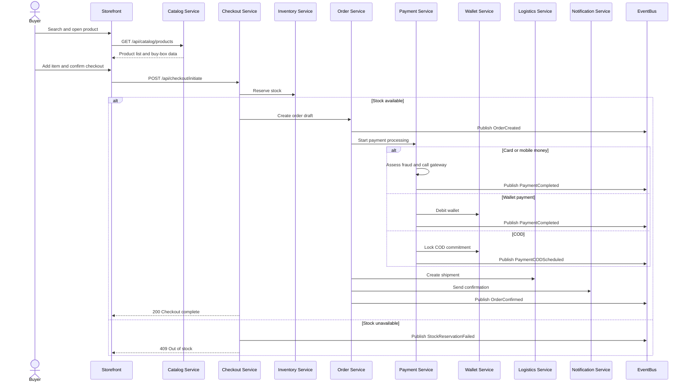
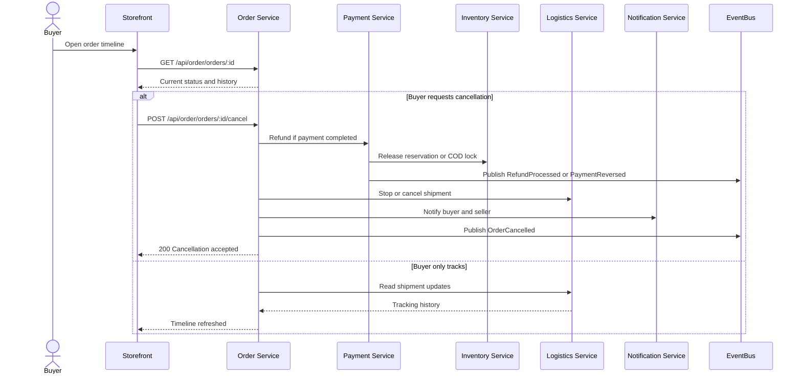
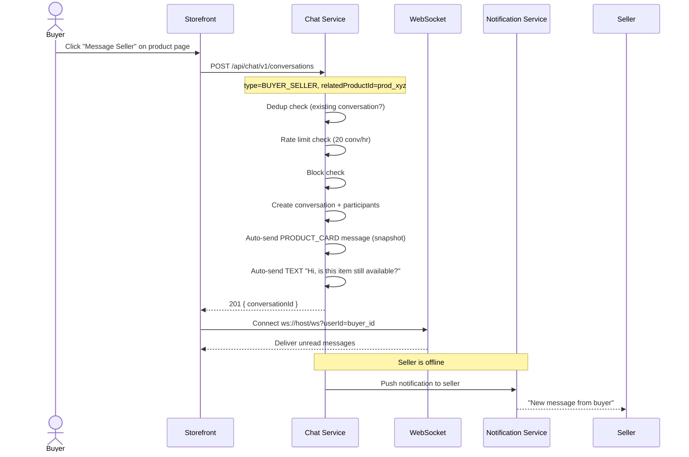
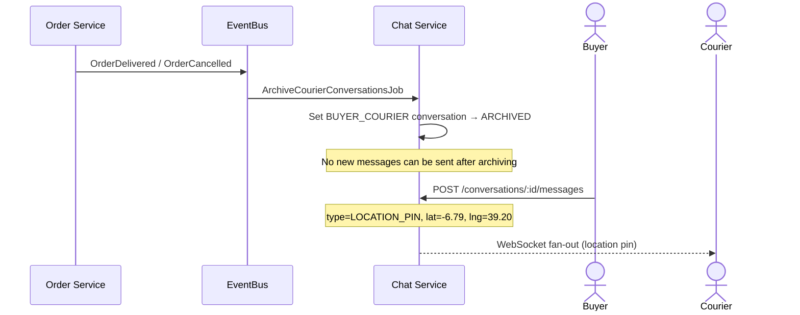

# Customer Journeys

This doc covers the buyer journey from discovery to payment, tracking, cancellation, and refund.

## Concerned Actors

| Actor | Concern |
|------|---------|
| Buyer / customer | Can I find the right product, pay safely, and receive it on time? |
| `catalog-service` | Product discovery, buy-box, pricing, and availability |
| `checkout-service` | Cart handling and checkout session orchestration |
| `order-service` | Order creation, lifecycle, cancellation, and tracking |
| `inventory-service` | Stock reservation and release |
| `payment-service` | Card, mobile money, wallet, refund, and COD pre-auth |
| `wallet-service` | Wallet balances and COD commitment locks |
| `logistics-service` | Shipment creation, routing, courier assignment, tracking |
| `notification-service` | Order, payment, shipment, and refund notifications |
| `analytics-service` | Funnel, conversion, and revenue metrics |

## Use Case Matrix

| ID | Use case | Happy path | Unhappy path |
|----|----------|------------|--------------|
| BUY-01 | Discovery and product detail | The buyer searches, filters, opens a product, and sees the current buy-box winner and price. | No results, stale index, or unavailable buy-box shows an empty state with retry and fallback suggestions. |
| BUY-02 | Checkout initiate and confirm | The cart is validated, stock is reserved, checkout is confirmed, and an order is created. | Invalid address, missing items, stock conflict, or duplicate confirm is blocked before money moves. |
| BUY-03 | Payment processing | The buyer pays with mobile money, card, wallet, or COD pre-auth and receives a confirmed payment state. | Gateway timeout, fraud rejection, insufficient wallet balance, or COD lock failure produces a clear recovery path. |
| BUY-04 | Order tracking | The buyer can follow the shipment timeline, courier updates, and notifications until delivery completes. | Tracking number mismatch, logistics delay, or courier update failure falls back to support guidance and refreshed status. |
| BUY-05 | Cancellation and refund | A valid cancel request triggers refund processing, inventory release, and notification updates. | Cancel window expired, partial fulfillment, or already-settled payment changes the path to support or manual review. |

## Flow Notes

- Checkout should be idempotent; double-clicks must not create duplicate orders.
- Payment failures must not leave inventory reserved without compensation.
- COD flows must show the wallet lock or delivery verification state explicitly.
- Refunds should always show the source payment, destination, and expected timing.

## Sequence Diagram: Search To Order Confirmation

## Sequence Diagram: Tracking, Cancellation, And Refund

## What Good Looks Like

- The buyer always sees a single source of truth for order state.
- Any failure in payment, stock reservation, or logistics is visible as a recoverable state, not a dead end.
- Notifications and analytics should follow the core order outcome, not lead it.

---

## Chat: Buyer Initiates Chat from Product Page

## Chat: Buyer Coordinates Delivery with Courier

