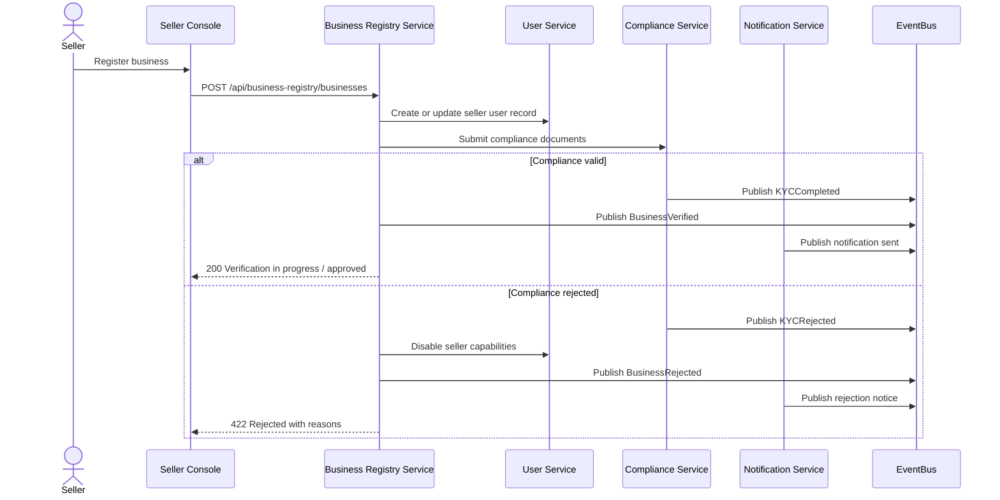
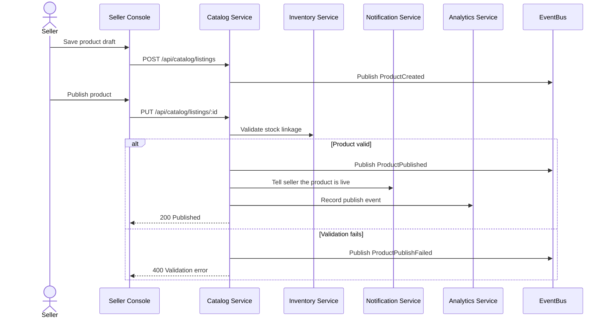
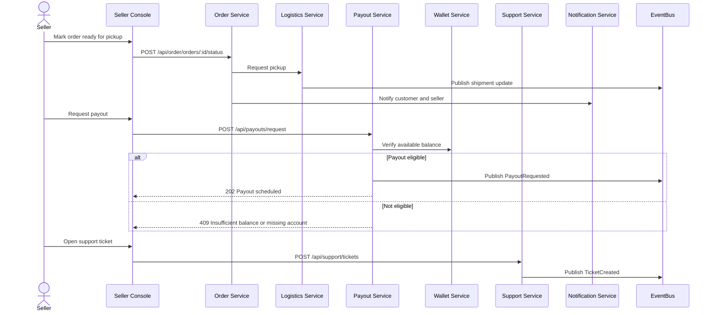
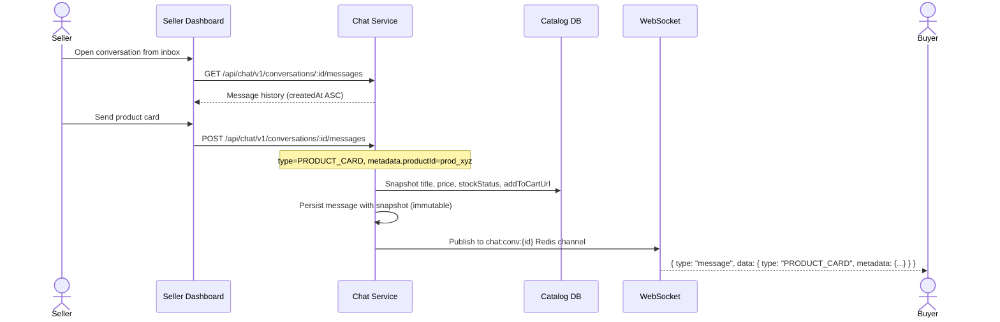
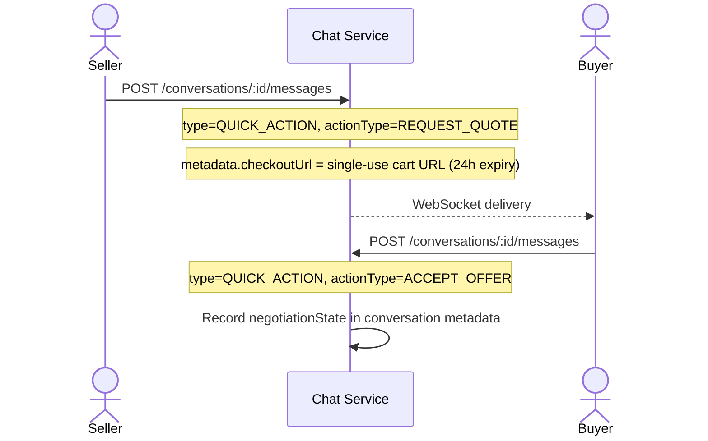
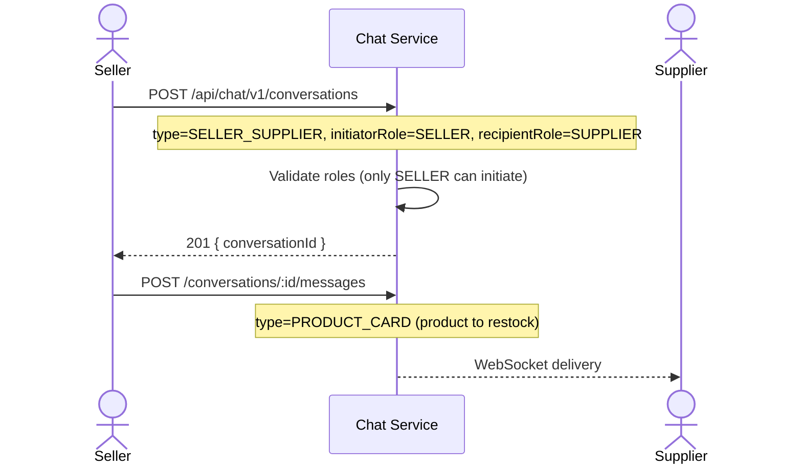

# Seller Journeys

This doc covers seller onboarding, catalog operations, pricing, campaigns, fulfillment, payouts, and support.

## Concerned Actors

| Actor | Concern |
|------|---------|
| Seller / business owner | Can I register, become compliant, publish products, and get paid? |
| `business-registry-service` | Business registration, verification, and lifecycle |
| `compliance-service` | KYC and AML checks for seller legitimacy |
| `user-service` | Seller identity, roles, and account status |
| `catalog-service` | Product CRUD, publish, pricing, campaigns, storefront |
| `inventory-service` | Stock validation for product publish and availability |
| `order-service` | Fulfillment status and dispute-aware order operations |
| `payout-service` | Seller payout requests and reconciliation |
| `analytics-service` | Sales dashboards, conversion, and campaign performance |
| `community-service` | Reviews, discussions, and customer engagement |
| `support-service` | Seller tickets, escalation, and resolution |
| `enabler-service` | Enabler collaboration and assisted selling |
| `notification-service` | Onboarding, publish, payout, and support notifications |

## Use Case Matrix

### Onboarding And Identity

| ID | Use case | Happy path | Unhappy path |
|----|----------|------------|--------------|
| SEL-01 | Seller settings update | Profile, address, store preferences, and security settings are saved and reflected everywhere. | Validation errors or role mismatch keep the seller on the same screen with field-level feedback. |
| SEL-02 | Seller KYC submit and track | Documents are uploaded, compliance checks pass, and seller status progresses toward approval. | Missing documents, expired ID, or failed compliance keeps the seller in review or rejection with reasons. |
| BIZ-01 | Business registration onboarding | The seller creates a business profile, receives a verification trail, and is provisioned for platform use. | Duplicate business, invalid documents, or KYC rejection disables seller capabilities until corrected. |

### Catalog And Growth

| ID | Use case | Happy path | Unhappy path |
|----|----------|------------|--------------|
| SEL-03 | Product CRUD and publish | The seller drafts a product, passes validation, publishes it, and it becomes searchable. | Incomplete attributes, inventory mismatch, or media failures block publish and keep the item in draft. |
| SEL-04 | Pricing and rules | Pricing rules are applied and the seller sees the margin, commission, and price impact before saving. | Invalid rule combinations or unsupported pricing mode are rejected before publish. |
| SEL-05 | Campaign lifecycle | A campaign is created, launched, monitored, paused, and completed with live metrics. | Budget, targeting, or schedule errors keep the campaign in draft or paused. |
| SEL-06 | Storefront and share URL | The seller receives a public storefront link that is trackable and shareable. | Missing publish state or unverified business keeps the storefront hidden. |

### Operations And Finance

| ID | Use case | Happy path | Unhappy path |
|----|----------|------------|--------------|
| SEL-07 | Order fulfillment and pickup request | The seller prepares the order, requests pickup, and the logistics timeline updates in sync. | Shipment prep failure, stock issue, or pickup scheduling conflict blocks handoff and notifies the seller. |
| SEL-08 | Payments list and payout request | The seller sees payable balances, requests payout, and receives a tracked disbursement. | Insufficient balance, missing bank/mobile-money profile, or failed payout approval prevents withdrawal. |
| SEL-09 | Sales analytics and action center | Dashboard cards refresh with period filters and action items resolve without reload. | Empty data, delayed analytics, or widget failures fall back to partial rendering and retry. |

### Engagement And Support

| ID | Use case | Happy path | Unhappy path |
|----|----------|------------|--------------|
| SEL-10 | Customer engagement | Posts, discussions, and challenges are created and surfaced to the right audience. | Moderation, publish failure, or low-quality content keeps the item private or pending review. |
| SEL-11 | Seller support ticket lifecycle | The seller opens a ticket, adds messages, and closes the issue after resolution. | SLA breach or missing assignment escalates the ticket to a higher queue. |
| SEL-12 | Enabler collaboration request | The seller requests help from an enabler and tracks acceptance or rejection. | No eligible enabler, training mismatch, or collaboration decline keeps the request pending. |

## Flow Notes

- Seller onboarding is not complete until business verification and compliance checks both succeed.
- Product publishing should never silently skip inventory validation.
- Payouts should show both the requested amount and the receivable source before confirmation.
- Campaign, support, and engagement flows should preserve auditability because they affect revenue and reputation.

## Sequence Diagram: Seller Onboarding And KYC

## Sequence Diagram: Product Publish And Catalog Sync

## Sequence Diagram: Fulfillment, Payout, And Support

## What Good Looks Like

- The seller can trace each commercial outcome back to a visible platform state.
- Rejections tell the seller what to fix, not just that something failed.
- Revenue-related actions always show the system and human owners involved.

---

## Chat: Seller Responds to Buyer and Sends Product Card

## Chat: Seller Sends Quote Bundle (Negotiation Mode)

## Chat: Seller Contacts Supplier for Restocking

