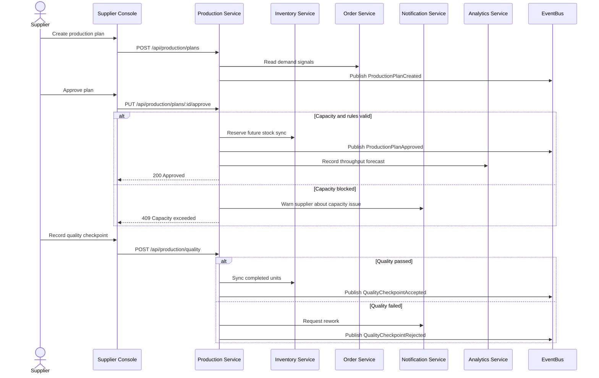
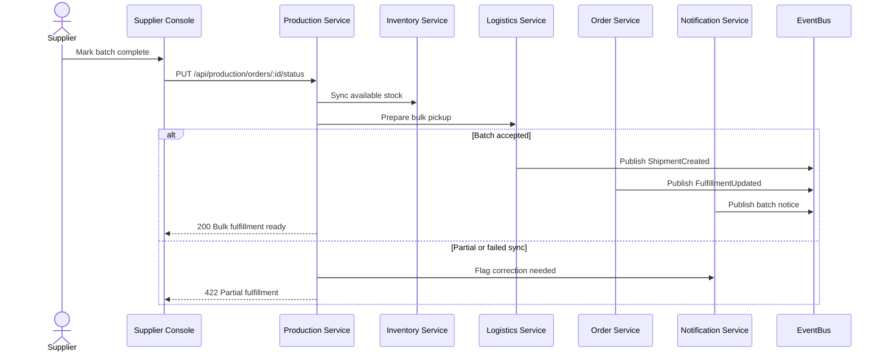

# Supplier Journeys

This doc covers the supplier side of the supply chain: production planning, quality control, capacity management, and bulk fulfillment.

## Concerned Actors

| Actor | Concern |
|------|---------|
| Supplier / production manager | Can I plan production, meet quality standards, and keep capacity aligned with demand? |
| `production-service` | Production plans, orders, and quality checkpoints |
| `inventory-service` | Stock sync after completed production |
| `order-service` | Demand signals and bulk fulfillment references |
| `logistics-service` | Shipment preparation for bulk orders |
| `pricing-service` | Supplier pricing and commercial adjustments |
| `payment-service` | Receivables and payment settlement |
| `analytics-service` | Capacity, throughput, and quality metrics |
| `notification-service` | Production alerts and exception notices |

## Use Case Matrix

| ID | Use case | Happy path | Unhappy path |
|----|----------|------------|--------------|
| SUP-01 | Production management | The supplier creates a plan, allocates capacity, approves it, and moves orders into progress. | Capacity shortfall, invalid schedule, or failed approval keeps the plan in draft or rejected. |
| SUP-02 | Supplier pricing and payment | The supplier sees agreed pricing, expected receivables, and settlement timing clearly. | Pricing conflicts, missing settlement data, or payment disputes send the flow to review. |
| SUP-03 | Bulk fulfillment tracking | Completed batches are synced to inventory and bulk shipments stay visible through logistics. | Quality failure, partial batch completion, or sync failure blocks shipment until corrected. |

## Flow Notes

- Production changes should be visible to inventory only after approval or successful checkpoint completion.
- Quality failures should produce a rework path, not a silent rejection.
- Bulk fulfillment must expose partial completion clearly so the supplier knows what still needs attention.

## Sequence Diagram: Production Plan And Quality Checkpoints

## Sequence Diagram: Bulk Fulfillment

## What Good Looks Like

- The supplier can see how production affects available stock and downstream orders.
- Quality issues are handled as recoverable work, not as unexplained failures.
- Every capacity or fulfillment problem has a visible owner and next action.

