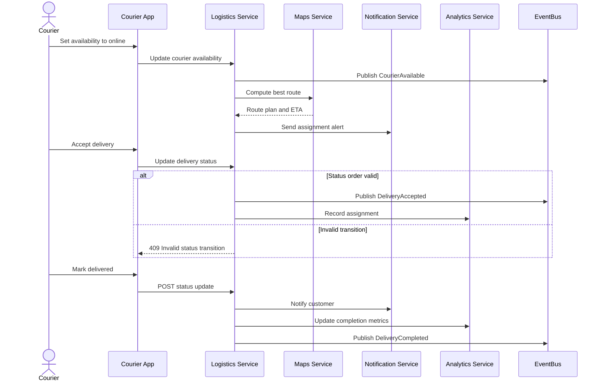
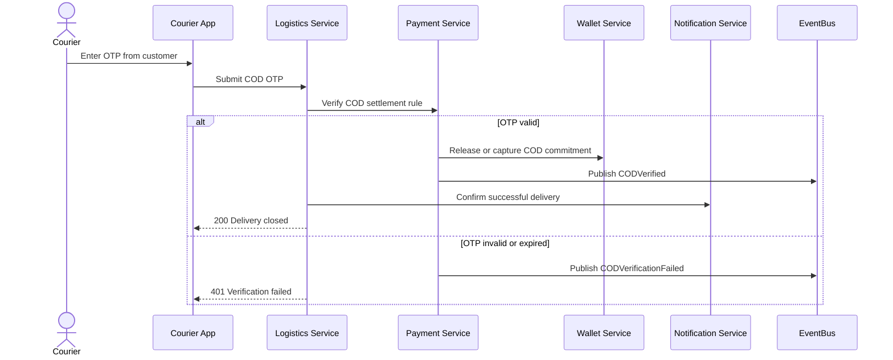
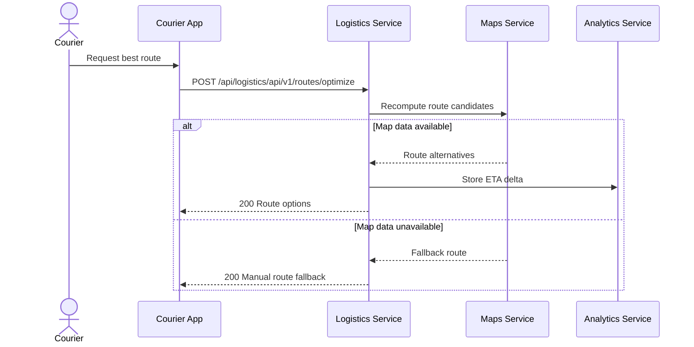

> ## ⚠️ PARTIALLY OBSOLETE — CONFLICTS WITH VERIFIED IMPLEMENTATION
>
> This document's sequence diagrams were created before the current logistics architecture was implemented.
> The following specific conflicts have been identified against the verified system (September 2026 sweep):
>
> **(a) Dispatch model is obsolete:** The diagrams show direct delivery status writes by the courier UI
> (`UI->>Logistics: Update delivery status`). The actual implementation uses `Logistics_DeliveryJob`
> records (`DJB-` prefix) dispatched via `PoolOptimizationJob` (runs every 5 minutes) →
> `DriverAssignmentEngine`. Couriers receive job assignments; they do not write delivery status directly.
>
> **(b) COD OTP routing is wrong:** The diagrams show the COD OTP flow routing through `payment-service`.
> The actual implementation routes: `logistics-service` → `notification-service` → Buyer (OTP receipt) →
> Courier (OTP entry) → `logistics-service` verify → `wallet-service` commitment release →
> `Delivery.Success.v1` event → `user-service` reputation update. `payment-service` is not involved in
> the COD OTP flow.
>
> **(c) Assignment records are wrong:** The diagrams show bare `Logistics_Delivery` records being assigned.
> The actual unit of work is a `Logistics_DeliveryJob` (`DJB-` prefix) which bundles one or more
> `Logistics_Shipment` records.
>
> **Canonical replacement:** [`docs/FLOWS/logistics/user-flow/courier-flows.md`](../FLOWS/logistics/user-flow/courier-flows.md)
>
> *Conflict identified: September 2026 — service-flow-documentation spec*

---

# Courier Journeys

This doc covers courier availability, assignment, delivery execution, COD verification, route planning, and earnings.

> **Implementation note (2026-09):** the diagrams below predate the optimization-engine rollout and reflect the courier console's planning intent. In the current implementation:
> - The unit of work is the **`Logistics_DeliveryJob`** (`DJB-`) bundling `Logistics_Shipment`s, not a bare `Logistics_Delivery`.
> - Jobs are **generated by the system** (`ConsolidationOrchestrator` / `PoolOptimizationJob`) from eligible Shipment clusters; driver matching is a ranked, auditable `DriverMatchingEngine` to `POST /api/logistics/internal/jobs/:jobId/match-drivers` with a hard **minimum-earnings gate**.
> - Driver-side lifecycle **events** (`DriverAssigned`, `GoodsLoaded`, `ShipmentDeparted`, `DeliveryAttempted`, `DeliveryCompleted`, `DeliveryFailed`) are emitted via the outbox — integration consumes events, not ad-hoc status writes.
> - Earnings/payout reconcile against **`Logistics_LedgerEntry`** (`CARRIER_PAYABLE`) and `Logistics_DriverMatchAudit`, and settlement reads **only the ledger**.
> See [`docs/logistics/LOGISTICS_IMPLEMENTATION.md`](../logistics/LOGISTICS_IMPLEMENTATION.md) for the as-built dispatch/settlement flow.

## Concerned Actors

| Actor | Concern |
|------|---------|
| Courier | Can I accept work, complete deliveries, and get paid correctly? |
| `logistics-service` | Availability, dispatch, delivery lifecycle, and tracking |
| `maps-service` | Route optimization and distance calculations |
| `payment-service` | COD verification and payment-related delivery constraints |
| `wallet-service` | Earnings settlement and COD commitments where applicable |
| `payout-service` | Courier payout requests and reconciliation |
| `notification-service` | Assignment, status, and customer notifications |
| `analytics-service` | Courier performance and earnings metrics |

## Use Case Matrix

| ID | Use case | Happy path | Unhappy path |
|----|----------|------------|--------------|
| COU-01 | Availability and assignment acceptance | The courier toggles availability and receives eligible assignments immediately. | Offline status, certification issues, or assignment decline keeps the order in the queue. |
| COU-02 | Delivery lifecycle updates | Pickup, transit, arrival, and delivery states move in order and notify the customer. | Out-of-order status, GPS failure, or delivery exception blocks progression and logs the issue. |
| COU-03 | COD OTP collection and verification | The courier captures the OTP, verifies it, and the delivery is closed successfully. | OTP expired, wrong code, or retry limit reached keeps the delivery pending and escalates it. |
| COU-04 | Route optimization and alternatives | The courier receives an optimized route and can compare ETA alternatives. | Missing map data, route conflict, or poor connectivity falls back to a manual route. |
| COU-05 | Earnings and performance dashboard | Earnings, completion rate, and period filters update in one pass. | Delayed analytics or missing payouts show partial data and a retry state. |

## Flow Notes

- Delivery state transitions must remain monotonic.
- Courier assignment should respect training or certification requirements.
- COD verification must be explicit because it closes both delivery and payment risk.
- Earnings screens should reconcile with wallet or payout data, not just raw delivery counts.

## Sequence Diagram: Assignment To Delivery Completion

## Sequence Diagram: COD OTP Verification

## Sequence Diagram: Route Optimization

## What Good Looks Like

- The courier always knows what is expected next and why a delivery is blocked.
- Route, OTP, and earnings flows all show a traceable state, not just a button click.
- Delivery problems are handled as visible exceptions, not hidden failures.
