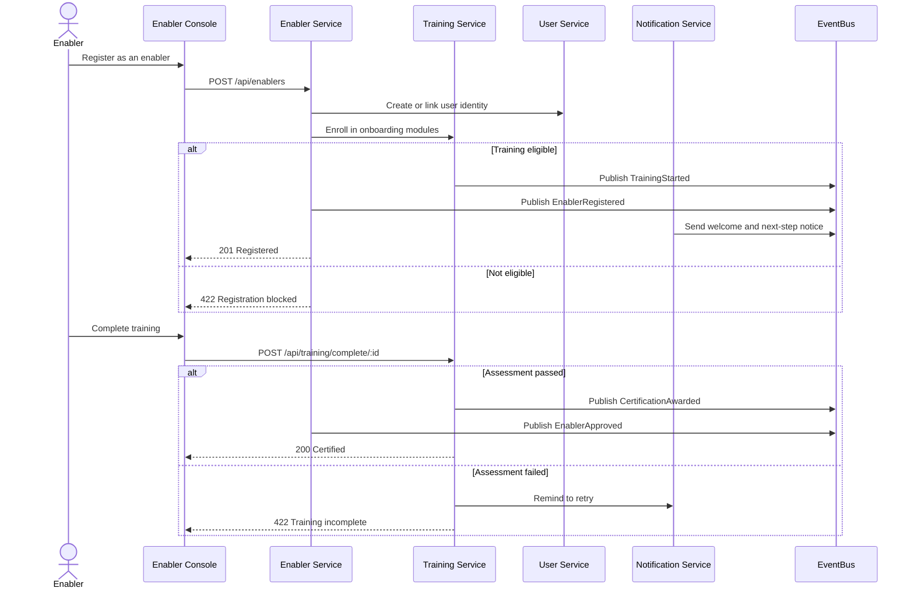
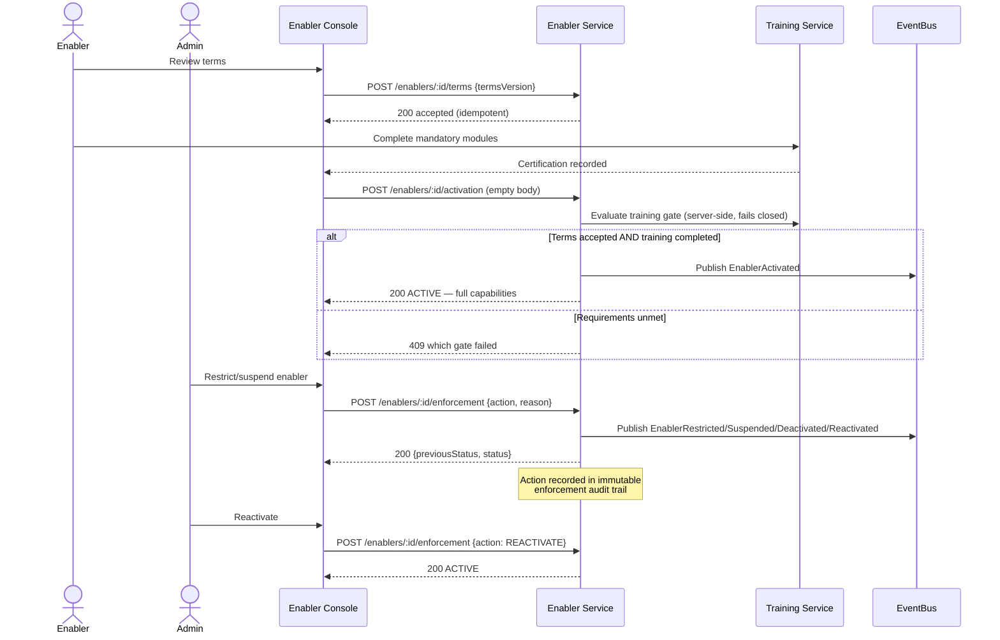
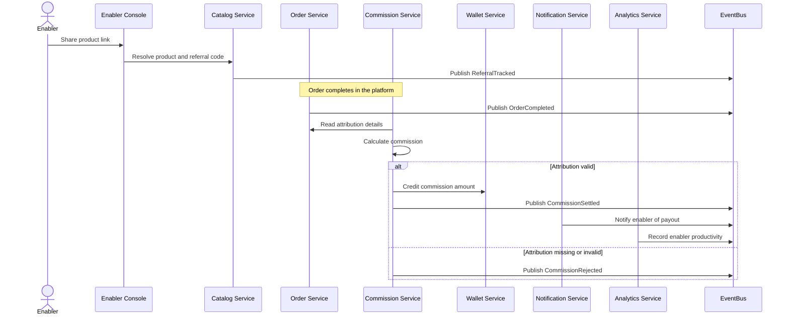
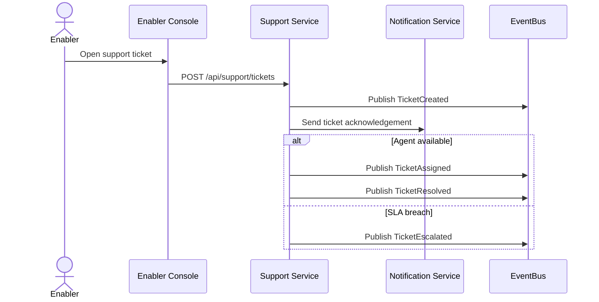

# Enabler Journeys

This doc covers the enabler lifecycle: onboarding, training, assisted sales, collaboration with sellers, and commission settlement.

## Concerned Actors

| Actor | Concern |
|------|---------|
| Enabler | Can I join the network, get trained, and earn commissions from assisted sales? |
| Seller | Can I collaborate with an enabler and track the assisted sale outcome? |
| `enabler-service` | Enabler profile, collaboration, listings, orders, and earnings |
| `training-service` | Onboarding training and certification |
| `commission-service` | Commission computation and settlement |
| `wallet-service` | Wallet credits for commission payouts |
| `catalog-service` | Listing and referral products |
| `order-service` | Order attribution and completion tracking |
| `support-service` | Enabler support tickets and escalations |
| `notification-service` | Onboarding, approval, commission, and support notifications |

## Use Case Matrix

| ID | Use case | Happy path | Unhappy path |
|----|----------|------------|--------------|
| ENA-01 | Register, approve, and profile | The enabler is registered, approved, and can maintain profile data and status. | Missing documents, failed approval, or inactive status keeps the enabler in review. |
| ENA-02 | Listing products and facilitating orders | The enabler receives shareable links, facilitates sales, and tracks order attribution. | Invalid eligibility, missing product listing, or attribution loss blocks commission credit. |
| ENA-03 | Training management progress | Training is assigned, progress is saved, completion is certified, and eligibility is unlocked. | Incomplete progress, expired certification, or failed assessment keeps the enabler unqualified. |
| ENA-04 | Support case handling | The enabler opens a ticket and receives structured resolution updates. | SLA breach or missing assignment escalates the case to a higher queue. |
| ENA-05 | Capability activation (terms + training gate) | The approved enabler accepts the mandated terms version, the training domain certifies the mandatory modules, and activation unlocks ACTIVE capabilities. | Terms not accepted or version mismatch, or training incomplete/expired, blocks activation with 409; the training gate fails closed on training-domain errors. |
| ENA-06 | Admin capability enforcement | Admin restricts, suspends, reactivates or deactivates an enabler capability; every action lands in the enforcement audit trail and emits a lifecycle event. | Invalid transition (e.g. reactivate a PENDING enabler) is refused with 409 even for admins; enforcement never touches the underlying user, wallet, orders or seller/courier duties. |

## Flow Notes

- Training completion is a business gate, not a nice-to-have.
- Activation is a separate, server-enforced gate after approval: accepted terms version + completed training are mandatory before ACTIVE.
- Capability is contextual, never role-based: the lifecycle status decides what the enabler may do, and a status change takes effect on the very next request.
- Enforcement touches capability state only — the underlying Maysar user remains intact.
- Enabler commissions should only be paid when attribution and completion are both confirmed.
- Seller collaboration should expose who owns the lead, who owns the sale, and who gets paid.

## Sequence Diagram: Enabler Onboarding And Training

## Sequence Diagram: Capability Activation And Enforcement

## Sequence Diagram: Assisted Sale And Commission Settlement

## Sequence Diagram: Enabler Support Ticket

## What Good Looks Like

- The enabler can see exactly when they are eligible to earn.
- Assisted sales must preserve attribution through the full order lifecycle.
- Training and support are visible business gates, not background paperwork.
- Activation is impossible without accepted terms + completed training, and the enabler's dashboard explains exactly which gate is missing.
- An enabler whose capability was restricted or suspended can still see why — but loses commercial capabilities on the very next request.
- Every admin enforcement action is auditable and emits a lifecycle event, without ever touching the underlying Maysar user.
