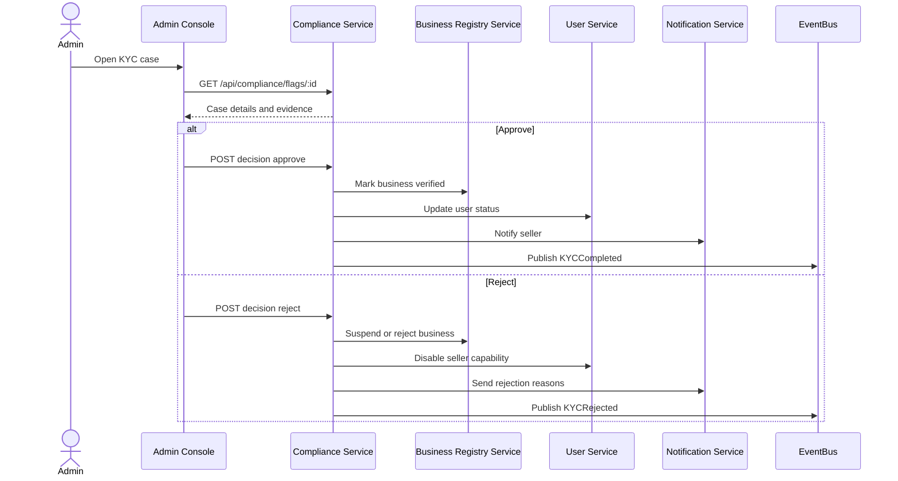
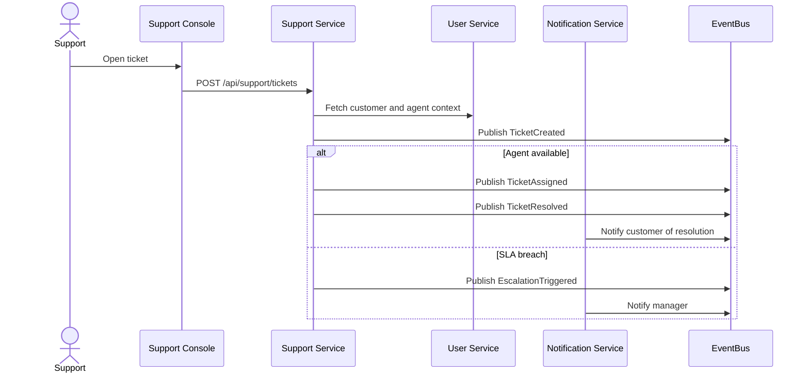
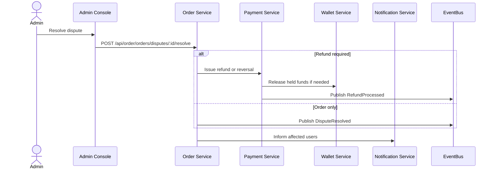

> ## ⚠️ CONFLICTING — COMPLIANCE-SERVICE REFERENCES ARE INCORRECT
>
> Multiple sections of this document reference `compliance-service` as a live standalone service
> responsible for KYC review, AML monitoring, and compliance reporting.
>
> **`compliance-service` does not exist as a live service in the verified system inventory.**
> It is not present in `docs/SERVICE_DEPENDENCY_MAP.md` and no `/api/compliance/*` routes were found
> in the September 2026 endpoint sweep.
>
> **Actual compliance implementation:**
> - KYC review is handled through `kyc-service` middleware events (`kyc.status_changed` →
>   consumed by order-service for COD trust signals).
> - COD dispute resolution and reputation management are handled through `support-service`
>   (`COD_DISPUTE_RESOLVED` event → `user-service` reputation penalty).
> - There is no standalone compliance HTTP service or compliance dashboard endpoint.
>
> Additionally, governance routes (`/api/governance/*`) referenced in this document as live admin
> capabilities **do not exist** — governance has been removed from the platform, with its paths and
> schemas deleted from both API specs (DEF-007).
>
> **Canonical replacement:** [`docs/FLOWS/role-overviews/compliance-officer-lifecycle.md`](../FLOWS/role-overviews/compliance-officer-lifecycle.md)
> **Canonical replacement for support flows:** [`docs/FLOWS/support/user-flow/support-agent-flows.md`](../FLOWS/support/user-flow/support-agent-flows.md)
>
> *Conflict identified: September 2026 — service-flow-documentation spec*

---

# Admin, Support, And Compliance

This doc covers internal operational personas: admins, support agents, and compliance officers.

## Concerned Actors

| Actor | Concern |
|------|---------|
| Admin | Can I manage users, risk, dashboards, and system settings safely? |
| Support agent | Can I triage, escalate, and resolve customer issues with the right context? |
| Compliance officer | Can I review KYC/AML signals and produce defensible reports? |
| `auth-service` | Enforces privileged access and session validity |
| `user-service` | User status, roles, suspension, security events |
| `support-service` | Ticket lifecycle, assignment, escalation, resolution |
| `compliance-service` | Compliance checks, suspicious activity, reporting |
| `order-service` | Disputes and order status for manual review |
| `payment-service` | Payment state, fraud, refunds, reversals |
| `wallet-service` | Holds, releases, and reversals during dispute handling |
| `analytics-service` | Dashboards, trends, and operational metrics |
| `notification-service` | Security, ticket, and compliance notifications |
| Audit log | Evidence of every privileged action |

## Use Case Matrix

### Admin Console

| ID | Use case | Happy path | Unhappy path |
|----|----------|------------|--------------|
| ADM-01 | User management | Admin can search users, update roles, suspend accounts, and review the audit trail. | Wrong role, missing authorization, or conflicting status is blocked and logged. |
| ADM-04 | Transaction monitoring | Suspicious transactions are surfaced, investigated, and blocked or cleared. | False positives or incomplete evidence move the record to manual review instead of silent approval. |
| ADM-05 | Dashboard management | Widgets load, filters apply, and the admin sees a consistent operational snapshot. | Partial data, stale metrics, or widget failure falls back to loading and retry states. |
| ADM-06 | System administration | Admin refreshes discovery, checks health, and updates configuration with confirmation. | Unsafe configuration, permission failure, or rollback requirement keeps the previous state intact. |
| ADM-07 | Compliance audit review | Audit entries are filtered, exported, and retained with actor/action/timestamp detail. | Missing export permissions or incomplete data stops the export and preserves the original audit record. |

### Support Desk

| ID | Use case | Happy path | Unhappy path |
|----|----------|------------|--------------|
| SUPPORT-01 | Ticket lifecycle | The agent assigns, responds, resolves, and closes the ticket with SLA visibility. | Missing assignment or SLA breach escalates the ticket and alerts the queue manager. |

### Compliance Office

| ID | Use case | Happy path | Unhappy path |
|----|----------|------------|--------------|
| ADM-02 | KYC workflow | Documents are reviewed, a decision is recorded, and the user status is updated. | Missing evidence, unclear identity, or policy conflict keeps the case under review. |
| ADM-03 | Dispute resolution | The dispute is decided, payment or wallet corrections are applied, and the outcome is recorded atomically. | Insufficient evidence or unresolved payment state sends the dispute to escalation. |

## Flow Notes

- Privileged access should be re-authenticated for high-risk operations.
- Every admin, support, and compliance decision must be explainable later.
- A manual review path is a valid outcome; it is better than guessing.

## Sequence Diagram: KYC Review And Seller Decision

## Sequence Diagram: Support Ticket Escalation

## Sequence Diagram: Dispute Resolution And Financial Correction

## What Good Looks Like

- Admin and support actions are visible, deliberate, and auditable.
- Compliance decisions always explain the resulting platform state.
- Disputes and fraud actions should be reversible only through the correct governance path.
