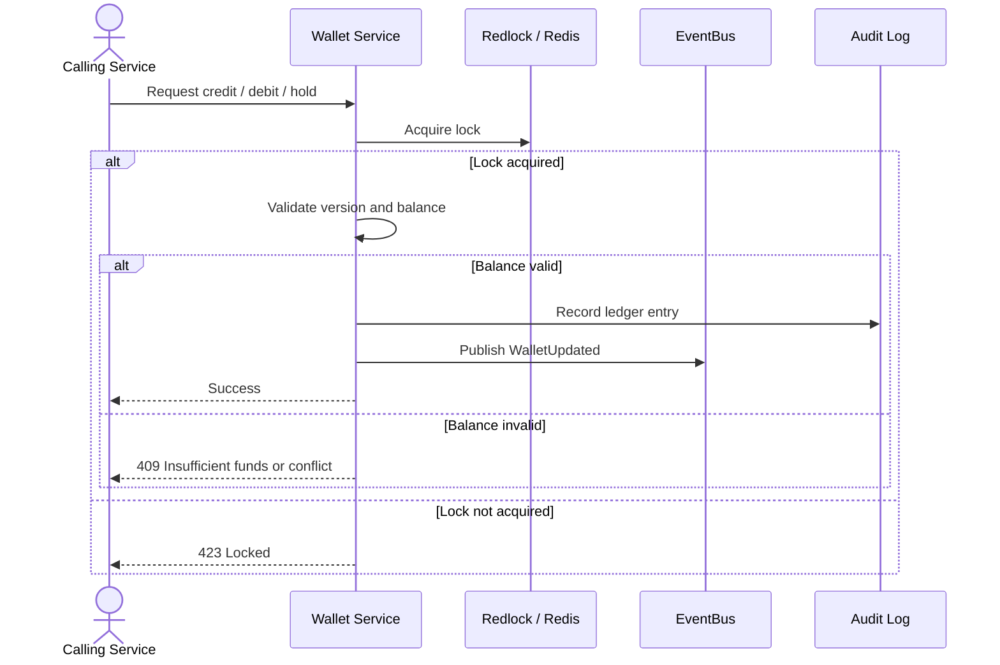
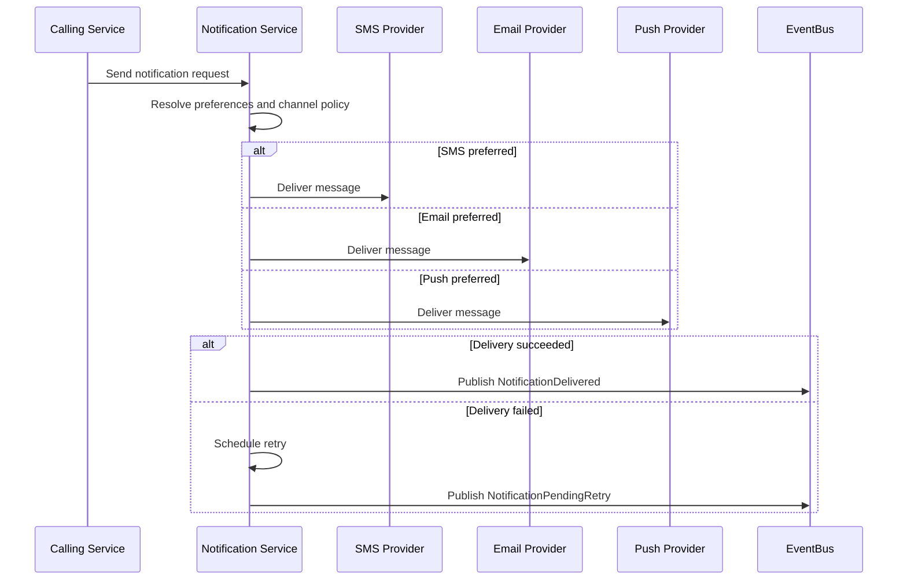
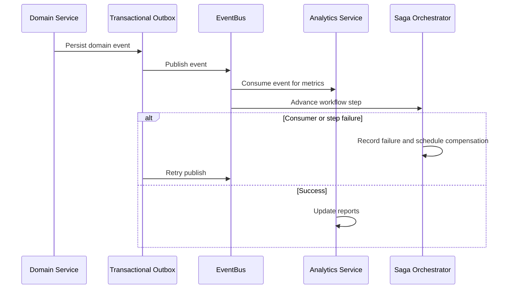

# Platform Operations

This doc covers the internal platform operations that keep the system safe and reliable. These are not user-facing screens, but they are critical concerns for every journey in the folder.

## Concerned Actors

| Actor | Concern |
|------|---------|
| Platform operator | Are money, notifications, analytics, and recovery behavior correct? |
| `wallet-service` | Balances, locks, ledger integrity, and COD commitments |
| `notification-service` | Delivery, preferences, retries, and read receipts |
| `analytics-service` | Event ingestion, metric aggregation, and reporting |
| `shared/outbox` | Durable event publishing |
| `shared/saga` | Workflow orchestration and compensation |
| `shared/locking` | Concurrency control around money and stock operations |
| EventBus | In-process event distribution across modules |
| Audit log | Evidence for every critical platform decision |

## Operation Matrix

| ID | Operation | Happy path | Unhappy path |
|----|-----------|------------|--------------|
| OPS-01 | Wallet balance and ledger integrity | Credits, debits, holds, and releases are serialized and ledgered correctly. | Double-spend, missing lock, or optimistic lock conflict aborts the mutation and preserves balance truth. |
| OPS-02 | COD commitment lifecycle | Funds are locked before delivery and released or captured when the order is completed or cancelled. | Delivery mismatch, timeout, or cancellation releases the hold and leaves an audit trail. |
| OPS-03 | Notification delivery and preferences | Notifications route to the right channel, respect preferences, and expose sent/delivered/read state. | Provider outage or retry exhaustion keeps the notification pending and schedules another attempt. |
| OPS-04 | Analytics ingestion and reports | Events flow from services to metrics, reports, and dashboards with predictable lag. | Consumer lag or event replay issues fall back to stale-but-visible metrics rather than silent loss. |
| OPS-05 | Saga recovery and idempotency | Outbox, saga, and retry logic repair transient failures without duplicating side effects. | Dead letters, stale retries, or duplicate submissions are surfaced for operator intervention. |

## Flow Notes

- Money and stock operations must always be idempotent.
- A successful domain command can still fail to notify, and that must not roll back the primary state without reason.
- Analytics should never be the source of truth for a business transaction; it is a consumer of those events.
- Compensation is part of the design, not a fallback afterthought.

## Sequence Diagram: Wallet Lock, Debit, And Release

## Sequence Diagram: Notification Routing And Retry

## Sequence Diagram: Event Ingestion And Saga Recovery

## What Good Looks Like

- Operators can explain every financial or notification state from logs and ledger entries.
- Retries repair transient faults without creating duplicate side effects.
- Analytics and operational dashboards stay useful even when upstream systems are degraded.

