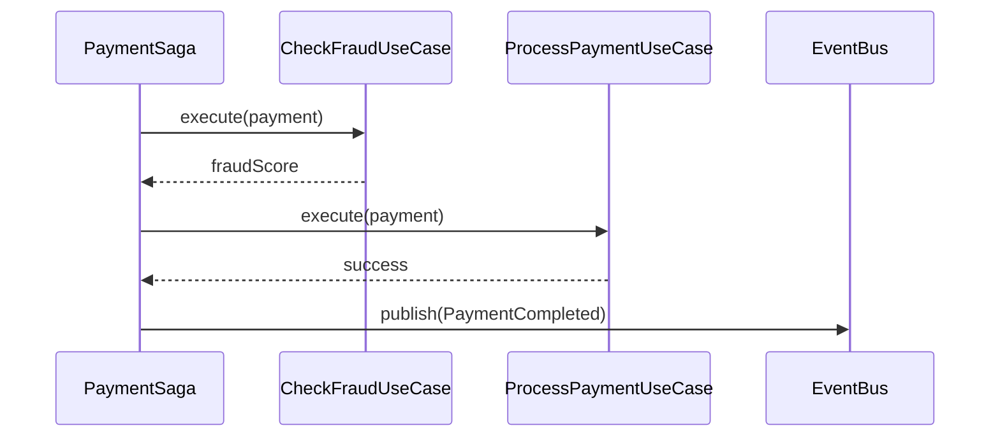
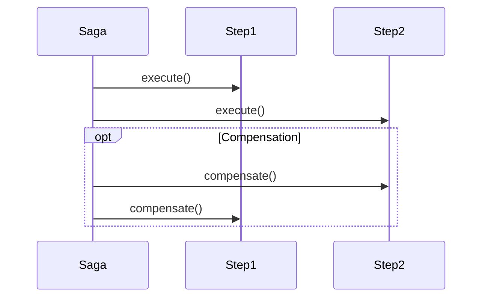
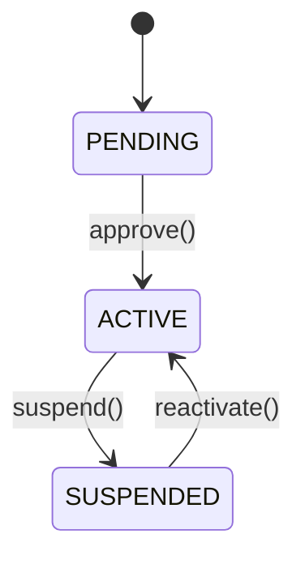
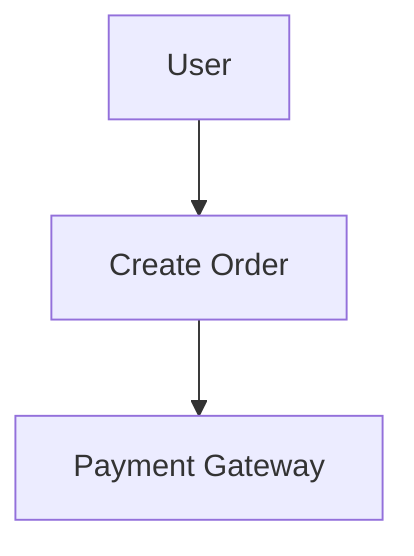
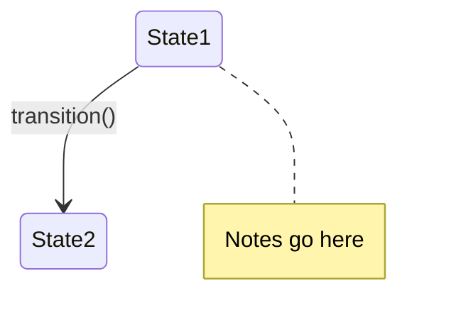
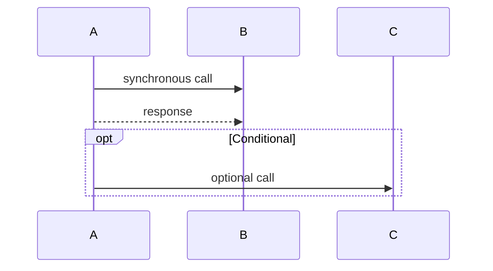
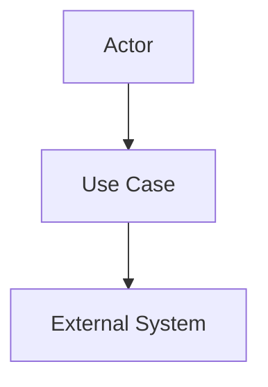

# Modeling Quick Start Guide

Get started with creating and maintaining Mermaid diagrams for your service in 5 minutes.

## Prerequisites

- Basic understanding of your service's domain
- Familiarity with Mermaid syntax (or willingness to learn)
- Code editor (VS Code recommended with Mermaid extension)

## Quick Start: 3 Steps

### 1. Identify What to Diagram

**For Sagas:**
- Every saga needs a sequence diagram
- Location: `docs/modeling/sequence/[saga-name].mmd`

**For Entities:**
- Every entity with a status field needs a state machine
- Location: `docs/modeling/state-machines/[entity-name]-status.mmd`

**For Use Cases:**
- Every service needs at least one use case diagram
- Location: `docs/modeling/use-cases/[feature-name].mmd`

### 2. Use a Template

Copy from `docs/templates/`:
- `saga-sequence-template.mmd` for sagas
- `state-machine-template.mmd` for entities
- `use-case-template.mmd` for use cases

### 3. Customize and Verify

1. Replace placeholders with your actual names
2. Match diagram content to your code
3. Preview at [mermaid.live](https://mermaid.live/)
4. Update `docs/modeling/README.md`

## Example: Creating a Saga Diagram

### Step 1: Copy Template
```bash
cp docs/templates/saga-sequence-template.mmd \
   services/my-service/docs/modeling/sequence/my-saga.mmd
```

### Step 2: Edit Content


### Step 3: Update README
Add to `services/my-service/docs/modeling/README.md`:
```markdown
### [my-saga.mmd](sequence/my-saga.mmd)
Orchestration of payment processing with fraud checks.
```

## Common Patterns

### Saga with Compensation


### Entity State Transitions


### Use Case with External System


## Cheat Sheet

### State Diagram Syntax


### Sequence Diagram Syntax


### Use Case Diagram Syntax


## Best Practices

### ✅ Do
- Keep diagrams simple and focused
- Use actual enum/event names from code
- Group related steps with `rect` blocks
- Add notes for complex logic
- Update diagrams with code changes

### ❌ Don't
- Create overly complex diagrams
- Use generic names like "Step1", "Step2"
- Forget compensation logic in sagas
- Skip README updates
- Create diagrams for non-existent code

## Tools

### VS Code Extensions
- **Markdown Preview Mermaid Support** - Preview diagrams in VS Code
- **Mermaid Markdown Syntax Highlighting** - Syntax highlighting for .mmd files

### Online Tools
- [Mermaid Live Editor](https://mermaid.live/) - Preview and edit diagrams
- [Mermaid Documentation](https://mermaid.js.org/) - Complete syntax reference

## Validation

Before committing, run:
```bash
npm run validate:diagrams
```

This checks:
- ✓ Valid Mermaid syntax
- ✓ All sagas have diagrams
- ✓ All entities have state machines
- ✓ README is updated

## Need Help?

1. **Check existing diagrams** - Look at similar services for patterns
2. **Read the Diagram Maintenance Guide** - `docs/DIAGRAM_MAINTENANCE_GUIDE.md`
3. **Review the Modeling Constitution** - `software-modeling-constitution.md`
4. **Ask for help** - #engineering Slack channel

## FAQ

**Q: Do I need diagrams for every entity?**  
A: Only entities with status fields that have lifecycle transitions.

**Q: What if my service has no sagas?**  
A: Document it as a utility service (see `services/maps-service/docs/modeling/README.md`).

**Q: How detailed should diagrams be?**  
A: Show all steps/states/transitions, but keep it readable. If it's too complex, break into multiple diagrams.

**Q: Can I use other diagram types?**  
A: Stick to state machines, sequence diagrams, and use cases unless you have a specific need.

---

**Time to create your first diagram:** ~15 minutes  
**Time to update existing diagram:** ~5 minutes

Happy diagramming! 🎨
