# Maysar Platform — Service Dependency Map

> **Purpose:** Authoritative, code-verified map of every inter-service dependency in the monorepo.
> **Methodology:** Generated by reading every service's `index.ts`, container/DI files, infrastructure clients, event handler files, and route files. All claims are traceable to specific source files listed per entry.
> **Last verified:** September 2026

---

## Visual Dependency Diagram

The diagram uses three edge styles:
- **Solid arrow `-->` (red label `import`)** — direct TypeScript module import or in-process container call (hardest coupling — breaks at compile/runtime if target changes)
- **Dashed arrow `-.->` (blue label `event`)** — async event bus subscription (loose coupling — survives independent deployment)
- **Dotted arrow `-.->` (orange label `middleware`)** — shared middleware import from kyc-service

```mermaid
graph TD
    %% ── Node definitions ────────────────────────────────────────────────────
    AUTH[auth-service]
    USER[user-service]
    WALLET[wallet-service]
    PAYMENT[payment-service]
    PAYOUT[payout-service]
    ORDER[order-service]
    LOGISTICS[logistics-service]
    MAPS[maps-service]
    KYC[kyc-service]
    INVENTORY[inventory-service]
    CHECKOUT[checkout-service]
    CATALOG[catalog-service]
    ENABLER[enabler-service]
    NOTIFICATION[notification-service]
    SUPPORT[support-service]
    COMMUNITY[community-service]
    TRAINING[training-service]
    BIZREG[business-registry-service]
    ANALYTICS[analytics-service]
    COMMISSION[commission-service]
    PRODUCTION[production-service]

    %% ── Direct imports / in-process calls (solid) ───────────────────────────
    AUTH -->|"import: user-service.facade"| USER
    PAYMENT -->|"in-process: WalletServiceClient"| WALLET
    WALLET -->|"in-process: PaymentServiceClient"| PAYMENT
    WALLET -->|"in-process: PayoutServiceClient"| PAYOUT
    PAYOUT -->|"in-process: WalletServiceClient\n(via payment-service path)"| WALLET
    LOGISTICS -->|"import: MapsRegistry\nMapsGeoPoint"| MAPS
    COMMUNITY -->|"import: businessRepository\nVerificationStatus"| BIZREG
    COMMUNITY -->|"in-process: Container.getInstance()\ntrainingRecordRepo, moduleRepo"| TRAINING
    CHECKOUT -->|"in-process: __placeOrderUseCase\nglobalThis registration"| ORDER
    CHECKOUT -->|"in-process: __createOrderShipments\nglobalThis registration"| LOGISTICS
    CATALOG -->|"import: kyc-gate.middleware\nprisma client"| KYC
    ENABLER -->|"import: kyc-gate.middleware"| KYC
    WALLET -->|"import: kyc-gate.middleware"| KYC
    PAYOUT -->|"import: kyc-gate.middleware"| KYC

    %% ── Event publications / subscriptions (dashed) ──────────────────────────
    AUTH -.->|"event: UserRegistered.v1"| USER
    AUTH -.->|"event: UserRegistered.v1"| WALLET
    AUTH -.->|"event: AuthLoginSuccess\nAuthLoginFailed\nAuthTwoFactor*"| USER

    ORDER -.->|"event: OrderCreated.v1\nOrderCancelled.v1"| INVENTORY
    ORDER -.->|"event: SettleCODPayment"| WALLET
    ORDER -.->|"event: Payment.Command.v1"| PAYMENT
    ORDER -.->|"event: order.pending_seller_verification\norder.seller_verified\norder.seller_declined"| NOTIFICATION

    PAYMENT -.->|"event: Payment.Success.v1\nPaymentInitiated"| WALLET
    PAYMENT -.->|"event: Payment.Success.v1\nPayment.Failure.v1"| ORDER

    LOGISTICS -.->|"event: Delivery.Success.v1\nDelivery.Failure.v1\nDeliveryDelivered"| USER
    LOGISTICS -.->|"event: StockReservation.Success.v1\nStockReservation.Failure.v1"| ORDER

    WALLET -.->|"event: WalletNotificationRequested"| NOTIFICATION

    SUPPORT -.->|"event: COD_DISPUTE_RESOLVED"| USER

    KYC -.->|"event: kyc.status_changed"| ORDER

    USER -.->|"event: UserRegistered"| NOTIFICATION
    USER -.->|"event: UserRegistered"| SUPPORT

    TRAINING -.->|"event: TrainingCompleted.v1\nCourseCompleted.v1\nUserEnrolled.v1"| NOTIFICATION

    %% ── Styling ──────────────────────────────────────────────────────────────
    classDef financial fill:#ffd700,stroke:#b8860b,color:#000
    classDef identity fill:#87ceeb,stroke:#4682b4,color:#000
    classDef fulfillment fill:#98fb98,stroke:#228b22,color:#000
    classDef content fill:#dda0dd,stroke:#8b008b,color:#000
    classDef infra fill:#f0e68c,stroke:#bdb76b,color:#000
    classDef comms fill:#ffa07a,stroke:#e9967a,color:#000

    class WALLET,PAYMENT,PAYOUT,COMMISSION financial
    class AUTH,USER,KYC identity
    class ORDER,LOGISTICS,INVENTORY,CHECKOUT fulfillment
    class CATALOG,ENABLER,COMMUNITY,TRAINING,BIZREG content
    class MAPS,ANALYTICS,PRODUCTION infra
    class NOTIFICATION,SUPPORT,CHAT comms
```



**Node colour key:**
- 🟡 **Gold** — Financial services (wallet, payment, payout, commission)
- 🔵 **Blue** — Identity services (auth, user, kyc)
- 🟢 **Green** — Fulfillment services (order, logistics, inventory, checkout)
- 🟣 **Purple** — Content/marketplace services (catalog, enabler, community, training, business-registry)
- 🟠 **Orange** — Communications services (notification, support)
- 🟤 **Khaki** — Infrastructure/analytics services (maps, analytics, production)

---

> **Legend:**
> - `direct-import` — TypeScript `import` statement crossing service boundaries
> - `in-process-call` — One service instantiates the other's container/class directly at runtime
> - `event-pub` — Publishes an event to the shared in-memory eventBus
> - `event-sub` — Subscribes to an event on the shared in-memory eventBus
> - `shared-middleware` — Imports KYC gate or auth middleware from another service's source

---

## Shared Infrastructure (Universal Dependencies)

Every service in the platform depends on these shared modules. They are not listed per-service below.

| Module | Purpose |
|--------|---------|
| `@shared/events/eventBus` | In-memory pub/sub event bus — all inter-service async coordination |
| `@shared/database/prisma-client` | Shared Prisma client factory |
| `@shared/middleware/auth-context.middleware` | JWT auth context, `requireAuth`, `requireRole`, `requireRoleOrService` |
| `@shared/middleware/idempotency` | Event idempotency tracking |
| `@shared/middleware/async-handler` | Express async error wrapper |
| `@shared/middleware/rate-limit.util` | Rate-limit bypass utility |
| `@shared/ids/id` | Distributed ID generation (`makeId`, `isSystemId`, `zodId`) |
| `@shared/validation/id` | Joi/Zod ID validators |
| `@shared/saga/saga-factory` | Distributed saga registry and orchestration |
| `@shared/saga/saga-log.repository` | Saga persistence (`PrismaSagaLogRepository`) |
| `@shared/saga/saga.orchestrator` | `DistributedSagaOrchestrator` base interface |
| `@shared/outbox/outboxPattern` | Transactional outbox pattern |
| `@shared/outbox/outbox.processor` | Outbox polling and event dispatch |
| `@shared/redis/ioredis-client` | Redis client factory |
| `@shared/locking/redis-lock` | Distributed Redis lock |
| `@shared/encryption/pii-encryption.service` | AES-256-GCM PII encryption + HMAC hashing |
| `@shared/i18n/i18n` | i18next internationalisation |
| `@shared/tracing/openTelemetry` | Distributed tracing correlation middleware |
| `@shared/logger/logger` | Shared logger |
| `@shared/business/minimum-basket-value` | Global minimum basket value constant |
| `@shared-events/eventBus` | Alias for `@shared/events/eventBus` used by some services |

---

## Service-by-Service Dependency Inventory

---

### AUTH-SERVICE (`/api/auth`)

**Depends on:**

| Type | Target | What / Why | Source file |
|------|--------|-----------|-------------|
| `direct-import` | user-service | `handleCreateUser`, `handleGetUserById`, `updateUserAuthState`, `verifyEmail` from `user-service.facade` | `src/infrastructure/clients/user-service.client.ts` |
| `in-process-call` | user-service | `UserServiceRepository` calls user-service facade functions in-process | `src/infrastructure/repositories/user-service.repository.ts` |
| `event-pub` | user-service, wallet-service | `UserRegistered.v1` — triggers user profile creation and wallet initialization | `src/application/use-cases/register-user.use-case.ts` |
| `event-pub` | user-service | `AuthLoginSuccess` — triggers `lastLoginAt` + lockout reset in user-service | `src/application/use-cases/authenticate-user.use-case.ts` |
| `event-pub` | user-service | `AuthLoginFailed` — triggers `failedLoginAttempts` increment + lockout in user-service | `src/application/use-cases/authenticate-user.use-case.ts` |
| `event-pub` | user-service | `AuthTwoFactorEnabled`, `AuthTwoFactorDisabled` — syncs 2FA state to user profile | `src/2fa/application/use-cases/` |

**Consumed by:** user-service (all auth events), wallet-service (`UserRegistered.v1`)

---

### USER-SERVICE (`/api/user`)

**Depends on:**

| Type | Target | What / Why | Source file |
|------|--------|-----------|-------------|
| `event-sub` | auth-service | `AuthLoginSuccess` → updates `lastLoginAt`, clears lockout on `user_User` | `src/infrastructure/messaging/auth-event-handlers.ts:114` |
| `event-sub` | auth-service | `AuthLoginFailed` → increments `failedLoginAttempts`, sets lockout | `src/infrastructure/messaging/auth-event-handlers.ts:129` |
| `event-sub` | auth-service | `AuthTwoFactorEnabled` → sets `twoFactorEnabled: true` on `user_User` | `src/infrastructure/messaging/auth-event-handlers.ts:152` |
| `event-sub` | auth-service | `AuthTwoFactorDisabled` → clears `twoFactorEnabled`, `twoFactorSecret` | `src/infrastructure/messaging/auth-event-handlers.ts:163` |
| `event-sub` | auth-service | `UserRegistered.v1` → upserts `user_User` row with PII-encrypted email/phone | `src/infrastructure/messaging/auth-event-handlers.ts:182` |
| `event-sub` | logistics-service | `Delivery.Success.v1` → increments COD reputation score for COD deliveries | `src/infrastructure/messaging/cod-event-handlers.ts:57` |
| `event-sub` | logistics-service | `Delivery.Failure.v1` → decrements COD reputation for refused deliveries | `src/infrastructure/messaging/cod-event-handlers.ts:75` |
| `event-sub` | logistics-service | `DeliveryDelivered` → alternative COD delivery success event | `src/infrastructure/messaging/cod-event-handlers.ts:94` |
| `event-sub` | support-service | `COD_DISPUTE_RESOLVED` → penalises COD reputation when commitment forfeited | `src/infrastructure/messaging/cod-event-handlers.ts:112` |

**Publishes:** `UserRegistered`, `UserEmailVerified`, `UserProfileUpdated`, `UserPasswordChanged`, `TwoFactorSetup`, `AccountSuspension`, `AccountDeletion`, `RoleChange`, `PhoneVerification`, `SecurityPolicyBreach`

---

### WALLET-SERVICE (`/api/wallet`)

**Depends on:**

| Type | Target | What / Why | Source file |
|------|--------|-----------|-------------|
| `direct-import` | payment-service | Type imports: `ProcessPaymentDTO`, `PaymentResultDTO`, `PaymentStatusDTO` | `src/infrastructure/clients/payment-service.client.ts:1-2` |
| `direct-import` | payment-service | `AuditInfo`, `ActorType` value objects (re-exported by payment client) | `src/infrastructure/clients/wallet-service.client.ts` in payment-service |
| `direct-import` | payout-service | `Payout` entity type import | `src/infrastructure/clients/payout-service.client.ts:7` |
| `direct-import` | kyc-service | `requireKycLevel` middleware — gates `POST /:userId/payout` behind KYC L2 | `src/api/routes/wallet.routes.ts:14` |
| `in-process-call` | payment-service | `PaymentServiceClient` dynamically imports payment-service `Container.getInstance()` | `src/infrastructure/clients/payment-service.client.ts` |
| `in-process-call` | payout-service | `PayoutServiceClient` calls payout-service for payout initiation | `src/infrastructure/clients/payout-service.client.ts` |
| `event-sub` | payment-service | `Payment.Success.v1` → credits wallet after successful payment | `src/container.ts:233` |
| `event-sub` | auth-service (via user-service) | `UserRegistered.v1` → initializes wallet for new user | `src/container.ts:239` |
| `event-sub` | payment-service | `PaymentInitiated` → starts `WalletTransactionSaga` for WALLET payments | `src/container.ts:274` |
| `event-sub` | order-service | `SettleCODPayment` → starts `CODSettlementSaga` to capture delivery hold | `src/container.ts:317` |
| `event-sub` | (internal) | `WalletTransaction.Command.v1` → distributed wallet transaction saga | `src/container.ts:264` |

**Publishes:** `WalletCredited`, `WalletDebited`, `HoldPlaced`, `HoldReleased`, `HoldCaptured`, `HoldExpired`, `WalletPayoutInitiated`, `WalletPaymentProcessed`, `WalletPaymentFailed`, `WalletNotificationRequested`

---

### PAYMENT-SERVICE (`/api/payment`)

**Depends on:**

| Type | Target | What / Why | Source file |
|------|--------|-----------|-------------|
| `direct-import` | wallet-service | `AuditInfo`, `ActorType`, `Transaction`, `TransactionType` — type-level imports | `src/infrastructure/clients/wallet-service.client.ts:1-2` |
| `in-process-call` | wallet-service | `WalletServiceClient` dynamically imports wallet-service `Container.getInstance()` — used for balance checks, debits, holds | `src/infrastructure/clients/wallet-service.client.ts` |
| `in-process-call` | wallet-service | `InternalWalletAdapter` wraps `WalletServiceClient` for WALLET payment processing | `src/infrastructure/providers/internal-wallet.adapter.ts` |

**Publishes:** `Payment.Success.v1`, `Payment.Failure.v1`, `PaymentInitiated`, `TransactionDetailsFetched`, `FraudAnalysisCompleted`, `TransactionBlockProcessed`, `DisputeEvidenceGathered`

**Consumed by:** wallet-service (`Payment.Success.v1`, `PaymentInitiated`), order-service (`Payment.Success.v1`, `Payment.Failure.v1`)

---

### PAYOUT-SERVICE (`/api/payout`)

**Depends on:**

| Type | Target | What / Why | Source file |
|------|--------|-----------|-------------|
| `direct-import` | payment-service | Imports `WalletServiceClient` **from payment-service's infrastructure** (re-uses the same client class) | `src/container.ts:15` |
| `direct-import` | kyc-service | `requireKycLevel` middleware — gates `POST /payouts` behind KYC L2 | `src/api/routes/payout.routes.ts:8` |
| `in-process-call` | wallet-service | `WalletServiceClient` (imported via payment-service path) calls wallet-service in-process: `checkEligibility`, `freezeFunds`, `debitFrozenFunds`, `unfreezeFunds`, `creditWallet` | `src/application/sagas/payout-processing.saga.ts` |

**Publishes:** payout lifecycle events via outbox processor

---

### ORDER-SERVICE (`/api/order`)

**Depends on:**

| Type | Target | What / Why | Source file |
|------|--------|-----------|-------------|
| `in-process-call` | auth-service | `AuthServiceClient` — identity verification | `src/infrastructure/integrations/auth-service.client.ts` |
| `in-process-call` | user-service | `UserServiceClient` — buyer/seller profile lookup, COD eligibility | `src/infrastructure/integrations/user-service.client.ts` |
| `in-process-call` | logistics-service | `LogisticsServiceClient` — stock reservation, delivery coordination | `src/infrastructure/integrations/logistics-service.client.ts` |
| `in-process-call` | wallet-service | `WalletServiceClient` — WALLET payment debit + COD commitment hold | `src/infrastructure/integrations/wallet-service.client.ts` |
| `event-sub` | logistics-service | `StockReservation.Success.v1`, `StockReservation.Failure.v1` — saga reply | `index.ts` saga reply handler |
| `event-sub` | payment-service | `Payment.Success.v1`, `Payment.Failure.v1` — saga reply | `index.ts` saga reply handler |
| `event-sub` | logistics-service | `Delivery.Success.v1`, `Delivery.Failure.v1`, `DeliveryDelivered` — delivery outcomes | `index.ts` |
| `event-sub` | kyc-service | `kyc.status_changed` — triggers ACCOUNT_AGE_MILESTONE COD trust signal | `index.ts` |

**Publishes:** `OrderCreated.v1`, `OrderCancelled.v1`, `OrderDelivered`, `SettleCODPayment` (triggers wallet COD settlement), `Payment.Command.v1` (triggers payment saga)

---

### LOGISTICS-SERVICE (`/api/logistics`)

**Depends on:**

| Type | Target | What / Why | Source file |
|------|--------|-----------|-------------|
| `direct-import` | maps-service | `TrackingPort` interface | `src/infrastructure/providers/maps-tracking.bridge.ts:1` |
| `direct-import` | maps-service | `MapsRegistry` — instantiates the maps-service tracking provider at runtime | `src/infrastructure/providers/maps-tracking.bridge.ts:4` |
| `direct-import` | maps-service | `GeoPoint` value object | `src/infrastructure/providers/maps-tracking.bridge.ts:5` |

> **Note:** `MapsRoutingBridge`, `MapsWeatherBridge`, and `MapsTrafficBridge` are self-contained local implementations — they do NOT import from maps-service. Only `MapsTrackingBridge` creates a hard runtime dependency on maps-service's `MapsRegistry`.

**Publishes:** `Delivery.Success.v1`, `Delivery.Failure.v1`, `DeliveryDelivered`, `StockReservation.Success.v1`, `StockReservation.Failure.v1`, `StockReserved.v1`, `StockReleased.v1`

**Consumed by:** order-service, user-service (all delivery events)

---

### MAPS-SERVICE (`/api/maps`)

**Depends on:** None (no inter-service imports or event subscriptions found)

**Consumed by:** logistics-service (`MapsTrackingBridge` imports `MapsRegistry` directly)

> Stateless routing/geocoding proxy. No domain events emitted to other services.

---

### KYC-SERVICE (internal middleware only)

**Depends on:** None (no inter-service imports)

**Consumed by (as shared middleware):**

| Service | Usage | Source file |
|---------|-------|-------------|
| wallet-service | `requireKycLevel(2)` on `POST /:userId/payout` | `wallet-service/src/api/routes/wallet.routes.ts:14` |
| payout-service | `requireKycLevel(2)` on `POST /payouts` | `payout-service/src/api/routes/payout.routes.ts:8` |
| catalog-service | `requireKycLevel`, `requireKycListingCapacity` on `POST /v1/products` | `catalog-service/src/api/routes/product.routes.ts:13-14` |
| catalog-service | `prisma` client from kyc-service's database module | `catalog-service/src/api/routes/product.routes.ts:14` |
| enabler-service | `requireKycLevel(1)`, `requireKycListingCapacity` on `POST /enablers/:id/listings` | `enabler-service/src/api/routes/enabler.routes.ts:14` |

**Publishes:** `kyc.status_changed` — consumed by order-service for COD trust signal bridge

---

### INVENTORY-SERVICE (`/api/inventory`)

**Depends on:**

| Type | Target | What / Why | Source file |
|------|--------|-----------|-------------|
| `event-sub` | order-service | `OrderCreated.v1` — triggers stock reservation | Event handlers |
| `event-sub` | order-service | `OrderCancelled.v1` — releases stock reservation | Event handlers |

**Publishes:** `InventoryCountCompleted.v1`, stock reservation events

---

### CHECKOUT-SERVICE (`/api/checkout`)

**Depends on:**

| Type | Target | What / Why | Source file |
|------|--------|-----------|-------------|
| `direct-import` | logistics-service | `ConsolidationOrchestrator` — used in multi-seller integration tests | `src/tests/integration/multi-seller-consolidation.integration.test.ts:30` |
| `in-process-call` | order-service | Uses `globalThis.__placeOrderUseCase` (registered by order-service at startup) to create real orders on checkout confirm | `src/api/controllers/checkout.controller.ts` |
| `in-process-call` | logistics-service | Uses `globalThis.__createOrderShipments` (registered by logistics-service) to create shipments on confirm | `src/api/controllers/checkout.controller.ts` |

**Publishes:** `OrderCreated` (via eventBus after checkout confirm)

---

### CATALOG-SERVICE (`/api/catalog`)

**Depends on:**

| Type | Target | What / Why | Source file |
|------|--------|-----------|-------------|
| `direct-import` | kyc-service | `requireKycLevel`, `requireKycListingCapacity` middleware | `src/api/routes/product.routes.ts:13` |
| `direct-import` | kyc-service | `prisma` Prisma client from kyc-service's `infrastructure/database/prisma-client` | `src/api/routes/product.routes.ts:14` |

**Publishes:** `ProductPublished`, `ProductDeleted`, `CategoryDeleted` (consumed by campaign event handlers)

---

### ENABLER-SERVICE (`/api/enabler`)

**Depends on:**

| Type | Target | What / Why | Source file |
|------|--------|-----------|-------------|
| `direct-import` | kyc-service | `requireKycLevel(1)`, `requireKycListingCapacity` middleware | `src/api/routes/enabler.routes.ts:14` |

**Publishes:** enabler lifecycle events via outbox processor

---

### NOTIFICATION-SERVICE (`/api/notification`)

**Depends on:**

| Type | Target | What / Why | Source file |
|------|--------|-----------|-------------|
| `event-sub` | auth-service/user-service | `UserRegistered` — triggers welcome notification | `src/application/sagas/saga-event-handler.ts:35` |
| `event-sub` | order-service | `order.pending_seller_verification` — notifies seller of new order awaiting verification | `src/application/sagas/saga-event-handler.ts:40` |
| `event-sub` | order-service | `order.seller_verified` — notifies buyer that stock is confirmed | `src/application/sagas/saga-event-handler.ts:44` |
| `event-sub` | order-service | `order.seller_declined` — notifies buyer of stock decline | `src/application/sagas/saga-event-handler.ts:48` |
| `event-sub` | wallet-service | `WalletNotificationRequested` — wallet-triggered notifications | `src/application/sagas/saga-event-handler.ts` |
| `event-sub` | (internal) | `NotificationCreated`, `NotificationFailed` — internal saga events | `src/application/sagas/saga-event-handler.ts:27,31` |

**Publishes:** none (consumer-only service)

---

### SUPPORT-SERVICE (`/api/support`)

**Depends on:**

| Type | Target | What / Why | Source file |
|------|--------|-----------|-------------|
| `event-sub` | (internal) | `TicketCreated` — internal subscription for auto-assignment | `src/infrastructure/messaging/support-event-subscriber.ts:15` |
| `event-sub` | user-service | `UserRegistered` — initialises support context for new users | `src/infrastructure/messaging/support-event-subscriber.ts:16` |

**Publishes:** `TicketCreated`, `TicketAssigned`, `TicketResolved`, `TicketStatusChanged`, `TicketClosed`, `MessageAdded`, `COD_DISPUTE_RESOLVED`

---

### COMMUNITY-SERVICE (`/api/community`)

**Depends on:**

| Type | Target | What / Why | Source file |
|------|--------|-----------|-------------|
| `direct-import` | business-registry-service | `businessRepository` (infrastructure repository) — direct in-process import | `src/infrastructure/clients/business-registry-client.ts:2` |
| `direct-import` | business-registry-service | `VerificationStatus` entity enum | `src/infrastructure/clients/business-registry-client.ts:3` |
| `direct-import` | training-service | `TrainingStatus` value object | `src/infrastructure/clients/training-service-client.ts:2` |
| `in-process-call` | training-service | Dynamically imports `Container.getInstance()` from training-service to query `trainingRecordRepo` and `moduleRepo` | `src/infrastructure/clients/training-service-client.ts:7,12,22` |

> ⚠️ **Tight coupling:** Community-service accesses business-registry-service's repository layer and training-service's container directly — bypassing HTTP APIs.

---

### TRAINING-SERVICE (`/api/training`)

**Depends on:** None (no inter-service imports or subscriptions found in production code)

**Publishes:** `TrainingCompleted.v1`, `UserEnrolled.v1`, `CourseCompleted.v1`, `LearnerEligibilityChanged.v1`, `TrainingFailed.v1`, `CertificationExpired.v1`, `BadgeEarned.v1`, `TrainingStarted.v1`, `TrainingProgressUpdated.v1`

**Consumed by:** community-service (in-process container access), notification-service (training events)

---

### BUSINESS-REGISTRY-SERVICE (`/api/business-registry`)

**Depends on:** None (no inter-service imports or event subscriptions found)

**Consumed by:** community-service (direct repository import)

---

### ANALYTICS-SERVICE (`/api/analytics`)

**Depends on:**

| Type | Target | What / Why | Source file |
|------|--------|-----------|-------------|
| `shared-db` | user-service | Reads `user_User` table directly via shared Prisma client in `SellerMetricsCalculationJob` | `src/infrastructure/SellerMetricsCalculationJob.ts` |
| `event-sub` | order-service, payment-service | Ingests order/payment events for metrics calculation | Event handlers |

> Analytics uses the shared Prisma connection to read across service schema boundaries.

---

### COMMISSION-SERVICE (`/api/commission`)

**Depends on:** None (no inter-service imports, HTTP clients, or event subscriptions found in production code)

**Consumed by:** none currently identified in production code (commissions are created internally by order fulfillment sagas)

---

### PRODUCTION-SERVICE

**Depends on:**

| Type | Target | What / Why | Source file |
|------|--------|-----------|-------------|
| `direct-import` | analytics-service | `IEventBus` interface — type compatibility only, test file | `src/domain/interfaces/IEventBus.test.ts:1` |

> The `IEventBus` import is test-only. No production dependency on analytics-service found.

**Publishes:** `ProductionScheduled`, `ProductionCompleted`, `CapacityUpdated`

---

## Cross-Service Shared Prisma Access

The platform uses a **single shared PostgreSQL database** with per-service schema prefixes. The following cross-schema accesses were identified:

| Service reading | Schema prefix accessed | Purpose |
|----------------|----------------------|---------|
| analytics-service | `user_User` | Seller metrics calculation |
| checkout-service | `catalog_Product`, `catalog_SellerLocation` | Product seller lookup on confirm |
| checkout-service | `checkout_Order` | Checkout order upsert |
| checkout-service | `order_Order` | Update `chatConversationId` on order |
| checkout-service | `chat_Conversation` | Create buyer-seller chat on seller verification checkout |
| order-service | `catalog_Product`, `catalog_SellerLocation` | Product/seller lookup during order placement |
| catalog-service | kyc-service's `prisma` client instance | Listing capacity check (shares the same Prisma singleton) |
| user-service | `user_UserIndex` | Email/phone hash lookup for PII |

---

## Event Flow Map

```
AUTH-SERVICE
  ──publishes──► UserRegistered.v1 ──► USER-SERVICE (creates user_User row)
                                  ──► WALLET-SERVICE (initializes wallet)
  ──publishes──► AuthLoginSuccess ──► USER-SERVICE (updates lastLoginAt)
  ──publishes──► AuthLoginFailed ──► USER-SERVICE (increments lockout)
  ──publishes──► AuthTwoFactor* ──► USER-SERVICE (syncs 2FA state)

ORDER-SERVICE
  ──publishes──► OrderCreated.v1 ──► INVENTORY-SERVICE (reserve stock)
  ──publishes──► OrderCancelled.v1 ──► INVENTORY-SERVICE (release stock)
  ──publishes──► OrderDelivered ──► (settlement)
  ──publishes──► SettleCODPayment ──► WALLET-SERVICE (COD settlement saga)
  ──publishes──► Payment.Command.v1 ──► PAYMENT-SERVICE (payment saga trigger)
  ──subscribes── StockReservation.{Success,Failure}.v1 ◄── LOGISTICS-SERVICE
  ──subscribes── Payment.{Success,Failure}.v1 ◄── PAYMENT-SERVICE
  ──subscribes── Delivery.{Success,Failure}.v1 ◄── LOGISTICS-SERVICE
  ──subscribes── kyc.status_changed ◄── KYC-SERVICE

PAYMENT-SERVICE
  ──publishes──► Payment.Success.v1 ──► WALLET-SERVICE (credit wallet)
  ──publishes──► PaymentInitiated ──► WALLET-SERVICE (start wallet saga)
  ──publishes──► Payment.{Success,Failure}.v1 ──► ORDER-SERVICE (saga reply)

WALLET-SERVICE
  ──subscribes── Payment.Success.v1 ◄── PAYMENT-SERVICE
  ──subscribes── UserRegistered.v1 ◄── AUTH-SERVICE
  ──subscribes── PaymentInitiated ◄── PAYMENT-SERVICE
  ──subscribes── SettleCODPayment ◄── ORDER-SERVICE
  ──publishes──► WalletNotificationRequested ──► NOTIFICATION-SERVICE

LOGISTICS-SERVICE
  ──publishes──► Delivery.Success.v1 ──► USER-SERVICE (COD reputation)
  ──publishes──► Delivery.Failure.v1 ──► USER-SERVICE (COD reputation)
  ──publishes──► DeliveryDelivered ──► USER-SERVICE (COD reputation)
  ──publishes──► StockReservation.*.v1 ──► ORDER-SERVICE (saga reply)

SUPPORT-SERVICE
  ──publishes──► COD_DISPUTE_RESOLVED ──► USER-SERVICE (COD reputation penalty)

NOTIFICATION-SERVICE
  ──subscribes── UserRegistered ◄── AUTH-SERVICE/USER-SERVICE
  ──subscribes── order.pending_seller_verification ◄── ORDER-SERVICE
  ──subscribes── order.seller_verified ◄── ORDER-SERVICE
  ──subscribes── order.seller_declined ──  ORDER-SERVICE
  ──subscribes── WalletNotificationRequested ◄── WALLET-SERVICE

TRAINING-SERVICE
  ──publishes──► TrainingCompleted.v1, UserEnrolled.v1, CourseCompleted.v1
  (consumed by community-service via in-process container, not events)

KYC-SERVICE
  ──publishes──► kyc.status_changed ──► ORDER-SERVICE (COD trust bridge)
```

---

## Direct Module Import Graph (Tight Coupling)

These are the hardest dependencies — a code change in the target may break the dependent at compile or runtime:

```
community-service
  ├──imports──► business-registry-service/src/infrastructure/ (businessRepository)
  └──imports──► training-service/src/infrastructure/container (Container.getInstance)

logistics-service
  └──imports──► maps-service/src/infrastructure/registry (MapsRegistry)
               maps-service/src/domain/value-objects/geopoint.value-object

catalog-service
  └──imports──► kyc-service/src/api/middleware/kyc-gate.middleware
               kyc-service/src/infrastructure/database/prisma-client

enabler-service
  └──imports──► kyc-service/src/api/middleware/kyc-gate.middleware

wallet-service
  ├──imports──► kyc-service/src/api/middleware/kyc-gate.middleware
  ├──imports──► payment-service/src/application/use-cases/ (type imports)
  └──imports──► payout-service/src/domain/entities/payout.entity (type import)

payout-service
  └──imports──► payment-service/src/infrastructure/clients/wallet-service.client
               kyc-service/src/api/middleware/kyc-gate.middleware

payment-service
  └──imports──► wallet-service/src/domain/value-objects/audit-info.value-object
               wallet-service/src/domain/entities/transaction.entity

auth-service
  └──imports──► user-service/src/internal/user-service.facade

checkout-service (tests only)
  └──imports──► logistics-service/src/application/services/consolidation-orchestrator.service
```

---

## In-Process Container Calls (Runtime Coupling)

These services call another service's DI container directly at runtime — no HTTP, no event bus, just a JavaScript function call across service boundaries:

| Caller | Callee | How | Purpose |
|--------|--------|-----|---------|
| payment-service | wallet-service | `import('../../../../wallet-service/src/container').Container.getInstance()` | Balance, debit, hold operations |
| wallet-service | payment-service | `import('../../../../payment-service/src/container').Container.getInstance()` | Initiates payments for top-up |
| wallet-service | payout-service | `import('../../../../payout-service/src/container').Container.getInstance()` | Initiates payouts from wallet |
| payout-service | wallet-service | Via `WalletServiceClient` (imported from payment-service path) | Freeze/debit/credit for payout processing |
| community-service | business-registry-service | `businessRepository.findById()` called directly | Business credential verification |
| community-service | training-service | `Container.getInstance().trainingRecordRepo.findByLearnerId()` | Training module progress |
| checkout-service | order-service | `globalThis.__placeOrderUseCase.execute()` | Placing real order on confirm |
| checkout-service | logistics-service | `globalThis.__createOrderShipments()` | Creating shipments on confirm |
| auth-service | user-service | `handleCreateUser()`, `updateUserAuthState()` etc. from facade | User profile CRUD on registration/auth |

---

## Deployment Constraints

Based on the dependency graph:

1. **Must deploy together** (direct module imports create hard runtime coupling):
   - `logistics-service` + `maps-service` (MapsTrackingBridge imports MapsRegistry)
   - `catalog-service` + `kyc-service` (shares prisma client instance)
   - `community-service` + `business-registry-service` + `training-service`
   - `auth-service` + `user-service` (facade calls)
   - `payment-service` + `wallet-service` + `payout-service` (container cross-imports)
   - `checkout-service` + `order-service` + `logistics-service` (globalThis registrations)

2. **Event-dependent startup order** (subscribers must be initialized before publishers fire):
   - `user-service` must be initialized before `auth-service` emits registration events
   - `wallet-service` must be initialized before `payment-service` processes WALLET payments
   - `notification-service` should start before order-service to avoid missing order events

3. **Shared Prisma singleton** — all services share a single database connection pool via `@shared/database/prisma-client`. Schema isolation is by prefix only, not by connection.
