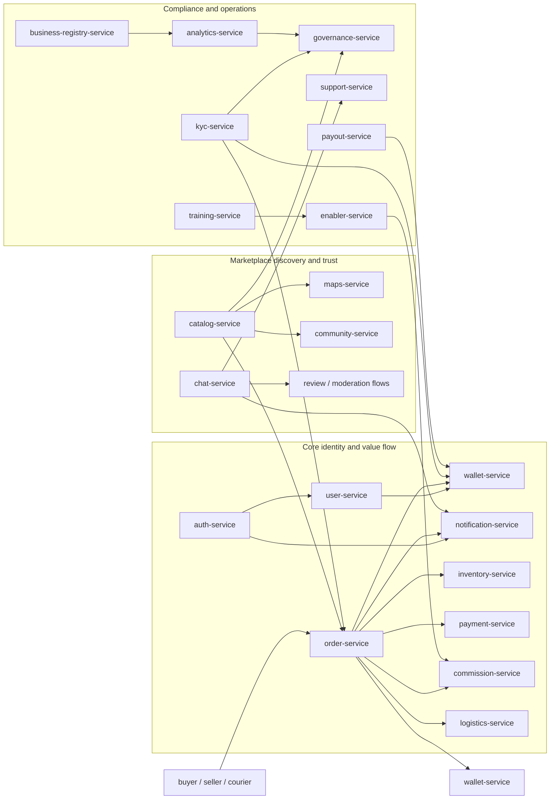

# Maysar Express — How the System Actually Works
# Last updated: May 2026

---

## Table of Contents

- [1. What Maysar Express Is](#1-what-maysar-express-is)
- [2. Registration: Three Things Happen Simultaneously](#2-registration-three-things-happen-simultaneously)
- [3. COD Trust Scoring: How a Buyer Earns the Right to Pay Later](#3-cod-trust-scoring-how-a-buyer-earns-the-right-to-pay-later)
- [4. COD Eligibility Enforcement at Order Time](#4-cod-eligibility-enforcement-at-order-time)
- [5. Placing an Order: The Saga Pattern](#5-placing-an-order-the-saga-pattern)
- [6. Buy-Box Ranking: How the Featured Seller Is Chosen](#6-buy-box-ranking-how-the-featured-seller-is-chosen)
- [7. Price Competitiveness Signal: No Race to the Bottom](#7-price-competitiveness-signal-no-race-to-the-bottom)
- [8. The Full Composite Score Computation](#8-the-full-composite-score-computation)
- [9. Fraud Detection: Three Passes](#9-fraud-detection-three-passes)
- [10. Geographic Adjustment: Zone-Aware Scoring](#10-geographic-adjustment-zone-aware-scoring)
- [11. Category Strategy: Operators Can Tune the Weights](#11-category-strategy-operators-can-tune-the-weights)
- [12. Scheduled Jobs: When Scores Are Recomputed](#12-scheduled-jobs-when-scores-are-recomputed)
- [13. The Event Bus: How Services Talk](#13-the-event-bus-how-services-talk)
- [14. Correctness: Property-Based Tests](#14-correctness-property-based-tests)
- [15. What Phase 4 Depends On (and Why It Is Ready)](#15-what-phase-4-depends-on-and-why-it-is-ready)
- [16. System Relationship Map](#16-system-relationship-map)
- [17. Service Ownership Matrix](#17-service-ownership-matrix)
- [18. Runtime and Operational Flow](#18-runtime-and-operational-flow)
- [19. Failure Modes and Recovery Law](#19-failure-modes-and-recovery-law)
- [20. Event and Topic Ownership Map](#20-event-and-topic-ownership-map)
- [21. Table Ownership Map](#21-table-ownership-map)
- [22. Service-by-Service Dependency List](#22-service-by-service-dependency-list)
- [23. Key File Index](#23-key-file-index)

## 1. What Maysar Express Is

A multi-sided marketplace for Tanzania. Buyers browse products, place orders, pay
(wallet, COD, card), and receive deliveries. Sellers list products and compete for
the "buy box" - the featured seller slot on a product page.

The backend is a TypeScript monorepo of ~22 microservices, all sharing one PostgreSQL
database via Prisma, communicating through an in-process event bus.

Architecture: Domain-Driven Design (DDD) with strict layering:
  domain -> application -> infrastructure -> api

Every service follows the same pattern.

---

## 2. Registration: Three Things Happen Simultaneously

When a user registers, auth-service publishes UserRegistered.v1 on the event bus.
Two other services are subscribed and react independently.

SOURCE: services/user-service/src/infrastructure/messaging/auth-event-handlers.ts

```typescript
eventBus.subscribe('UserRegistered.v1', async (envelope: EventEnvelope) => {
  const payload = asUserRegistered(envelope.data);
  if (!payload.userId) return;

  await prisma.user_User.upsert({
    where: { id: payload.userId },
    create: {
      id: payload.userId,
      email: payload.email ?? '',
      publicCode: payload.publicCode ?? null,
      passwordHash: '',                          // never stored here — auth-service owns credentials
      role: mapRole(payload.role),
      status: User_UserStatus.PENDING_VERIFICATION,
      firstName: firstName ?? null,
      lastName: lastName ?? null,
      phoneNumber: phoneNumber ?? null
    },
    update: {
      publicCode: payload.publicCode ?? null,
      role: mapRole(payload.role),
      status: User_UserStatus.PENDING_VERIFICATION
    }
  });
});
```

The upsert is intentional — if the event is delivered twice (network retry), the
second delivery is a no-op. passwordHash is always '' in user-service because
auth-service owns credentials.

SOURCE: services/wallet-service/src/infrastructure/messaging/user-registered.handler.ts

```typescript
async handle(event: EventEnvelope): Promise<void> {
  const { userId } = data;
  const idempotencyKey = event.eventId ?? `user-registered:${userId}`;

  await this.eventIdempotency.withIdempotency(idempotencyKey, 'UserRegisteredHandler', async () => {
    const existing = await this.walletRepository.findByUserId(userId);
    if (existing) return; // already created — skip

    const wallet = new Wallet({
      id: makeId(getModelPrefix('Wallet_Wallet')),
      userId,
      balance: 0,
      currency: 'TZS',
      status: WalletStatus.ACTIVE,
      frozenAmount: 0,
      codCommitmentLimit: 0,
    });

    await this.walletRepository.save(wallet);
  });
}
```

The wallet starts at TZS 0. The idempotency wrapper ensures duplicate events do not
create duplicate wallets.

Result after one registration:
  - one auth_users row (auth-service)
  - one user_User row (user-service)
  - one wallet_Wallet row (wallet-service)
  All three are consistent.

---

## 3. COD Trust Scoring: How a Buyer Earns the Right to Pay Later

COD (Cash on Delivery) is the dominant payment method in Tanzania. The risk is buyers
refusing delivery. The system manages this with a score from 0-100 per buyer.

SOURCE: services/order-service/src/domain/engines/cod-trust/trust-signal.types.ts

```typescript
export enum TrustSignalType {
  SUCCESSFUL_DELIVERY        = 'SUCCESSFUL_DELIVERY',
  PHONE_VERIFIED             = 'PHONE_VERIFIED',
  HIGH_VALUE_COMPLETION      = 'HIGH_VALUE_COMPLETION',
  ACCOUNT_AGE_MILESTONE      = 'ACCOUNT_AGE_MILESTONE',
  POST_DISPATCH_CANCELLATION = 'POST_DISPATCH_CANCELLATION',
  DELIVERY_REFUSED           = 'DELIVERY_REFUSED',
  DISPUTE_LOST               = 'DISPUTE_LOST',
  COURIER_NEGATIVE_REPORT    = 'COURIER_NEGATIVE_REPORT',
}

export const SIGNAL_WEIGHTS: Record<TrustSignalType, number> = {
  [TrustSignalType.SUCCESSFUL_DELIVERY]:        +8,
  [TrustSignalType.PHONE_VERIFIED]:             +5,
  [TrustSignalType.HIGH_VALUE_COMPLETION]:      +10,
  [TrustSignalType.ACCOUNT_AGE_MILESTONE]:      +7,
  [TrustSignalType.POST_DISPATCH_CANCELLATION]: -10,
  [TrustSignalType.DELIVERY_REFUSED]:           -15,
  [TrustSignalType.DISPUTE_LOST]:               -12,
  [TrustSignalType.COURIER_NEGATIVE_REPORT]:    -8,
};
```

SOURCE: services/order-service/src/domain/engines/cod-trust/trust-score.functions.ts

```typescript
export function applySignal(currentScore: number, signal: TrustSignalType): number {
  const delta = SIGNAL_WEIGHTS[signal];
  return Math.max(0, Math.min(100, currentScore + delta));  // always clamped [0,100]
}

export function deriveTier(score: number): TrustTier {
  if (score <= 20) return 'NEW_BUYER';
  if (score <= 40) return 'TRUSTED_BEGINNER';
  return 'TRUSTED_BUYER';
}

export function getCODLimit(tier: TrustTier): number | null {
  if (tier === 'NEW_BUYER')        return 30_000;   // TZS 30k
  if (tier === 'TRUSTED_BEGINNER') return 150_000;  // TZS 150k
  return null;                                       // TRUSTED_BUYER — unlimited
}

export function replayScore(events: Array<{ delta: number }>): number {
  return events.reduce((score, event) => {
    return Math.max(0, Math.min(100, score + event.delta));
  }, 0);
}
```

These are pure functions — no I/O, no side effects. The score is event-sourced:
every change is appended to order_CODScoreEvent and the current score is a
materialized view in order_CODTrustScore. You can replay the full history at any time.

Progression example:
  New buyer registers:          score = 0  → NEW_BUYER    → TZS 30k limit
  Completes 4 COD deliveries:   score = 32 → TRUSTED_BEGINNER → TZS 150k limit
  Verifies phone:               score = 37 → TRUSTED_BEGINNER
  Completes 1 high-value order: score = 47 → TRUSTED_BUYER → unlimited


---

## 4. COD Eligibility Enforcement at Order Time

SOURCE: services/order-service/src/domain/engines/progressive-cod-eligibility.engine.ts

```typescript
async checkOrderEligibility(order: Order, sellerAddress: any): Promise<EligibilityResult> {
  const scoreRecord = await this.trustScoreRepo.findByBuyerId(buyerId);
  const score = scoreRecord?.score ?? 0;
  const tier = deriveTier(score);
  const codLimit = getCODLimit(tier);
  const orderAmount = typeof order.totalAmount?.amount === 'number'
    ? order.totalAmount.amount
    : Number(order.totalAmount);

  // 1. Value check — fail fast
  if (codLimit !== null && orderAmount > codLimit) {
    return {
      eligible: false,
      reason: `COD order value TZS ${orderAmount} exceeds your current limit of TZS ${codLimit}.
               Complete more orders to increase your COD limit.`,
    };
  }

  // 2. Geographic check — NEW_BUYER only: same city as seller
  if (tier === 'NEW_BUYER') {
    const deliveryCity = order.deliveryAddress?.city?.toLowerCase()?.trim();
    const sellerCity = sellerAddress?.city?.toLowerCase()?.trim();
    if (deliveryCity && sellerCity && deliveryCity !== sellerCity) {
      return {
        eligible: false,
        reason: `New buyers can only use COD within the same city as the seller (${sellerAddress.city}).`,
      };
    }
  }

  // 3. Concurrency check — NEW_BUYER only: max 1 active COD order at a time
  if (tier === 'NEW_BUYER') {
    const activeCODOrders = await this.countActiveCODOrders(buyerId);
    if (activeCODOrders >= 1) {
      return {
        eligible: false,
        reason: 'New buyers can only have 1 active COD order at a time.',
      };
    }
  }

  // 4. Logistics area support
  const isSupportedArea = await this.logisticsService.isCODSupportedInArea(order.deliveryAddress);
  if (!isSupportedArea) return { eligible: false, reason: 'UNSUPPORTED_AREA' };

  // 5. High-risk item check (codAccepted flag on product)
  const hasHighRiskItem = order.items.some(item => this.isHighRiskItem(item.productId));
  if (hasHighRiskItem) return { eligible: false, reason: 'HIGH_RISK_ITEM' };

  return { eligible: true };
}
```

Checks run in fail-fast order. A brand-new buyer (score 0) can immediately place a
COD order up to TZS 30,000 in the same city as the seller. After 4 successful
deliveries (+8 each = +32), they cross into TRUSTED_BEGINNER and the limit jumps
to TZS 150,000.

---

## 5. Placing an Order: The Saga Pattern

PlaceOrderUseCase is the entry point. It handles all payment methods in one place.

SOURCE: services/order-service/src/application/use-cases/place-order.use-case.ts

```typescript
async execute(request: PlaceOrderRequest): Promise<PlaceOrderResponse> {

  // WALLET: debit synchronously BEFORE creating the order
  if (request.paymentMethod === 'WALLET') {
    if (!this.walletClient) {
      throw new Error('WALLET payment method requires WalletServiceClient — dependency not injected');
    }
    const txId = await this.walletClient.debitWallet(
      request.buyerId,
      totalAmount,
      currency,
      `Payment for order ${orderId}`
    );
    // If this throws, no order is created — money never moved
  }

  // COD: run all three eligibility checks, then secure commitment fee
  if (request.paymentMethod === 'COD') {
    const buyerEligibility = await this.codEligibilityEngine.checkBuyerEligibility(request.buyerId);
    if (!buyerEligibility.eligible) throw new Error(`COD Ineligible: ${buyerEligibility.reason}`);

    const orderEligibility = await this.codEligibilityEngine.checkOrderEligibility(tempOrder, sellerAddress);
    if (!orderEligibility.eligible) throw new Error(`COD Ineligible: ${orderEligibility.reason}`);

    codCommitmentFee = this.codCommitmentService.calculateCommitmentFee(deliveryFee, logisticsEstimate);
    // Hold placed on wallet BEFORE order is saved
    codHoldId = await this.codCommitmentService.secureCommitment(
      request.buyerId, orderId, codCommitmentFee, currency, isFreeDelivery
    );
  }

  // Order saved only after payment is secured
  const order = new Order(orderData);
  await this.orderRepository.save(order);

  // Saga starts: StockReservation -> Payment -> DeliveryAssignment
  await this.sagaOrchestrator.start({ orderId, buyerId, sellerId, amount, items });

  return {
    orderId: order.id,
    deliveryCode,
    commitmentFee: codCommitmentFee,
    // Free delivery: buyer pays product price - commitment fee at door
    // Paid delivery: buyer pays full product price at door
    cashOnDeliveryAmount: request.paymentMethod === 'COD'
      ? (isFreeDelivery ? totalAmount - codCommitmentFee : totalAmount)
      : 0,
  };
}
```

Key invariant: money moves before the order record is created. If the wallet debit
fails, no order is saved. If the order save fails after the debit, the saga
compensation rolls back the debit. Each saga step has a compensating action.

---

## 6. Buy-Box Ranking: How the Featured Seller Is Chosen

When multiple sellers offer the same product, one wins the "buy box" — the default
add-to-cart seller. The ranking engine computes a composite score (0-100) for each.

SOURCE: services/catalog-service/src/domain/buy-box/types.ts

```typescript
// Default weights — sum to exactly 1.00
export const DEFAULT_STRATEGY_WEIGHTS: SignalWeights = {
  priceCompetitiveness:    0.22,  // most important
  sellerTrustScore:        0.20,
  fulfillmentReliability:  0.18,
  deliverySpeed:           0.12,
  stockReliability:        0.08,
  disputeRate:             0.08,
  cancellationRate:        0.05,
  returnRate:              0.04,
  customerRetentionImpact: 0.03,
};

// Category-specific: Medicines prioritize trust over price
MEDICINES: {
  explorationBudget: 0.05,
  minTrustScoreThreshold: 70,   // sellers below 70 trust score are disqualified entirely
  weights: {
    priceCompetitiveness: 0.10,
    sellerTrustScore:     0.35, // heavily emphasised
    fulfillmentReliability: 0.20,
    deliverySpeed:        0.12,
    stockReliability:     0.08,
    disputeRate:          0.07,
    cancellationRate:     0.04,
    returnRate:           0.03,
    customerRetentionImpact: 0.01,
  },
},

// Groceries prioritize delivery speed and stock availability
GROCERIES: {
  weights: {
    priceCompetitiveness: 0.18,
    sellerTrustScore:     0.12,
    fulfillmentReliability: 0.15,
    deliverySpeed:        0.25,  // emphasised
    stockReliability:     0.18,  // emphasised
    // ...
  },
},
```


---

## 7. Price Competitiveness Signal: No Race to the Bottom

SOURCE: services/catalog-service/src/domain/buy-box/signals/price-competitiveness.signal.ts

```typescript
export function computePriceCompetitiveness(
  offerPrice: number,
  allOfferPrices: number[]
): number {
  if (allOfferPrices.length <= 1) return 100;

  const median = computeMedian(allOfferPrices);
  const ratio = offerPrice / median; // 1.0 = at median

  // Within +-5% of median -> perfect score
  if (ratio >= 0.95 && ratio <= 1.05) return 100;

  // More than 5% below median -> diminishing returns, capped at 85
  // Being 50% cheaper does NOT score 50% better — prevents race to the bottom
  if (ratio < 0.95) {
    const discount = (1 - ratio);
    const score = 85 * (1 - Math.exp(-discount * 10));
    return Math.min(85, Math.max(0, score));
  }

  // 5%-20% above median -> linear decrease from 100 to 0
  if (ratio <= 1.20) {
    return Math.max(0, 100 * (1 - (ratio - 1.05) / 0.15));
  }

  // More than 20% above median -> zero price score
  return 0;
}
```

Concrete examples with median = TZS 1,000:
  TZS 980  (2% below)  -> score 100  (within band)
  TZS 900  (10% below) -> score ~85  (capped — no reward for extreme undercutting)
  TZS 1,100 (10% above) -> score ~33  (linear decrease)
  TZS 1,250 (25% above) -> score 0   (disqualified on price)

---

## 8. The Full Composite Score Computation

SOURCE: services/catalog-service/src/domain/buy-box/ranking-engine.ts

```typescript
async computeCompositeScore(sellerId, productId, context, strategy, allOfferPrices) {

  // Step 1: Fetch raw signal data from DB
  const data = await this.repository.getSellerSignalData(sellerId, productId, context.buyerZone);

  // Step 2: Build 9 signal scores from pure functions
  const rawSignals: SignalValues = {
    priceCompetitiveness: computePriceCompetitiveness(data.offerPrice, allOfferPrices),

    sellerTrustScore: computeSellerTrustScore({
      verifiedIdentity: data.isVerifiedIdentity,
      accountAgeDays: data.accountAgeDays,
      disputeHistory: data.disputeCount,
      complianceScore: data.complianceScore,
    }),

    fulfillmentReliability: computeFulfillmentReliability({
      fulfillmentRate: data.orderCount > 0
        ? (data.fulfillmentCount / data.orderCount) * 100 : 50,
      codRefusalRate: data.codOrderCount > 0
        ? data.codRefusalCount / data.codOrderCount : 0,
      paymentMethod: context.paymentMethod,
    }),

    disputeRate:     computeRateSignal(data.disputeCount / data.orderCount),
    cancellationRate: computeRateSignal(data.cancellationCount / data.orderCount),
    returnRate:      computeRateSignal(data.returnCount / data.orderCount),
    // ... deliverySpeed, stockReliability, customerRetentionImpact
  };

  // Step 3: Fraud detection pre-pass
  // Flags anomalies, substitutes rolling averages for flagged signals
  const anomalyFlags = this.fraudDetector.detectAnomalies(rawSignals, historicalStats);
  let adjustedSignals = this.fraudDetector.applyAnomalySubstitutions(rawSignals, anomalyFlags);

  // Step 4: Geographic zone adjustment (if buyer zone is known and has >= 5 deliveries)
  if (context.buyerZone && zoneData?.orderCount >= 5) {
    adjustedSignals.fulfillmentReliability =
      zoneDeliverySuccessRate * 100 * 0.70 + adjustedSignals.fulfillmentReliability * 0.30;
    adjustedSignals.deliverySpeed =
      zoneDeliverySpeedScore * 0.70 + adjustedSignals.deliverySpeed * 0.30;
  }

  // Step 5: Penalties
  const newSellerPenalty    = data.orderCount === 0 ? -10 : 0;
  const manipulationPenalty = this.fraudDetector.computeManipulationPenalty(activeFlagCount);
  // activeFlagCount >= 3 -> -20 penalty

  // Step 6: Weighted sum across all 9 signals
  let weightedSum = 0;
  for (const key of SIGNAL_KEYS) {
    weightedSum += adjustedSignals[key] * strategy.weights[key];
  }

  // Step 7: Apply penalties and bonuses, clamp to [0, 100]
  const compositeScore = Math.max(0, Math.min(100,
    weightedSum + newSellerPenalty + manipulationPenalty + marginAdjustments
  ));

  return { compositeScore, signalValues: adjustedSignals, anomalyFlags, penalties, bonuses };
}
```

---

## 9. Fraud Detection: Three Passes

SOURCE: services/catalog-service/src/domain/buy-box/fraud-detector.ts

```typescript
detectAnomalies(currentInputs, historicalStats): AnomalyFlagResult[] {

  // Pass 1: Statistical outlier — any signal > 2 std deviations from rolling mean
  for (const key of SIGNAL_KEYS) {
    const mean = historicalStats.rollingMean[key];
    const stdDev = historicalStats.rollingStdDev[key];
    const expectedMin = mean - 2 * stdDev;
    const expectedMax = mean + 2 * stdDev;

    if (currentValue < expectedMin || currentValue > expectedMax) {
      flagMap.set(key, {
        signalName: key,
        detectedValue: currentValue,
        expectedMin, expectedMax,
        substitutedValue: mean,  // replace with rolling average in scoring
      });
    }
  }

  // Pass 2: Stock spike — >500% increase without a supplier shipment record
  const isSpike = currentStockLevel > stockLevelYesterday * 6;
  if (isSpike && !hasSupplierShipmentRecord) {
    flagMap.set('stockReliability', { substitutedValue: rollingMean.stockReliability });
  }

  // Pass 3: Price drop — >40% below 30-day average without a promotional campaign
  const isSteepDrop = currentOfferPrice < thirtyDayAveragePrice * 0.60;
  if (isSteepDrop && !hasPromotionalCampaign) {
    flagMap.set('priceCompetitiveness', { substitutedValue: rollingMean.priceCompetitiveness });
  }

  return Array.from(flagMap.values());
}

computeManipulationPenalty(activeFlagCount: number): number {
  return activeFlagCount >= 3 ? -20 : 0;
}
```

A seller who suddenly spikes their stock 6x overnight without a shipment record gets
their stockReliability signal replaced with their 90-day rolling average. If they
have 3+ active flags, they take a -20 penalty on top of the substitution.

---

## 10. Geographic Adjustment: Zone-Aware Scoring

SOURCE: services/catalog-service/src/domain/buy-box/geographic-optimizer.ts

```typescript
async getZoneAdjustedSignals(sellerId, zone, baseSignals): Promise<SignalValues> {
  const zonePerf = await this.repository.getZonePerformance(sellerId, zone);

  // Fallback: fewer than 5 deliveries in this zone -> use base signals unchanged
  if (zonePerf === null || zonePerf.orderCount < 5) {
    return { ...baseSignals };
  }

  const { deliverySuccessRate, avgDeliveryDays } = zonePerf;

  // Zone delivery speed: 1 day -> 100, 11 days -> 0
  const zoneDeliverySpeedScore = Math.max(0, 100 - (avgDeliveryDays - 1) * 10);

  return {
    ...baseSignals,
    // 70% zone-actual, 30% global base signal
    fulfillmentReliability: deliverySuccessRate * 100 * 0.70 + baseSignals.fulfillmentReliability * 0.30,
    deliverySpeed:          zoneDeliverySpeedScore * 0.70    + baseSignals.deliverySpeed * 0.30,
  };
}
```

A seller who delivers reliably in Kariakoo but slowly in Arusha will score
differently depending on where the buyer is. The zone data needs at least 5
deliveries before it overrides the base signal — below that threshold, the system
falls back to the global average.

Tanzania zones defined in code:
  DAR_ES_SALAAM_KARIAKOO, DAR_ES_SALAAM_MIKOCHENI, DAR_ES_SALAAM_OTHER,
  ARUSHA, MWANZA, DODOMA, OTHER_TANZANIA

---

## 11. Category Strategy: Operators Can Tune the Weights

SOURCE: services/catalog-service/src/domain/buy-box/category-strategy.service.ts

```typescript
validateWeights(weights: SignalWeights): { valid: boolean; error?: string } {
  const missingKeys = SIGNAL_KEYS.filter(key => !(key in weights));
  if (missingKeys.length > 0) {
    return { valid: false, error: `Missing signal keys: ${missingKeys.join(', ')}` };
  }

  const sum = SIGNAL_KEYS.reduce((acc, key) => acc + weights[key], 0);
  if (Math.abs(sum - 1.0) > 0.001) {
    return { valid: false, error: `Weights sum to ${sum.toFixed(6)}, expected 1.0 +-0.001` };
  }
  return { valid: true };
}

async upsertStrategy(categoryId, weights, explorationBudget, operatorId): Promise<CategoryStrategy> {
  const validationResult = this.validateWeights(weights);
  if (!validationResult.valid) throw new Error(validationResult.error);

  // Every change is audit-logged: who changed it, what it was before, what it is now
  await this.repository.writeOperatorAuditLog({
    operatorId,
    entityType: 'CategoryStrategy',
    entityId: categoryId,
    field: 'weights',
    previousValue: existingStrategy?.weights ?? null,
    newValue: weights,
    changedAt: new Date(),
  });
}
```

An operator can change the Groceries category to weight delivery speed at 0.35
instead of 0.25. The system validates the weights sum to 1.0, writes an audit log,
and triggers a category-wide recomputation within 60 minutes.


---

## 12. Scheduled Jobs: When Scores Are Recomputed

SOURCE: services/catalog-service/src/infrastructure/jobs/buy-box-recomputation.job.ts

```typescript
// Runs every 6 hours — full recomputation of all products
async runFullRecomputation(): Promise<void> {
  const buyBoxProducts = await this.prisma.buyBox.findMany({ select: { productId: true } });
  const variantProducts = await this.prisma.productVariant.findMany({
    where: { status: 'active' },
    select: { productId: true },
    distinct: ['productId'],
  });

  const productIds = deduplicate([...buyBoxProducts, ...variantProducts]);

  for (const productId of productIds) {
    await this.computeUseCase.execute(productId, { productId }, 'DEFAULT');
  }
}

// Triggered on-demand when a seller's score changes by >5 points
async runDeltaRecomputation(sellerId: string): Promise<void> {
  const products = await this.prisma.product.findMany({ where: { sellerId } });
  for (const { id } of products) {
    await this.computeUseCase.execute(id, { productId: id }, 'DEFAULT');
  }
}

// Triggered when a CategoryStrategy is updated (within 60 minutes)
async runCategoryRecomputation(categoryId: string): Promise<void> {
  const products = await this.prisma.product.findMany({ where: { categoryId } });
  for (const { id } of products) {
    await this.computeUseCase.execute(id, { productId: id }, categoryId);
  }
}
```

SOURCE: services/catalog-service/src/infrastructure/jobs/rolling-average.job.ts

```typescript
// Runs every 24 hours — computes per-seller rolling means and std deviations
// Reads directly from orders table — no external analytics service needed
async run(): Promise<void> {
  const windowStart = new Date();
  windowStart.setDate(windowStart.getDate() - 90); // 90-day window

  const sellerRows = await this.prisma.order_Order.findMany({
    where: { createdAt: { gte: windowStart } },
    select: { sellerId: true },
    distinct: ['sellerId'],
  });

  for (const { sellerId } of sellerRows) {
    const orders = await this.prisma.order_Order.findMany({
      where: { sellerId, createdAt: { gte: windowStart } },
      include: { codDisputes: true },
    });

    // Build event arrays: each order is a binary outcome
    const disputeEvents = orders.map(o => ({
      occurredAt: o.createdAt,
      isNegative: o.codDisputes.length > 0,
    }));

    // computeRecencyWeightedRate applies exponential decay:
    //   events in last 30 days -> weight 1.0
    //   events in days 31-90   -> weight 0.5
    const disputeResult = computeRecencyWeightedRate(disputeEvents);

    // Persist mean + stdDev for fraud detection and Bayesian prior blending
    await this.prisma.catalog_OperatorAuditLog.create({
      data: {
        operatorId: 'SYSTEM',
        entityType: 'SellerRollingStats',
        entityId: sellerId,
        field: 'stats',
        newValue: { mean, stdDev, orderCount, computedAt },
      },
    });
  }
}
```

---

## 13. The Event Bus: How Services Talk

All inter-service communication within the monolith goes through a shared in-process
event bus. The pattern is consistent across all services:

  auth-service publishes  -> UserRegistered.v1
  user-service subscribes -> creates user_User row
  wallet-service subscribes -> creates wallet_Wallet row

  order-service publishes -> OrderDelivered
  order-service subscribes -> records SUCCESSFUL_DELIVERY trust signal (+8 to score)

  order-service publishes -> OrderCancelled (after dispatch)
  order-service subscribes -> records POST_DISPATCH_CANCELLATION (-10 to score)

Every outbox-backed event is written to the database in the same transaction as the
domain change, then published asynchronously. If the process crashes between write
and publish, the outbox worker replays it on restart.

This is why the wallet debit and the order creation are atomic — they share a
transaction boundary. The saga compensates if any step fails after the debit.

---

## 14. Correctness: Property-Based Tests

Every critical algorithm is verified with property-based tests using fast-check.
These generate hundreds of random inputs and assert mathematical invariants hold
for all of them — not just the cases the developer thought of.

COD Trust — 39 tests, all passing:

  Property 1 — Score Bounds:
    applySignal always returns [0, 100] for any score x signal combination
    Verified: 100 runs x all TrustSignalType values

  Property 2 — Tier Completeness:
    deriveTier covers all integers [0,100] with no gaps, no overlaps
    0-20 -> NEW_BUYER, 21-40 -> TRUSTED_BEGINNER, 41-100 -> TRUSTED_BUYER

  Property 3 — Score Round-Trip:
    replaying events from 0 reproduces the final score (event sourcing is lossless)
    Verified: 100 runs

  Property 4 — Monotone Positive:
    applying a positive signal to score < 100 never decreases the score

  Property 5 — Monotone Negative:
    applying a negative signal to score > 0 never increases the score

Buy-Box Ranking — 21 tests, all passing:

  Property 1 — Score Bounds:
    composite score always in [0, 100]
    Verified: 500 random (signals, weights) pairs

  Property 2 — Weight Sum:
    validateWeights() accepts only sums within 1.0 +-0.001
    Verified: 200 valid sets accepted, 200 invalid sets rejected

  Property 3 — Monotonicity:
    seller A with strictly higher signals always scores higher than seller B
    Verified: 300 random pairs

  Property 4 — Idempotence:
    computing the same score twice always yields identical results
    Verified: 300 random pairs

  Property 5 — Audit Round-Trip:
    recomputing from stored JSON snapshot reproduces the score within +-0.01
    Verified: 300 random pairs

  Property 6 — Price Ordering:
    no seller >20% above median scores higher than one within the +-5% band
    Verified: 200 random price pairs

  Property 7 — COD Risk Ordering:
    seller with refusal rate <15% always beats seller with rate >30% (COD payment)
    Verified: 200 random fulfillment rates

  Property 8 — Rotation:
    with explorationBudget=0.10, no single seller holds 100% of assignments
    Verified: 30-window simulation

Chat System — 8 tests, all passing:

  Property 1 — Ordering:
    messages always returned createdAt ASC regardless of insertion order
    Verified: 100 runs, arrays up to 50 messages

  Property 2 — Read-receipt idempotence:
    unreadCount === 0 after markRead, regardless of how many times called
    Verified: 100 runs

  Property 3 — Access control:
    non-participant always returns false from isParticipant()
    Verified: 100 runs

  Property 6 — Rate-limit atomicity:
    exactly maxAllowed requests succeed, rest rejected
    Verified: 100 runs

Product Reviews — 14 tests, all passing:

  Property 2 — Average Rating:
    computeAverageRating(ratings) === round(sum/count, 2) for any non-empty set
    Verified: 100 runs

  Property 3 — Distribution Sum:
    sum(distribution values) === reviewCount, always
    Verified: 100 runs

  Property 5 — Pagination Completeness:
    union of all pages === full set, no duplicates, no omissions
    Verified: 100 runs, arrays up to 200 items

  Property 6 — Uniqueness:
    exactly one review per (buyerId, productId) pair regardless of duplicates
    Verified: 100 runs

  Property 7 — Visibility Filter:
    FLAGGED and HIDDEN reviews never appear in public listing or aggregate stats
    Verified: 100 runs

---

## 15. What Phase 4 Depends On (and Why It Is Ready)

Phase 4 (Enabler network, Supplier B2B, KYC) requires four prerequisites.
All four are implemented and tested.

1. Chat service (Phase 3)
   Seller<->Supplier conversations are a SELLER_SUPPLIER conversation type already
   defined in the chat schema. The InitiateConversationUseCase enforces role rules:
   only SELLER can initiate, only SUPPLIER can receive.

2. COD trust scoring (Phase 2)
   KYC verification sends a PHONE_VERIFIED or equivalent trust signal that increases
   the buyer's score, unlocking higher COD limits. The TrustSignalIngestionService
   accepts any sourceService — the KYC service just needs to call it.

3. Geographic optimizer (Phase 2)
   Zone performance data (catalog_zone_performance table) feeds directly into
   buy-box scoring. Phase 4's geographic zone management writes to this table via
   GeographicOptimizer.updateZonePerformance().

4. Commission service (Phase 1)
   Enabler-assisted sales add an enablerId attribution to the commission record.
   The commission service already has the event store to support this — Phase 4
   just adds the attribution field and the 15-20% split logic.

---

## 16. System Relationship Map

This section turns the evidence into a system atlas. It shows how the major
services and engines relate to one another in the current codebase.



Observed relationship themes:

1. Identity and wallet state are the root of trust.
   Auth creates the identity, user-service materializes the profile, and
   wallet-service holds the monetary account that later order flows depend on.

2. Order placement is the main orchestration boundary.
   order-service coordinates payment, inventory reservation, commission events,
   logistics dispatch, and notification fanout.

3. Catalog-scoring and buy-box logic are read-heavy but cross-service.
   catalog-service owns ranking, fraud detection, geolocation adjustments, and
   category strategy, while external data comes from orders, sellers, and zone
   performance history.

4. Governance sits above the rest of the platform.
   It observes runtime behavior, API readiness, evidence, and compliance gates
   without becoming the source of operational truth itself.

5. Event-driven fanout is the common integration pattern.
   The event bus and outbox let one service persist state first and publish
   side effects safely after the fact.

---

## 17. Service Ownership Matrix

The table below is the current evidence-backed ownership map. Some services are
heavily documented in code, while others are inferred from their boundaries and
their current usage in the platform.

| Area | Primary services | What they own |
| --- | --- | --- |
| Identity and access | `auth-service`, `user-service` | Login, registration, profile materialization, account state, identity fanout |
| Money movement | `wallet-service`, `payment-service`, `payout-service` | Wallet balances, payment capture, wallet top-ups, seller/enabler disbursements |
| Orders and inventory | `order-service`, `inventory-service`, `checkout-service` | Order saga, stock reservation, order lifecycle, checkout orchestration |
| Marketplace discovery | `catalog-service`, `maps-service`, `community-service` | Product discovery, buy-box ranking, geo-aware scoring, public marketplace surfaces |
| Messaging and support | `chat-service`, `notification-service`, `support-service` | Buyer/seller/courier chat, push/email/SMS delivery, service assistance workflows |
| Trust and compliance | `kyc-service`, `governance-service`, `business-registry-service` | KYC verification, compliance checks, audit reports, release gates |
| Growth and partnerships | `enabler-service`, `commission-service`, `training-service` | Enabler attribution, commission splits, onboarding and partner enablement |
| Analytics and reporting | `analytics-service` | Aggregated reporting, operational metrics, decision support |
| Fulfillment and operations | `logistics-service`, `production-service` | Dispatch, delivery lifecycle, operational throughput and fulfillment support |

The important thing is not just ownership, but dependency direction:

- `auth-service` creates identity, and downstream services trust that identity.
- `user-service` and `wallet-service` materialize the business-facing side effects
  of authentication events.
- `order-service` is the central transaction coordinator for commerce flows.
- `catalog-service` consumes transactional history but does not own payment truth.
- `governance-service` reads the platform state and evidence, but does not own
  the business workflows it audits.

---

## 18. Runtime and Operational Flow

1. The monolith boots modules from the service registry.
   `src/main.ts` imports the service bundle, `services/index.ts` exports the
   modules, and `src/app.ts` mounts each service under `/api/{service-name}`.

2. Each service exposes its own runtime contract.
   The governance service exposes health, ready, report, dashboard, and evidence
   endpoints; the core platform services expose their own feature routes through
   the same mounting pattern.

3. Persistence happens before publication.
   The event bus and outbox pattern ensure important domain changes are saved
   first, then replayed or published to downstream consumers.

4. Scheduled work keeps derived data fresh.
   Buy-box recomputation, rolling averages, and other background jobs keep
   read models and ranking signals aligned with the latest platform state.

5. Operational visibility is part of the contract.
   Health endpoints, readiness checks, logs, structured errors, and governance
   audits are all meant to prove the system is safe to run, not merely alive.

6. CI uses the same governance path as operators.
   The audit CLI and OpenAPI contract let the release pipeline validate the same
   logic that admins inspect in the dashboard.

---

## 19. Failure Modes and Recovery Law

This system treats failure as a first-class citizen.

- P0 issues block release and require immediate action because they affect money,
  data integrity, security, or complete feature failure.
- P1 issues block release because they break a core user journey or the business
  logic that the platform depends on.
- P2 issues are visible and tracked, but they can be advanced only with a dated
  resolution plan and explicit sign-off.
- P3 issues are logged, but they do not block advancement.

Recovery behavior follows the rollback law already described elsewhere in this
doc and in the governance service:

- A new phase may not begin while an unresolved P0 or P1 from a prior phase is
  still open.
- If a live P0 appears, the affected feature must be disabled or rolled back
  within the defined time window.
- If a live P1 appears, the fix must land quickly or the feature must be paused
  until it is safe again.

The practical takeaway is simple:

- runtime truth wins over documentation,
- evidence wins over assumptions,
- and release readiness wins only when the blockers are gone.

---

## 20. Event and Topic Ownership Map

The platform is not organized around one giant bus; it is organized around
event families that each service owns and other services consume.

- **User events**
  - `UserRegistered.v1` and `UserProfileUpdated.v1` are the core identity fanout
    events from the user boundary.
  - They feed profile materialization, wallet creation, notifications, and
    downstream trust/compliance flows.

- **Catalog events**
  - `ProductCreated.v1`, `ProductCreatedWithStructuredData.v1`, and
    `CategoryCreated.v1` are the main catalog registry events.
  - The catalog side also emits product publishing, stock, buy-box, and matching
    events that downstream ranking, search, and campaign flows consume.

- **Compliance events**
  - `KYCStatusChanged.v1` is the clearest compliance signal in the registry.
  - It updates trust and eligibility state and creates an audit trail for
    governance.

- **Payment and wallet events**
  - `PaymentInitiated`, `PaymentProcessing`, `PaymentCompleted`,
    `PaymentFailed`, `PaymentRefunded`, and `PaymentCancelled` represent the
    payment lifecycle.
  - `WalletCredited`, `WalletDebited`, `FundsFrozen`, `FundsUnfrozen`,
    `WalletStatusChanged`, `HoldPlaced`, `HoldReleased`, `HoldCaptured`, and
    `HoldExpired` represent ledger truth and hold state.
  - `PayoutRequested`, `PayoutProcessed`, `PayoutCompleted`, and
    `PayoutFailed` represent the withdrawal/disbursement side.

- **Saga and workflow events**
  - `SagaStarted`, `SagaCompleted`, `SagaFailed`, and `SagaCompensated` are the
    orchestration markers that make retry and rollback visible.
  - `ReserveInventoryCommand` and related workflow commands show how the saga
    fans out without making one service own the whole transaction.

- **Notification and delivery events**
  - `NotificationCreated` and SMS queue/delivery events drive outbound user
    communication.
  - These events are intentionally downstream of core truth; they should reflect
    state, not define it.

The relationship rule is simple:

- domain services emit truth,
- infrastructure services deliver side effects,
- and governance observes both to decide whether the platform is safe.

---

## 21. Table Ownership Map

This is a representative ownership map of the primary persistence surfaces the
platform uses today. It is intentionally written as a system atlas, not as a
strict database migration dump.

| Service | Representative owned tables/models | Responsibility |
| --- | --- | --- |
| `user-service` | `user_User`, `user_UserAddress`, `user_AuditLog`, `user_OutboxEvent` | Identity profile, addresses, audit trail, identity fanout |
| `wallet-service` | `wallet_Wallet`, `wallet_Transaction`, `wallet_Hold`, `wallet_AuditLog`, `wallet_IdempotencyRecord`, `wallet_OutboxEvent` | Ledger balance, transactions, holds, idempotency, ledger fanout |
| `order-service` | `order_Order`, `order_CODDispute`, `order_OutboxEvent` | Order lifecycle, COD disputes, order fanout |
| `payment-service` | `payment_Payment` / `payment`, `payment_WebhookEvent`, `payment_FraudAssessment` | Payment state, provider webhook truth, fraud analysis |
| `catalog-service` | `product`, `productVariant`, `buyBox`, `catalog_ScoreSnapshot`, `catalog_AnomalyFlag`, `catalog_CategoryStrategy`, `catalog_ZonePerformance`, `catalog_OperatorAuditLog`, `catalog_MatchConfirmation`, `eventStore` | Product catalog, buy-box scoring, strategy, anomalies, event storage |
| `chat-service` | `chat_Conversation`, `chat_Message`, `chat_ConversationParticipant`, `chat_UserBlock`, `chat_ModerationReport` | Conversation state, messages, access control, moderation |
| `notification-service` | `notification`, `notificationTemplate`, `sms_Message`, `notification_DeliveryLog` | Outbound notification queue, templates, delivery records |
| `kyc-service` | `kyc_AuditLog` and related compliance records | Verification decisions, compliance history, trust updates |
| `commission-service` | `commission`, `payout` | Commission ledger, payout records |
| `analytics-service` | analytics/read-model tables and aggregates | Reporting, derived metrics, operating dashboards |
| `governance-service` | inspection runs, gate results, evidence indexes | Compliance evidence, verdicts, readiness history |
| `enabler-service`, `business-registry-service`, `logistics-service`, `production-service`, `support-service` | service-specific domain tables | Partner onboarding, fulfillment, support, and operational workflows |

Important ownership rule:

- if a service writes the row, it owns the row;
- if a service reads the row, it depends on it;
- if a service aggregates the row, it must tolerate lag or partial staleness;
- and if governance audits the row, it must not be the same system deciding the
  verdict.

---

## 22. Service-by-Service Dependency List

This is the clearest “who depends on whom” view in the platform.

- `auth-service`
  - Seeds `user-service` and `wallet-service` via registration fanout.
  - Feeds notification flows for verification, login, and security events.

- `user-service`
  - Depends on `auth-service` identity events.
  - Feeds `wallet-service`, `kyc-service`, `notification-service`, and
    `governance-service` audit checks.

- `wallet-service`
  - Depends on `user-service` for account identity.
  - Is consumed by `order-service`, `payment-service`, `commission-service`,
    `payout-service`, and `kyc-service`.

- `order-service`
  - Depends on `inventory-service`, `payment-service`, `wallet-service`, and
    `catalog-service`.
  - Fanouts to `commission-service`, `logistics-service`, and
    `notification-service`.

- `payment-service`
  - Depends on `wallet-service` for wallet-based value movement and on provider
    webhook truth for card/payment-provider flows.
  - Emits events consumed by `order-service`, `analytics-service`, and
    `governance-service`.

- `catalog-service`
  - Depends on `order-service`, `inventory-service`, and seller/product data.
  - Feeds search, buy-box, campaigns, analytics, and governance.

- `chat-service`
  - Depends on user identity, product/order context, media storage, and
    notification delivery.
  - Feeds support workflows and search/indexing surfaces.

- `notification-service`
  - Depends on events from user, order, payment, wallet, KYC, and chat flows.
  - Does not own the business truth; it only transports it.

- `kyc-service`
  - Depends on user identity, order history, wallet activity, and compliance
    audit requirements.
  - Feeds trust signals back into order eligibility and governance.

- `commission-service`
  - Depends on order/payment truth and enabler attribution.
  - Feeds payout and finance workflows.

- `analytics-service`
  - Depends on the event bus and the stable truth emitted by the transactional
    services.
  - Produces read-optimized, decision-support projections.

- `governance-service`
  - Depends on every public service’s health, evidence, and auditability.
  - Does not own product truth; it owns release truth.

This is the structural reason the platform works:

- transactional services own the canonical state,
- read/analytics services derive views from it,
- and governance verifies that the two still match.

---

## 23. Key File Index

  services/order-service/src/domain/engines/cod-trust/trust-signal.types.ts
    -> TrustSignalType enum, SIGNAL_WEIGHTS map, TrustScoreRecord interface

  services/order-service/src/domain/engines/cod-trust/trust-score.functions.ts
    -> applySignal(), deriveTier(), getCODLimit(), replayScore() — all pure functions

  services/order-service/src/domain/engines/progressive-cod-eligibility.engine.ts
    -> checkBuyerEligibility(), checkOrderEligibility() — enforces tier limits at order time

  services/order-service/src/application/use-cases/place-order.use-case.ts
    -> PlaceOrderUseCase — handles all payment methods, starts saga

  services/catalog-service/src/domain/buy-box/types.ts
    -> SignalValues, SignalWeights, DEFAULT_STRATEGY_WEIGHTS, CATEGORY_STRATEGY_PRESETS

  services/catalog-service/src/domain/buy-box/ranking-engine.ts
    -> RankingEngine.computeCompositeScore(), selectBuyBoxWinner()

  services/catalog-service/src/domain/buy-box/fraud-detector.ts
    -> FraudDetector.detectAnomalies(), applyAnomalySubstitutions(), computeManipulationPenalty()

  services/catalog-service/src/domain/buy-box/signals/price-competitiveness.signal.ts
    -> computePriceCompetitiveness() — median-relative scoring with diminishing returns

  services/catalog-service/src/domain/buy-box/geographic-optimizer.ts
    -> GeographicOptimizer.getZoneAdjustedSignals(), updateZonePerformance()

  services/catalog-service/src/domain/buy-box/category-strategy.service.ts
    -> CategoryStrategyService.validateWeights(), upsertStrategy()

  services/catalog-service/src/infrastructure/jobs/buy-box-recomputation.job.ts
    -> BuyBoxRecomputationJob — full (6h), delta (on score change), category (on strategy change)

  services/catalog-service/src/infrastructure/jobs/rolling-average.job.ts
    -> RollingAverageJob — 90-day recency-weighted means and std devs, runs every 24h

  services/user-service/src/infrastructure/messaging/auth-event-handlers.ts
    -> AuthEventHandlers.setupSubscriptions() — UserRegistered.v1 -> user_User upsert

  services/wallet-service/src/infrastructure/messaging/user-registered.handler.ts
    -> UserRegisteredHandler.handle() — UserRegistered.v1 -> wallet_Wallet create

---

*Generated from source code — May 2026*
