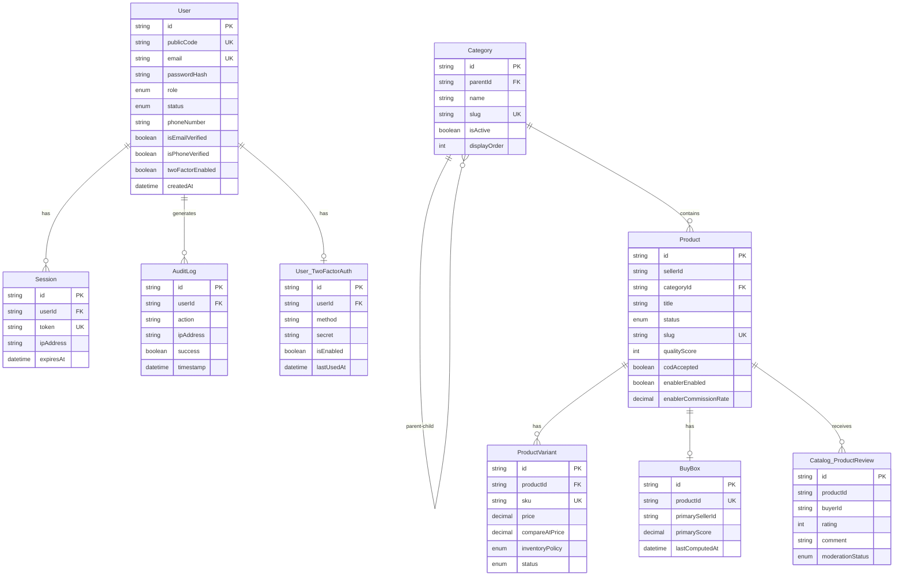
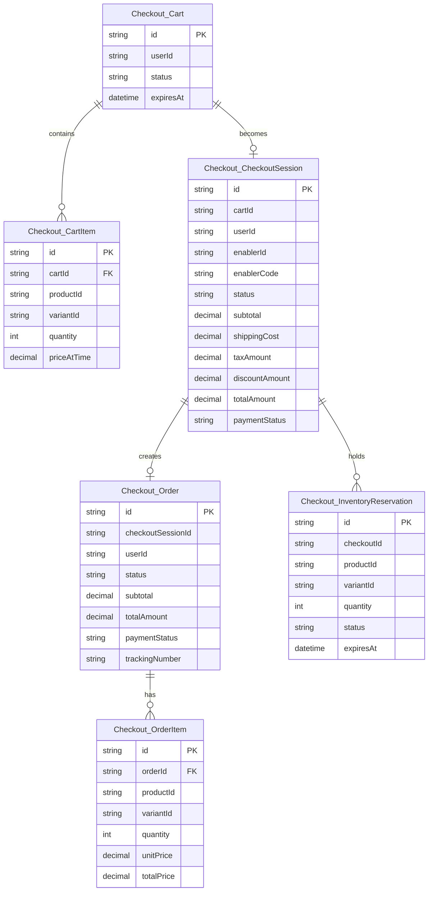
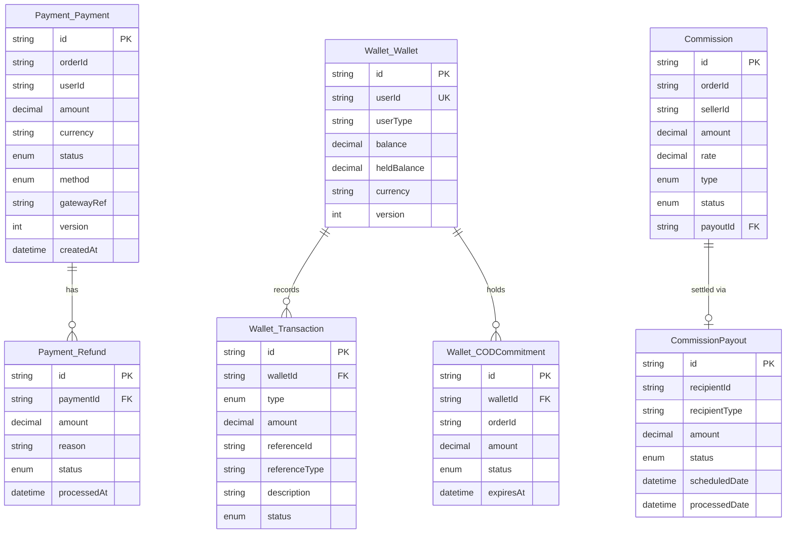
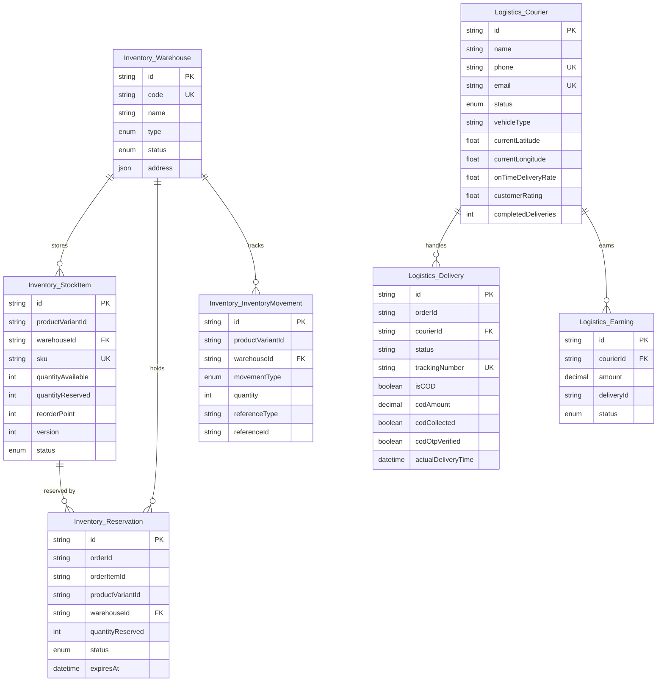
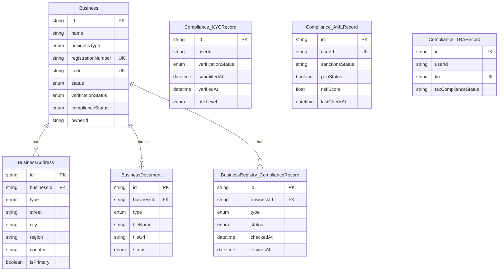
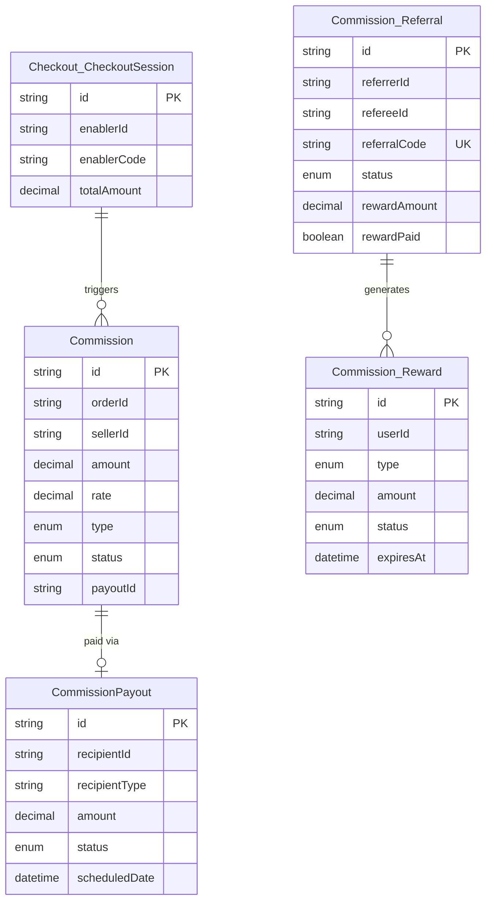

# Maysar Express — Database Relationship Diagrams

> Each service owns its own isolated PostgreSQL schema. These diagrams show the key entity relationships within each domain.

---

## 1. Core Commerce ERD (Auth + User + Catalog)

---

## 2. Order & Checkout ERD

---

## 3. Payment & Wallet ERD

---

## 4. Inventory & Logistics ERD

---

## 5. Business Registry & Compliance ERD

---

## 6. Commission & Enabler ERD

