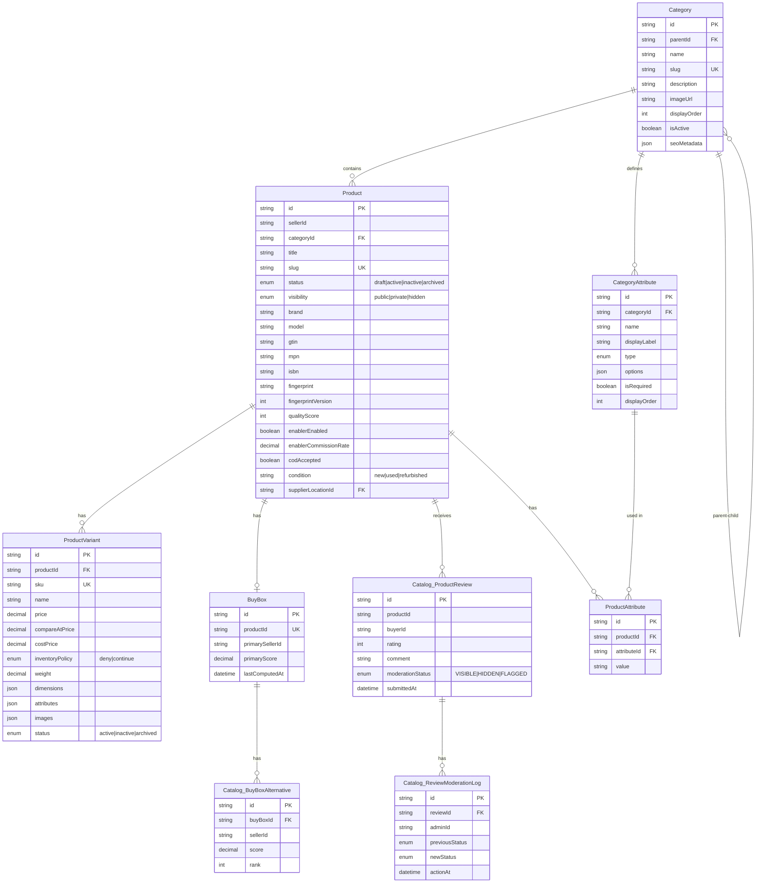
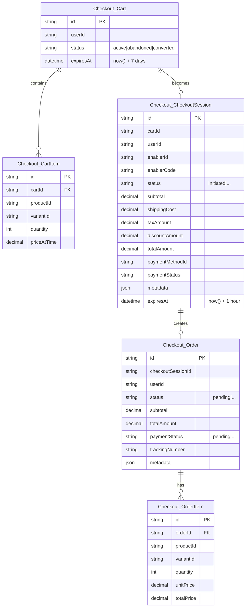
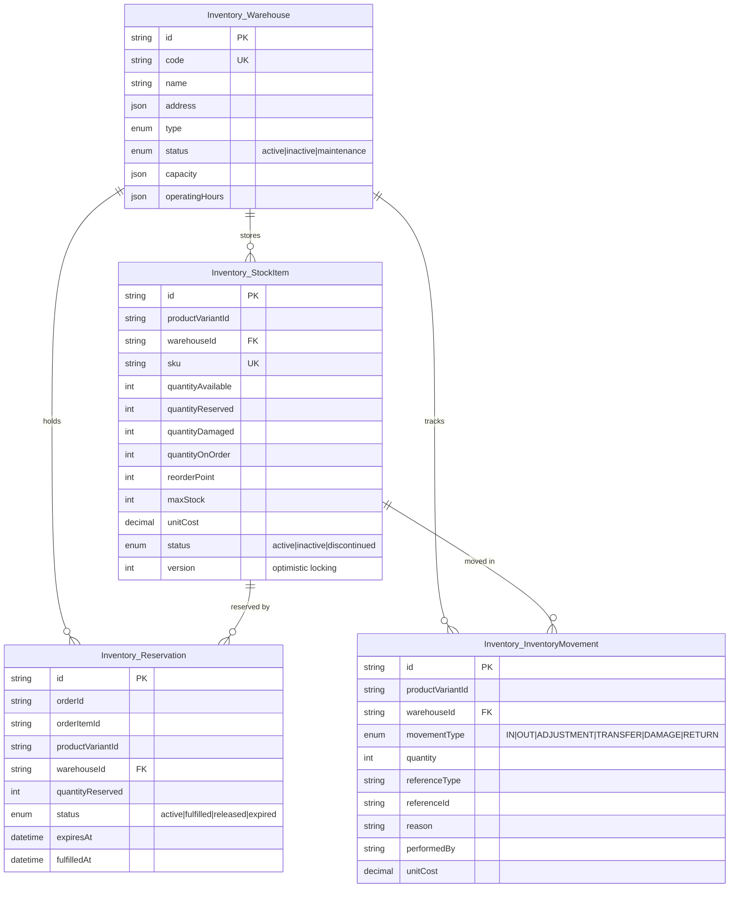
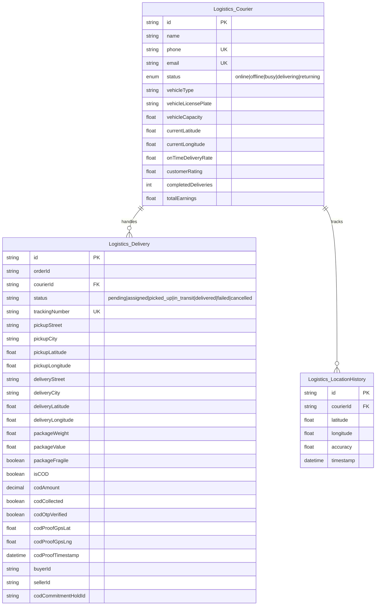
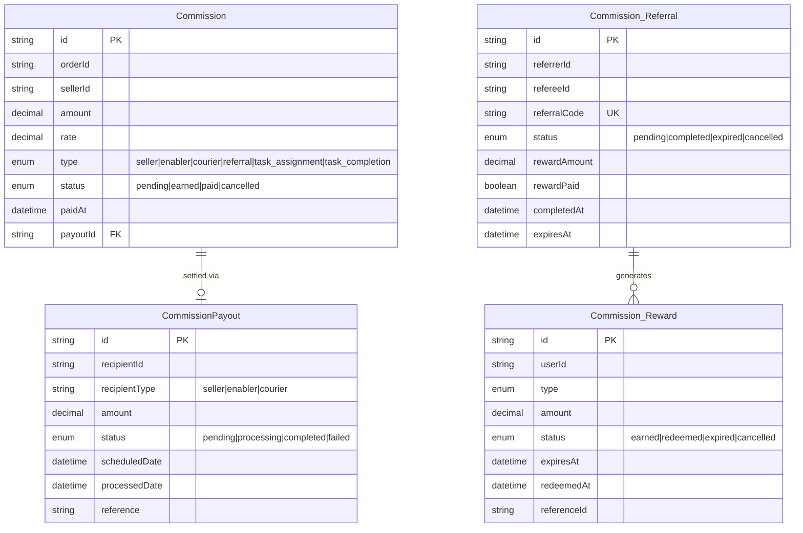
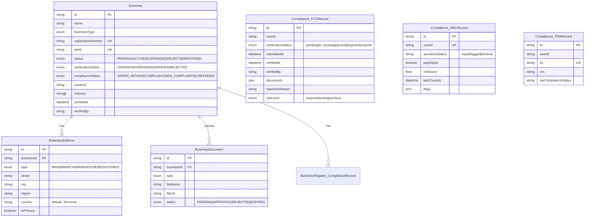

# Maysar Express — Database Relationship Diagrams

> **Evidence-based** — built directly from `prisma/schema.prisma` (3799 lines).
> Only models confirmed present in the schema are shown. No invented tables.

---

## 1. Auth & User Domain (from schema.prisma)

```mermaid
erDiagram
    User {
        string id PK
        string publicCode UK
        string email UK
        string passwordHash
        enum role "BUYER|SELLER|COURIER|SUPPLIER|ENABLER|SYSTEM|ADMIN"
        enum status "PENDING_VERIFICATION|ACTIVE|SUSPENDED|BANNED"
        string phoneNumber
        boolean isEmailVerified
        boolean isPhoneVerified
        boolean twoFactorEnabled
        string twoFactorSecret
        int failedLoginAttempts
        datetime lockoutUntil
        datetime lastLoginAt
        datetime passwordChangedAt
        datetime createdAt
        datetime updatedAt
    }

    Session {
        string id PK
        string userId FK
        string token UK
        string ipAddress
        string userAgent
        datetime expiresAt
        datetime createdAt
    }

    AuditLog {
        string id PK
        string userId FK
        string email
        string action
        string ipAddress
        string userAgent
        boolean success
        string reason
        json metadata
        datetime timestamp
    }

    User_TwoFactorAuth {
        string id PK
        string userId FK_UK
        string method
        string secret
        json backupCodes
        boolean isEnabled
        boolean isVerified
        string deviceName
        datetime lastUsedAt
    }

    Auth_PasswordResetToken {
        string id PK
        string userId FK
        string token UK
        datetime expiresAt
        boolean used
    }

    Auth_EmailVerificationToken {
        string id PK
        string userId FK
        string token UK
        datetime expiresAt
        boolean used
    }

    Auth_RoleRequest {
        string id PK
        string userId FK
        string requestedRole
        string status "PENDING|APPROVED|REJECTED"
        string justification
        datetime reviewedAt
        string reviewedBy
    }

    User ||--o{ Session : "has"
    User ||--o{ AuditLog : "generates"
    User ||--o| User_TwoFactorAuth : "has"
    User ||--o{ Auth_PasswordResetToken : "has"
    User ||--o{ Auth_EmailVerificationToken : "has"
    User ||--o{ Auth_RoleRequest : "has"
```

---

## 2. Catalog Domain (from schema.prisma)



---

## 3. Order & Checkout Domain (from schema.prisma)



---

## 4. Inventory Domain (from schema.prisma)



---

## 5. Logistics Domain (from schema.prisma)



---

## 6. Commission Domain (from schema.prisma)



---

## 7. Business Registry & Compliance (from schema.prisma)


