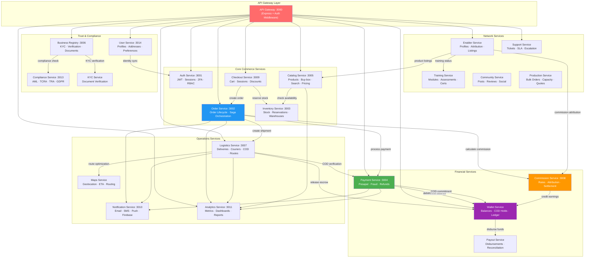
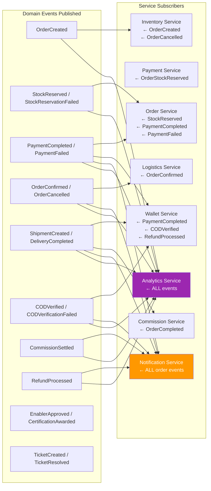
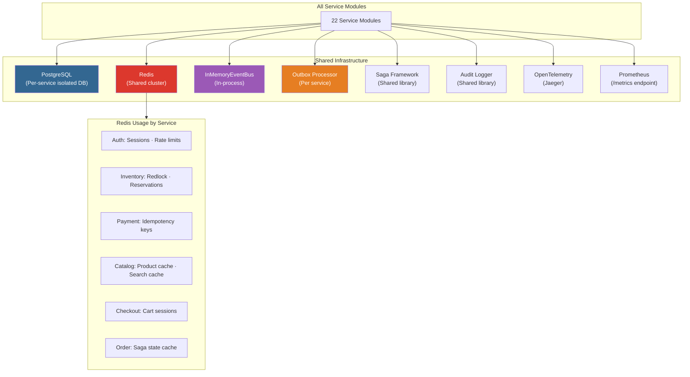

# Maysar Express — Service Dependency Map

> Shows runtime dependencies, event subscriptions, and data flow between all 22 service modules.

---

## 1. Full Service Dependency Graph

---

## 2. Event Subscription Matrix

---

## 3. Shared Infrastructure Dependencies

