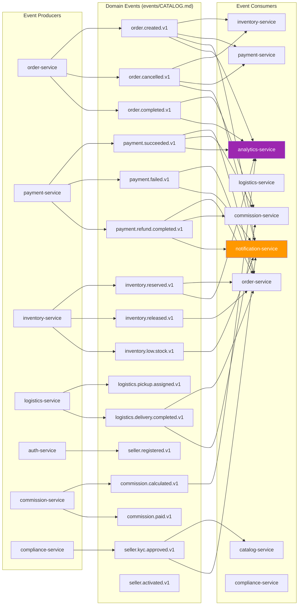
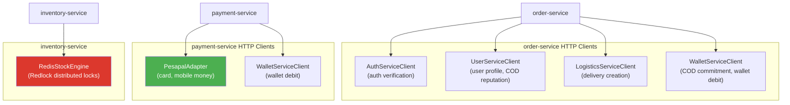
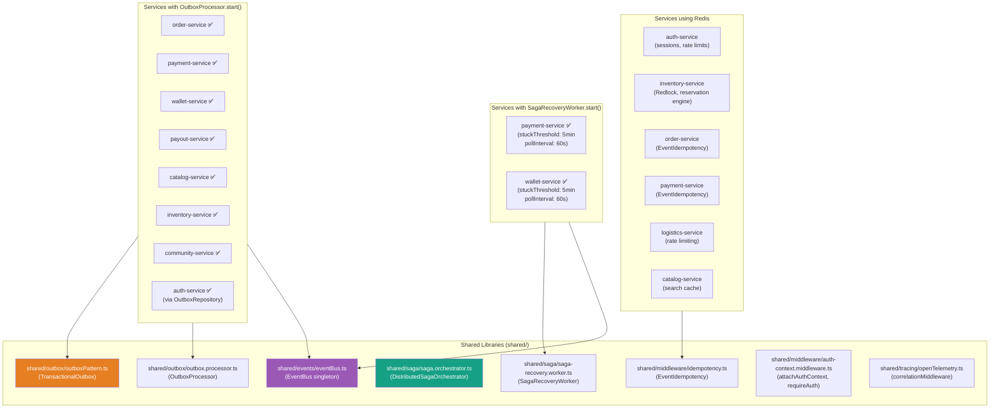
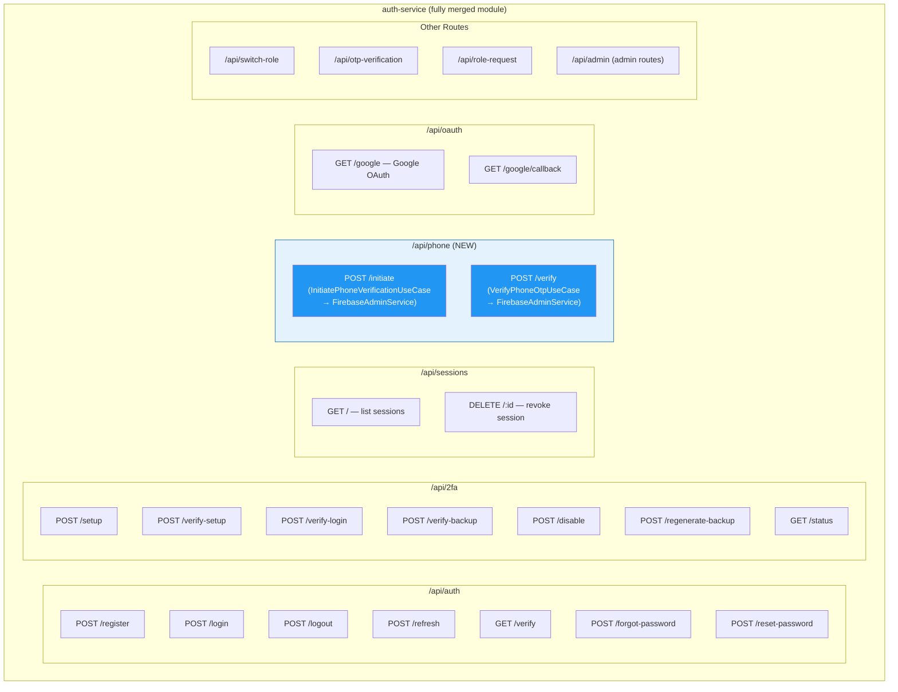
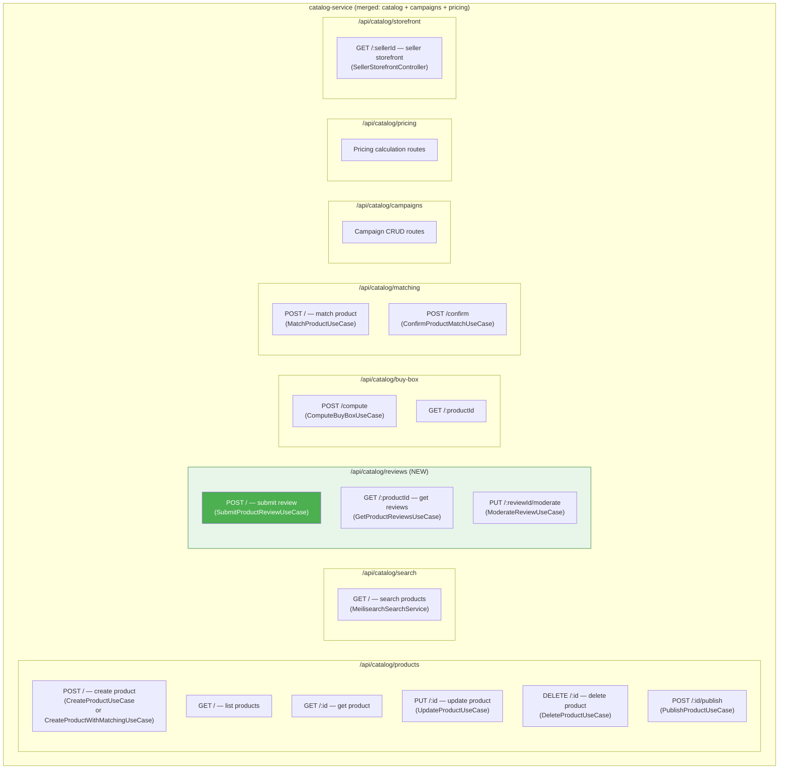
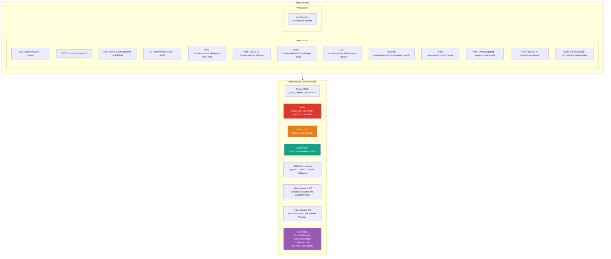

# Maysar Express — Service Dependency Map

> **Evidence-based** — built from reading actual source files.
> Sources: service `index.ts` files, `shared/events/eventBus.ts`, `events/CATALOG.md`, `events/types.ts`, integration client files.

---

## 1. Actual Event Producer/Consumer Matrix

> Evidence: `events/CATALOG.md` — canonical source of truth for all events.

---

## 2. Synchronous Service Client Dependencies

> Evidence: `services/order-service/src/infrastructure/integrations/` — actual HTTP client files.

---

## 3. Shared Infrastructure Usage (Actual)

> Evidence: service `index.ts` files — which services start OutboxProcessor and SagaRecoveryWorker.

---

## 4. Auth Service — Actual Routes Mounted

> Evidence: `services/auth-service/index.ts` — fully merged module.

---

## 5. Catalog Service — Actual Routes Mounted

> Evidence: `services/catalog-service/index.ts` — merged module (includes campaigns + pricing).

---

## 6. Chat Service — Routes and Dependencies

> Evidence: `services/chat-service/src/api/routes/chat.routes.ts`, `services/chat-service/index.ts`

### Redis Key Patterns

| Key | Type | TTL | Purpose |
|---|---|---|---|
| `chat:presence:{userId}` | String | 60s | Online/offline presence |
| `chat:ratelimit:conv:{userId}` | Counter | 3600s | 20 conversations/hr limit |
| `chat:ratelimit:msg:{userId}` | Counter | 3600s | 200 messages/hr limit |
| `chat:ratelimit:massmsg:{userId}:{hash}` | Counter | 300s | Mass-messaging detection |
| `chat:conv:{conversationId}` | Pub/Sub | — | Real-time message fan-out |
| `chat:blocklist:domains` | Set | — | Phishing domain blocklist |
| `chat:penaltyscore:{userId}` | String | 3600s | Elevated spam score penalty |
| `chat:freq:{userId}` | Counter | 300s | Message frequency (5-min window) |
