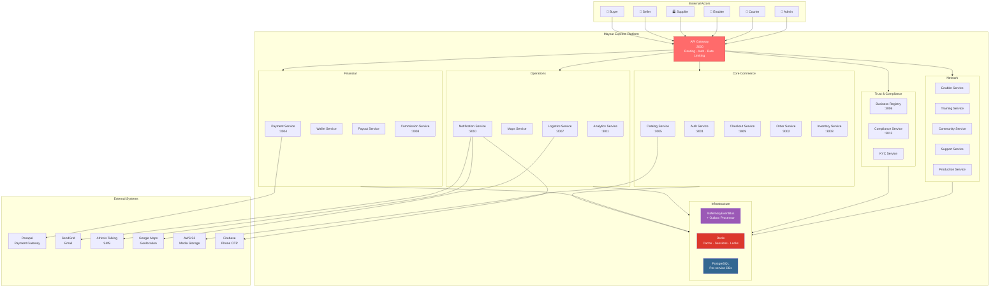
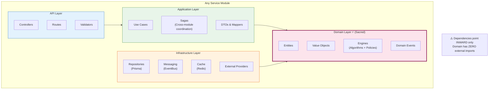
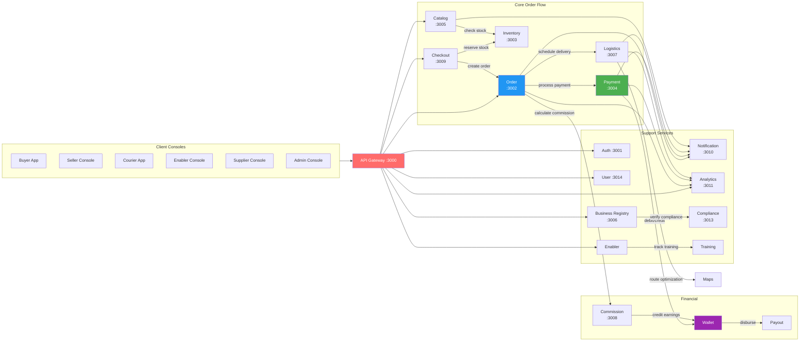
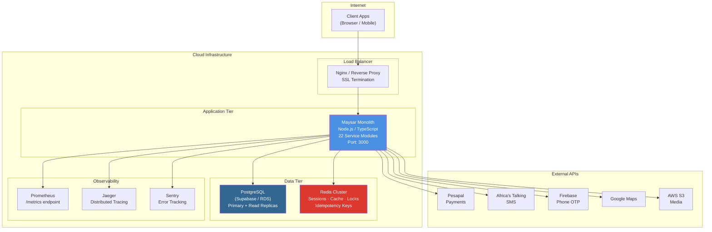

# Maysar Express — System Architecture Diagrams

> Architecture: Modular Monolith with Clean Architecture + Saga Orchestration
> Stack: Node.js / TypeScript, PostgreSQL, Redis, InMemoryEventBus + Transactional Outbox

---

## 1. High-Level System Context

---

## 2. Layered Architecture (Per Service)

---

## 3. Service Dependency Map

---

## 4. Event-Driven Architecture

```mermaid
graph TB
    subgraph Publishers["Event Publishers"]
        P1["Order Service"]
        P2["Payment Service"]
        P3["Inventory Service"]
        P4["Logistics Service"]
        P5["Catalog Service"]
        P6["Commission Service"]
        P7["Wallet Service"]
    end

    subgraph Outbox["Transactional Outbox Pattern"]
        OB["Outbox Table\n(per service DB)\nSame TX as business op"]
        OP["Outbox Processor\nPolls every 5s\nBatch: 50 events\nMax retries: 5"]
    end

    subgraph Bus["InMemoryEventBus"]
        BUS["Event Bus\n3-retry exponential backoff\n50ms / 100ms / 200ms"]
    end

    subgraph Subscribers["Event Subscribers"]
        S1["Order Service\n(StockReserved, PaymentCompleted)"]
        S2["Inventory Service\n(OrderCreated, OrderCancelled)"]
        S3["Payment Service\n(OrderStockReserved)"]
        S4["Logistics Service\n(OrderConfirmed)"]
        S5["Notification Service\n(All order events)"]
        S6["Analytics Service\n(All events)"]
        S7["Commission Service\n(OrderCompleted)"]
        S8["Wallet Service\n(PaymentCompleted, CODVerified)"]
    end

    Publishers -->|"Write event\n(same DB transaction)"| OB
    OB --> OP
    OP -->|"Dispatch"| BUS
    BUS --> Subscribers

    style OB fill:#E67E22,color:#fff
    style OP fill:#E67E22,color:#fff
    style BUS fill:#9B59B6,color:#fff
```

---

## 5. Deployment Architecture

