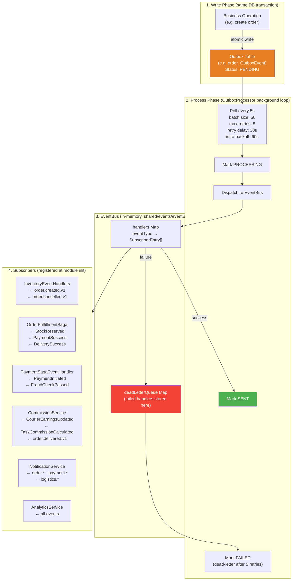
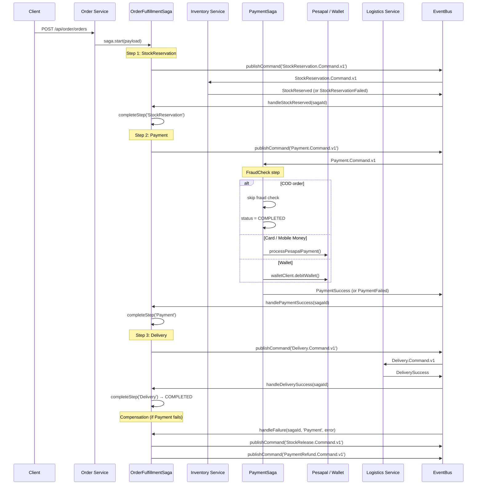
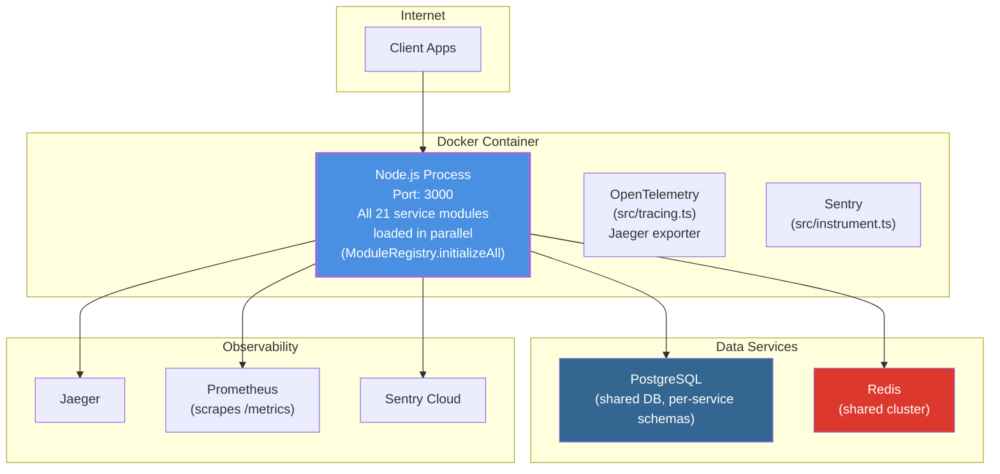

# Maysar Express — System Architecture Diagrams

> **Evidence-based** — built from reading actual source files, not documentation.
> Sources: `src/main.ts`, `src/app.ts`, `src/core/module-registry.ts`, service `index.ts` files, `shared/events/eventBus.ts`, `shared/outbox/`.

---

## 1. High-Level System Context

```mermaid
graph TB
    subgraph Actors["External Actors"]
        BUYER["🛒 Buyer"]
        SELLER["🏪 Seller"]
        SUPPLIER["🏭 Supplier"]
        ENABLER["🤝 Enabler"]
        COURIER["🚴 Courier"]
        ADMIN["🔐 Admin"]
    end

    subgraph Platform["Maysar Express — Single Process, Port 3000"]
        GW["Express App (src/app.ts)\nCORS · Helmet · Compression\nCSRF · Auth Context · i18n\nIdempotency · Rate Limiting"]

        subgraph Modules["Service Modules (loaded in parallel via ModuleRegistry)"]
            AUTH["auth-service\n/api/auth · /api/2fa\n/api/sessions · /api/phone\n/api/oauth · /api/switch-role"]
            CATALOG["catalog-service\n/api/catalog\n(includes campaigns + pricing)"]
            CHECKOUT["checkout-service\n/api/checkout"]
            ORDER["order-service\n/api/order"]
            INVENTORY["inventory-service\n/api/inventory"]
            PAYMENT["payment-service\n/api/payment"]
            WALLET["wallet-service\n/api/wallet"]
            PAYOUT["payout-service\n/api/payout"]
            COMMISSION["commission-service\n/api/commission"]
            LOGISTICS["logistics-service\n/api/v1 · /api/courier"]
            NOTIFICATION["notification-service\n/api/notification"]
            ANALYTICS["analytics-service\n/api/analytics"]
            BUSINESS["business-registry\n/api/business"]
            ENABLER_SVC["enabler-service\n/api/enabler"]
            USER["user-service\n/api/user"]
            SUPPORT["support-service\n/api/support"]
            TRAINING["training-service\n/api/training"]
            COMMUNITY["community-service\n/api/community"]
            PRODUCTION["production-service\n/api/production"]
            MAPS["maps-service\n/api/maps"]
            KYC["kyc-service\n/api/kyc"]
        end

        subgraph Infra["Shared Infrastructure"]
            BUS["EventBus (in-memory)\nshared/events/eventBus.ts\nDead-letter queue built-in"]
            OUTBOX["TransactionalOutbox\n+ OutboxProcessor\nPer-service DB table\nPolls every 5s, batch 50\nMax 5 retries"]
            SAGA["DistributedSagaOrchestrator\n+ SagaRecoveryWorker\nPolls every 60s\nStuck threshold: 5min"]
            IDEMPOTENCY["EventIdempotency\n(Redis-backed)\n24h TTL"]
        end
    end

    subgraph Data["Data Layer"]
        PG["PostgreSQL\n(Supabase / RDS)\nShared DB, per-service schemas"]
        REDIS["Redis\nSessions · Rate limits\nIdempotency · Redlock\nReservation engine"]
    end

    subgraph External["External Services"]
        PESAPAL["Pesapal\nCard · M-Pesa · Airtel\nTigo Pesa · HaloPesa"]
        FIREBASE["Firebase Admin\nPhone OTP verification"]
        SENDGRID["SendGrid\nEmail"]
        AT["Africa's Talking\nSMS"]
        GMAPS["Google Maps\nRoute optimization"]
        S3["AWS S3\nMedia storage"]
        SENTRY["Sentry\nError tracking"]
        JAEGER["Jaeger\nDistributed tracing"]
        PROM["Prometheus\n/metrics per service"]
    end

    Actors --> GW
    GW --> Modules
    Modules --> Infra
    Modules --> Data
    PAYMENT --> PESAPAL
    AUTH --> FIREBASE
    NOTIFICATION --> SENDGRID & AT
    LOGISTICS --> GMAPS
    CATALOG --> S3
    Modules --> SENTRY & JAEGER & PROM

    style GW fill:#FF6B6B,color:#fff
    style BUS fill:#9B59B6,color:#fff
    style OUTBOX fill:#E67E22,color:#fff
    style SAGA fill:#16A085,color:#fff
    style PG fill:#336791,color:#fff
    style REDIS fill:#DC382D,color:#fff
```

---

## 2. Actual Layered Architecture (Per Service Module)

> Evidence: `services/order-service/src/`, `services/payment-service/src/`, `services/wallet-service/src/`

```mermaid
graph TB
    subgraph Service["Service Module (e.g. order-service)"]
        subgraph API["api/"]
            CTRL["controllers/\n(HTTP handlers)"]
            ROUTES["routes/\n(Express Router)"]
            VALID["validators/\n(Joi / express-validator)"]
            MW["middleware/\n(auth, idempotency)"]
        end

        subgraph APP["application/"]
            UC["use-cases/\n(orchestrate domain + infra)"]
            SAGAS["sagas/\n(DistributedSagaOrchestrator\nsteps + compensations)"]
            DTO["dto/ + mappers/"]
        end

        subgraph DOMAIN["domain/ ⚡"]
            ENT["entities/\n(Payment, Wallet, Delivery...)"]
            VO["value-objects/\n(Money, Hold...)"]
            ENG["engines/\n(CODEligibilityEngine\nFraudEngine...)"]
            POL["policies/"]
            DEVT["events/"]
        end

        subgraph INFRA["infrastructure/"]
            REPO["repositories/\n(Prisma adapters)"]
            MSG["messaging/\n(OutboxRepository\nEventPublisher)"]
            PROV["providers/\n(PesapalAdapter\nFirebaseAdminService)"]
            CLIENTS["integrations/\n(WalletServiceClient\nAuthServiceClient\nLogisticsServiceClient)"]
            CACHE["redis/\n(RedisStockEngine\nRedlock)"]
        end
    end

    API --> APP
    APP --> DOMAIN
    INFRA --> DOMAIN

    note1["Domain has ZERO external imports\nAll external calls go through Infrastructure"]

    style DOMAIN fill:#fce4ec,stroke:#880e4f,stroke-width:3px
    style API fill:#e3f2fd,stroke:#1565c0
    style APP fill:#e8f5e9,stroke:#2e7d32
    style INFRA fill:#fff3e0,stroke:#e65100
```

---

## 3. Event Bus Architecture (Actual Implementation)

> Evidence: `shared/events/eventBus.ts`, `shared/outbox/outboxPattern.ts`, `shared/outbox/outbox.processor.ts`

---

## 4. Actual Saga Steps (Order Fulfillment)

> Evidence: `services/order-service/src/application/sagas/order-fulfillment.saga.ts`, `services/order-service/src/application/sagas/payment.saga.ts`

---

## 5. Deployment Architecture (Actual)

> Evidence: `docker-compose.yml`, `docker-compose.prod.yml`, `src/main.ts` (port 3000), service index files

