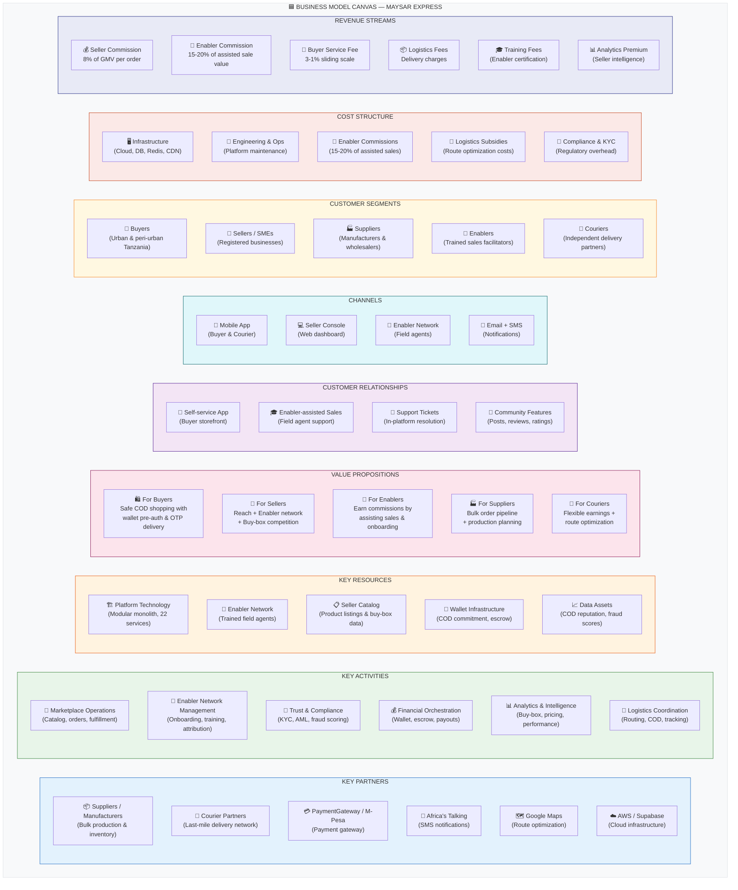
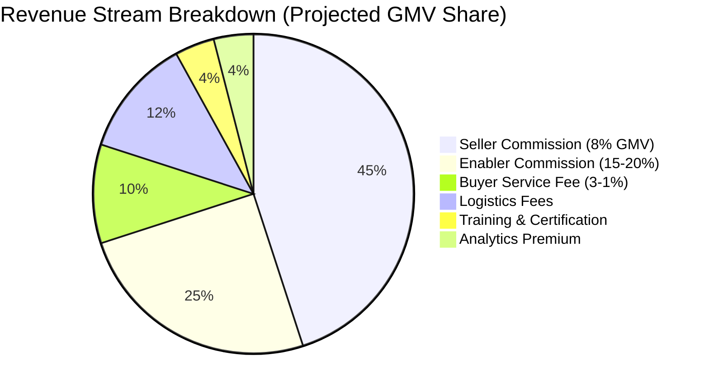
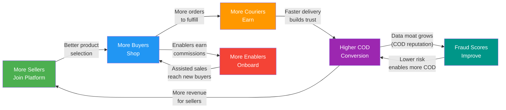

# Maysar Express — Business Model Canvas

> Platform: Digital Community Trade Marketplace (Tanzania)
> Model: Multi-sided marketplace with Enabler network, COD-first payments, and logistics orchestration.

---

## Canvas Overview

---

## Revenue Model Detail

---

## Platform Flywheel

---

## Unit Economics

| Metric | Value |
|--------|-------|
| Blended Take Rate | 10–12% of GMV |
| Seller Commission | 8% base |
| Enabler Commission | 15–20% of assisted sale |
| Buyer Service Fee | 3% → 1% (sliding scale) |
| CAC : LTV Ratio | 30:1 (excellent) |
| Break-even Orders/Month | ~500 orders |
| Infrastructure Cost (Launch) | ~$500/month |
| Infrastructure Cost (10K orders/day) | ~$1,200/month |
