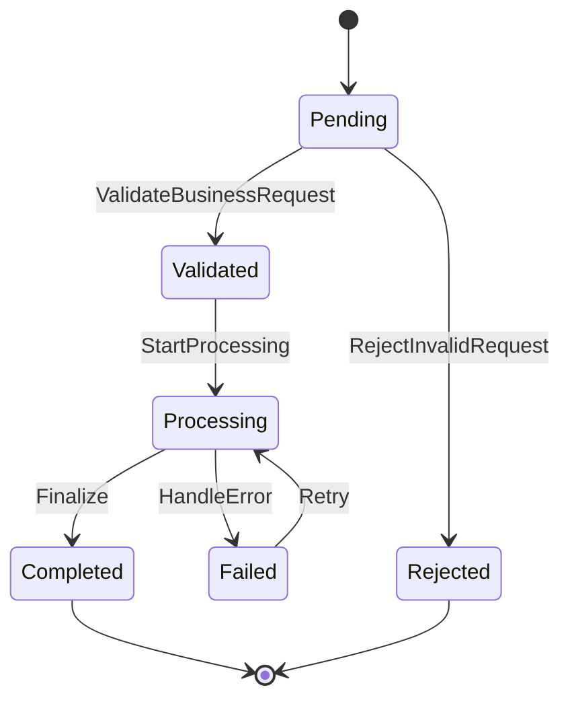
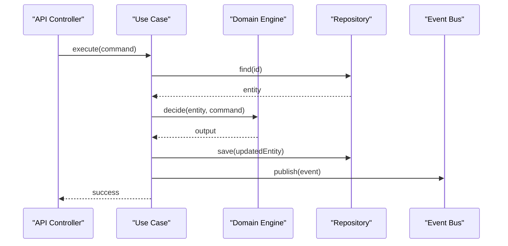

# Software Modeling Constitution

> **Purpose**: This document defines the standard for visualize business logic, system behavior, and component interactions.
> **Goal**: Ensure all architectural and behavioral decisions are documented using robust, version-controlled UML diagrams integrated directly into the codebase.

---

## 1. Core Philosophy

**Visual documentation is a first-class citizen.**  
**Diagrams must live with the code they describe.**  
**Mermaid is the sovereign modeling language.**

---

## 2. Integrated Modeling Structure

Every module MUST maintain a `docs/modeling/` directory to house its UML definitions. This ensures that behavioral specs are updated alongside code changes.

### Folder Structure Mandate

```
module-root/
 └── docs/
      └── modeling/
           ├── use-cases/      # User interactions & goals
           ├── state-machines/ # Entity lifecycles & complex states
           ├── sequence/       # Sagas, Use Cases, & Cross-module flows
           └── README.md       # Index of all models
```

---

## 3. Modeling Standards (Mermaid)

### 3.1 Use Case Diagrams
**Standard**: Define system boundaries, actors, and clear business goals.

```mermaid
useCaseDiagram
    actor "Customer" as C
    actor "Payment Provider" as PP
    
    package "Order Service" {
        usecase "Create Order" as UC1
        usecase "Process Payment" as UC2
        usecase "Verify Inventory" as UC3
    }
    
    C --> UC1
    UC1 ..> UC3 : <<include>>
    UC1 ..> UC2 : <<include>>
    UC2 -- PP
```

### 3.2 State Machine Diagrams
**Standard**: Mandatory for any Entity with a `status` field or complex lifecycle.



### 3.3 Sequence Diagrams
**Standard**: Used to document Sagas, Use Case executions, and Interaction between layers.



---

## 4. Modeling Rules (Non‑Negotiable)

### 4.1 Truth Dependency
- Diagrams must be updated in the same PR as the code changes they reflect.
- Outdated diagrams are considered technical debt and must be remediated immediately.

### 4.2 Level of Abstraction
- **Use Cases**: Business level. No technical details.
- **State Machines**: Domain level. Focus on valid transitions and triggers.
- **Sequence Diagrams**: Implementation level. Document coordination of Sagas and Use Cases.

### 4.3 Version Control Purity
- Standalone modeling files MUST use the `.mmd` extension.
- `.mmd` files must contain ONLY the raw Mermaid code (no Markdown headers or code fences).
- For complex documentation requiring both text and diagrams, Mermaid blocks may be used within `.md` files, but the primary behavioral models must be kept as `.mmd` in the `docs/modeling/` directories.

---

## 5. Enforcement

1. **Architecture Review**: Sagas without sequence diagrams will be rejected.
2. **Review Checklists**: Each PR must confirm if modeling changes are required.
3. **CI Validation**: (Planned) Mermaid syntax validation in pre-commit hooks.

---

> **"If it's not modeled, it's not understood."**

**End of Constitution**
