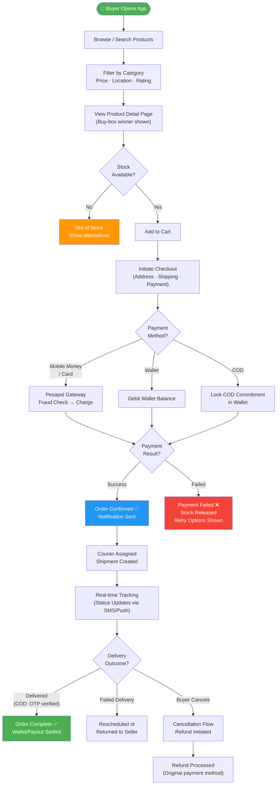
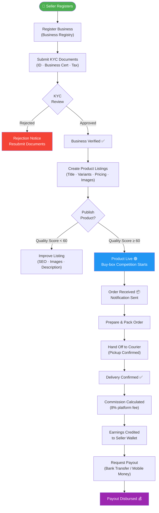
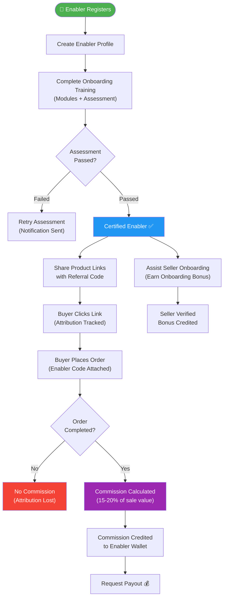
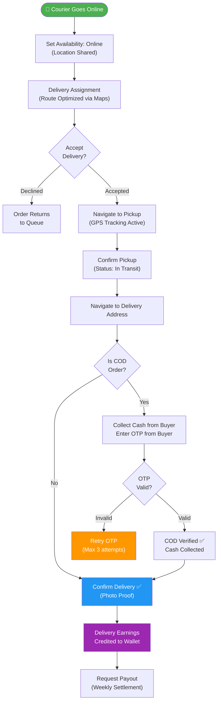
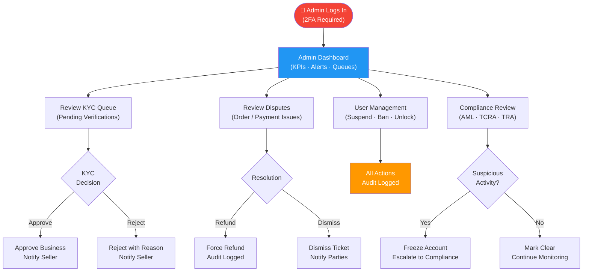

# Maysar Express — User Flow Maps

> All persona journeys mapped end-to-end with happy paths, decision points, and failure states.

---

## 1. Buyer Journey — Discovery to Delivery

---

## 2. Seller Journey — Onboarding to Payout

---

## 3. Enabler Journey — Onboarding to Commission

---

## 4. Courier Journey — Assignment to Earnings

---

## 5. Admin Journey — Oversight & Control

