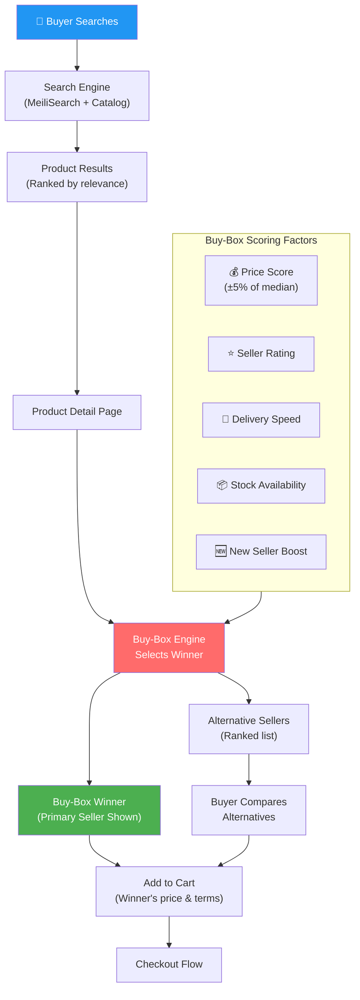
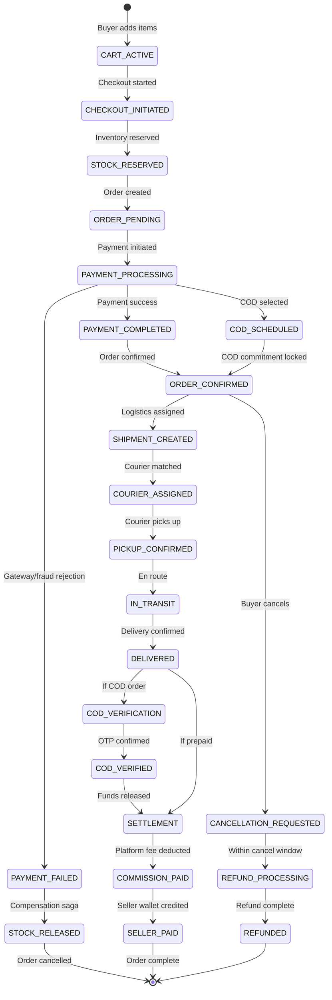
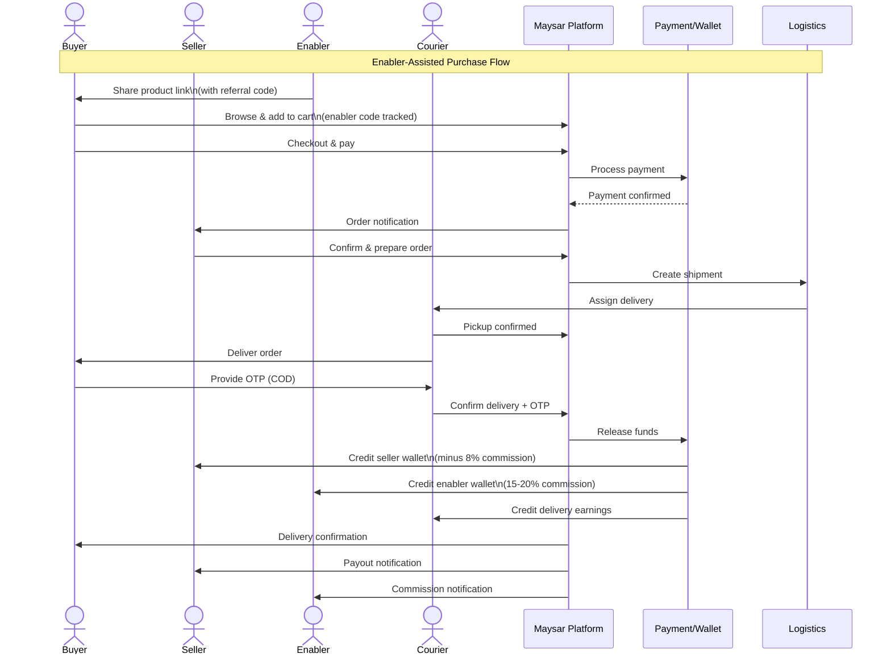
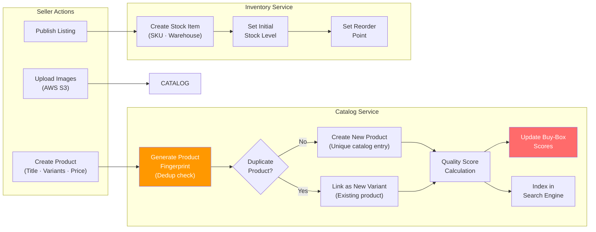
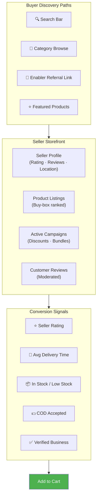

# Maysar Express — Marketplace Flow Diagrams

> End-to-end flows for the multi-sided marketplace: product discovery, buy-box competition, order lifecycle, and multi-party coordination.

---

## 1. Product Discovery & Buy-Box Flow

---

## 2. Full Order Lifecycle

---

## 3. Multi-Party Marketplace Coordination

---

## 4. Catalog & Inventory Sync Flow

---

## 5. Seller Storefront & Discovery

