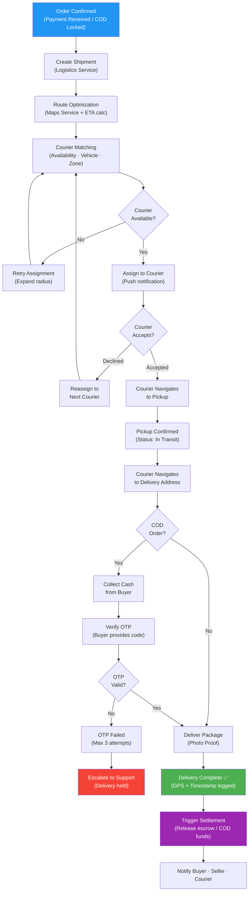
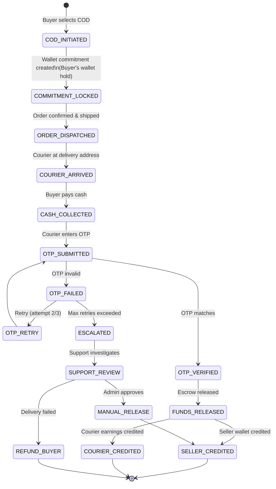
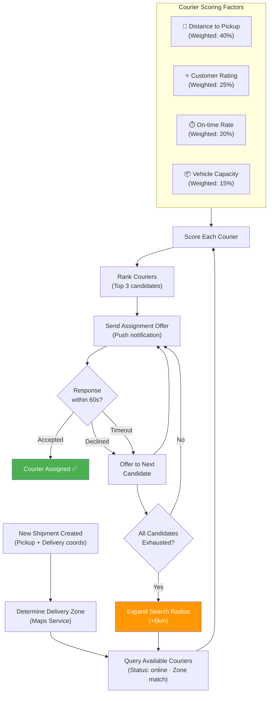
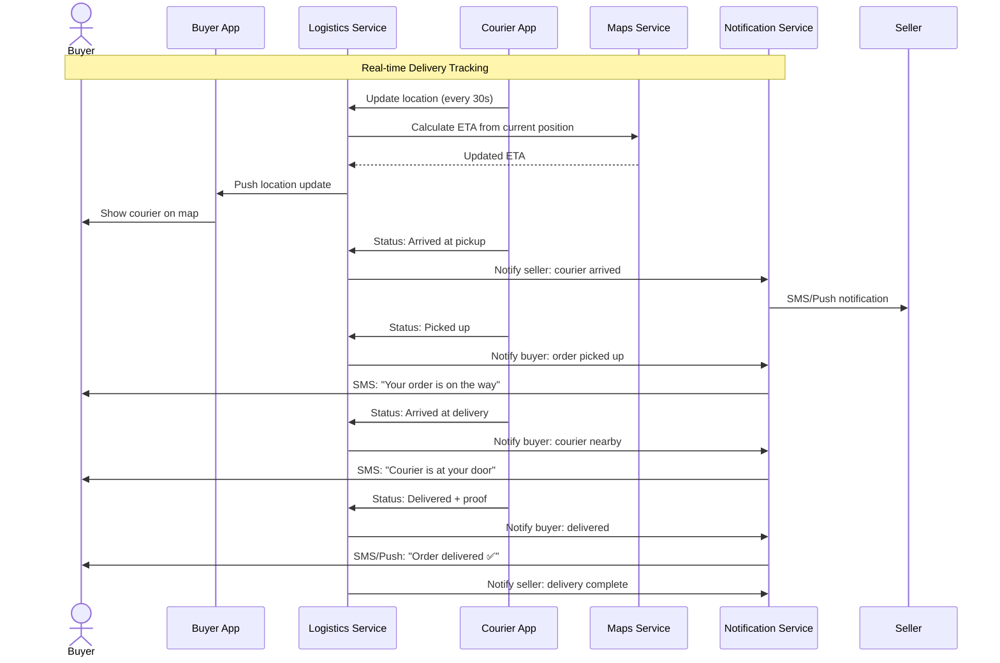
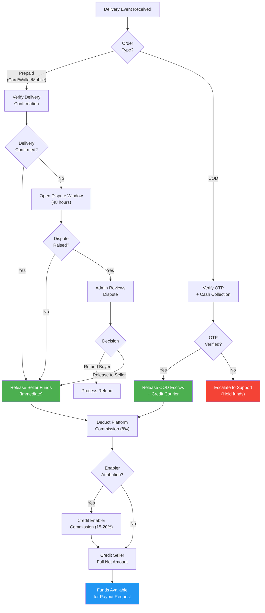

# Maysar Express — Logistics & Escrow Flowcharts

> Covers: delivery lifecycle, COD escrow, route optimization, courier assignment, and dispute resolution.

---

## 1. Logistics End-to-End Flow

---

## 2. COD Escrow State Machine

---

## 3. Courier Assignment Algorithm

---

## 4. Delivery Status Tracking Flow

---

## 5. Escrow Release Decision Tree

