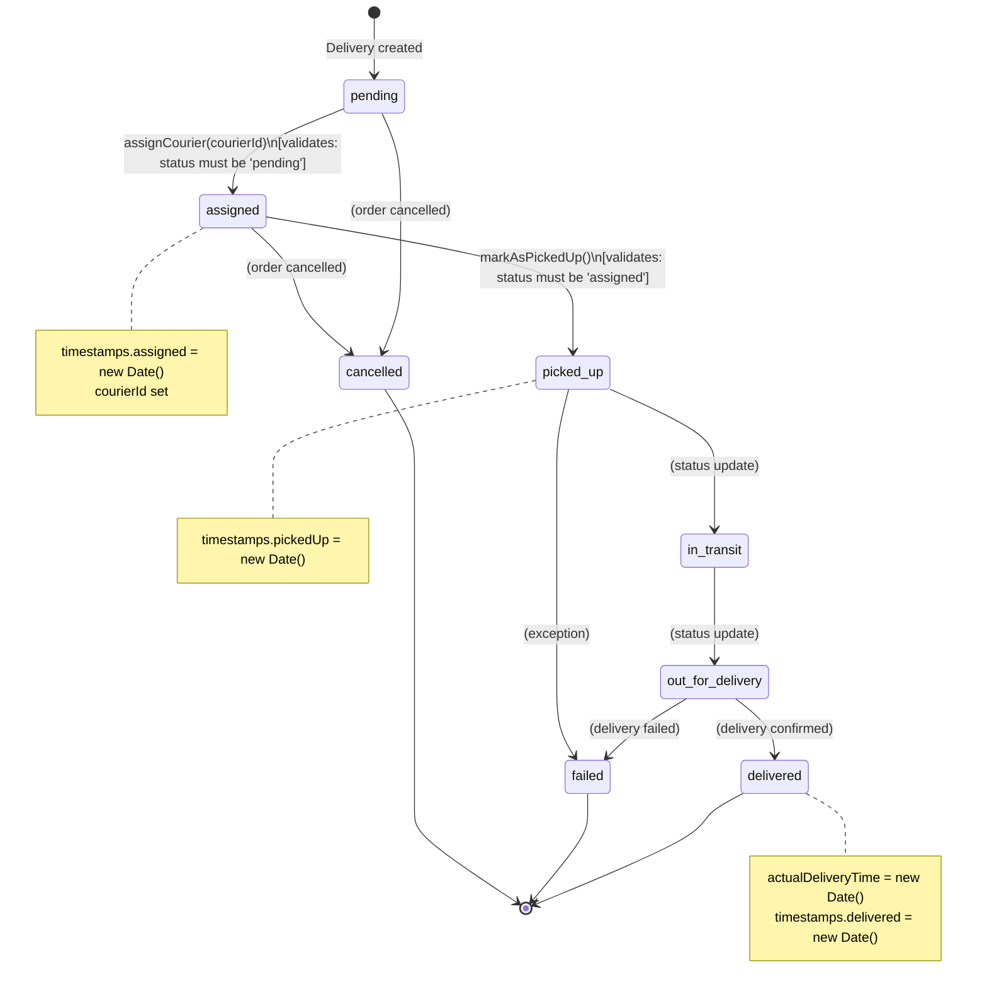
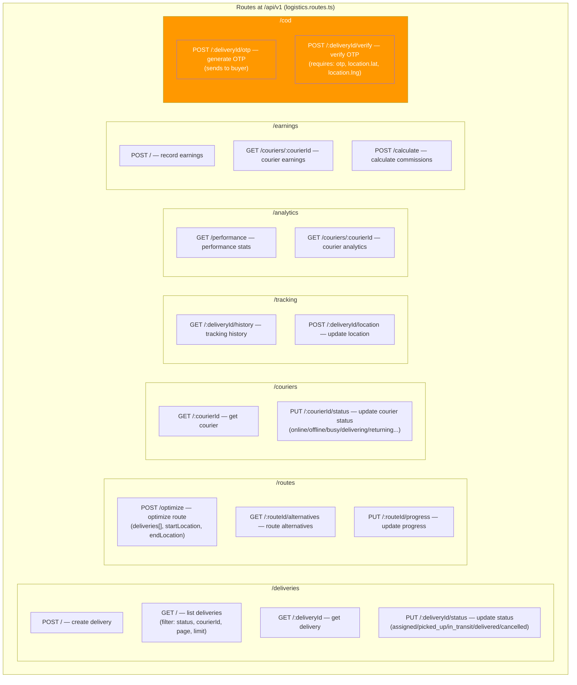
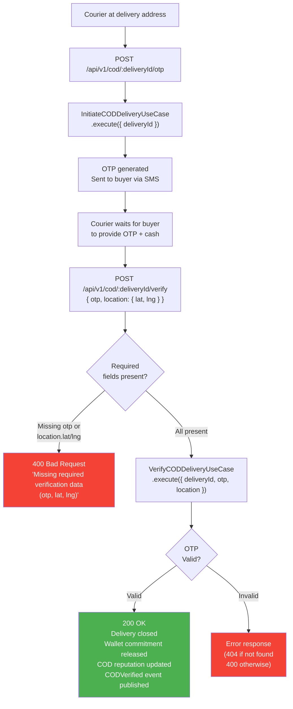
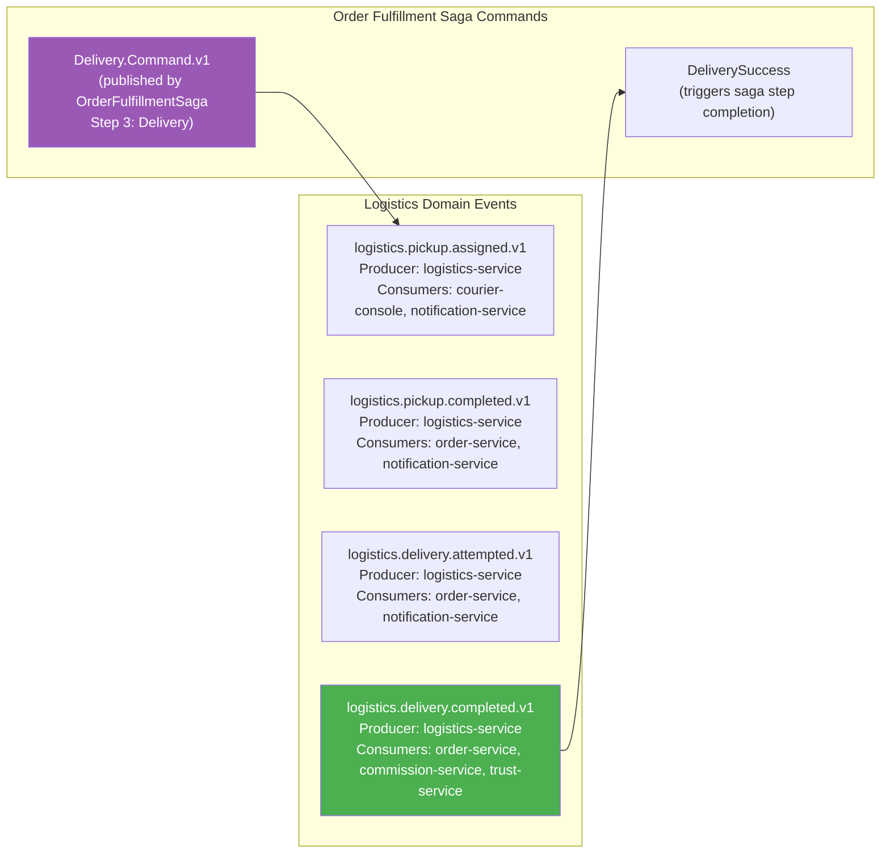
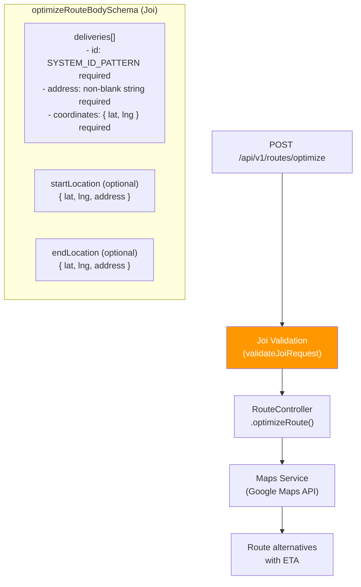
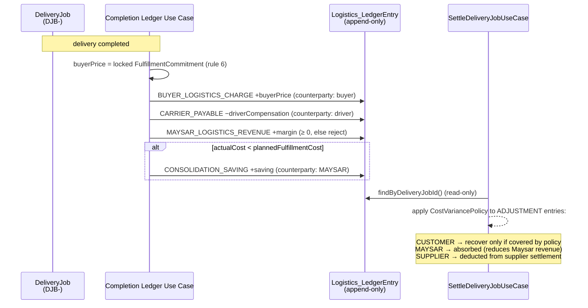

# Maysar Express — Logistics & Escrow Flowcharts

> **Evidence-based** — built from reading actual source files.
> Sources: `services/logistics-service/src/domain/entities/delivery.entity.ts`, `services/logistics-service/src/api/routes/logistics.routes.ts`, `services/logistics-service/src/api/controllers/cod.controller.ts`, `events/CATALOG.md`

> **Scope note (2026-09):** sections 1–5 document the **legacy `Logistics_Delivery`** courier flow and the COD OTP loop, which remain live. Since the optimization-engine rollout the operational unit is the **`Logistics_DeliveryJob`** (`DJB-` ids) bundling `Logistics_Shipment`s; pricing/compensation run through the three-engine model; and **escrow-style settlement now reads the append-only `Logistics_LedgerEntry` ledger** ([`LOGISTICS_IMPLEMENTATION.md`](../logistics/LOGISTICS_IMPLEMENTATION.md) §7–§9). Section 6 documents that settlement lifecycle.

---

## 1. Delivery Status Transitions (Actual — from delivery.entity.ts)

---

## 2. Logistics API Routes (Actual — from logistics.routes.ts)

---

## 3. COD OTP Verification (Actual — from cod.controller.ts)

---

## 4. Logistics Events (Actual — from events/CATALOG.md)

---

## 5. Route Optimization Request (Actual — from logistics.routes.ts validators)

---

## 6. Settlement Lifecycle (Actual — ledger-only, Phase 3)

The **`Logistics_LedgerEntry`** table is an append-only accounting ledger. When a `DeliveryJob` completes, `RecordJobCompletionLedgerUseCase` writes the locked-price buyer charge, the carrier payable, Maysar's realized revenue, and (when post-confirmation optimization beat the plan) a `CONSOLIDATION_SAVING` attributed to Maysar. Settlement (`SettleDeliveryJobUseCase`) then reads **only the ledger** — it never re-derives amounts from current config.

Adjustments are recorded immutably as `Logistics_CostAdjustment` and **mirrored as ledger `ADJUSTMENT` entries** (with `responsibleParty`/`adjustmentType` in metadata) by `RecordCostAdjustmentUseCase`, using the pure `resolveAttribution()` rules (`SUPPLIER_NOT_READY`, `CUSTOMER_UNREACHABLE`, `ROUTE_MISCALCULATED`, `DRIVER_DEVIATION`, `EXTERNAL_DELAY`).

Live-verified end-to-end by `scripts/verify-settlement.ts` (VERIFY: PASS).
