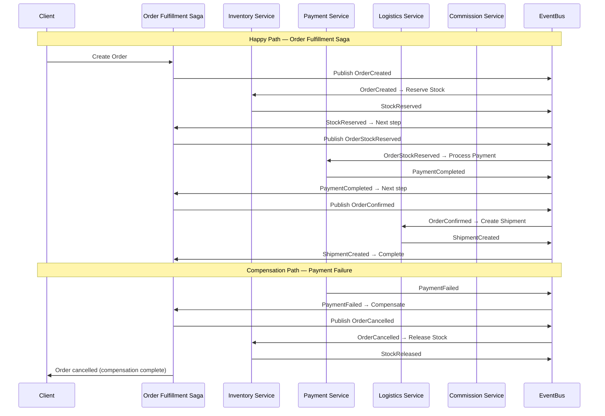
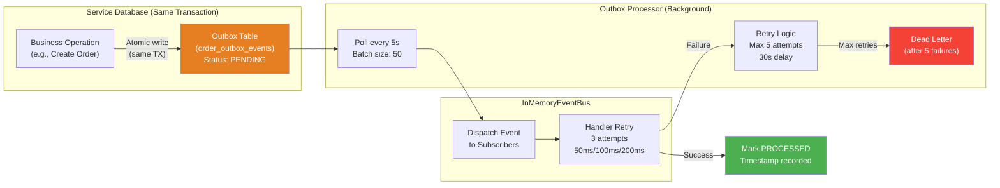
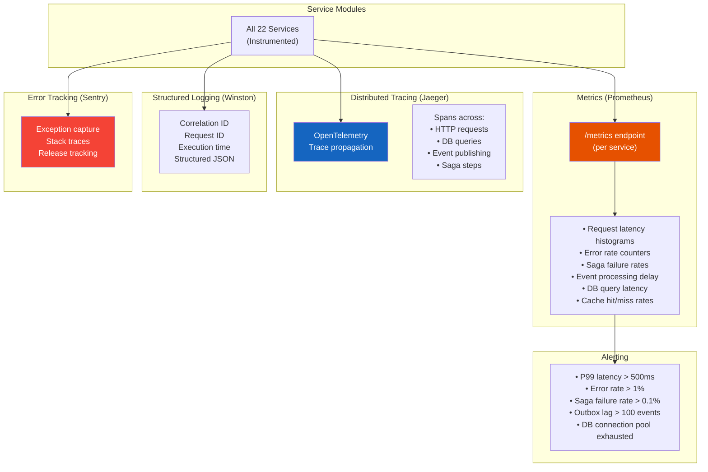
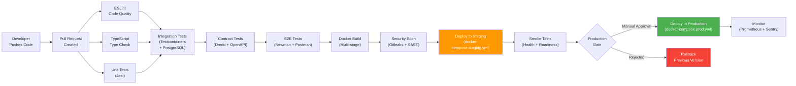
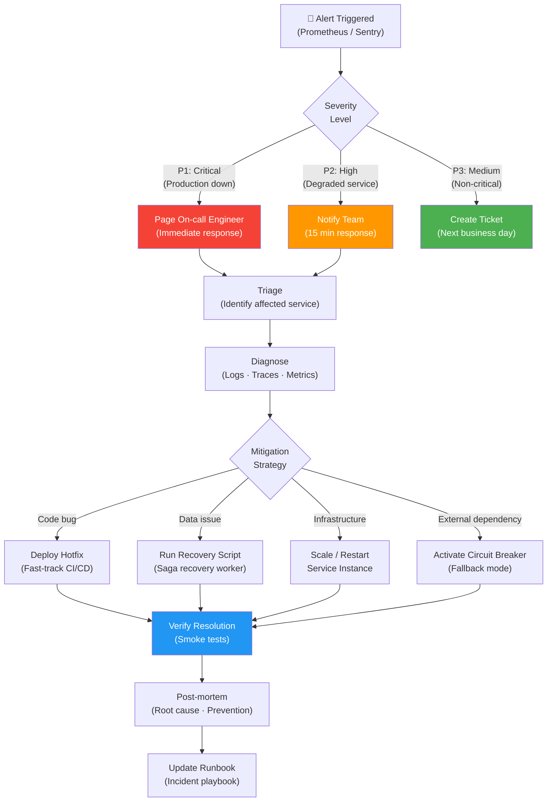

# Maysar Express — Operations Diagrams

> Covers: saga orchestration, outbox pattern, observability, CI/CD, and incident response.

---

## 1. Saga Orchestration Overview

---

## 2. Outbox Pattern Flow

---

## 3. Observability Stack

---

## 4. CI/CD Pipeline

---

## 5. Incident Response Flow

